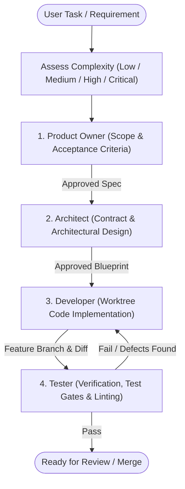

# Team Orchestration & Dynamic Model Selection

Use this skill to orchestrate an iteration using a 4-role software engineering team:
1. **Product Owner (PO)**: Analyzes requirements, refines user stories, defines acceptance criteria, enforces scope boundaries.
2. **Architect**: Designs system architecture, verifies interfaces and contracts, enforces invariants, assesses security and failure modes.
3. **Developer**: Implements code, refactors, manages dependencies, commits to isolated worktree branches.
4. **Tester**: Generates test fixtures, executes automated test suites, analyzes code coverage, performs adversarial boundary checking.

---

## 1. Complexity Tier Matrix

Before executing an iteration, evaluate the task complexity:

| Complexity | Criteria |
| :--- | :--- |
| **LOW** | Minor bugfix, typo, doc tweak, single-file trivial change (< 2 files). |
| **MEDIUM** | Standard CRUD feature, new API endpoint, routine UI component, isolated refactor (2–6 files). |
| **HIGH** | Multi-module integration, database migration, auth/permission logic, security vulnerability (> 6 files). |
| **CRITICAL** | Core architectural shift, financial calculation invariants, money/payment flows, concurrency/race conditions. |

---

## 2. Role-to-Model Assignment Matrix

| Role | LOW Complexity | MEDIUM Complexity | HIGH Complexity | CRITICAL Complexity |
| :--- | :--- | :--- | :--- | :--- |
| **Product Owner** | `gemini-3.8-flash`<br/>(thinking: `low`) | `gemini-3.8-flash`<br/>(thinking: `high`) | `claude-sonnet-5-5`<br/>(effort: `high`) | `claude-opus-5-5`<br/>(effort: `high`) |
| **Architect** | `gemini-3.8-flash`<br/>(thinking: `medium`) | `claude-sonnet-5-5`<br/>(effort: `medium`) | `claude-sonnet-5-5`<br/>(effort: `high`, ultracode: true) | `claude-opus-5-5`<br/>(effort: `ultrathink`, ultracode: true) |
| **Developer** | `gemini-3.8-flash`<br/>(worktree) | `gpt-6-luna`<br/>(effort: `medium`, worktree) | `gpt-6-luna`<br/>(effort: `high`, worktree) | `claude-opus-5-5`<br/>(effort: `max`, ultracode: true, worktree) |
| **Tester** | `gemini-3.8-flash`<br/>(thinking: `low`) | `gemini-3.8-flash`<br/>(thinking: `high`) | `claude-sonnet-5-5`<br/>(effort: `high`) | `claude-opus-5-5`<br/>(effort: `high`) |

---

## 3. Iteration Execution Workflow



---

## 4. Automation CLI

To automatically score complexity and generate the exact T3 `delegate_task` payloads:

```bash
# Evaluate by prompt
./scripts/team_orchestrator.py --task "Implement new dues calculation endpoint"

# Output structured JSON for automation
./scripts/team_orchestrator.py --task "Migrate user authentication schema" --schema --auth --json

# Explicitly override complexity
./scripts/team_orchestrator.py --task "Refactor logging pipeline" --complexity medium
```
