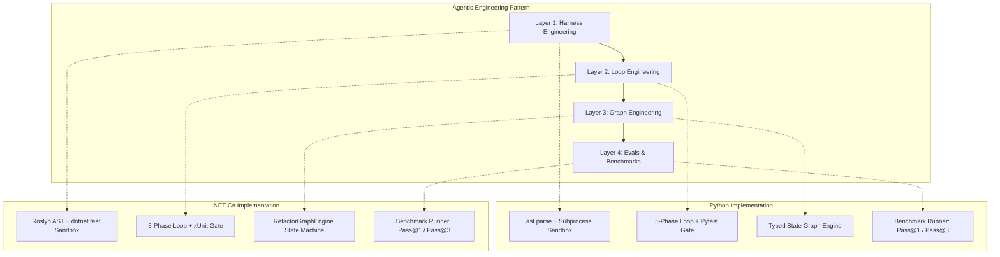
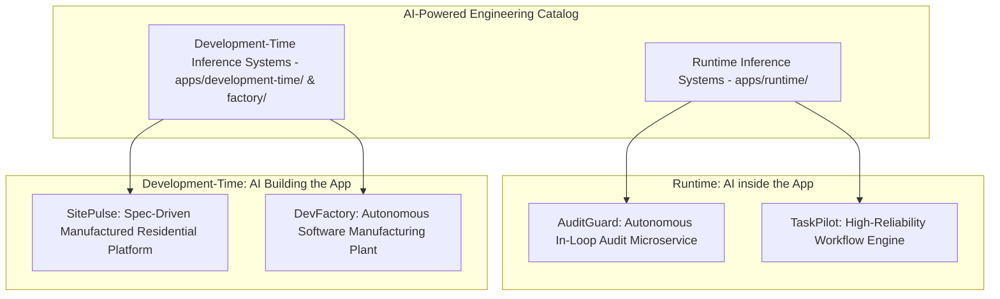

# AI-Powered Engineering Catalog: Dual-Stack Agentic Architecture

> **Domain**: Agentic Software Engineering, Stochasticity Mitigation, Harness/Loop/Graph Engineering, Evals.  
> **Implementations**:
> - [Python Solution (`ai-powered-engineering/python/`)](python/README.md)
> - [.NET Solution (`ai-powered-engineering/dotnet/`)](dotnet/README.md)

---

## 1. The Core Engineering Challenge

Development using LLMs and agents is **stochastic** (probabilistic) rather than **deterministic**. Without structured engineering boundaries, models hallucinate syntax, introduce silent regressions, and burn token budgets in runaway loops.

To overcome this, we implement the **Four Layers of Agentic Engineering** across both modern enterprise stacks: **Python** and **.NET (C#)**.

---

## 2. Side-by-Side Dual-Stack Architecture



### Component Comparison Matrix

| Layer | Concept | Python Implementation | .NET / C# Implementation |
|:---|:---|:---|:---|
| **1. Harness** | **AST Syntax Gate** | `ast.parse(code)` | Roslyn `CSharpSyntaxTree.ParseText(code)` |
| **1. Harness** | **Diff Sanity** | `difflib.unified_diff()` | Roslyn line-retention analysis |
| **1. Harness** | **Isolated Sandbox** | Ephemeral directory + `pytest` subprocess | Ephemeral directory + `dotnet test` subprocess |
| **1. Harness** | **Anti-Rot Context** | Pytest failure traceback extractor | xUnit / MSBuild assertion extractor |
| **2. Loop** | **Deterministic Verify Gate** | `VerifyGate` (AST + Pytest) | `VerifyGate` (Roslyn + xUnit) |
| **2. Loop** | **Maker / Checker** | `MockMaker` / `HeuristicMaker` / `RuleBasedChecker` | `IMakerAgent` / `HeuristicMakerAgent` / `RuleBasedCheckerAgent` |
| **2. Loop** | **Finite Budget** | Max 3 iterations $\rightarrow$ Escalate | Max 3 iterations $\rightarrow$ Escalate |
| **3. Graph** | **Control Flow** | `RefactorGraphEngine` state transitions | `RefactorGraphEngine` state transitions |
| **3. Graph** | **Execution Tracing** | Step index, phase, duration ms | `GraphStepTrace` with stopwatch ms |
| **4. Evals** | **Benchmark Runner** | `benchmarks/runner.py` | `PatchMaster.Benchmarks` console app |
| **4. Evals** | **Metrics** | Pass@1: 100%, Pass@3: 100% | Pass@1: 100%, Pass@3: 100% |

---

### 3. Runtime vs Development-Time Inference Paradigms

This repository explicitly separates two fundamental modes of AI engineering:



| Paradigm | Location | Purpose | AI Role | Key Mechanisms |
| :--- | :--- | :--- | :--- | :--- |
| **Runtime Inference** | [`apps/runtime/`](apps/runtime/README.md) | Solves business problems in production | Executing live in the request/response pipeline | Deterministic verification gates (`MathVerifyGate`, `PolicyAuditGate`), context compactor, bounded loop budget, state graph |
| **Development-Time Inference** | [`apps/development-time/`](apps/development-time/README.md), [`factory/`](factory/DevFactory/README.md) | Solves software engineering problems during development | Specifying, architecting, coding, and testing software | Spec Kit (`.specify`), Task DAG dependency scheduler, Maker-Checker closed loop, AST syntax gates |

> **AI Tooling Instructions**:
> - [GitHub Copilot Custom Instructions](.github/copilot-instructions.md)
> - [Antigravity Workspace Directives](AGENTS.md)
> - [Antigravity Runtime Rules](.agents/rules/runtime-inference.md)
> - [Antigravity Development-Time Rules](.agents/rules/development-time-inference.md)

---

## 4. Directory Navigation

```
ai-powered-engineering/
├── intent.md                          # Original learning intent and goals
├── README.md                          # This dual-stack catalog
├── AGENTS.md                          # Antigravity workspace directives
├── .github/
│   └── copilot-instructions.md        # GitHub Copilot instructions (runtime vs dev-time)
├── .agents/
│   └── rules/
│       ├── runtime-inference.md       # Antigravity rules for runtime apps
│       └── development-time-inference.md # Antigravity rules for dev-time apps
├── python/                            # Complete Python implementation
│   ├── README.md                      # Python architecture & run guide
│   ├── pyproject.toml                 # Package & pyright config
│   ├── requirements.txt               # Dependencies (pydantic, pytest)
│   ├── src/                           # Harness, Loop, Graph, Agents, CLI
│   ├── tests/                         # 11 unit tests (100% passing)
│   └── benchmarks/                    # 4 benchmark fixtures & evaluation runner
├── apps/
│   ├── runtime/                       # === RUNTIME INFERENCE SYSTEMS ===
│   │   ├── README.md                  # Runtime inference guide & Copilot/Antigravity docs
│   │   ├── AuditGuard/                # Agent-Powered Business Application (.NET 8)
│   │   │   ├── README.md              # Autonomous Expense Audit Microservice
│   │   │   ├── AuditGuard.slnx        # Solution file
│   │   │   ├── src/                   # Core, Harness, Loop, Agents, Graph, CLI
│   │   │   ├── tests/                 # 12 xUnit unit tests (100% passing)
│   │   │   └── benchmarks/            # 6 real-world benchmark fixtures & evaluation runner
│   │   └── TaskPilot/                 # Standalone Business Application (.NET 8/10)
│   │       ├── README.md              # Standalone Task & Workflow Management App
│   │       ├── TaskPilot.slnx         # Solution file (Zero Agent Dependencies)
│   │       ├── src/                   # Core, Infrastructure, Services, Cli
│   │       └── tests/                 # 13 xUnit unit tests (100% passing)
│   └── development-time/              # === DEVELOPMENT-TIME INFERENCE SYSTEMS ===
│       ├── README.md                  # Development-time guide & Copilot/Antigravity docs
│       └── SitePulse/                 # AI-Manufactured Residential Management Platform
│           ├── README.md              # Spec-Driven Platform (Android Native + Spring Boot + Postgres)
│           ├── .specify/              # Constitution, agent roles, specs, and task-dag.json
│           ├── harness/               # Graph DAG scheduler & Maker-Checker loop runner
│           ├── android/               # Native Android app (Kotlin / Compose Material 3)
│           ├── backend/               # Spring Boot 3 Java 21 REST backend & Flyway migrations
│           └── scripts/               # Docker dev database scripts
└── factory/
    └── DevFactory/                    # Autonomous Software Development Factory Platform (.NET 8/10)
        ├── README.md                  # Factory Architecture & Assembly Line Guide
        ├── DevFactory.sln             # Solution file
        ├── src/                       # Core, Harness (Roslyn AST), Loop, Agents, Graph, Cli
        └── tests/                     # 6 xUnit unit tests (100% passing)
```

---

## 5. Quick Execution Guide

### Run Python PatchMaster Solution
```bash
cd ai-powered-engineering/python
source .venv/bin/activate

# 1. Run unit tests
pytest tests -v

# 2. Run benchmark evaluation suite
python benchmarks/runner.py
```

### Run Runtime Apps

#### AuditGuard (.NET 8 Runtime Inference Microservice)
```bash
# 1. Run unit tests (12 passing)
dotnet test apps/runtime/AuditGuard/tests/AuditGuard.Tests

# 2. Run benchmark evaluation suite (Pass@1 vs Pass@3)
dotnet run --project apps/runtime/AuditGuard/benchmarks/AuditGuard.Benchmarks

# 3. Run interactive CLI demo
dotnet run --project apps/runtime/AuditGuard/src/AuditGuard.Cli -- demo
```

#### TaskPilot (.NET 8/10 Business Workflow Engine)
```bash
# 1. Run unit tests (13 passing)
dotnet test apps/runtime/TaskPilot/tests/TaskPilot.Tests

# 2. Run standalone CLI
dotnet run --project apps/runtime/TaskPilot/src/TaskPilot.Cli -- seed
dotnet run --project apps/runtime/TaskPilot/src/TaskPilot.Cli -- list
dotnet run --project apps/runtime/TaskPilot/src/TaskPilot.Cli -- summary
```

### Run Development-Time Apps & Factories

#### SitePulse (AI-Manufactured Platform Harness)
```bash
# 1. Inspect Task DAG Status
python3 apps/development-time/SitePulse/harness/harness_cli.py status

# 2. View Next Runnable Tasks
python3 apps/development-time/SitePulse/harness/harness_cli.py next

# 3. Run SitePulse Harness Unit Tests
python3 -m unittest discover -s apps/development-time/SitePulse/harness/tests

# 4. Run closed-loop verification on a task
python3 apps/development-time/SitePulse/harness/harness_cli.py verify --task task-01
```

#### DevFactory (Autonomous Software Manufacturing Plant)
```bash
cd ai-powered-engineering/factory/DevFactory

# 1. Run factory unit tests
dotnet test

# 2. Run autonomous manufacturing assembly line
dotnet run --project src/DevFactory.Cli -- demo
```
