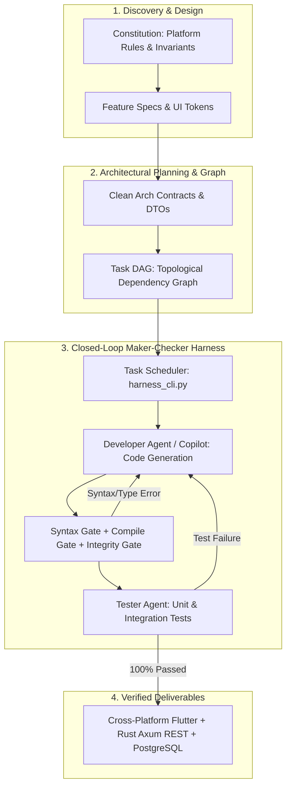

# Development-Time Inference Systems (`apps/development-time/`)

> **Definition**: Systems where Large Language Models (LLMs), specialized agents, and closed-loop harnesses are utilized *during the software development lifecycle* to specify, architect, implement, verify, and manufacture software applications.

---

## 1. Overview & Architectural Principles

Unlike runtime inference (where AI executes in production to serve end-users), **Development-Time Inference** empowers human engineers and autonomous agents to build production-grade software with zero runtime agent dependencies:



### Core Methodologies
1. **Spec-Driven Development (Spec Kit / `.specify`)**: Single source of truth containing product rules (`constitution.md`), user stories, and architectural contracts before writing any code.
2. **Topological Task Scheduling (Task DAG)**: Decomposes application delivery into a dependency graph (`task-dag.json`). Tasks can only be scheduled once their parent dependencies are verified.
3. **Closed-Loop Verification Harness**: The Maker generates code; the Checker runs static AST syntax checks, compilation, and unit test gates. Errors are captured and fed back to self-heal.
4. **Autonomous Manufacturing**: Closely integrated with [DevFactory](file:///factory/DevFactory/README.md), which manufactures complete standalone .NET software solutions from natural-language blueprints.

---

## 2. Catalog of Development-Time Applications

| Application / System | Technologies | Methodology | Key Artifacts |
| :--- | :--- | :--- | :--- |
| [**SitePulse**](SitePulse/README.md) | Cross-Platform Flutter (Dart, M3) + Rust (Axum, Tokio, rust_decimal) + PostgreSQL 16 | Spec-Driven Development + Task DAG + Loop Harness | `.specify/`, `harness/harness_cli.py`, `flutter/`, `backend/`, `scripts/` |
| [**DevFactory**](../../factory/DevFactory/README.md) | .NET 10, Roslyn AST In-Memory Analysis, CLI | Multi-Stage Manufacturing Assembly Line | `src/DevFactory.Harness`, `DevFactory.Loop`, `DevFactory.Graph` |

---

## 3. Developer Guide: Working with GitHub Copilot

When using GitHub Copilot for development-time code generation and refactoring:

### A. Grounding Copilot in Specifications
Always reference the relevant spec files when invoking Copilot:
```text
Prompt: "@workspace Read apps/development-time/SitePulse/.specify/constitution.md and .specify/specs/001-resident-dashboard/spec.md. Implement CalculateDuesUseCase in Kotlin using BigDecimal for KMK statutory interest."
```

### B. Following Task DAG Dependency Order
Ensure Copilot does not write code ahead of its dependencies:
```text
# Check eligible tasks first
python3 apps/development-time/SitePulse/harness/harness_cli.py next

# Prompt Copilot for the exact task
Prompt: "Generate the implementation for task-08 (Offline Room Cache) conforming to the interface defined in task-01."
```

### C. Prompting the Maker-Checker Pair
Use Copilot in dual roles:
1. **As Maker**: `"Generate the Spring Boot 3 Controller implementation conforming to the DTO contract."`
2. **As Checker**: `"Generate a comprehensive JUnit 5 test suite verifying edge cases: negative amounts, zero balances, and overdue interest calculations."`

---

## 4. Developer Guide: Working with Antigravity

Antigravity natively understands this workspace's spec-driven development lifecycle, governed by [.agents/rules/development-time-inference.md](file:///.agents/rules/development-time-inference.md):

### A. Executing Next DAG Tasks
Ask Antigravity to progress the project:
```text
"Inspect the SitePulse Task DAG, find the next runnable task, and implement both code and tests."
```
Antigravity will:
1. Run `python3 harness_cli.py next`.
2. Inspect the spec requirements in `.specify/`.
3. Implement the clean architecture code and matching tests.
4. Run `python3 harness_cli.py verify --task <task-id>` to pass all gates.

### B. Architectural Invariant Checks
Ask Antigravity to run static harness audits:
```text
"Run the SitePulse harness self-tests and verify all syntax and financial integrity gates."
```

---

## 5. Quickstart & Verification

```bash
# 1. Inspect Task DAG Status
python3 apps/development-time/SitePulse/harness/harness_cli.py status

# 2. View Next Runnable Tasks
python3 apps/development-time/SitePulse/harness/harness_cli.py next

# 3. Run SitePulse Harness Unit Tests
python3 -m unittest discover -s apps/development-time/SitePulse/harness/tests

# 4. Verify Task Gates
python3 apps/development-time/SitePulse/harness/harness_cli.py verify --task task-01
```
