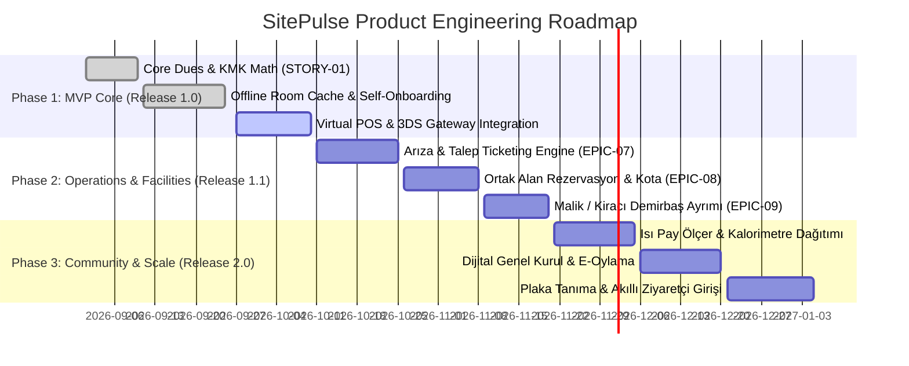

# SitePulse Platform - Product Strategy, Feature Gap Analysis & MVP Roadmap

> **Author:** PropTech PM Specialist Agent  
> **Target Platform:** SitePulse (Apsiyon / Papara Fintech Benchmark)  
> **Governance:** Turkish Condominium Law (634 Sayılı Kat Mülkiyeti Kanunu - KMK)  
> **Evaluation Date:** September 2026  
> **Status:** Approved for Implementation  

---

## 1. Executive Product Summary

SitePulse is engineered to be an AI-manufactured, high-reliability residential community and financial management platform. While **Release 1.0 (Foundation)** successfully established mathematical rigor (zero floating-point precision loss, KMK Art. 20 statutory delay calculations, offline-first Room cache, and tokenized resident self-onboarding), real-world Turkish residential complexes (Siteler ve Toplu Yapılar) operate as complex micro-municipalities with legal, operational, and physical access needs.

To bridge the gap between an **accounting tool** and an **indispensable daily community platform**, this report outlines:
1. **The Feature Gap Analysis**: What essential capabilities are missing compared to market leaders (Apsiyon, Senyonet) and statutory obligations.
2. **The Phased MVP Plan**: A lean, high-impact release schedule to reach full commercial readiness.
3. **Formal Specifications & Gherkin Scenarios**: Concrete user stories ready for autonomous code manufacturing.

---

## 2. Feature Gap Analysis: "What Features Should Have Been There?"

Analyzing typical 100+ unit residential communities in Turkey reveals six critical feature gaps in the initial architecture:

```
┌────────────────────────────────────────────────────────────────────────────────────────┐
│                                FEATURE GAP TAXONOMY                                   │
├─────────────────────────┬───────────────────────────────┬──────────────────────────────┤
│ Operational Pillar      │ Missing Commercial Feature    │ Legal / Business Impact      │
├─────────────────────────┼───────────────────────────────┼──────────────────────────────┤
│ 1. Financial Operations │ Real Virtual POS & Settlement │ Unreconciled manual bank EFT │
│ 2. Facility Management  │ Maintenance / Fault Ticketing │ Unresolved elevator/plumbing │
│ 3. Common Area Access   │ Amenity / Facility Booking    │ Double-booked courts/pool    │
│ 4. KMK Legal Rigor      │ Malik vs. Kiracı Partitioning │ Illegal capex to tenants     │
│ 5. Energy & Utilities   │ Heat-Cost Allocator (PayÖlçer)│ Non-compliance with Law 5627 │
│ 6. Governance & Voting  │ Digital AGM & Decision Polls  │ Inability to reach quorums   │
└─────────────────────────┴───────────────────────────────┴──────────────────────────────┘
```

### Gap 1: End-to-End Regulated Payment Gateway (Sanal POS & Otomatik Mutabakat)
- **Current State:** The mobile app has "Aidat Öde" buttons, but transactions are mocked in local state.
- **Missing Need:** Integration with a Turkish payment aggregator (Iyzico, Papara, PayTR, Garanti BBVA) supporting 3D Secure 2.0, card tokenization (Card-on-File), automated monthly recurring auto-charge (Otomatik Talimat), and virtual IBAN matching.
- **Pain Point Solved:** Eliminates managers manually matching bank EFT descriptions ("A blok no 14 aidat") against bank statements.

### Gap 2: Arıza & Talep Yönetimi (Maintenance & Facility Work Orders)
- **Current State:** Residents see dues and announcements, but have no channel to report physical issues.
- **Missing Need:** Mobile ticketing engine where residents photograph a broken elevator, leaking pipe, or blown bulb. Supports status tracking (`AÇIK`, `ATANDI`, `İŞLEMDE`, `TAMAMLANDI`), vendor dispatch, cost estimates, and resident satisfaction star ratings.
- **Pain Point Solved:** Stops endless WhatsApp complaints and lost verbal messages to the site guard (kapıcı).

### Gap 3: Ortak Alan & Tesis Rezervasyonu (Amenity Booking)
- **Current State:** Quick-action icon "Rezervasyon" exists as a static UI placeholder without business logic.
- **Missing Need:** Slot-based calendar reservations for tennis/basketball courts, barbecue gazebos, meeting rooms, and guest suites. Must enforce quotas (e.g. max 2 hours/week per flat) and overdue-debt blocks (residents with unpaid dues cannot book premium amenities).
- **Pain Point Solved:** Prevents arguments between residents over facility usage and incentivizes on-time dues payment.

### Gap 4: Malik vs. Kiracı Legal Segregation & Demirbaş Fonu (Capex vs. Opex)
- **Current State:** Each apartment has a single balance.
- **Missing Need:** Under KMK Article 20 & 72, capital expenses (**Demirbaş**: roof overhaul, elevator replacement, facade painting) belong strictly to the **Kat Maliki** (Property Owner), while operating dues (**İşletme Projesi**: security, cleaning, garden) belong to the **Kiracı** (Tenant).
- **Pain Point Solved:** Landlords currently refuse to pay full statements containing tenant operating bills, while tenants refuse to pay structural overhaul charges.

### Gap 5: Isı Pay Ölçer & Sayaç Tüketim Dağıtımı (Utility Sub-Metering)
- **Current State:** Only fixed monthly dues are supported.
- **Missing Need:** Central heating and hot water consumption splitting per the Energy Efficiency Law (5627 Sayılı Enerji Verimliliği Kanunu): 70% based on calorie meter consumption + 30% flat square-meter area allocation.
- **Pain Point Solved:** Mandatory legal compliance for all central boiler complexes in Turkey.

### Gap 6: Dijital Genel Kurul & Karar Defteri (Digital AGM, Quorum & Polling)
- **Current State:** Announcements are one-way broadcasts.
- **Missing Need:** Remote electronic voting for Annual General Meetings (Kat Malikleri Kurulu), proxy (vekalet) management, live quorum calculation (arsa payı ve sayı çoğunluğu), and binding decision record archiving.
- **Pain Point Solved:** Fixes the chronic problem where 60% of site general meetings fail at the first call due to lack of quorum.

---

## 3. Product MVP Execution Plan (Phased Roadmap)

To maximize commercial velocity while preserving code quality, the roadmap is divided into three distinct phases:



### Phase 1: Commercial MVP Core (Target: 2 Weeks)
**Objective:** Complete the financial payment loop so real money can be collected and deposited to site bank accounts.
- **Deliverable 1.1:** Virtual POS Payment Provider (Iyzico / Papara Checkout SDK integration with 3D Secure callback).
- **Deliverable 1.2:** Payment Webhook & Automated Receipt PDF generator (instant SMS/Email delivery).
- **Deliverable 1.3:** Push Notifications (Firebase Cloud Messaging) for overdue notices and payment confirmations.

### Phase 2: Operational Community Engine (Target: 4 Weeks)
**Objective:** Deliver daily utility so residents open the app multiple times a week.
- **Deliverable 2.1 (EPIC-07):** Arıza / Talep Bildirimi (Photo capture, category selection, manager assignment board, push notifications).
- **Deliverable 2.2 (EPIC-08):** Ortak Alan Rezervasyonu (Interactive hourly time-slot selector, capacity rules, cancellation policy).
- **Deliverable 2.3 (EPIC-09):** Malik vs. Kiracı Ayrık Borçlandırma (Demirbaş Fonu vs. İşletme Avansı dual ledger).

### Phase 3: Compliance & Enterprise Scale (Target: 6 Weeks)
**Objective:** Win institutional facility management contracts (Site Yönetim Firmaları).
- **Deliverable 3.1:** Isı Pay Ölçer & Sayaç Okuma (CSV import of meter readings, 70/30 legal formula distribution).
- **Deliverable 3.2:** Dijital Genel Kurul & Karar Defteri (Real-time quorum tracker, certified voting results).
- **Deliverable 3.3:** Plaka Tanıma Sistemi (PTS) & Ziyaretçi QR Davetiyesi (Temporary gate pass codes for visitors/couriers).

---

## 4. Priority User Story Specifications (Sprint Ready)

The following two epic specifications are defined according to `.specify/agents/pm-agent.md` standard and are ready for Task DAG topological execution:

### EPIC-07: Arıza & Bakım Talep Sistemi (Maintenance Work Orders)

#### STORY-07-01: Resident Ticket Creation with Photo Attachment
- **Persona:** Site Sakini (Resident)
- **Problem:** When an elevator fails or a common light burns out, residents text the manager or security guard, leading to forgotten repairs and lack of accountability.
- **Solution:** Native 3-step ticket creation form with category, location description, camera/gallery attachment, and urgency indicator.

```gherkin
Feature: Arıza & Bakım Talebi Oluşturma

  Scenario: Resident reports a broken elevator with photo
    Given the resident "Ahmet Yılmaz" is logged in for "A Blok D:14"
    When the resident navigates to "Talepler" and taps "Yeni Talep Bildir"
    And selects category "Asansör / Mekanik"
    And enters title "A Blok Sağ Asansör 3. Katta Kaldı"
    And attaches 1 photo "elevator_error.jpg"
    And taps "Talebi Gönder"
    Then a new ticket is generated with status "BEKLEMEDE"
    And a push notification is dispatched to all Site Managers
    And the resident sees the ticket with a tracking ID "#TLP-2026-089"
```

#### STORY-07-02: Manager Kanban Board & Vendor Dispatch
- **Persona:** Site Yöneticisi (Manager)
- **Problem:** Managers struggle to track which service vendor was contacted and whether the repair was completed.
- **Solution:** Manager ticket dashboard with state transitions (`BEKLEMEDE` -> `ATANDI` -> `İŞLEMDE` -> `TAMAMLANDI`), vendor notes, and expense association.

```gherkin
Feature: Site Yöneticisi Talep Yönetimi

  Scenario: Manager assigns an authorized elevator technician
    Given a pending ticket "#TLP-2026-089" exists
    When the manager views the ticket details
    And selects vendor "Kone Asansör Bakım A.Ş."
    And updates status to "İŞLEMDE"
    Then the resident receives an in-app status update "Talebiniz Kone Asansör firmasına iletildi"
    And the ticket timeline records the transition with timestamp
```

---

### EPIC-08: Sanal POS & Otomatik Tahsilat (Real Payment Gateway)

#### STORY-08-01: 3D Secure Mobile Card Checkout
- **Persona:** Site Sakini (Resident)
- **Problem:** Manual bank EFT transfer requires typing long IBANs and complex explanation codes, resulting in delayed dues and unmatched bank balances.
- **Solution:** In-app payment sheet tokenizing credit/debit cards with 3D Secure verification and zero floating-point rounding.

```gherkin
Feature: 3D Secure Sanal POS ile Kredi Kartı Aidat Ödeme

  Scenario: Successful dues payment with 3D Secure
    Given the resident has an overdue balance of ₺1423.33 including ₺23.33 delay penalty
    When the resident taps "Hemen Öde" on the Hero Balance Card
    And selects "Kredi Kartı ile Öde"
    And enters card credentials and triggers 3D Secure SMS OTP
    And the payment gateway returns "SUCCESS" with transaction ID "TXN-998811"
    Then the dues statement status is transitioned to "ODENDI"
    And the resident balance updates immediately to ₺0.00
    And an immutable digital receipt is stored in the local cache and backend database
```

---

## 5. Key Success Metrics & KPIs for the MVP

To quantitatively track whether the product meets business and user goals:

| KPI Metric | Target Baseline | Measurement Window | Target Value |
| :--- | :--- | :--- | :--- |
| **Aidat Tahsilat Oranı (Collection Rate)** | 65% (Manual Bank EFT) | First 60 days of site launch | **≥ 90.0%** |
| **Gecikme Süresi (Avg Days Overdue)** | 22 days | Monthly dues cycle | **≤ 6 days** |
| **Arıza Çözüm Süresi (Mean Time to Repair)** | 96 hours | Ticket open to closed | **≤ 24 hours** |
| **Uygulama Benimseme Oranı (Resident WAU)** | 20% (Sporadic use) | Weekly Active Users | **≥ 75.0%** |
| **Finansal Mutabakat Hata Oranı** | 2.5% discrepancy | Monthly accounting closure | **0.00% (Zero Kuruş Drift)** |

---

## 6. Recommended Next Action

To execute this plan using our Spec-Driven Development harness:
1. Register **EPIC-07** (`Arıza & Bakım`) and **EPIC-08** (`Sanal POS`) into `.specify/tasks/task-dag.json`.
2. Generate the Spring Boot backend entities, Flyway migrations (`V4__maintenance_and_payment_gateways.sql`), and Jetpack Compose mobile screens using our topological Maker-Checker verification pipeline.
