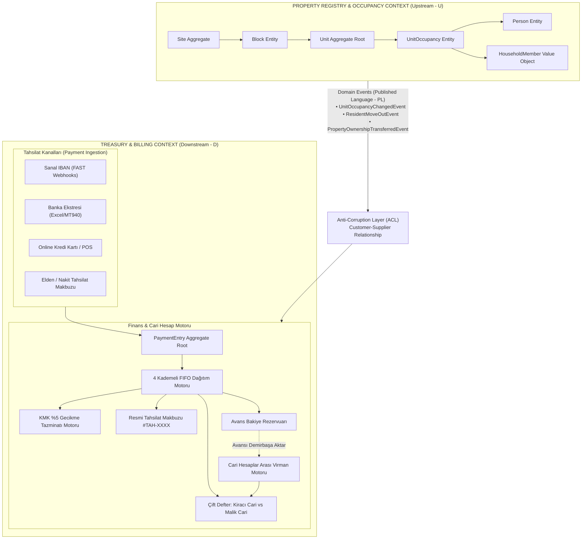
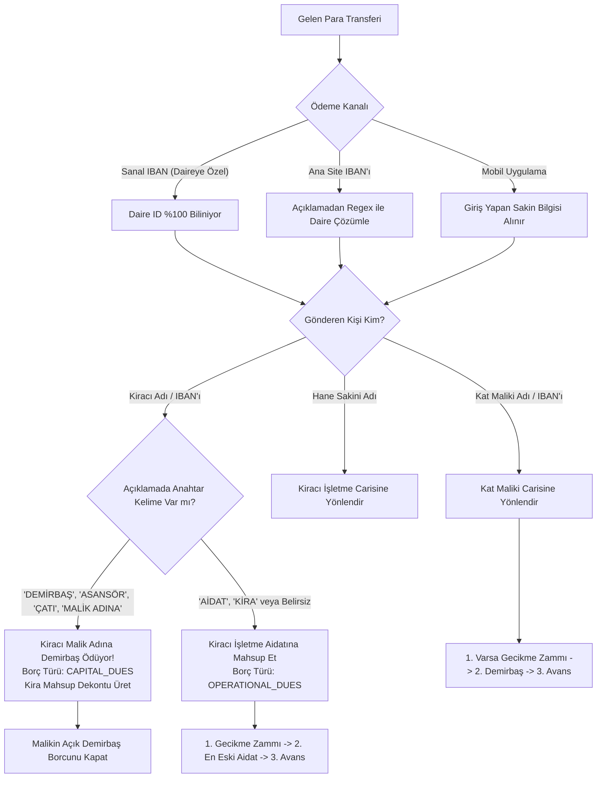
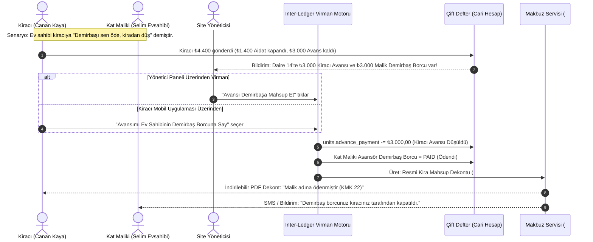
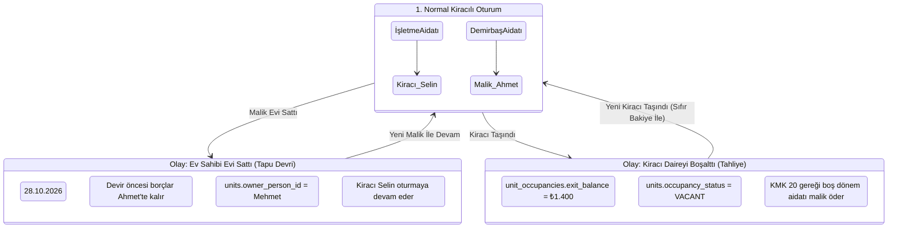

# Epic: Payment Tracking, Dual-Ledger Treasury & Delinquency Management

> **Epic ID:** EPIC-09  
> **Module:** `backend-rust`, `flutter-ui`, `flutter-domain`, `postgres-db`  
> **Bounded Context:** `Treasury & Billing Context` (Integrated with `Property & Occupancy Registry Context`)  
> **Status:** SPECIFIED / IN PROGRESS (7 / 7 Stories Specified)  
> **Target Audience:** `SITE_MANAGER`, `PROPERTY_OWNER`, `TENANT`, `SAAS_ADMIN`  
> **Governing Standards:** Kat Mülkiyeti Kanunu (634 Sayılı KMK Madde 20 & 22), Türk Borçlar Kanunu (TBK Madde 83 & 314), GAAP Dual-Ledger Accounting, TCMB FAST / Açık Bankacılık Standartları  
> **Invariants:** Strict decimal precision (`NUMERIC(15, 2)` / `rust_decimal::Decimal`), English-only code identifiers, zero floating-point arithmetic, immutable collection ledger.

---

## 1. Epic Overview & Architectural Purpose

While **EPIC-07** provided the bank integration infrastructure (*Sanal IBAN allocation, bank statement parsers, and periodic dues batch accruals*), **EPIC-09** establishes the dedicated **Treasury & Billing Context** for end-to-end payment tracking, multi-channel payment ingestion, dual-ledger sub-accounts (*Cari Hesap* for Owner vs Tenant), automated FIFO allocation, delinquency/aging analysis, inter-ledger transfers, and official payment receipt generation.

This module operates in strict coordination with the **Property & Occupancy Registry Context** (EPIC-08 / `OwnersResidentsModulePage`):
- It consumes occupancy lifecycle events (*Move-In, Move-Out, Vacancy, Ownership Transfer*) to target operational vs capital dues.
- It tracks distinct debtor sub-ledgers so that tenants are only liable for operational dues during their tenancy window, while property owners maintain legal statutory guarantees and capital dues liabilities.
- It supports third-party payments where a tenant pays capital dues (*Demirbaş*) on behalf of their landlord with automatic rent-offset receipts.
- It provides an inter-ledger transfer mechanism (*"Avansı Demirbaşa Aktar"*) for surplus funds.
- It provides Site Managers and Residents with unified payment visibility, real-time filtering, debt aging, and exportable payment receipts (`#TAH-2026-XXXX`).

---

## 2. Bounded Context Architecture & Visual Diagrams

### 2.1 Strategic Context Map & Domain Boundaries



---

### 2.2 Payment Payer & Intent Detection Decision Tree (NLP Keyword Matching)

When a payment is ingested from bank statements or FAST webhooks, the system resolves both the unit and the payer's liability intent:



---

### 2.3 Inter-Ledger Advance-to-Capital Offset Workflow (Virman)

When a tenant sends funds that exceed their operational dues, creating an advance balance (`advance_payment`), this balance can be seamlessly transferred to offset the landlord's capital dues:



---

### 2.4 Mülk Devri (Ev Satışı) ve Kiracı Tahliyesi Yaşam Döngüsü



---

## 3. User Stories & Acceptance Criteria

### STORY-09-01: Unified Payment Inflow Stream & Multi-Channel Transaction Ledger
- **Epic Ref:** `EPIC-09` | **Task Ref:** `task-15`
- **Description:** Provide a centralized payment tracking stream aggregating payments from all channels:
  1. Flat-Specific Virtual IBAN (FAST webhooks)
  2. Reconciled Bank Statements (Excel, MT940, CSV)
  3. Direct Credit Card / Online POS
  4. Manual Cash / Bank Transfer receipts entered by Site Manager.
  The stream allows instant filtering by Date Range, Block & Unit, Debtor Type (`TENANT` vs `OWNER`), Payment Channel, and Settlement Status.
- **Acceptance Criteria (Gherkin):**
  ```gherkin
  Scenario: Filter payment stream by tenant payments for current month
    Given the site manager opens the "Ödeme Takibi" (Payment Tracking) module
    When filtering by period "Ekim 2026" and debtor type "TENANT"
    Then the system lists all verified tenant payments
    And displays total collected amount, collection rate, and channel distribution breakdown
    And clicking any payment opens the detailed allocation breakdown dialog
  ```

---

### STORY-09-02: Dual-Ledger FIFO Payment Allocation & KMK Interest Settlement Engine
- **Epic Ref:** `EPIC-09` | **Task Ref:** `task-16`
- **Description:** When a payment is delivered (or confirmed manually), the allocation engine must automatically settle outstanding obligations according to Kat Mülkiyeti Kanunu (KMK Article 20) and Turkish accounting conventions using a deterministic waterfall:
  1. **Tier 1:** Outstanding KMK Statutory Delay Penalties (`delay_penalty` - 5% monthly daily pro-rated).
  2. **Tier 2:** Oldest unpaid Operational Dues (`OPERATIONAL_DUES`) for that debtor/occupancy.
  3. **Tier 3:** Oldest unpaid Capital Dues (`CAPITAL_DUES`) if the payer is the Property Owner.
  4. **Tier 4 (Surplus):** Any remaining balance is credited to the unit's `advance_payment` (Avans Bakiye) reservoir.
- **Acceptance Criteria (Gherkin):**
  ```gherkin
  Scenario: Settle delay penalty first, then oldest dues, then credit surplus as advance
    Given Unit "A Blok D:14" has an overdue operational due of ₺1.400,00 with ₺23,33 delay penalty
    When a payment of ₺2.000,00 is received via Sanal IBAN
    Then ₺23,33 is allocated to clear the delay penalty
    And ₺1.400,00 is allocated to settle the principal dues liability (Status = PAID)
    And the surplus of ₺576,67 is credited to the unit's advance balance
    And the payment allocation audit record reflects the exact 3-tier distribution
  ```

---

### STORY-09-03: Real-Time Debt Aging, Delinquency Tracking & Sub-Ledger (Cari Hesap) Ekstresi
- **Epic Ref:** `EPIC-09` | **Task Ref:** `task-18`
- **Description:** Provide an itemized, printable Sub-Ledger (*Cari Hesap Ekstresi*) separate for the Tenant and the Property Owner, alongside an interactive Debt Aging report (*Borç Yaşlandırma Raporu*) segmented into:
  - Vadesi Gelmemiş (Current / Not due)
  - 1 - 30 Gün Gecikmede (Mild delinquency, 5% interest accrual)
  - 31 - 60 Gün Gecikmede (Notice issued / İhtar aşaması)
  - 60+ Gün Gecikmede (Legal enforcement ready / KMK Madde 20 İcra Takibi).
- **Acceptance Criteria (Gherkin):**
  ```gherkin
  Scenario: Generate itemized Cari Hesap Ekstresi for Tenant
    Given Tenant "Canan Kiracı" in "B Blok D:99"
    When the Site Manager requests the tenant sub-ledger statement
    Then the statement only includes operational dues, payments made by Canan, and delay interest
    And excludes capital dues assessed to the Property Owner
    And displays the net balance with statutory interest breakdown
  ```

---

### STORY-09-04: Official Digital Payment Receipt Generation (`#TAH-2026-XXXX`) & Voucher Export
- **Epic Ref:** `EPIC-09` | **Task Ref:** `task-17`
- **Description:** Every settled payment transaction automatically generates a legally compliant, sequentially numbered Digital Payment Receipt (*Tahsilat Makbuzu* / *Dekont* with unique sequence `#TAH-YYYY-XXXXXX`). The receipt includes:
  - Site Title & Potential Tax Number (*Site Vergi Kimlik No*)
  - Payer Name, Unit Identifier, Debtor Role (`Kat Maliki` / `Kiracı`)
  - Payment Method, Date/Time, Reference Code
  - Itemized Allocation (*Hangi aya ve gidere mahsup edildiği*)
  - Digital verification hash / QR code for fraud prevention
  - Print & PDF download options in mobile and web clients.
- **Acceptance Criteria (Gherkin):**
  ```gherkin
  Scenario: Issue sequential payment receipt upon settlement
    Given a successful dues payment of ₺1.423,33 for "A Blok D:14"
    When the payment is recorded in the collection ledger
    Then a receipt record is created with sequence code "TAH-2026-000142"
    And the resident can view and download the official receipt in Papara-style fullscreen view
    And the receipt includes the site tax ID and itemized dues breakdown
  ```

---

### STORY-09-05: Occupancy Lifecycle Financial Settlement & Move-Out Frozen Balance Handover
- **Epic Ref:** `EPIC-09` | **Task Ref:** `task-19`
- **Description:** When a resident moves out (triggered in `OwnersResidentsModulePage` or via Move-Out flow), the Treasury module executes an automated financial settlement:
  1. Computes final closing balance of tenant up to move-out date.
  2. Closes tenant's active billing session and stamps exit balance on `unit_occupancies.exit_balance`.
  3. Freezes historical receivables without deleting them.
  4. Automatically shifts future recurring operational dues liabilities to Property Owner while unit is `VACANT`.
  5. If tenant left an unsettled balance, alerts Site Manager with option to transfer guarantor liability to Property Owner under KMK Art. 22.
- **Acceptance Criteria (Gherkin):**
  ```gherkin
  Scenario: Move-out freezes tenant balance and shifts recurring accrual to owner
    Given Tenant "Zeynep Kaya" vacates "B Blok D:12" with ₺1.400,00 unpaid dues
    When the move-out action is finalized in the property registry
    Then Zeynep Kaya's sub-ledger is frozen with ₺1.400,00 outstanding
    And subsequent monthly operational dues are automatically billed to the Property Owner
    And past payment receipts remain attributed to Zeynep Kaya
  ```

---

### STORY-09-06: Tenant Paying Capital Dues On Behalf of Landlord & Automated Rent Offset (Kiracının Malik Adına Demirbaş Ödemesi)
- **Epic Ref:** `EPIC-09` | **Task Ref:** `task-16`, `task-17`
- **Description:** Under Turkish lease agreements and KMK Art. 22, landlords frequently request tenants to pay capital/fixture assessments (*Demirbaş*) on their behalf and deduct the amount from their rent. The system must support this workflow through three coordinated paths:
  1. **NLP Keyword Intent Extraction:** When a tenant's transfer contains keywords like `"DEMİRBAŞ"`, `"ASANSÖR"`, `"ÇATI"`, `"MANTOLAMA"`, or `"MALİK ADINA"`, route the funds to settle the owner's `CAPITAL_DUES` liability rather than operational dues.
  2. **Inter-Ledger Advance Offset ("Avansı Demirbaşa Aktar"):** If the tenant overpays or has an advance balance (`advance_payment`), provide a 1-click action in both Manager and Tenant screens to transfer the advance balance to settle the owner's capital dues with full audit logging.
  3. **Official Rent-Deduction Receipt:** Generate an official receipt (`#TAH-YYYY-XXXXXX`) that explicitly declares: *“Payer: Tenant (Canan Kaya), Debtor: Property Owner (Selim Evsahibi), Purpose: Capital Elevator Assessment under KMK Art. 22 (Eligible for rent offset)”*.
- **Acceptance Criteria (Gherkin):**
  ```gherkin
  Scenario: Tenant pays elevator fixture fee on behalf of landlord
    Given Unit "A Blok D:14" has Tenant "Canan Kaya" and Owner "Selim Evsahibi"
    And Selim Evsahibi has an outstanding CAPITAL_DUES assessment of ₺3.000,00 for "Asansör Revizyonu"
    When Canan Kaya transfers ₺3.000,00 with description "A Blok D:14 Asansör Demirbaş"
    Then the system identifies CAPITAL_DUES intent from the keyword
    And allocates ₺3.000,00 to Selim Evsahibi's capital dues liability (Status = PAID)
    And issues official receipt #TAH-2026-000481 stating "Ödeyen: Canan Kaya (Kiracı), Adına Ödenen: Selim Evsahibi (Kat Maliki)"
    And Canan Kaya's tenant operational dues balance remains unchanged
  ```

---

### STORY-09-07: Change of Ownership (Property Sale) & Title Deed Financial Handover (Tapu Devri ve Mülk Satış Kapanışı)
- **Epic Ref:** `EPIC-09` | **Task Ref:** `task-19`
- **Description:** When an apartment is sold to a new owner, the system must separate past liabilities from future assessments according to the legal deed transfer date:
  1. **Historical Ledger Freezing:** All capital dues and uncollected debts accrued prior to the transfer date remain attributed to the Previous Owner (`Old Owner`).
  2. **New Owner Assignment:** The new owner is bound to `units.owner_person_id` starting from the deed transfer date.
  3. **Tenancy Preservation:** If an active tenant resides in the unit, their lease, deposit notes, and operational dues schedule continue seamlessly without interruption.
  4. **Subsequent Assessments:** All future capital levies and any vacant-period operational dues are automatically debited to the New Owner.
- **Acceptance Criteria (Gherkin):**
  ```gherkin
  Scenario: Property ownership transfer freezes old owner balance and binds new owner
    Given Unit "B Blok D:10" is owned by "Ahmet Yılmaz" with ₺2.500,00 unpaid capital dues
    When the Site Manager registers a Title Deed Transfer to "Burak Demir" effective 2026-10-28
    Then Ahmet Yılmaz's sub-ledger is frozen with ₺2.500,00 historical capital liability
    And Burak Demir is assigned as current Property Owner starting 2026-10-28 with ₺0,00 initial balance
    And all future capital dues and vacant period charges are billed to Burak Demir
    And active tenant records and operational dues remain unaffected
  ```

---

## 4. Verification Harness & Engineering Quality Gates

All implementations under EPIC-09 must satisfy:
1. **Decimal Precision Gate:** Monetary balances computed strictly in `rust_decimal::Decimal` and Dart `Decimal`.
2. **Sequential Receipt Gate:** Receipt sequence numbers must be monotonic and gap-free per site.
3. **Dual-Ledger Audit Gate:** Tenant payments must never offset capital project liabilities unless explicit capital intent or inter-ledger virman is authorized.
4. **Automated Test Matrix:** Integration test suite covering FIFO allocation waterfall, multi-channel payment ingestion, tenant-paying-capital flow, and property sale handover.
