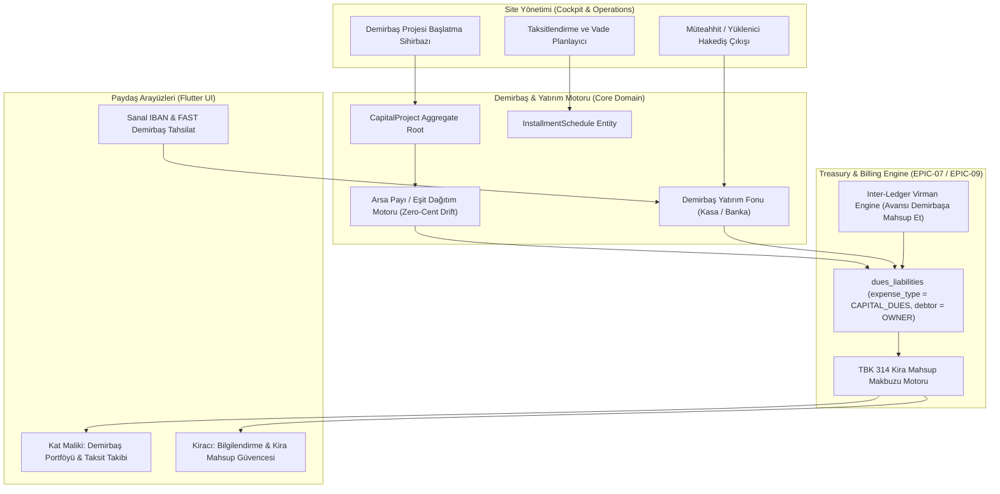

# Epic: Capital Expenditure & Fixture Dues Management (Demirbaş & Yatırım Projeleri)

> **Epic ID:** EPIC-10  
> **Module:** `backend-rust`, `flutter-ui`, `flutter-domain`, `postgres-db`  
> **Bounded Context:** `Capital Projects & Investment Treasury Context` (Coordinating with `Treasury & Billing Context` and `Property & Occupancy Context`)  
> **Status:** SPECIFIED  
> **Target Audience:** `SITE_MANAGER`, `PROPERTY_OWNER`, `TENANT`, `SAAS_ADMIN`  
> **Governing Standards:** 
> - 634 Sayılı Kat Mülkiyeti Kanunu (KMK Madde 20/a, 20/b, 22, 34, 35)
> - 6098 Sayılı Türk Borçlar Kanunu (TBK Madde 314 - Kiracının Kira Bedelinden Mahsup Hakkı)
> - GAAP Dual-Ledger Accounting (Strict Separation of Operational Dues vs. Capital Reserve Funds)
> **Invariants:**
> - High-precision decimal arithmetic (`NUMERIC(15, 2)` / `Decimal`), zero floating-point math.
> - Strict English-only code identifiers, database schemas, tables, and API routes.
> - Statutory debtor guarantee: Capital liabilities (`CAPITAL_DUES`) accrue exclusively to `OWNER` (`PROPERTY_OWNER`). Tenants are legally exempt under KMK 20/b.
> - Exact fractional sum reconciliation: $\sum \text{Unit Shares} = \text{Total Project Installment Budget}$ (zero-cent drift guarantee).

---

## 1. Epic Overview & Strategic Business Value

Under Turkish Condominium Law (634 sayılı KMK), residential sites manage two strictly decoupled financial pipelines:
1. **İşletme Bütçesi (Operational Dues - Aidat)**: Routine operational maintenance (security, cleaning, gardening, common electricity) incurred by the active resident occupying the flat (`TENANT` or `OWNER`).
2. **Yatırım / Demirbaş Bütçesi (Capital Projects - Demirbaş)**: Structural, asset-enhancing, long-term capital investments (elevator modernizations, exterior facade insulation/painting, roof waterproofing, seismic retrofits, generator installations, security camera infrastructure).

### Core Problem Solved:
In typical property management systems, mixing operational dues with capital assessments causes severe legal and financial disputes:
- **Tenant Exposure**: Tenants are mistakenly charged for structural elevator or roof renovations that legally belong solely to the landlord.
- **Cash Flow Starvation**: Operational funds get diverted to pay large contractor down payments, leaving the site unable to pay utility bills or staff salaries.
- **Statutory Deadlock**: Collecting large capital budgets in a single lump sum creates massive default rates, whereas managing multi-month installments manually in spreadsheets results in lost receipts and unreconciled bank balances.

**EPIC-10 introduces a first-class Capital Expenditure & Fixture Dues Management System**:
- Site Managers define Capital Projects with budgets, contractor contracts, distribution methods (Arsa Payı vs. Eşit), and multi-stage installment schedules.
- The system automatically accrues `CAPITAL_DUES` liabilities directly to property owners (`OWNER`) without burdening tenants.
- Tenants who choose to pay on behalf of their landlords are automatically issued **TBK 314 Statutory Rent-Offset Receipts** (*Kira Mahsubuna Uygun Demirbaş Makbuzu*).
- An **Inter-Ledger Virman Engine** allows owners to seamlessly transfer excess operational advance balances into their capital debts.
- Contractor milestone disbursements are tracked directly against the capital reserve fund.

---

## 2. Strategic Domain Model & Context Architecture

### 2.1 Bounded Context Map & Domain Flow



---

## 3. Key Domain Entities & Schema Specifications

### 3.1 Database Schema Extensions

```sql
-- 1. Capital Projects (Demirbaş / Yatırım Projeleri)
CREATE TABLE capital_projects (
    id BIGINT GENERATED BY DEFAULT AS IDENTITY PRIMARY KEY,
    site_id BIGINT NOT NULL REFERENCES sites(id) ON DELETE CASCADE,
    title VARCHAR(180) NOT NULL,
    category VARCHAR(40) NOT NULL, -- 'ELEVATOR', 'FACADE_INSULATION', 'ROOF_WATERPROOFING', 'GENERATOR', 'SECURITY_SYSTEM', 'OTHER'
    description TEXT,
    total_budget NUMERIC(15, 2) NOT NULL,
    allocation_basis VARCHAR(30) NOT NULL DEFAULT 'BY_LAND_SHARE', -- 'BY_LAND_SHARE', 'EQUAL_PER_UNIT'
    target_start_date DATE NOT NULL,
    target_completion_date DATE,
    contractor_name VARCHAR(150),
    contractor_tax_no VARCHAR(20),
    contractor_iban VARCHAR(34),
    contract_amount NUMERIC(15, 2),
    status VARCHAR(30) NOT NULL DEFAULT 'ACTIVE', -- 'PLANNED', 'ACTIVE', 'COMPLETED', 'CANCELLED'
    created_by BIGINT REFERENCES users(id),
    created_at TIMESTAMP WITH TIME ZONE DEFAULT CURRENT_TIMESTAMP
);

-- 2. Project Installment Milestones (Demirbaş Taksit Planı)
CREATE TABLE capital_project_installments (
    id BIGINT GENERATED BY DEFAULT AS IDENTITY PRIMARY KEY,
    project_id BIGINT NOT NULL REFERENCES capital_projects(id) ON DELETE CASCADE,
    installment_number INT NOT NULL,
    total_installments INT NOT NULL,
    due_date DATE NOT NULL,
    installment_budget NUMERIC(15, 2) NOT NULL,
    percentage NUMERIC(5, 2) NOT NULL, -- e.g. 33.33
    is_accrued BOOLEAN NOT NULL DEFAULT FALSE,
    accrued_at TIMESTAMP WITH TIME ZONE,
    created_at TIMESTAMP WITH TIME ZONE DEFAULT CURRENT_TIMESTAMP,
    CONSTRAINT uq_project_installment UNIQUE (project_id, installment_number)
);

-- 3. Capital Contractor Disbursements (Demirbaş Hakediş / Gider Çıkışları)
CREATE TABLE capital_contractor_disbursements (
    id BIGINT GENERATED BY DEFAULT AS IDENTITY PRIMARY KEY,
    project_id BIGINT NOT NULL REFERENCES capital_projects(id) ON DELETE CASCADE,
    milestone_name VARCHAR(120) NOT NULL, -- e.g. '1. Hakediş: Malzeme Alımı ve Sözleşme Avansı'
    invoice_number VARCHAR(60),
    amount NUMERIC(15, 2) NOT NULL,
    disbursement_date DATE NOT NULL DEFAULT CURRENT_DATE,
    recipient_name VARCHAR(150) NOT NULL,
    recipient_iban VARCHAR(34) NOT NULL,
    payment_reference VARCHAR(100),
    disbursement_method VARCHAR(30) NOT NULL DEFAULT 'BANK_TRANSFER', -- 'BANK_TRANSFER', 'CASH'
    authorized_by BIGINT REFERENCES users(id),
    notes TEXT,
    created_at TIMESTAMP WITH TIME ZONE DEFAULT CURRENT_TIMESTAMP
);

-- Link dues_liabilities to capital projects
ALTER TABLE dues_liabilities 
ADD COLUMN IF NOT EXISTS capital_project_id BIGINT REFERENCES capital_projects(id) ON DELETE SET NULL,
ADD COLUMN IF NOT EXISTS installment_number INT DEFAULT NULL;

CREATE INDEX idx_dues_capital_project ON dues_liabilities (capital_project_id);
```

---

## 4. User Stories & Acceptance Criteria

### STORY-10-01: Capital Project Creation & Budget Allocation Wizard
- **As a:** Site Manager  
- **I want to:** Define a new capital project (e.g. "A & B Blok Asansör Revizyonu") specifying total project budget, vendor details, and the apportionment method (Arsa Payı vs. Eşit).  
- **So that:** The financial obligations are legally grounded under KMK Art. 20 without manual calculation errors.

#### Acceptance Criteria (Gherkin):
Executable scenarios: [`STORY-10-01-capital-project-creation.feature`](../features/EPIC-10/STORY-10-01-capital-project-creation.feature) (run and reported by scenario id, see `scripts/feature_traceability.py`).

---

### STORY-10-02: Multi-Stage Installment Scheduling & Automatic Accrual Batch Generation
- **As a:** Site Manager  
- **I want to:** Divide a large capital expenditure budget into manageable monthly installments (e.g. 3 eşit taksit) with defined due dates.  
- **So that:** Property owners can pay gradually and the system automatically generates `CAPITAL_DUES` liabilities when each installment maturity arrives.

#### Acceptance Criteria (Gherkin):
Executable scenarios: [`STORY-10-02-installment-scheduling.feature`](../features/EPIC-10/STORY-10-02-installment-scheduling.feature) (run and reported by scenario id, see `scripts/feature_traceability.py`).

---

### STORY-10-03: Dual-Ledger Capital Payment Ingestion & TBK 314 Rent-Offset Receipts
- **As a:** Property Owner or Tenant  
- **I want to:** Pay an accrued capital installment via Sanal IBAN, credit card, or bank transfer.  
- **So that:** The capital liability is cleared and, if paid by a tenant, a legally binding TBK 314 Rent-Offset receipt is generated.

#### Acceptance Criteria (Gherkin):
Executable scenarios: [`STORY-10-03-capital-payment-ingestion.feature`](../features/EPIC-10/STORY-10-03-capital-payment-ingestion.feature) (run and reported by scenario id, see `scripts/feature_traceability.py`).

---

### STORY-10-04: Inter-Ledger Virman Engine (Advance Balance Offset Against Capital Dues)
- **As a:** Site Manager or Property Owner  
- **I want to:** Offset an outstanding capital dues installment using surplus funds from the unit's operational advance payment reservoir (`advance_payment`).  
- **So that:** Property owners who overpaid previous dues do not need to make duplicate bank transfers.

#### Acceptance Criteria (Gherkin):
Executable scenarios: [`STORY-10-04-inter-ledger-virman.feature`](../features/EPIC-10/STORY-10-04-inter-ledger-virman.feature) (run and reported by scenario id, see `scripts/feature_traceability.py`).

---

### STORY-10-05: Contractor Milestone Disbursements & Capital Fund Treasury Dashboard
- **As a:** Site Manager  
- **I want to:** Record progress payments (hakediş) paid to contractors from the collected capital reserve fund.  
- **So that:** The site maintains 100% financial transparency between collected capital funds and paid contractor invoices.

#### Acceptance Criteria (Gherkin):
Executable scenarios: [`STORY-10-05-contractor-disbursements.feature`](../features/EPIC-10/STORY-10-05-contractor-disbursements.feature) (run and reported by scenario id, see `scripts/feature_traceability.py`).

---

### STORY-10-06: Mobile Resident UI Separation (Owner Capital Card vs. Tenant Guidance)
- **As a:** Resident (Owner or Tenant)  
- **I want to:** See a clear distinction between monthly operational dues and long-term capital projects on my mobile dashboard.  
- **So that:** I have complete visibility over my obligations without confusion.

#### Acceptance Criteria (Gherkin):
Executable scenarios: [`STORY-10-06-resident-capital-view.feature`](../features/EPIC-10/STORY-10-06-resident-capital-view.feature) (run and reported by scenario id, see `scripts/feature_traceability.py`).

---

### STORY-10-07: Site Manager Cockpit & Dues Management Integration (Demirbaş Segment)
- **As a:** Site Manager  
- **I want to:** Access a dedicated "Demirbaş & Yatırım" segment inside the **Aidat Yönetimi** view.  
- **So that:** I can manage active projects, monitor unit collection percentages, trigger installment accruals, and export project audit reports from one cohesive interface.

#### Acceptance Criteria (Gherkin):
Executable scenarios: [`STORY-10-07-manager-capital-cockpit.feature`](../features/EPIC-10/STORY-10-07-manager-capital-cockpit.feature) (run and reported by scenario id, see `scripts/feature_traceability.py`).

---

## 5. Verification Gates & Acceptance Checklist

| Verification Gate | Gate Owner | Requirement | Pass Criteria |
| :--- | :--- | :--- | :--- |
| **1. Decimal Precision Gate** | Backend / Financial | `NUMERIC(15, 2)` & `rust_decimal::Decimal` | Zero floating-point rounding drift. $\sum \text{Unit Shares} \equiv \text{Installment Budget}$. |
| **2. Legal Debtor Gate** | Domain Logic | KMK Art. 20/b Enforcement | Capital liabilities charged 100% to `OWNER`. Tenants receive zero unsolicited debt. |
| **3. Rent-Offset Integrity** | Audit Voucher | TBK Art. 314 Compliance | Receipts for tenant capital payments include verified legal statutory offset wording. |
| **4. Zero-Data-Loss Gate** | Persistence | Database Foreign Keys | Archiving or canceling projects retains all historical payment vouchers and receipts. |
| **5. Full-Screen UX Gate** | Flutter UI | Papara-Style Viewports | All project wizards, installment schedules, and disbursement dialogs render via `AppFullscreenPage`. |
| **6. Automated Test Suite**| CI/CD Pipeline | Rust & Flutter Verification | `cargo test` passes 100%, `flutter test` passes 100%, Python harness passes 100%. |
