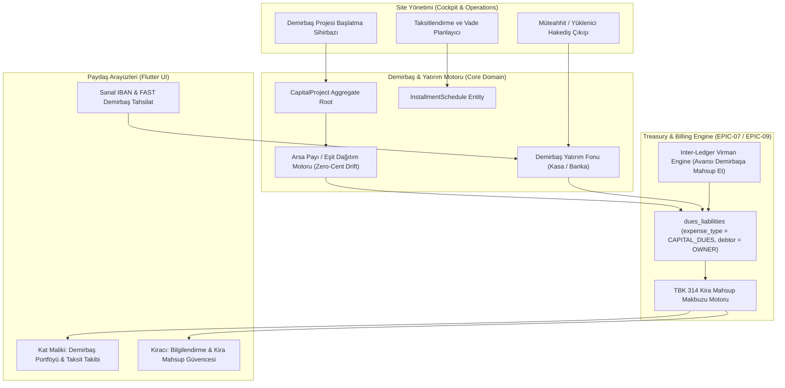

# Epic: Capital Expenditure & Fixture Dues Management (Demirbaş & Yatırım Projeleri)

> **Epic ID:** EPIC-10  
> **Module:** `backend-rust`, `flutter-ui`, `flutter-domain`, `postgres-db`  
> **Bounded Context:** `Capital Projects & Investment Treasury Context` (Coordinating with `Treasury & Billing Context` and `Property & Occupancy Context`)  
> **Status:** SPECIFIED  
> **Target Audience:** `SITE_MANAGER`, `PROPERTY_OWNER`, `TENANT`, `SAAS_ADMIN`  
> **Governing Standards:** 
> - 634 Sayılı Kat Mülkiyeti Kanunu (KMK Madde 20/a, 20/b, 22, 34, 35)
> - 6098 Sayılı Türk Borçlar Kanunu (TBK Madde 314 - Kiracının Kira Bedelinden Mahsup Hakkı)
> - GAAP Dual-Ledger Accounting (Strict Separation of Operational Dues vs. Capital Reserve Funds)
> **Invariants:**
> - High-precision decimal arithmetic (`NUMERIC(15, 2)` / `Decimal`), zero floating-point math.
> - Strict English-only code identifiers, database schemas, tables, and API routes.
> - Statutory debtor guarantee: Capital liabilities (`CAPITAL_DUES`) accrue exclusively to `OWNER` (`PROPERTY_OWNER`). Tenants are legally exempt under KMK 20/b.
> - Exact fractional sum reconciliation: $\sum \text{Unit Shares} = \text{Total Project Installment Budget}$ (zero-cent drift guarantee).

---

## 1. Epic Overview & Strategic Business Value

Under Turkish Condominium Law (634 sayılı KMK), residential sites manage two strictly decoupled financial pipelines:
1. **İşletme Bütçesi (Operational Dues - Aidat)**: Routine operational maintenance (security, cleaning, gardening, common electricity) incurred by the active resident occupying the flat (`TENANT` or `OWNER`).
2. **Yatırım / Demirbaş Bütçesi (Capital Projects - Demirbaş)**: Structural, asset-enhancing, long-term capital investments (elevator modernizations, exterior facade insulation/painting, roof waterproofing, seismic retrofits, generator installations, security camera infrastructure).

### Core Problem Solved:
In typical property management systems, mixing operational dues with capital assessments causes severe legal and financial disputes:
- **Tenant Exposure**: Tenants are mistakenly charged for structural elevator or roof renovations that legally belong solely to the landlord.
- **Cash Flow Starvation**: Operational funds get diverted to pay large contractor down payments, leaving the site unable to pay utility bills or staff salaries.
- **Statutory Deadlock**: Collecting large capital budgets in a single lump sum creates massive default rates, whereas managing multi-month installments manually in spreadsheets results in lost receipts and unreconciled bank balances.

**EPIC-10 introduces a first-class Capital Expenditure & Fixture Dues Management System**:
- Site Managers define Capital Projects with budgets, contractor contracts, distribution methods (Arsa Payı vs. Eşit), and multi-stage installment schedules.
- The system automatically accrues `CAPITAL_DUES` liabilities directly to property owners (`OWNER`) without burdening tenants.
- Tenants who choose to pay on behalf of their landlords are automatically issued **TBK 314 Statutory Rent-Offset Receipts** (*Kira Mahsubuna Uygun Demirbaş Makbuzu*).
- An **Inter-Ledger Virman Engine** allows owners to seamlessly transfer excess operational advance balances into their capital debts.
- Contractor milestone disbursements are tracked directly against the capital reserve fund.

---

## 2. Strategic Domain Model & Context Architecture

### 2.1 Bounded Context Map & Domain Flow



---

## 3. Key Domain Entities & Schema Specifications

### 3.1 Database Schema Extensions

```sql
-- 1. Capital Projects (Demirbaş / Yatırım Projeleri)
CREATE TABLE capital_projects (
    id BIGINT GENERATED BY DEFAULT AS IDENTITY PRIMARY KEY,
    site_id BIGINT NOT NULL REFERENCES sites(id) ON DELETE CASCADE,
    title VARCHAR(180) NOT NULL,
    category VARCHAR(40) NOT NULL, -- 'ELEVATOR', 'FACADE_INSULATION', 'ROOF_WATERPROOFING', 'GENERATOR', 'SECURITY_SYSTEM', 'OTHER'
    description TEXT,
    total_budget NUMERIC(15, 2) NOT NULL,
    allocation_basis VARCHAR(30) NOT NULL DEFAULT 'BY_LAND_SHARE', -- 'BY_LAND_SHARE', 'EQUAL_PER_UNIT'
    target_start_date DATE NOT NULL,
    target_completion_date DATE,
    contractor_name VARCHAR(150),
    contractor_tax_no VARCHAR(20),
    contractor_iban VARCHAR(34),
    contract_amount NUMERIC(15, 2),
    status VARCHAR(30) NOT NULL DEFAULT 'ACTIVE', -- 'PLANNED', 'ACTIVE', 'COMPLETED', 'CANCELLED'
    created_by BIGINT REFERENCES users(id),
    created_at TIMESTAMP WITH TIME ZONE DEFAULT CURRENT_TIMESTAMP
);

-- 2. Project Installment Milestones (Demirbaş Taksit Planı)
CREATE TABLE capital_project_installments (
    id BIGINT GENERATED BY DEFAULT AS IDENTITY PRIMARY KEY,
    project_id BIGINT NOT NULL REFERENCES capital_projects(id) ON DELETE CASCADE,
    installment_number INT NOT NULL,
    total_installments INT NOT NULL,
    due_date DATE NOT NULL,
    installment_budget NUMERIC(15, 2) NOT NULL,
    percentage NUMERIC(5, 2) NOT NULL, -- e.g. 33.33
    is_accrued BOOLEAN NOT NULL DEFAULT FALSE,
    accrued_at TIMESTAMP WITH TIME ZONE,
    created_at TIMESTAMP WITH TIME ZONE DEFAULT CURRENT_TIMESTAMP,
    CONSTRAINT uq_project_installment UNIQUE (project_id, installment_number)
);

-- 3. Capital Contractor Disbursements (Demirbaş Hakediş / Gider Çıkışları)
CREATE TABLE capital_contractor_disbursements (
    id BIGINT GENERATED BY DEFAULT AS IDENTITY PRIMARY KEY,
    project_id BIGINT NOT NULL REFERENCES capital_projects(id) ON DELETE CASCADE,
    milestone_name VARCHAR(120) NOT NULL, -- e.g. '1. Hakediş: Malzeme Alımı ve Sözleşme Avansı'
    invoice_number VARCHAR(60),
    amount NUMERIC(15, 2) NOT NULL,
    disbursement_date DATE NOT NULL DEFAULT CURRENT_DATE,
    recipient_name VARCHAR(150) NOT NULL,
    recipient_iban VARCHAR(34) NOT NULL,
    payment_reference VARCHAR(100),
    disbursement_method VARCHAR(30) NOT NULL DEFAULT 'BANK_TRANSFER', -- 'BANK_TRANSFER', 'CASH'
    authorized_by BIGINT REFERENCES users(id),
    notes TEXT,
    created_at TIMESTAMP WITH TIME ZONE DEFAULT CURRENT_TIMESTAMP
);

-- Link dues_liabilities to capital projects
ALTER TABLE dues_liabilities 
ADD COLUMN IF NOT EXISTS capital_project_id BIGINT REFERENCES capital_projects(id) ON DELETE SET NULL,
ADD COLUMN IF NOT EXISTS installment_number INT DEFAULT NULL;

CREATE INDEX idx_dues_capital_project ON dues_liabilities (capital_project_id);
```

---

## 4. User Stories & Acceptance Criteria

### STORY-10-01: Capital Project Creation & Budget Allocation Wizard
- **As a:** Site Manager  
- **I want to:** Define a new capital project (e.g. "A & B Blok Asansör Revizyonu") specifying total project budget, vendor details, and the apportionment method (Arsa Payı vs. Eşit).  
- **So that:** The financial obligations are legally grounded under KMK Art. 20 without manual calculation errors.

#### Acceptance Criteria (Gherkin):
```gherkin
Scenario: Create a capital project distributed strictly by Land Share (Arsa Payı)
  Given Site "Begonya Sitesi" has 10 units with total land share of 1000
  And Unit 14 has land share 24 (2.4%)
  When the Site Manager creates a Capital Project:
    | title          | Asansör Revizyon Projesi |
    | total_budget   | ₺500.000,00              |
    | allocation     | BY_LAND_SHARE            |
    | contractor     | Otis Asansör San. Tic.   |
  Then the project is saved with status "ACTIVE"
  And Unit 14's total projected share is exactly ₺12.000,00
  And the sum of all flat project allocations exactly equals ₺500.000,00 with 0 kuruş drift

Scenario: Create a capital project with equal allocation per unit
  Given Site "Begonya Sitesi" has 12 units
  When the Site Manager creates a project with budget ₺60.000,00 and allocation "EQUAL_PER_UNIT"
  Then every unit receives an allocation of exactly ₺5.000,00
```

---

### STORY-10-02: Multi-Stage Installment Scheduling & Automatic Accrual Batch Generation
- **As a:** Site Manager  
- **I want to:** Divide a large capital expenditure budget into manageable monthly installments (e.g. 3 eşit taksit) with defined due dates.  
- **So that:** Property owners can pay gradually and the system automatically generates `CAPITAL_DUES` liabilities when each installment maturity arrives.

#### Acceptance Criteria (Gherkin):
```gherkin
Scenario: Schedule 3 installments and accrue installment 1
  Given an active capital project with total budget ₺300.000,00 across 10 units
  When the Site Manager configures 3 monthly installments:
    | Installment 1 | ₺100.000,00 | Due: 2026-11-15 |
    | Installment 2 | ₺100.000,00 | Due: 2026-12-15 |
    | Installment 3 | ₺100.000,00 | Due: 2027-01-15 |
  And triggers accrual for Installment 1
  Then exactly 10 new dues_liabilities records are created
  And each liability has expense_type = "CAPITAL_DUES"
  And each liability has debtor_type = "OWNER"
  And no tenant receives a dues liability
  And installment 1 is marked as is_accrued = true
```

---

### STORY-10-03: Dual-Ledger Capital Payment Ingestion & TBK 314 Rent-Offset Receipts
- **As a:** Property Owner or Tenant  
- **I want to:** Pay an accrued capital installment via Sanal IBAN, credit card, or bank transfer.  
- **So that:** The capital liability is cleared and, if paid by a tenant, a legally binding TBK 314 Rent-Offset receipt is generated.

#### Acceptance Criteria (Gherkin):
```gherkin
Scenario: Property owner pays capital due directly via FAST Sanal IBAN
  Given Unit 14 has an accrued capital due of ₺4.000,00 for "Asansör Revizyonu 1. Taksit"
  When Property Owner Ahmet Yılmaz transfers ₺4.000,00 to Unit 14's Virtual IBAN with description "Demirbaş 1. Taksit"
  Then the capital dues liability transitions to "PAID"
  And a collection receipt is issued indicating debtor "OWNER"
  And the capital project collected amount increases by ₺4.000,00

Scenario: Tenant pays capital due on behalf of owner and receives TBK 314 Rent-Offset Receipt
  Given Unit 14 is TENANT_OCCUPIED by Canan Can and owned by Ahmet Yılmaz
  And Unit 14 has an accrued capital due of ₺4.000,00
  When Tenant Canan Can pays ₺4.000,00 with note "Demirbaş Ödemesi"
  Then the capital dues liability is marked "PAID"
  And the receipt contains the statutory legal clause:
    """
    634 sayılı KMK Madde 20 & 22 uyarınca ortak demirbaş giderleri Kat Maliki sorumluluğundadır. 
    Kiracı tarafından ödenen bu tutar TBK Madde 314 gereğince kira bedelinden mahsuba uygundur.
    """
  And the receipt is tagged with is_rent_offset_eligible = true
```

---

### STORY-10-04: Inter-Ledger Virman Engine (Advance Balance Offset Against Capital Dues)
- **As a:** Site Manager or Property Owner  
- **I want to:** Offset an outstanding capital dues installment using surplus funds from the unit's operational advance payment reservoir (`advance_payment`).  
- **So that:** Property owners who overpaid previous dues do not need to make duplicate bank transfers.

#### Acceptance Criteria (Gherkin):
```gherkin
Scenario: Transfer advance balance to clear capital dues (Virman)
  Given Unit 14 has an advance balance of ₺3.500,00 in operational reservoir
  And Unit 14 has an accrued capital due of ₺2.500,00
  When the Site Manager executes Virman transfer of ₺2.500,00 to capital project
  Then Unit 14's advance balance decreases to ₺1.000,00
  And the capital dues liability is fully paid (paid_amount = ₺2.500,00, status = "PAID")
  And an inter-ledger audit record is recorded in collection_transactions
```

---

### STORY-10-05: Contractor Milestone Disbursements & Capital Fund Treasury Dashboard
- **As a:** Site Manager  
- **I want to:** Record progress payments (hakediş) paid to contractors from the collected capital reserve fund.  
- **So that:** The site maintains 100% financial transparency between collected capital funds and paid contractor invoices.

#### Acceptance Criteria (Gherkin):
```gherkin
Scenario: Record contractor milestone disbursement
  Given Capital Project "Asansör Revizyonu" has collected ₺220.000,00 from unit owners
  And total previous disbursements are ₺50.000,00
  When the Site Manager authorizes "2. Hakediş (Motor & Halat Montajı)" of ₺120.000,00 to "Otis Asansör San. Tic."
  Then the disbursement is recorded with invoice number "ASN-2026-0044"
  And the project disbursed_amount becomes ₺170.000,00
  And the remaining capital fund cash balance displays ₺50.000,00 (₺220.000,00 collected - ₺170.000,00 disbursed)
  And disbursement exceeding collected funds triggers an overdrawn cash warning
```

---

### STORY-10-06: Mobile Resident UI Separation (Owner Capital Card vs. Tenant Guidance)
- **As a:** Resident (Owner or Tenant)  
- **I want to:** See a clear distinction between monthly operational dues and long-term capital projects on my mobile dashboard.  
- **So that:** I have complete visibility over my obligations without confusion.

#### Acceptance Criteria (Gherkin):
```gherkin
Scenario: Property Owner views separate Operational and Capital balance cards
  Given Property Owner "Ahmet Yılmaz" logs in
  When inspecting the dashboard
  Then the primary balance card displays:
    | Operational Dues | ₺1.500,00 (Aylık İşletme Aidatı) |
    | Capital Dues     | ₺3.000,00 (Demirbaş Taksiti: Asansör Revizyonu 2/3) |
  And clicking "Detay" shows project breakdown, contractor info, and installment schedule

Scenario: Tenant views clear statutory protection guidance
  Given Tenant "Canan Can" logs in to a unit with an active capital project
  When viewing the dues breakdown
  Then the capital project is listed with badge "Kat Maliki Sorumluluğunda"
  And a banner clarifies: "Demirbaş giderleri yasal olarak ev sahibinize aittir. Ödemeniz halinde kiradan düşebilirsiniz."
```

---

### STORY-10-07: Site Manager Cockpit & Dues Management Integration (Demirbaş Segment)
- **As a:** Site Manager  
- **I want to:** Access a dedicated "Demirbaş & Yatırım" segment inside the **Aidat Yönetimi** view.  
- **So that:** I can manage active projects, monitor unit collection percentages, trigger installment accruals, and export project audit reports from one cohesive interface.

#### Acceptance Criteria (Gherkin):
```gherkin
Scenario: Site Manager inspects Capital Projects segment in Aidat Yönetimi
  Given the Site Manager navigates to the "Aidat Yönetimi" tab
  When selecting the "Demirbaş & Yatırım" segment tab
  Then the view displays:
    | Active Capital Projects Summary (Total Budget, Collected %, Disbursed %) |
    | Unit-by-unit capital debt and payment status table                        |
    | Action Button: "Yeni Demirbaş Projesi Tanımla"                            |
    | Action Button: "Hakediş / Gider Çıkışı Yap"                              |
    | Action Button: "Taksit Tahakkuk Ettir"                                   |
```

---

## 5. Verification Gates & Acceptance Checklist

| Verification Gate | Gate Owner | Requirement | Pass Criteria |
| :--- | :--- | :--- | :--- |
| **1. Decimal Precision Gate** | Backend / Financial | `NUMERIC(15, 2)` & `rust_decimal::Decimal` | Zero floating-point rounding drift. $\sum \text{Unit Shares} \equiv \text{Installment Budget}$. |
| **2. Legal Debtor Gate** | Domain Logic | KMK Art. 20/b Enforcement | Capital liabilities charged 100% to `OWNER`. Tenants receive zero unsolicited debt. |
| **3. Rent-Offset Integrity** | Audit Voucher | TBK Art. 314 Compliance | Receipts for tenant capital payments include verified legal statutory offset wording. |
| **4. Zero-Data-Loss Gate** | Persistence | Database Foreign Keys | Archiving or canceling projects retains all historical payment vouchers and receipts. |
| **5. Full-Screen UX Gate** | Flutter UI | Papara-Style Viewports | All project wizards, installment schedules, and disbursement dialogs render via `AppFullscreenPage`. |
| **6. Automated Test Suite**| CI/CD Pipeline | Rust & Flutter Verification | `cargo test` passes 100%, `flutter test` passes 100%, Python harness passes 100%. |
