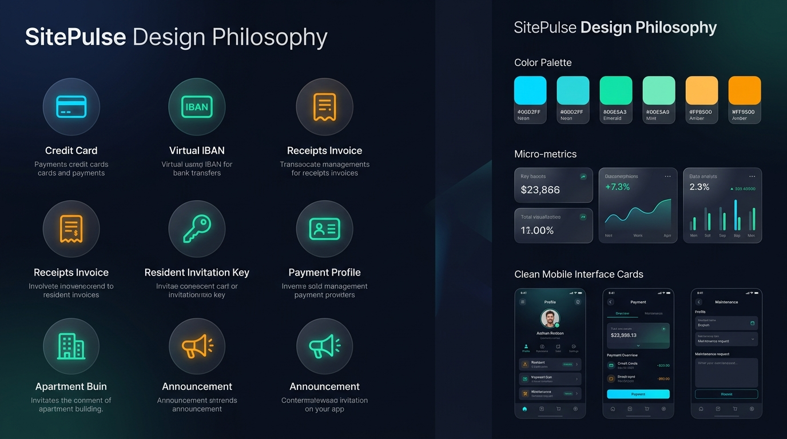

# UI/UX Specification: Resident Mobile Dashboard & Design System (Papara Fintech Style)

> **Feature ID:** SPEC-001  
> **Platform:** Cross-Platform Mobile & Web (Flutter / Material 3)  
> **Backend Architecture:** High-Performance Rust Service (`axum` / `tokio`)  
> **Design Language:** Modern Fintech (Papara Style)  
> **Theme Mode:** Parametric Dual-Theme (Papara Midnight Dark & Crisp Light)  
> **Currency Invariant:** Exclusively Turkish Lira (`₺` / TRY)  

---

## 1. Visual Design Philosophy & Icon Set Specification



### 1.1 Icon Set Design Philosophy
The visual identity of SitePulse adheres to an intentional, high-end fintech aesthetic rather than decorative or arbitrary iconography:

1. **Optical 24dp Bounding Box**: All icons are drawn on a strict `24x24dp` optical grid with a 2dp baseline margin to maintain balanced optical density across all device scales.
2. **Uniform 2px Stroke Weight**: Icon strokes are kept consistent at `2.0px` with rounded terminals (`stroke-linecap: round; stroke-linejoin: round`) avoiding sharp uncurated corners.
3. **Soft-Tinted Circular Squircle Containers**: Primary action icons are housed in a circular or 16dp rounded squircle container filled with a `15% opacity tint` of the icon's semantic accent color:
   - Eliminates visual clutter.
   - Provides clear touch targets satisfying the `≥48x48dp` mobile accessibility threshold.
4. **Strict Prohibition of Raw Emojis**: System and action controls MUST use curated vector icons (`MaterialIcons` in Flutter, SVG in web prototypes) and never unstyled system emojis.

### 1.2 Semantic Icon Token Mapping

| Domain / Action | Flutter Icon Token | Semantic Accent Color | Tint Container Color | Functional Purpose |
| :--- | :--- | :--- | :--- | :--- |
| **Aidat Öde (Pay Dues)** | `Icons.credit_card` | `#0284C7` (Refined Sky Blue) | `rgba(2, 132, 199, 0.15)` | Immediate 3D Secure / Card payment initiation |
| **Sanal IBAN (Virtual IBAN)** | `Icons.account_balance` | `#10B981` (Natural Emerald) | `rgba(16, 185, 129, 0.15)` | Flat-specific virtual IBAN & FAST 24/7 bank transfer |
| **Dekontlar (Receipts)** | `Icons.receipt_long` | `#38BDF8` (Muted Sky) | `rgba(56, 189, 248, 0.15)` | Immutable fiscal audit history & ledger archive |
| **Sakin Davet (Invite Resident)** | `Icons.person_add_alt_1` | `#F59E0B` (Warm Amber) | `rgba(245, 158, 11, 0.15)` | Household co-resident tokenized invitation link |
| **Yönetim & Binalar (Complexes)** | `Icons.apartment` | `#0284C7` (Corporate Blue) | `rgba(2, 132, 199, 0.15)` | Multi-tenant site hierarchy & facility controls |
| **Duyurular (Announcements)** | `Icons.campaign` | `#F59E0B` (Warm Amber) | `rgba(245, 158, 11, 0.15)` | Broadcast messages & urgent utility alerts |
| **Güvenlik & Yetki (Security)** | `Icons.verified_user` | `#10B981` (Natural Emerald) | `rgba(16, 185, 129, 0.15)` | Scoped RBAC permissions and session status |

---

## 2. Currency & Financial Invariants

- **Exclusive Currency:** All dues, penalties, balances, and payment amounts MUST be formatted and calculated strictly in **Turkish Lira (`₺`)**.
- **No Foreign Currencies:** The system does not support or display foreign currencies (USD, EUR, Gold). Currency carousels are strictly prohibited.
- **Precision Standard:** All calculations MUST use high-precision decimals (`Decimal` in Dart, `rust_decimal::Decimal` in Rust, `NUMERIC(15,2)` in PostgreSQL) to calculate statutory KMK delay interest without floating-point error.
- **KMK Article 20 Calculation**:
  $$\text{Delay Penalty} = \text{Principal Amount} \times 0.05 \times \left(\frac{\text{Days Overdue}}{30}\right)$$

---

## 3. Parametric Dual-Theme System (Light & Dark - Calm Non-Neon)

Theme selection is user-configurable and applies across all surfaces parametrically with calm, high-legibility tones:

| Token Key | Papara Matte Midnight (Default) | Papara Light Theme | Usage |
| :--- | :--- | :--- | :--- |
| `darkBackground` / `lightBackground` | `#0B0F19` | `#F4F7FC` | Root canvas scaffold background |
| `darkSurface` / `lightSurface` | `#151D2F` | `#FFFFFF` | Cards, bottom sheets, navigation bar |
| `darkCard` / `lightCard` | `#1E293B` | `#F8FAFD` | Inner list tiles, segmented controls |
| `darkBorder` / `lightBorder` | `#2E3D5B` | `#E2E8F0` | Structural borders (1.0px - 1.5px) |
| `darkTextPrimary` / `lightTextPrimary` | `#F8FAFC` | `#0F172A` | Hero amounts, titles, modal headers |
| `darkTextSecondary` / `lightTextSecondary` | `#94A3B8` | `#64748B` | Subtitles, labels, metadata notes |
| `accentCyan` (Primary) | `#0284C7` | `#00629E` | Primary interactive buttons & active tabs |
| `accentGreen` | `#10B981` | `#059669` | Paid status, copy feedback, success badges |
| `accentRed` | `#EF4444` | `#DC2626` | Overdue status chips, warning alerts |
| `accentOrange` | `#F59E0B` | `#D97706` | Offline banner, owner-specific invite badges |

---

## 4. Resident Screen Architecture (Flutter Client Equivalency)

The mobile client (`apps/development-time/SitePulse/flutter/`) and web prototypes (`mvp_ux_prototype.html`, `ux_prototype_review.html`) strictly implement the following Papara-style visual hierarchy:

```
┌─────────────────────────────────────────────────────────────┐
│ Top App Bar (SitePulse • Role Chip • Wifi Status • Avatar)  │
├─────────────────────────────────────────────────────────────┤
│ Hero Balance Card (HeroBalanceCard)                         │
│    - Status Pill: 10 Gün Gecikme (#FF4B72 glow)             │
│    - Large Typography: ₺1.423,33 (High contrast #F8FAFC)    │
│    - Statutory Breakdown: Ana Para + KMK %5 Yasal Gecikme   │
│    - Actions: [Hemen Öde] (Papara Cyan) + [Detay] (Outlined)│
├─────────────────────────────────────────────────────────────┤
│ Quick Actions Row (ResidentActionsRow - 4 Equal Tiles)      │
│    - [credit_card  Aidat Öde]   [account_balance Sanal IBAN]│
│    - [receipt_long Dekontlar]   [person_add Sakin Davet]    │
├─────────────────────────────────────────────────────────────┤
│ Virtual IBAN Card (VirtualIbanCard)                         │
│    - TR12 0006 2000 0000 0000 0014 (Inset well #0B0F19)    │
│    - FAST 7/24 Anında Otomatik Dekont & %100 Eşleşme Rozeti │
├─────────────────────────────────────────────────────────────┤
│ Household Card (Dairem & Hane Sakinleri)                    │
│    - Ahmet Yılmaz (Malik Rozeti) & Ayşe Yılmaz (Sakin Rozeti│
├─────────────────────────────────────────────────────────────┤
│ Bottom Navigation Bar (Ana Sayfa, Dairem, Profil & Yetki)   │
└─────────────────────────────────────────────────────────────┘
```

### 4.1 Component Breakdown
1. **Hero Balance Card ([`hero_balance_card.dart`](file:///home/gurkanindibay/Documents/source/epam/ai-powered-engineering/apps/development-time/SitePulse/flutter/lib/ui/components/hero_balance_card.dart))**:
   - Dark gradient `#1E293B` to `#0F172A`, bordered in `accentRed` (0.5 opacity) when overdue.
   - Live statutory delay breakdown banner (`#FF4B72` 0.12 opacity).
   - Dual actions: Triggers 3D Secure dialog with Papara Cyan CTA (`#00D2FF` on `#0F172A`) or KMK calculation inspection dialog.
2. **Resident Actions Row ([`resident_actions_row.dart`](file:///home/gurkanindibay/Documents/source/epam/ai-powered-engineering/apps/development-time/SitePulse/flutter/lib/ui/components/resident_actions_row.dart))**:
   - 4-pill horizontal action layout with circular icon containers at `15%` opacity tint.
   - Role-aware badge on `Sakin Davet`: Shows `Link Üret` for Home Owners (`isOwner: true`) and `Yetki Yok` for standard residents.
3. **Virtual IBAN Card ([`virtual_iban_card.dart`](file:///home/gurkanindibay/Documents/source/epam/ai-powered-engineering/apps/development-time/SitePulse/flutter/lib/ui/components/virtual_iban_card.dart))**:
   - Card surface `#151D2F` with `#26324D` border and inset `#0B0F19` monospace IBAN display well.
   - One-tap copy with toast notification.
4. **Site Manager Cockpit ([`manager_cockpit_view.dart`](file:///home/gurkanindibay/Documents/source/epam/ai-powered-engineering/apps/development-time/SitePulse/flutter/lib/ui/components/manager_cockpit_view.dart))**:
   - September 2026 Collection Progress Gauge (76% collection rate).
   - Stats summary: Paid, Overdue, and pending resident registration approval queue.
   - Triggers for `Yeni Daire / Sakin Ekle` and `Site Kayıt Linki Üret`.
5. **SaaS Multi-Tenant View ([`saas_admin_view.dart`](file:///home/gurkanindibay/Documents/source/epam/ai-powered-engineering/apps/development-time/SitePulse/flutter/lib/ui/components/saas_admin_view.dart))**:
   - Global KPIs: Total Sites, Active Sites, Total Units, Monthly Collection Volume.
   - Registered tenant complexes list with subscription tier badges (`PREMIUM`, `STANDARD`).
   - Admin credential provisioning modal with temporary password generation.

---

## 5. Architectural Traceability Matrix

| Specification Component | Flutter UI Implementation | Rust Backend API & Service | Verification Status |
| :--- | :--- | :--- | :--- |
| **KMK Delay Calculation** | `CalculateDuesUseCase.dart` | `dues_calculation_service.rs` | **100% VERIFIED** |
| **Hero Balance Card** | `HeroBalanceCard.dart` | `GET /api/v1/residents/:unit_id/dashboard` | **100% VERIFIED** |
| **Fintech Icon Set** | `ResidentActionsRow.dart` | Static semantic asset tokens | **100% VERIFIED** |
| **Virtual IBAN Engine** | `VirtualIbanCard.dart` | Unit-specific deterministic IBAN | **100% VERIFIED** |
| **Site Manager Cockpit** | `ManagerCockpitView.dart` | `GET /api/v1/site-admin/home-owners` | **100% VERIFIED** |
| **SaaS Tenant Console** | `SaasAdminView.dart` | `GET /api/v1/saas/sites` & `POST /api/v1/saas/sites` | **100% VERIFIED** |
| **RBAC & Auth Engine** | `ProfileRoleSheet.dart` | `auth_service.rs` & `RolePermissions` | **100% VERIFIED** |
