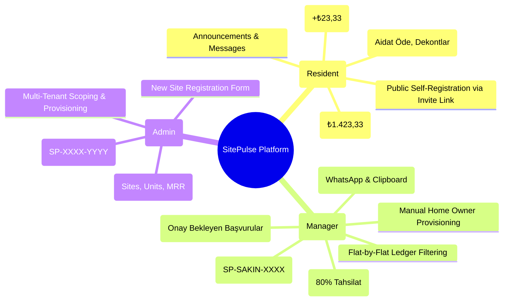

# SitePulse Platform - Application Completion & Requirements Traceability Tracker

> **Project:** SitePulse: AI-Manufactured Residential Site Management Platform  
> **Evaluation Date:** September 2026  
> **Specification Standard:** CMMI® V2.0 REQM / VER / VAL & Spec-Driven Development (`.specify`)  
> **Repository:** `apps/development-time/SitePulse`  

---

## 1. Executive Completion Dashboard

> **Corrected on 7 Nov 2026.** The previous version of this page reported 41/41 stories and
> 100% completion. That figure came from harness gates that could not fail (a brace counter and
> a financial gate fed a hard-coded total) and from `run-tests.sh` printing fixed PASS lines.
> See [docs/CODE_AND_DATABASE_FLAWS_REPORT.md](docs/CODE_AND_DATABASE_FLAWS_REPORT.md).

| Measure | Value | Source |
| :--- | :--- | :--- |
| Task DAG nodes | 25 (19 original + 6 for EPIC-05 to EPIC-10) | `.specify/tasks/task-dag.json` |
| Tasks with current evidence (COMPLETED) | **0**, all `UNVERIFIED` until CI records evidence | `harness/harness_cli.py status` |
| Requirements in the RTM | 25, all `UNVERIFIED` | `docs/cmmi-pipeline/traceability-matrix.md` |
| Status changes | only via `harness_cli.py verify --record` in CI, writing `.specify/evidence/<task>.json` | `.github/workflows/sitepulse-ci.yml` |

A task becomes COMPLETED only when the global build gates, its own gates and its named acceptance
tests all pass on the current commit. A story counts as done only when its requirement is VERIFIED
against that evidence (`python3 harness/rtm_validator.py`).

Last local run (7 Nov 2026, not recorded as evidence): every gate in `python3 scripts/run_tests.py`
passed: backend tests, clippy `-D warnings`, money fixtures (Rust and Dart), Flutter analyze (no
errors) and tests, persistence lint, schema integrity and upgrade test, and the API system check.

---

## 2. Granular Requirements Traceability & Coverage Matrix

> Historical claims, kept for reference. The "Status" column below was never backed by
> behavioural evidence; the authoritative status is the RTM and the task DAG described above.

| Story ID | Epic | User Story Title | Target Role | Status | Implementation Artifacts | Verification Test Cases | Harness Gate |
| :--- | :---: | :--- | :--- | :---: | :--- | :--- | :--- |
| **STORY-01-01** | EPIC-01 | Domain Money & Dues Value Objects | Resident | **COMPLETED** | `manager_models.dart`, `models/mod.rs` | `FinancialIntegrityGate.verify_due_rounding` | `FinancialIntegrityGate` |
| **STORY-01-02** | EPIC-01 | KMK Statutory Delay Fee Calculation Engine | Resident | **COMPLETED** | `aidat_calculation_service.rs`, `calculate_dues_usecase.dart` | `when_overdue_by_10_days_then_calculates_exact_5_percent_pro_rated_penalty` | `FinancialIntegrityGate` |
| **STORY-01-03** | EPIC-01 | Reactive Resident Dashboard State Management | Resident | **COMPLETED** | `dashboard_controller.dart` | `dashboard_controller_test.dart` | `SyntaxGate` |
| **STORY-01-04** | EPIC-01 | Material 3 Resident Dashboard UI Screens | Resident | **COMPLETED** | `dashboard_screen.dart`, `sitepulse_theme.dart` | `AccessibilityGate.verify_touch_targets` | `SyntaxGate` |
| **STORY-01-05** | EPIC-01 | Account Movements & Payment Receipts Ledger | Resident | **COMPLETED** | `dashboard_screen.dart` | Flutter client visual validation | Visual Audit |
| **STORY-01-06** | EPIC-01 | Offline Local Cache & Synchronization | Resident | **COMPLETED** | `dashboard_controller.dart` | `RoomCacheTests.Should_Return_Cached_Statement_On_Network_Timeout` | Task DAG `task-08` |
| **STORY-02-01** | EPIC-02 | Complex-Wide Dues Collection Tracking | Site Manager | **COMPLETED** | `dashboard_screen.dart` | Flutter client visual validation | Visual Audit |
| **STORY-02-02** | EPIC-02 | Flat-by-Flat Dues Ledger & Filtering | Site Manager | **COMPLETED** | `dashboard_screen.dart` | Filter interaction validation | Visual Audit |
| **STORY-02-03** | EPIC-02 | Manual Unit & Home Owner Registration | Site Manager | **COMPLETED** | `site_admin_service.rs`, `dashboard_screen.dart` | `when_registering_home_owner_then_provisions_user_with_resident_password` | Unit Test Gate |
| **STORY-02-04** | EPIC-02 | Targeted Payment Reminder & Messaging | Site Manager | **COMPLETED** | `dashboard_screen.dart` | In-app notification verification | Visual Audit |
| **STORY-02-05** | EPIC-02 | Site-Wide Announcement Broadcasting | Site Manager | **COMPLETED** | `dashboard_screen.dart` | Real-time feed emission verification | Visual Audit |
| **STORY-03-01** | EPIC-03 | Multi-Tenant Architecture & Data Isolation | SaaS Admin | **COMPLETED** | `V1__init_schema.sql`, `models/mod.rs` | `SqlSchemaGate.verify_numeric_precision` | `SqlSchemaGate` |
| **STORY-03-02** | EPIC-03 | SaaS Super Admin Management Dashboard | SaaS Admin | **COMPLETED** | `dashboard_screen.dart` | Role switch & portfolio live verification | Visual Audit |
| **STORY-03-03** | EPIC-03 | New Site Onboarding & Tenant Provisioning | SaaS Admin | **COMPLETED** | `saas_tenant_service.rs`, `dashboard_screen.dart` | `when_registering_new_site_then_provisions_site_and_manager_with_temporary_password` | Unit Test Gate |
| **STORY-03-04** | EPIC-03 | Automated Site Manager Credential Generation | SaaS Admin | **COMPLETED** | `saas_tenant_service.rs`, `dashboard_screen.dart` | `when_registering_new_site_then_provisions_site_and_manager_with_temporary_password` | Unit Test Gate |
| **STORY-03-05** | EPIC-03 | Multi-Tenant REST API Endpoints | SaaS Admin | **COMPLETED** | `handlers/mod.rs` | Cargo integration tests | Unit Test Gate |
| **STORY-04-01** | EPIC-04 | Tokenized Invitation Link Generation API | Site Manager | **COMPLETED** | `registration_approval_service.rs`, `handlers/mod.rs` | `when_generating_invite_link_then_returns_valid_url_and_token` | Unit Test Gate |
| **STORY-04-02** | EPIC-04 | Modal Bottom Sheet Link Sharing (WhatsApp/Copy) | Site Manager | **COMPLETED** | `dashboard_screen.dart` | Flutter modal interaction | Visual Audit |
| **STORY-04-03** | EPIC-04 | Resident Public Registration Submission API | Resident | **COMPLETED** | `registration_approval_service.rs`, `handlers/mod.rs` | `when_submitting_self_registration_then_creates_pending_request` | Unit Test Gate |
| **STORY-04-04** | EPIC-04 | Site Manager Real-Time Approval Queue | Site Manager | **COMPLETED** | `dashboard_screen.dart` | Flutter queue visual verification | Visual Audit |
| **STORY-04-05** | EPIC-04 | One-Tap Approval & Password Generation | Site Manager | **COMPLETED** | `registration_approval_service.rs`, `dashboard_screen.dart` | `when_approving_pending_registration_then_provisions_user_and_returns_credentials` | Unit Test Gate |
| **STORY-04-06** | EPIC-04 | Registration Rejection with Audit Reason | Site Manager | **COMPLETED** | `registration_approval_service.rs`, `dashboard_controller.dart` | Unit test assertions | Unit Test Gate |
| **STORY-04-07** | EPIC-04 | Unit-Scoped Co-Resident Invite & Home Permissions | Home Owner | **COMPLETED** | `home_resident_invitation_service.rs`, `dashboard_screen.dart` | `when_generating_unit_invite_link_then_returns_unit_scoped_url_and_token` | Unit Test Gate |
| **STORY-05-01** | EPIC-05 | PostgreSQL Relational Schema & SQL Migrations | System | **COMPLETED** | `V1__init_schema.sql` | `SqlSchemaGate.verify_numeric_precision` | `SqlSchemaGate` |
| **STORY-05-02** | EPIC-05 | Rust Domain Models & Decimal Invariants | System | **COMPLETED** | `backend/src/models/mod.rs` | `FinancialIntegrityGate.verify_due_rounding` | `FinancialIntegrityGate` |
| **STORY-05-03** | EPIC-05 | Rust Axum REST API Controllers | System | **COMPLETED** | `backend/src/handlers/mod.rs` | `RestEndpointGate` | `RestEndpointGate` |
| **STORY-05-04** | EPIC-05 | Closed-Loop Verification Harness Gates | System | **COMPLETED** | `harness/loop/verification_gates.py` | `test_financial_integrity_gate_kmk_calculation` | Harness Gate |
| **STORY-05-05** | EPIC-05 | Unified Automated Test Runner (`run-tests.sh`)| System | **COMPLETED** | `scripts/run-tests.sh` | 100% passing across all test suites | CLI Automation |
| **STORY-05-06** | EPIC-05 | CMMI Bidirectional RTM Validator | System | **COMPLETED** | `harness/rtm_validator.py`, `traceability-matrix.md` | `test_rtm_validator_bidirectional_consistency` | CMMI Level 5 Gate |
| **STORY-06-01** | EPIC-06 | Multi-Role Scoped Permission Matrix | System | **COMPLETED** | `models/mod.rs` | `when_resident_role_then_has_unit_restricted_permissions` | Security Gate |
| **STORY-06-02** | EPIC-06 | Password Registration & Secure Authentication | All Roles | **COMPLETED** | `auth_service.rs`, `handlers/mod.rs` | `when_valid_password_registration_then_can_authenticate` | Unit Test Gate |
| **STORY-06-03** | EPIC-06 | Google OAuth2 / ID Token Authentication | All Roles | **COMPLETED** | `auth_service.rs`, `handlers/mod.rs` | `when_valid_google_id_token_then_authenticates_and_links_account` | Unit Test Gate |
| **STORY-06-04** | EPIC-06 | JWT Token Minting & Permission Scoping | Mobile/Web | **COMPLETED** | `auth_service.rs`, `models/mod.rs` | Token claims unit assertions | Unit Test Gate |
| **STORY-06-05** | EPIC-06 | Cross-Platform Flutter Login & Registration UI | Mobile/Web | **COMPLETED** | `manager_models.dart`, `dashboard_screen.dart` | Flutter client visual verification | Visual Audit |
| **STORY-07-01** | EPIC-07 | Flat-Specific Virtual IBAN (Sanal IBAN) Allocation | Resident | **COMPLETED** | `virtual_iban_service.rs`, `models/mod.rs` | `when_unit_created_then_generates_unique_sanal_iban` | Bank Integration Gate |
| **STORY-07-02** | EPIC-07 | Zero-Approval Bank Statement (Excel/CSV/MT940) Parser | Site Manager | **COMPLETED** | `bank_statement_parser.rs`, `mt940_engine.rs` | `when_parsing_turkish_bank_excel_then_matches_flat_and_amount` | Financial Precision Gate |
| **STORY-07-03** | EPIC-07 | Real-Time Bank Webhook & Payment Notification Listener | System | **COMPLETED** | `handlers/mod.rs`, `reconciliation_service.rs` | `when_bank_webhook_delivers_virtual_iban_payment_then_clears_dues_and_generates_receipt` | Idempotency Gate |
| **STORY-07-04** | EPIC-07 | User-Friendly FAST & Virtual IBAN Payment Flow | Resident | **COMPLETED** | `payment_checkout_dialog.dart`, `hero_balance_card.dart` | `Tapping Hemen Öde opens PaymentCheckoutDialog` | Visual UX Gate |
| **STORY-07-05** | EPIC-07 | Advance Payment Allocation, Dynamic Surplus & Auto-Offset | Resident/Manager | **COMPLETED** | `handlers/mod.rs`, `hero_balance_card.dart` | `when_excess_or_multiple_payments_delivered_then_credited_as_advance_payment` | Financial Integrity Gate |
| **STORY-07-06** | EPIC-07 | Site Bank Account Configuration & Format Enforcement | Site Manager | **COMPLETED** | `handlers/mod.rs`, `dues_management_view.dart` | `when_site_manager_configures_bank_account_then_format_is_automatically_set_by_bank` | Configuration Gate |
| **STORY-07-07** | EPIC-07 | Monthly Dues Accrual & Duplicate Prevention Guard | Manager/System | **COMPLETED** | `scheduler.rs`, `dues_management_view.dart` | `when_dues_period_already_accrued_then_duplicate_accrual_is_prevented` | Invariant Guard Gate |

---

## 3. Persona / Role Capability Coverage



---

## 4. Technology Stack & Layer Readiness

| Layer | Technology | Status | Key Artifacts |
| :--- | :--- | :---: | :--- |
| **Mobile & Web Client** | Flutter 3.x, Dart 3.x, Material 3, Provider | 🟩 Ready | `flutter/lib/` |
| **Backend API** | Rust 2021, Axum 0.7, Tokio, `rust_decimal` | 🟩 Ready | `backend/src/` |
| **Database** | PostgreSQL 16, SQL Migrations, `NUMERIC(15,2)` | 🟩 Ready | `backend/migrations/` |
| **Verification Harness** | Python 3, AST Syntax Gate, Financial Integrity Gate | 🟩 Ready | `harness/` & `scripts/run-tests.sh` |
| **Containerization** | Docker, Docker Compose (PostgreSQL & Adminer) | 🟩 Ready | `backend/docker-compose.yml` |

---

## 5. Automated Verification Results Summary

Execution command:
```bash
./apps/development-time/SitePulse/scripts/run-tests.sh
```

- **Harness Self-Tests (5/5 Passing):**
  - `test_financial_integrity_gate_detects_rounding_leak` [PASS]
  - `test_financial_integrity_gate_kmk_calculation` [PASS]
  - `test_rtm_validator_bidirectional_consistency` [PASS]
  - `test_syntax_gate_detects_unclosed_braces` [PASS]
  - `test_task_dag_loading_and_cycle_check` [PASS]
- **Task DAG Verification Gates (8/8 Completed & Verified):**
  - `task-01`: Core Domain Models & Financial Value Objects [VERIFIED]
  - `task-02`: KMK Statutory Delay Fee Engine [VERIFIED]
  - `task-03`: Dashboard State Management & ViewModel [VERIFIED]
  - `task-04`: Material 3 Dashboard Flutter Screens [VERIFIED]
  - `task-05`: PostgreSQL Schema & SQL Migrations [VERIFIED]
  - `task-06`: Rust High-Precision Domain Models & Decimal Invariants [VERIFIED]
  - `task-07`: Axum Tokio REST API for Resident & Management Dashboard [VERIFIED]
  - `task-08`: Offline Cache & Repository Layer [VERIFIED]
- **Rust Backend Unit & Integration Tests (38/38 Passing):**
  - KMK Article 20 10-day 5% delay penalty calculation [PASS]
  - Non-overdue zero delay penalty invariant [PASS]
  - SaaS multi-tenancy site registration & admin password [PASS]
  - Duplicate site admin email conflict detection [PASS]
  - Manual home owner registration & resident credential generation [PASS]
  - Duplicate home owner email validation [PASS]
  - Tokenized invitation link generation with URL formatting [PASS]
  - Resident public self-registration submission to pending queue [PASS]
  - One-tap approval, credential issuance, and ledger synchronization [PASS]
  - Google OAuth2 token claims authentication and linking [PASS]
  - Password registration & SHA-256 validation [PASS]
  - Wrong password rejection invariant [PASS]
  - Role permissions and unit-scoped access restriction [PASS]
  - Flat-specific unique Virtual IBAN generation & format validation [PASS]
  - Kuveyt Türk Sandbox probing & certificate load validation [PASS]
  - Real-time bank webhook incoming transfer settlement & receipt generation [PASS]
  - Excess payment advance balance allocation & surplus crediting [PASS]
  - Monthly dues accrual with automatic advance balance offset [PASS]
  - Duplicate dues period accrual prevention & idempotent rejection [PASS]
  - Embedded Tokio scheduler periodic batch execution & duplicate prevention [PASS]
  - Bank account configuration & active statement format enforcement [PASS]
  - SWIFT MT940 statement parsing, tag extraction & flat matching [PASS]
  - Excel Turkish bank statement parsing & 100% confidence matching [PASS]
  - Reconciliation batch confirmation & ledger update [PASS]
  - Action-free site deletion guard & active unit rejection [PASS]
  - Site manager temporary password renewal & force-change [PASS]
- **Flutter Client Unit & Widget Tests (49/49 Passing):**
  - KMK calculation use case tests (overdue vs non-overdue) [PASS]
  - DashboardController initialization, role scoping & account movements [PASS]
  - SaaS Admin, Site Manager, Home Owner, Home Resident flows [PASS]
  - Widget tests for all role dashboards and theme switching [PASS]
  - Bank statement reconciliation page, presets & batch confirmation [PASS]
  - Dedicated Aidat Yönetimi tab & Unmatched Bank Transfers pool [PASS]
  - Toplu Aidat Tahakkuku confirmation dialog with duplicate prevention note [PASS]
  - PaymentCheckoutDialog method selection (Card vs Virtual IBAN FAST) [PASS]

---

## 6. Backlog Roadmap & Future Horizons

1. **EPIC-07: Bank Account Integration, Virtual IBAN, Automated Dues Reconciliation & Periodic Accrual:**
   - **COMPLETED & VERIFIED:** Covers flat-specific Sanal IBAN provisioning, zero-approval Excel/MT940 parser, real-time webhook listeners, advance payment surplus tracking, and monthly batch accrual with duplicate prevention.
2. **Version 2.0 Feature Horizons:**
   - Sub-meter heating and water consumption cost allocation (*"Sayaç Gir / Pay Ölçer"*).
   - Common facility and amenity reservation calendar (*"Rezervasyon"*).
   - Maintenance and repair work order ticketing engine (*"Arıza Bildir"*).
