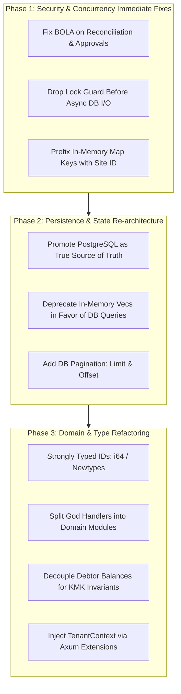

# SitePulse Backend Architecture Evaluation & Flaws Report

**Target System:** `apps/development-time/SitePulse/backend` (Rust, Axum 0.7, Tokio, PostgreSQL, deadpool-postgres, rust_decimal)  
**Evaluation Scope:** System Architecture, Concurrency Model, Multi-Tenancy Isolation, Data Flow & Persistence, API & Middleware Design, Domain Integrity  
**Date:** November 2026

---

## Executive Summary

The SitePulse backend was engineered as a high-performance Rust service using Axum, Tokio, and PostgreSQL to handle residential property and dues accounting under Turkish Condominium Law (Kat Mülkiyeti Kanunu - KMK). While recent remediation cycles resolved several severe cryptographic and authentication issues (e.g., implementing Argon2id, signed JWTs, and HMACS), the **underlying architecture retains critical structural defects**.

The system suffers from an **In-Memory State Paradox**: PostgreSQL is not treated as the true system of record for operational queries; instead, the entire database is eagerly loaded into RAM on startup and held inside an `Arc<RwLock<AppStateInner>>`. This fundamental architectural choice creates severe bottlenecks in concurrency, eliminates horizontal scalability, induces multi-tenant data leaks, and creates dual-write state divergence.

---

## Architectural Flaw Matrix

| # | Flaw Category | Architectural Impact | Severity | Primary Files |
|---|---|---|---|---|
| **AF-01** | **In-Memory Dual-State Paradox** | Zero horizontal scalability; OOM risk on large datasets; dual-write state drift. | **CRITICAL** | `state.rs`, `db/sync.rs`, `handlers/mod.rs` |
| **AF-02** | **Coarse Global Lock Contention & Starvation** | Single global `RwLock`; holding write lock across async DB I/O risks server-wide deadlock/freeze. | **CRITICAL** | `state.rs`, `scheduler.rs`, `services/saas_tenant_service.rs` |
| **AF-03** | **Multi-Tenant Authorization & BOLA Leaks** | `get_reconciliation_queue` and `approve_registration` allow cross-tenant data exfiltration & unauthorized actions. | **CRITICAL** | `handlers/mod.rs`, `auth.rs`, `registration_approval_service.rs` |
| **AF-04** | **Un-namespaced In-Memory Multi-Tenant Collisions** | `unit_members` keyed by un-prefixed flat numbers (`"14"`, `"d-14"`), causing cross-site data overwrites. | **HIGH** | `site_admin_service.rs`, `state.rs` |
| **AF-05** | **Middleware Wire-Tampering (Body Rewriting)** | Intercepts, buffers, parses, mutates, and re-serializes JSON payloads in middleware; double deserialization. | **HIGH** | `auth.rs` |
| **AF-06** | **Domain Invariant & Accounting Logic Violations** | Advance balances coalesce owner and tenant funds, violating KMK statutory rules during auto-offset. | **HIGH** | `handlers/mod.rs`, `dues_repository.rs` |
| **AF-07** | **Destructive Semantic Deletion (Cascade of Physical Entities)** | Deleting a home-owner drops the physical `IndependentUnit` and purges financial history. | **HIGH** | `site_admin_service.rs` |
| **AF-08** | **ID Representation & Schema Impedance Mismatch** | Rust models use `String` while DB uses `BIGINT`; fragile 21-prefix parsing logic (`parse_id_to_i64`). | **MEDIUM** | `db/base.rs`, `models/mod.rs` |
| **AF-09** | **God Modules & Layering Leakage** | 4,000+ line handlers file; services execute raw SQL directly, bypassing repository layer. | **MEDIUM** | `handlers/mod.rs`, `site_admin_service.rs` |
| **AF-10** | **Unbounded Queries & Missing Pagination** | Payment streams and reconciliation queues clone and return unbounded vectors into JSON. | **MEDIUM** | `payment_tracking_service.rs`, `handlers/mod.rs` |

---

## Detailed Architectural Findings

### 1. In-Memory Dual-State Paradox & Horizontal Scalability Block (AF-01)
- **Location:** `state.rs` 31–68, `db/sync.rs` 25–60
- **Mechanism:**
  `AppState` maintains an in-memory representation of nearly all database entities (`Vec<Site>`, `Vec<User>`, `Vec<IndependentUnit>`, `Vec<DuesLiability>`, `Vec<PaymentReceipt>`, `Vec<PaymentEntry>`, etc.) wrapped in `Arc<RwLock<AppStateInner>>`. At startup, `load_all_from_db` executes unbounded queries (`SELECT * FROM sites`, `SELECT * FROM users`, etc.) loading all tenants' history into memory.
- **Architectural Consequences:**
  1. **Zero Horizontal Scalability:** The backend cannot be scaled horizontally. If two replicas run behind an Application Load Balancer (ALB), each maintains its own isolated in-memory cache without distributed cache invalidation. A write on Node 1 is invisible to Node 2.
  2. **High Memory Overhead & OOM:** In an enterprise or SaaS deployment with 10,000 units and 500,000 dues/payments, loading everything into RAM consumes gigabytes of heap and dramatically lengthens boot times.
  3. **Linear Scan Penalties:** Read endpoints perform linear scans ($O(N)$) over `Vec` collections (e.g., `inner.dues.iter().filter(...)`), discarding PostgreSQL's indexed B-Tree access paths ($O(\log N)$).

---

### 2. Coarse-Grained Lock Contention & Starvation Cascade (AF-02)
- **Location:** `services/saas_tenant_service.rs` 34–81, `scheduler.rs` 56–128
- **Mechanism:**
  Services acquire an exclusive `RwLockWriteGuard` on `AppStateInner` and **hold it across `.await` suspension points** while communicating over the network with PostgreSQL:
  ```rust
  let mut inner = self.state.inner.write().await;
  // ...
  let reg = crate::db::create_site_with_manager_and_blocks(pool, ...).await?; // ASYNC DB CALL UNDER LOCK
  ```
- **Architectural Consequences:**
  1. **Connection Pool Starvation Deadlock:** If the database pool is temporarily saturated or under heavy load, `pool.get().await` pauses the thread while holding the global in-memory write lock. All subsequent incoming read and write requests across all tenants immediately block on acquiring the lock, resulting in an application-wide hang.
  2. **Batch Accrual Monopolization:** In `scheduler.rs`, `run_periodic_accrual_for_all_sites` holds `state.inner.write().await` while sequentially inserting dues for all units across all sites and persisting ledger snapshots. During this batch cycle, the web server is unresponsive to API traffic.

---

### 3. Multi-Tenancy Leaks & Broken Object-Level Authorization (AF-03)
- **Location:** `handlers/mod.rs` 1052–1057, 799–809
- **Mechanism:**
  1. **Reconciliation Queue Exposure:**
     Endpoint `GET /api/v1/bank/statements/reconciliation-queue` requires `SiteStaff` role, but its handler simply clones the entire queue without filtering by `site_id`:
     ```rust
     pub async fn get_reconciliation_queue(State(state): State<AppState>) -> Json<Vec<ReconciliationMatch>> {
         let inner = state.inner.read().await;
         Json(inner.reconciliation_queue.clone())
     }
     ```
     A site manager from Site B calling this endpoint sees all bank transactions, sender IBANs, payer names, and debt matches of Site A.
  2. **BOLA in Registration Approvals:**
     `POST /api/v1/registration/approve/:id` and `POST /api/v1/registration/reject/:id` do not validate that the requested `request_id` belongs to the site administered by the caller's JWT token. Any site manager can approve or reject tenant registrations across any site on the platform.

---

### 4. Un-Namespaced In-Memory Multi-Tenant Key Collisions (AF-04)
- **Location:** `services/site_admin_service.rs` 577–584, 996–1001
- **Mechanism:**
  To accommodate multiple ID conventions, the service inserts member DTOs into `inner.unit_members` under multiple keys:
  ```rust
  inner.unit_members.entry(unit_id.clone()).or_default().push(member_dto.clone());
  inner.unit_members.entry(request.unit_no.to_string()).or_default().push(member_dto.clone());
  inner.unit_members.entry(format!("d-{}", request.unit_no)).or_default().push(member_dto);
  ```
- **Architectural Consequences:**
  Unit numbers (e.g. `14` or `d-14`) are not globally unique; they exist within almost every site. Storing them in a single global `HashMap<String, Vec<UnitMemberDto>>` without a `site_id` prefix causes cross-site data collision: residents from Site 1 appear in the household list of Flat 14 in Site 2.

---

### 5. Middleware Wire-Tampering Anti-Pattern (AF-05)
- **Location:** `auth.rs` 489–508
- **Mechanism:**
  In `require_auth`, for every mutating HTTP request (`POST`, `PUT`, `PATCH`), the middleware:
  1. Consumes the incoming body stream into an in-memory buffer (`to_bytes`).
  2. Deserializes the buffer into a `serde_json::Value`.
  3. Mutates the JSON AST in-place to enforce/inject `site_id` and `unit_id`.
  4. Serializes the JSON value back into bytes and replaces the request body.
- **Architectural Consequences:**
  - **Double Deserialization Overhead:** Every API write payload is deserialized twice (first by the middleware, then by the Axum route handler's `Json<T>` extractor).
  - **Violation of Layering:** Multi-tenant boundaries should be asserted by injecting validated claims (`Extension<Claims>` or `TenantContext`) into handlers and letting domain repositories enforce tenancy, not by rewriting raw HTTP bodies on the wire.
  - **Incompatibility with Streaming:** Breaks streaming requests, multipart file uploads, or non-JSON payloads.

---

### 6. KMK Accounting Invariant Violations: Advance Balance Coalescing (AF-06)
- **Location:** `handlers/mod.rs` 85–128, `db/dues_repository.rs` 205–238
- **Mechanism:**
  While PostgreSQL maintains `advance_balances` partitioned by `(unit_id, debtor_type)` (`OWNER` vs `TENANT`), `AppStateInner` coalesces this into `HashMap<String, Decimal>` (one balance per unit).
  When `apply_advance_payments_offset` runs:
  - It iterates over all unpaid dues of the unit regardless of whether `due.debtor_type` is `OWNER` or `TENANT`.
  - It applies the unit's single advance balance to clear whichever debt is oldest.
  - In `save_advance_balance`, any surplus is assumed to be `TENANT` credit.
- **Architectural Consequences:**
  Under the Turkish Condominium Law (KMK Article 20), **tenants are strictly liable only for operational dues**, whereas **owners are liable for capital improvements and fixture investments**. Coalescing these funds in memory allows a tenant's advance money to pay off the landlord's capital dues, violating legal and statutory accounting invariants.

---

### 7. Destructive Entity Deletion Semantics (AF-07)
- **Location:** `services/site_admin_service.rs` 1356–1400
- **Mechanism:**
  In `delete_home_owner`, when removing an owner:
  ```rust
  inner.units.retain(|u| !(target_unit_ids.contains(&u.id) || target_unit_nos.contains(&u.unit_number)));
  inner.dues.retain(|d| !target_unit_ids.contains(&d.unit_id));
  ```
- **Architectural Consequences:**
  The domain action is intended to dissociate an owner or resident from a unit. Instead, the backend purges the physical `IndependentUnit` itself from the system, while also deleting all historical debts, dues, and advance accounts associated with the unit. This violates relational integrity and accounting audit retention.

---

### 8. ID Representation & Schema Impedance Mismatch (AF-08)
- **Location:** `db/base.rs` 64–85, `models/mod.rs`
- **Mechanism:**
  Rust models define IDs as `String` (`id: String`, `site_id: String`, `unit_id: String`), whereas PostgreSQL tables define primary and foreign keys as `BIGINT`.
  To bridge the gap, the application relies on `parse_id_to_i64` and `require_id` across 60+ call sites, inspecting a hard-coded list of 21 prefixes:
  `["site-", "unit-", "d-", "b-", "borc-", "person-", "kisi-", "blk-", "blok-", "sba-", "txn-", "cproj-", ...]`
- **Architectural Consequences:**
  - Fragile type conversion throughout all repository and service boundaries.
  - Inability to utilize Rust's type system to distinguish entity IDs at compile time.
  - Redundant string allocations and parsing operations on every request and database query.

---

### 9. Monolithic Modules & Layering Leaks (AF-09)
- **Location:** `handlers/mod.rs` (4,030 lines), `services/site_admin_service.rs` (2,257 lines)
- **Mechanism:**
  1. Handlers directly implement domain logic, mutate state, and trigger database queries.
  2. Services frequently execute ad-hoc SQL strings (`client.query`, `client.query_opt`) rather than delegating to repository interfaces in `src/db/`.
  3. Services tightly couple to the concrete `AppState` struct rather than abstract repository traits (`dyn UserRepository`, `dyn DuesRepository`), making isolated unit testing impossible without instantiating the complete global state.

---

### 10. Unbounded Queries & Lack of API Pagination (AF-10)
- **Location:** `services/payment_tracking_service.rs` 80–185, `handlers/mod.rs` 550, 625
- **Mechanism:**
  Endpoints querying payment streams, dues liabilities, units, and reconciliation queues lack pagination parameters (`page`, `page_size`, or cursor-based pagination).
  In `get_payment_stream`, the service clones all payment entries from memory, filters them using in-memory predicates, and serializes the entire vector into JSON.
- **Architectural Consequences:**
  Under normal operational growth, response payload size and JSON serialization latency will degrade linearly, exhausting client memory and network bandwidth.

---

## Architectural Remediation Roadmap



---

## Verification Review & Reviewer Comments

**Review date:** 2026-11-07
**Method:** Static re-reading of every cited file and line range against the current `master` working tree (`backend/src`, `backend/migrations`). Every claim was traced to the code. Nothing was reproduced at runtime, and no test suite was run for this review: only this document changed, and no source code. Paths below are relative to `backend/src/` unless they say otherwise.

### Verdict Summary

| # | Verdict | Line refs | Severity (original → reviewed) | Note |
|---|---|---|---|---|
| AF-01 | **Confirmed** | Accurate | CRITICAL → CRITICAL | `AppStateInner` holds 27 collections; `load_all_from_db` loads every tenant with no filters. |
| AF-02 | **Confirmed, wording corrected** | Accurate | CRITICAL → CRITICAL | This is an indefinite stall, not a deadlock. No pool wait timeout makes it worse (see below). |
| AF-03 | **Confirmed, wider than reported** | Accurate | CRITICAL → CRITICAL | The model has no `site_id`. `confirm_reconciliation` is also unscoped. |
| AF-04 | **Confirmed, mechanism corrected** | Accurate | HIGH → HIGH | Entries are appended, not overwritten. Collisions also happen *within* one site and reach JWT issuance. |
| AF-05 | **Partially confirmed** | Accurate | HIGH → MEDIUM | Re-serialisation happens only when `site_id` is missing. Non-JSON bodies pass through unchanged. |
| AF-06 | **Confirmed, worse than reported** | Accurate | HIGH → HIGH | Each restart also silently drops one debtor's balance bucket. |
| AF-07 | **Confirmed, understated** | Accurate | HIGH → **CRITICAL** | The delete is non-transactional and leaves partial data behind. In-memory filters cross tenants. |
| AF-08 | **Confirmed, count corrected** | Accurate | MEDIUM → MEDIUM | 184 call sites, not "60+". The parser ignores prefixes, which causes ID type confusion. |
| AF-09 | **Confirmed** | Accurate | MEDIUM → MEDIUM | 4,029 / 2,257 lines. There are no repository traits anywhere. |
| AF-10 | **Confirmed** | Accurate | MEDIUM → MEDIUM | `PaymentStreamFilter` has no paging fields. |

### Per-Finding Comments

**AF-01: In-memory dual state.** Confirmed in `state.rs:37-68` and `db/sync.rs` (20+ unfiltered `SELECT`s, e.g. lines 30, 143, 266, 399, 478). One addition: dual writes are not atomic. For example, `approve_registration` (`services/registration_approval_service.rs:148-170`) sets the status to `APPROVED` in memory, releases the lock, and then writes to PostgreSQL. If that DB write fails, the request returns an error but memory still says `APPROVED` until the next restart.

**AF-02: Lock held across `.await`.** Confirmed in `services/saas_tenant_service.rs:34-81` and `scheduler.rs:56-128`. Corrections and additions:
- "Deadlock" is the wrong term. The effect is head-of-line blocking or an indefinite stall. Tokio's `RwLock` is fair (FIFO), so one queued writer blocks every reader that arrives after it.
- `db/base.rs` sets **no deadpool wait timeout**, so `pool.get().await` can wait forever. The stall therefore has no upper bound. Set `PoolConfig::timeouts.wait` regardless of other fixes.
- The scheduler takes the global write lock **every 60 seconds** (`scheduler.rs:136`). It then runs an O(units × dues) existence scan, even in months when nothing needs to accrue.
- **Caveat on roadmap item F2 ("Drop Lock Guard Before Async DB I/O"):** today the held write guard is what serialises the memory and DB writes. Dropping it on its own allows lost updates and double accrual between the snapshot and persist steps. F2 should ship together with DB-first writes (Phase 2), or with per-site locking. It should not be a standalone quick fix.

**AF-03: BOLA / tenant leaks.** Confirmed in `handlers/mod.rs:799-821` and `1052-1057`. The middleware (`auth.rs:258-279`) only extracts tenant IDs from `residents/`, `units/`, `home-residents/…`, `site-admin/units|home-owners/…` and `site-admin/bank-account/…` paths. `/registration/approve|reject/:id` is not in that list, so no check runs. Additional observations:
- **Root cause:** `ReconciliationMatch` (`models/mod.rs:931-945`) has **no `site_id` field**, even though the DB column exists and is `NOT NULL` (`migrations/V12__financial_and_tenancy_remediation.sql:70-82`). The handler *cannot* filter by tenant without first changing the model. Unmatched items have no `matched_unit_id`, so a join through units cannot fix this either.
- **New, same class:** `confirm_reconciliation` (`handlers/mod.rs:1058+`) looks up `payload.match_ids` across the global queue with no site check. A manager of Site B can therefore confirm Site A's matches, which **mutates Site A's dues ledger and advance balances**. This is more severe than the read leak.
- `reject_registration` (`registration_approval_service.rs:399-418`) does not check that the status is still `PENDING`, so an already-approved application can be flipped to `REJECTED`.

**AF-04: Un-namespaced `unit_members` keys.** Confirmed in `services/site_admin_service.rs:577-583` and `996-1001`. Corrections:
- Entries are **appended** (`entry().or_default().push`), not overwritten. The leak comes from the read side's fallback chain at `996-1001`. If a unit has no entry under its own ID, it shows the list stored under a bare flat number, which may belong to any site.
- The collision also happens **within a single site**. The DB-ID key (`unit_numeric_id.to_string()`, e.g. `"14"`) and the flat-number key (`request.unit_no.to_string()`, e.g. `"14"`) share one namespace.
- After a restart, `db/sync.rs:569-597` rebuilds the map using DB-ID keys only, so the legacy keys disappear. The same query can return different households before and after a restart.
- **Security impact (plausible, not reproduced):** `AuthService::resolve_unit_id` (`services/auth_service.rs:53-59`) iterates `unit_members` in `HashMap` order, which is non-deterministic. It returns the *first key* whose members match the user's email, and that key becomes the JWT `unit_id` (`auth_service.rs:96, 306, 404`). For a household member, this could be a flat-number key such as `"14"`. `check_unit_access` would then authorise access to DB unit 14, which may be a different unit.

**AF-05: Body-rewriting middleware.** Partially confirmed in `auth.rs:489-519`. Corrections:
- The body is **re-serialised only when `site_id`/`siteId` is absent**. Otherwise the original bytes are forwarded unchanged. Requests from SaaS admins are not inspected at all.
- Non-JSON bodies, including multipart, fail `serde_json::from_slice` and are forwarded unchanged. So "breaks multipart" is not accurate. The real restriction is that every non-admin `POST/PUT/PATCH` is buffered and rejected with **413 above 2 MiB** (`MAX_INSPECTED_BODY_BYTES`, `auth.rs:37`). That blocks large statement or file uploads, and it rules out streaming.
- The double parse is real. On its own, though, it is a cost and layering problem rather than a HIGH defect, hence the downgrade to MEDIUM.
- **Security gap not in the original report:** `check_body_scope` (`auth.rs:410-428`) inspects **top-level keys only**. A tenant ID nested inside an object or array (e.g. `items[].unit_id`) is never checked. This matters because AF-03 shows handlers rely on the middleware rather than checking tenancy themselves.

**AF-06: Advance balance coalescing.** Confirmed in `handlers/mod.rs:73-128` (the offset ignores `debtor_type`) and `db/dues_repository.rs:205-238`. It is worse than described:
- **Lossy reload:** `db/sync.rs:682-688` runs `SELECT unit_id, balance FROM advance_balances`, which has no `debtor_type`, no `SUM` and no `ORDER BY`, and stores the rows with `HashMap::insert`. Because the primary key is `(unit_id, debtor_type)` (`V12…sql:49`), a unit with both an OWNER and a TENANT row keeps only one of them in memory, chosen arbitrarily, after every restart.
- **The persisted OWNER bucket never decreases:** `save_advance_balance` only rewrites the TENANT row, as `max(total − others, 0)`. Once the TENANT bucket reaches zero, any further consumption of owner credit in memory is never written to the DB. The DB then overstates owner credit, and `advance_ledger_entries` records every change as TENANT.
- The KMK Art. 20 reading (tenants liable for operating expenses, owners for capital and fixtures) matches the debtor model already in the schema. This review did not independently check it against the legal text.

**AF-07: Destructive deletion.** Confirmed in `services/site_admin_service.rs:1293-1420`. Several problems make it worse than reported, so the severity is raised to CRITICAL:
- **Not transactional:** the DB branch (`1299-1350`) runs about 8 separate `DELETE`s with no transaction. `payment_receipts`, `advance_ledger_entries` and `payment_allocations` are `RESTRICT` FKs (`V14…sql:57-62`) and are never deleted. For any unit with receipts, `DELETE FROM units` fails *after* the dues, payment entries, occupancies and advance balances are already gone. The result is a permanent partial deletion that returns an error to the caller.
- **Errors are swallowed:** if `pool.get()` fails (`if let Ok(client)`), the DB step is skipped silently and the in-memory deletion still runs. `query_opt(...).ok().flatten()` also hides the error `query_opt` raises when more than one row matches.
- **Mixed ID spaces:** `WHERE id = $1 OR owner_person_id = $1 OR tenant_person_id = $1` compares a unit ID against person IDs. In memory, `u.id` is compared against `owner_user_id` (a user ID, which is a third ID space). A numeric ID can therefore match an unrelated unit.
- **Cross-unit and cross-tenant purge in memory:** `units.retain` (`1379-1385`) removes every unit in the site with the same *flat number*, including units in other blocks. `dues.retain` (`1388-1391`) also removes dues where `d.unit_id == n.to_string()` **with no site filter**. That deletes, in memory, the dues of whichever unit in any tenant has a DB ID equal to the flat number.

**AF-08: ID impedance mismatch.** Confirmed in `db/base.rs:70-85`. There are **184** call sites of `parse_id_to_i64` / `require_id`, not "60+". The more important point is that the parser **ignores prefixes**: `"site-5"`, `"usr-5"`, `"d-5"` and `"5"` all resolve to `5`. Likewise `auth::same_id` treats `"d-14"`, `"unit-14"` and `"14"` as equal. ID type confusion therefore reaches authorisation decisions (see AF-04 and AF-07), not just performance. Typed newtypes (roadmap T1) are a correctness fix, not just a cleanup.

**AF-09: God modules and layering.** Confirmed. Line counts are 4,029 (`handlers/mod.rs`) and 2,257 (`site_admin_service.rs`). Raw `client.query/execute` calls outside `db/` number 33 in `site_admin_service.rs`, 11 in `handlers/mod.rs`, and 2 each in `auth_service`, `payment_tracking_service` and `site_bank_account_service`. `db/` exposes only free functions and defines no repository traits.

**AF-10: No pagination.** Confirmed. `PaymentStreamFilter` (`models/mod.rs:1314+`) has filter fields but no `limit`/`page`/cursor. `get_reconciliation_queue` returns the whole global queue.

### Additional Findings Surfaced During Verification

| ID | Finding | Severity | Location |
|---|---|---|---|
| **NV-01** | `confirm_reconciliation` confirms any `match_id` platform-wide, so it can mutate another tenant's ledger. | CRITICAL | `handlers/mod.rs:1058+` |
| **NV-02** | `delete_home_owner` is a non-transactional multi-table delete. RESTRICT FKs cause partial deletions. | CRITICAL | `services/site_admin_service.rs:1299-1350` |
| **NV-03** | `advance_balances` reload drops one debtor bucket per unit on each restart. | HIGH | `db/sync.rs:682-688` |
| **NV-04** | The JWT `unit_id` may be resolved from a non-deterministic, un-namespaced `unit_members` key. | HIGH (plausible) | `services/auth_service.rs:53-59` |
| **NV-05** | Tenant-scope checks on bodies cover top-level keys only, so nested IDs are unchecked. | MEDIUM | `auth.rs:410-428` |
| **NV-06** | No deadpool wait timeout, so `pool.get()` can block forever while the global lock is held. | MEDIUM | `db/base.rs` |
| **NV-07** | `reject_registration` skips the `PENDING` check, so an approved application can be re-rejected. | LOW | `services/registration_approval_service.rs:399-418` |

### Comments on the Remediation Roadmap

1. **Phase 1 order:** fix NV-01 alongside the AF-03 items. It is a write-side BOLA, so it is more urgent than the read leak. AF-03 cannot be fixed without first adding `site_id` to `ReconciliationMatch`, so plan for that model and sync change.
2. **Phase 1, F2:** see the AF-02 caveat. Releasing the guard before DB I/O is unsafe without DB-first writes or per-site locks. A safer quick win is to configure a pool wait timeout (NV-06) and move the scheduler's existence scan out of the write lock.
3. **Phase 1, add an item:** wrap `delete_home_owner` in a single DB transaction, and change it from a hard delete to dissociation or soft-delete (NV-02, AF-07). This stops data loss right away.
4. **Phase 1, F3 ("Prefix map keys with Site ID"):** prefixing alone is not enough. The DB-ID and flat-number namespaces must also be separated, or the map should be keyed only by DB unit ID. `resolve_unit_id` must stop iterating the map.
5. **Phase 3, T1 (typed IDs):** move this earlier, or at least add prefix-aware parsing. Several authorisation paths depend on ID equality.
6. **Testing:** each confirmed finding should get a regression test in the existing harness. Cross-tenant tests should cover AF-03, NV-01 and AF-04. A restart round-trip test should cover NV-03, and a delete-with-receipts test should cover NV-02. That way each fix gets checked by the Maker-Checker gates.

---

## Second Audit: Remediation Check and New Findings (AF-11 .. AF-22)

**Audit date:** 2026-11-08
**Baseline:** `master` at `6e5602c` (it includes the AF-01..AF-10 fix commit `635ba17`).
**Method:** Static reading of `backend/src` and `backend/migrations`, compared with `.specify/requirements` (EPIC-07, EPIC-08, EPIC-09) and `.specify/specs/004-*`. Every new finding was then reproduced as a failing regression test in `backend/tests/architecture_flaws_af11_regression_tests.rs` before it was fixed. Line references point to the **baseline** (pre-fix) code. Paths are relative to `backend/src/`.

### Part A: Did the AF-01..AF-10 Fixes Land?

| # | Status | Evidence / residual |
|---|---|---|
| AF-01 | **Open (by design)** | The in-memory dual state is still the architecture. No change was intended in `635ba17`. Tracked by the roadmap, Phase 2. |
| AF-02 | **Partially fixed** | The pool wait timeout (`db/base.rs`) and the scheduler read-then-write split landed. Request handlers still hold the global write lock across DB I/O (see AF-21). |
| AF-03 | **Fixed** | `ReconciliationMatch.site_id` was added. The queue is filtered by the `site_id` the middleware pins (`auth.rs:339-361`). `confirm_reconciliation` returns 403 for a foreign match. Approve and reject check the site. |
| AF-04 | **Fixed** | The bare flat-number keys are gone from `unit_members`, and the read-side fallback chain was removed. |
| AF-05 | **Partially fixed** | `check_body_scope` now recurses. The body is still buffered and re-serialised (accepted, MEDIUM). Note that the scope check is keyed by field *name* only: ids under other names (`project_id`, path ids) are not covered. That gap is what makes AF-11 possible. |
| AF-06 | **Partially fixed** | The reload sums both debtor buckets, and the OWNER bucket is written back. However, `apply_advance_payments_offset` still spends the coalesced per-unit advance on **any** unpaid due, including `CAPITAL_DUES` (see AF-18). |
| AF-07 | **Partially fixed** | The database now dissociates the owner inside one transaction. The in-memory branch still **removes the unit and all of its dues** (`services/site_admin_service.rs:1382-1391`), so memory and the DB disagree (see AF-19). |
| AF-08 | **Open** | IDs are still `String` and `same_id` still ignores prefixes. Application-assigned `max()+1` IDs also collide with DB sequences (see AF-14, AF-22). |
| AF-09 | **Open** | `handlers/mod.rs` is about 4,090 lines, and there are still no repository traits. |
| AF-10 | **Fixed for payment streams** | `PaymentStreamFilter` pages. Other list endpoints remain unpaged (accepted). |

### Part B: New Findings

| # | Finding | Severity | Primary location | Status |
|---|---|---|---|---|
| **AF-11** | Capital-project object routes have no tenant check (BOLA): another site's manager can read, accrue and disburse a project. | **CRITICAL** | `handlers/mod.rs:4025-4091` | Fixed |
| **AF-12** | Capital installment accrual, unit shares and "collected" totals are computed over **every tenant's** units and dues. | **CRITICAL** | `services/capital_project_service.rs:408, 716, 294, 743` | Fixed |
| **AF-13** | Capital installment accrual is not atomic or idempotent. Memory dues get invented IDs that differ from the DB rows, and pool errors are swallowed. | **HIGH** | `services/capital_project_service.rs:384-520` | Fixed |
| **AF-14** | Manual dues accrual upserts **every site's** dues for the period, by application-invented id (`ON CONFLICT (id) DO UPDATE SET unit_id = …`). | **CRITICAL** | `handlers/mod.rs:2181-2190`, `db/dues_repository.rs:97-136` | Fixed |
| **AF-15** | Two accrual implementations with different rules. The manual one always bills `TENANT` and invents a ₺1,400 tariff. | **HIGH** | `handlers/mod.rs:2140-2175` vs `scheduler.rs:55-128` | Fixed |
| **AF-16** | Bank webhook fallback matching (remembered IBAN, narrative, payer name) searches all tenants. Unattributable money defaults to site `"1"`. | **CRITICAL** | `handlers/mod.rs:1712-1779` | Fixed |
| **AF-17** | Capital project, installment and disbursement writes fall back to memory-only on DB errors, which loses financial records silently. | **HIGH** | `services/capital_project_service.rs:80-94, 147, 596` | Fixed |
| **AF-18** | Advance auto-offset settles the owner's `CAPITAL_DUES` with coalesced (possibly tenant) money. This is the AF-06 residual. | **HIGH** | `handlers/mod.rs:92-97` | Fixed |
| **AF-19** | `delete_home_owner` keeps the unit in the DB but deletes the unit, dues, advance balance and payer names from memory. This is the AF-07 residual. | **MEDIUM** | `services/site_admin_service.rs:1382-1405` | Fixed |
| **AF-20** | Hard-coded tenants and fabricated data: `"site-begonya"` default, `"1"` site fallbacks, a fake owner phone, `total_units_count: 12`. | **MEDIUM** | `handlers/mod.rs:103, 2046`, `services/reconciliation_service.rs:251`, `services/capital_project_service.rs:272, 766` | Fixed |
| **AF-21** | Request handlers still hold the global write lock across DB I/O. This is the AF-02 residual. | **MEDIUM** | `handlers/mod.rs` (`confirm_reconciliation`, `process_bank_incoming_webhook`, `create_dues_period`, …) | Partially fixed / deferred |
| **AF-22** | Production code chooses its data by sniffing the executable name. App-assigned `max()+1` IDs are used in about 30 places. | **MEDIUM** | `state.rs:137, 354-356`; see `grep 'max().unwrap_or(0)'` | Deferred |

### Detailed Findings

#### AF-11: Capital-project object-level authorization missing (CRITICAL)
- **Evidence:** `handlers/mod.rs:4025-4091`. `get_capital_project`, `list_capital_installments`, `accrue_capital_installment`, `record_capital_disbursement`, `list_capital_disbursements` and `get_unit_capital_shares` take only `Path(id)`. In `auth.rs`, `path_unit_id` and `path_site_id` do not cover `/capital-projects/:id`, and `route_access` gives every authenticated user `GET` access.
- **Impact:** The manager of Site B can create capital liabilities for Site A's owners (`accrue-installment`) and record contractor payments against Site A's fund (`disbursements`). Any resident of any site can read another site's budgets, contractor IBANs and owner lists.
- **Fix:** `authorize_capital_project` loads the project and requires `same_id(project.site_id, claims.site_id)` unless the caller is a SaaS admin. A foreign project returns **404**, so IDs cannot be enumerated. Residents receive only their own unit's line from `unit-shares`.
- **Test:** `af11_foreign_manager_cannot_read_or_accrue_another_sites_capital_project`.

#### AF-12: Capital allocation spans all tenants (CRITICAL)
- **Evidence:** `accrue_installment` sets `units = inner.units.clone()` (`capital_project_service.rs:408`), and `get_unit_capital_shares` does the same (`:716`). The "collected" totals match `period.contains("Demirbaş" | "Asansör")` over all dues (`:294, :743`).
- **Impact:** A ₺120,000 installment of Site A is split by land share across **every unit on the platform**. Site A under-collects, and owners in unrelated sites receive capital liabilities they do not owe, which is a KMK Art. 20 violation. Fund balances also include other projects' and other sites' payments.
- **Fix:** `site_units(project.site_id)` is used for accrual, shares and unit counts. Project dues are matched by `CAPITAL_DUES`, the project's own period label, and the site's units.
- **Test:** `af12_installment_accrual_and_unit_shares_cover_only_the_projects_site`.

#### AF-13: Capital installment accrual not atomic or idempotent (HIGH)
- **Evidence:** `capital_project_service.rs:384-520`. The `is_accrued` check is check-then-act. Around 50 `INSERT`s and the final `UPDATE … is_accrued = TRUE` (`:482`) run on one connection **without a transaction**. `if let Ok(client)` skips the DB silently. Memory dues get `max()+1` IDs instead of the IDs the DB generated.
- **Impact:** Two concurrent requests both charge every owner (double billing). A failure part-way leaves some owners charged and the installment still open, so a retry charges them again. Payments recorded against the in-memory due update a *different* DB row.
- **Fix:** One transaction. The guard is `UPDATE … SET is_accrued = TRUE WHERE … AND is_accrued = FALSE`, and 0 rows means a duplicate, which is rejected before any insert. Each due is inserted with `RETURNING id`, and memory uses those IDs. Pool errors are returned. Without a DB, the write lock re-checks the flag.
- **Test:** `af13_concurrent_installment_accruals_charge_exactly_once`.

#### AF-14: Manual accrual rewrites every site's dues by invented ID (CRITICAL)
- **Evidence:** `handlers/mod.rs:2159-2160` invents `max(memory ids)+1`. `:2181-2190` then calls `save_due_liability` for **all** in-memory dues whose `period` equals the request's period, across all sites. `db/dues_repository.rs:113-121` writes `INSERT … (id, …) ON CONFLICT (id) DO UPDATE SET unit_id = EXCLUDED.unit_id, …, status = EXCLUDED.status`.
- **Impact:** (1) When memory and the DB disagree (for example after a scheduler insert or a restart), an invented ID can equal an existing row's ID, and the upsert **re-assigns another tenant's liability to this unit** and overwrites its status. (2) Explicit IDs do not advance the `BIGSERIAL` sequence, so later sequence-based inserts (scheduler, capital accrual) fail with primary-key violations. (3) A unique-index conflict (`uq_unit_period_expense`) part-way through returns 503 after some rows are written. (4) Every accrual rewrites other tenants' rows.
- **Fix:** The manual endpoint now persists DB-first through `scheduler::persist_accruals` → `insert_accrued_due` (`RETURNING id`, `ON CONFLICT … DO NOTHING`), and only for this site's new liabilities. Memory is updated afterwards with the DB IDs. The advance offset runs only for the site's own units.
- **Test:** `af14_repeated_manual_accrual_creates_no_duplicates`, `af14_af15_manual_accrual_is_site_scoped_owner_liable_and_never_invents_a_tariff`.

#### AF-15: Duplicated accrual logic with divergent invariants (HIGH)
- **Evidence:** The scheduler (`scheduler.rs:55-128`) bills the tenant only when the unit has one, otherwise the owner, and skips units without a tariff. The manual endpoint (`handlers/mod.rs:2140-2175`) always writes `debtor_type: "TENANT"` and falls back to `Decimal::new(1400, 0)`. Its duplicate check also uses `period` only, while the DB unique key is `(unit_id, period, expense_type)`.
- **Impact:** Owner-occupied units get `TENANT` liabilities, which contradicts EPIC-08 ("tenants are only liable for operational dues during their tenancy window"). Units with no tariff are billed an invented ₺1,400.
- **Fix:** There is now a single rule set, `scheduler::build_operational_accruals`, with `operational_debtor_for` and `tariff_for`. Both paths use it, and units without a tariff are counted and skipped.
- **Test:** `af14_af15_manual_accrual_is_site_scoped_owner_liable_and_never_invents_a_tariff`.

#### AF-16: Webhook fallback matching crosses tenants (CRITICAL)
- **Evidence:** `handlers/mod.rs:1712-1767`. When the virtual IBAN does not match, the code searches `remembered_sender_ibans`, the narrative "A Blok 14", `unit_payer_names` and `users` across **all** units. `:1773-1779` assigns an unmatched transfer to site `"1"` when the receiving IBAN is unknown.
- **Impact:** A transfer into Site B's main account whose description says "A Blok Daire 14" (a flat that exists in nearly every site) **settles Site A's dues and credits Site A's advance balance**. Site B's money is then posted to another tenant's ledger. Unknown transfers appear in site 1's queue.
- **Fix:** The receiving site comes from the unit's virtual IBAN, or else from `site_bank_accounts`. All fallback matching is restricted to that site's units. If the receiving site is unknown, nothing is matched, and the queue item gets an empty `site_id`, so only SaaS admins see it. One integration test that posted to an IBAN not configured for any site now uses site-1's configured account.
- **Test:** `af16_narrative_match_never_credits_a_unit_of_another_site`, `af16_unknown_receiving_account_is_unmatched_and_not_assigned_to_a_default_site`.

#### AF-17: Silent memory-only fallback for capital writes (HIGH)
- **Evidence:** `create_project` logs "Falling back to memory" on an INSERT error (`capital_project_service.rs:80-94`). Installment inserts (`:147`) and `record_disbursement` (`:596`) use `if let Ok(row)`. The project and its installments are written in separate statements.
- **Impact:** The API returns 201 for a contractor payment or project that was never stored. It disappears on restart, so the fund balance is wrong and there is no audit trail.
- **Fix:** When a pool is attached, errors are returned. The project and its installments are written in one transaction with `RETURNING id`.
- **Test:** covered by existing `when_*capital*` integration tests (memory path). The DB path is exercised by the `api-system` gate.

#### AF-18: Auto-offset spends coalesced advance on capital dues (HIGH)
- **Evidence:** `handlers/mod.rs:92-97` filters unpaid dues by unit and status only. The advance is one `Decimal` per unit, which mixes owner and tenant money (AF-06).
- **Impact:** A tenant's overpayment silently pays the landlord's elevator assessment. This contradicts EPIC-09 §"Dual-Ledger Audit Gate": *tenant payments must never offset capital project liabilities unless explicit capital intent or inter-ledger virman is authorized*.
- **Fix:** The auto-offset is limited to non-`CAPITAL_DUES` liabilities. Capital dues are settled through the explicit `inter-ledger-transfer` flow (STORY-09-06). A per-debtor advance model is still the long-term fix (roadmap T3).
- **Test:** `af18_auto_offset_settles_operational_dues_only`.

#### AF-19: `delete_home_owner` memory/DB divergence (MEDIUM)
- **Evidence:** `services/site_admin_service.rs:1382-1405` still runs `units.retain`, `dues.retain`, `advance_payments.remove` and `unit_payer_names.remove`, while the DB only sets `owner_person_id = NULL`.
- **Impact:** Until the next restart, the unit and its whole financial history vanish from every in-memory read model (dashboards, debt aging, reconciliation). Payments to the unit fail with "unit not found". After a restart everything reappears.
- **Fix:** Memory mirrors the DB. `owner_user_id` is cleared and the owner's household entry is dropped. The unit, dues, advance balance and payer names are kept.
- **Test:** `af19_delete_home_owner_keeps_unit_and_financial_history_in_memory`.

#### AF-20: Hard-coded tenants and fabricated values (MEDIUM)
- **Evidence:** `list_dues_periods` defaults to `"site-begonya"` (`handlers/mod.rs:2046`). There are `unwrap_or_else(|| "1")` site fallbacks in the advance offset (`:103`), the webhook (`:1779`) and `reconciliation_service.rs:251`. `owner_phone: "+90 532 111 22 33"` (`capital_project_service.rs:766`) and `total_units_count: 12` (`:272`, `:179`) are invented.
- **Impact:** Data is silently attributed to a real tenant, and fake PII and counts are shown as facts.
- **Fix:** No default tenant: `list_dues_periods` needs a `site_id` and returns 400 without one (the middleware pins it for site users). Fallbacks now produce an empty site, visible to SaaS admins only. The owner phone comes from the owner's user record or is `None`. Unit counts come from `COUNT(*)` or memory.
- **Test:** `af20_dues_periods_require_an_explicit_site`, plus assertions in `af12_*`.

#### AF-21: Global write lock held across DB I/O in handlers (MEDIUM, AF-02 residual)
- **Evidence:** `confirm_reconciliation`, `process_bank_incoming_webhook`, `record_homeowner_payment` and `create_dues_period` take `state.inner.write()` and then `await` PostgreSQL while still holding it.
- **Status:** Partially fixed. `accrue_monthly_dues` now inserts without the lock (build under a read lock, persist DB-first, record under a short write lock that re-checks duplicates). The rest is **deferred on purpose**. As the AF-02 reviewer noted, releasing the guard before the DB write without DB-first writes would allow lost updates and double settlement. The 10 s pool wait timeout limits the stall.

#### AF-22: Test-aware production state and app-assigned IDs (MEDIUM)
- **Evidence:** `state.rs:137` and `:354-356` decide whether to seed demo dues by checking whether the executable path contains `/deps/integration_tests` or ends in `test`. About 30 call sites assign IDs as `max(memory)+1` (`grep -rn 'max().unwrap_or(0)' src`).
- **Impact:** Behaviour depends on a binary's file name: a new test binary silently gets different data (found while writing this audit's tests). Invented IDs collide with DB sequences (see AF-14).
- **Status:** Deferred. The money paths for dues accrual and capital accrual now use DB-generated IDs. The remaining sites should move to `RETURNING id` together with typed IDs (roadmap T1). Fixture seeding should become an explicit constructor (`AppState::new_with_test_fixtures`, which already exists) instead of name sniffing.

### Verification

- New suite: `backend/tests/architecture_flaws_af11_regression_tests.rs` (10 tests). All 10 pass after the fix. On the baseline `6e5602c`, **8 of 10 fail**, which reproduces AF-11, AF-12, AF-14/15, AF-16 (two tests), AF-18, AF-19 and AF-20. The other two (`af13_concurrent_installment_accruals_charge_exactly_once`, `af14_repeated_manual_accrual_creates_no_duplicates`) also pass on the baseline. They run without PostgreSQL, where the baseline's sequential in-memory path happens not to race. They guard the rewritten idempotency paths. The DB-side race they target (AF-13 and AF-14) is covered by the transactional guard and the unique index, not by a dedicated DB test.
- One existing integration test changed: `when_sender_iban_is_remembered_subsequent_blank_desc_payment_auto_matches` now posts to site-1's configured account instead of an IBAN that belongs to no site (AF-16).
- Gates: `cargo build`, `cargo clippy -D warnings`, `cargo test` and `scripts/run_tests.py` (results in the commit message).
