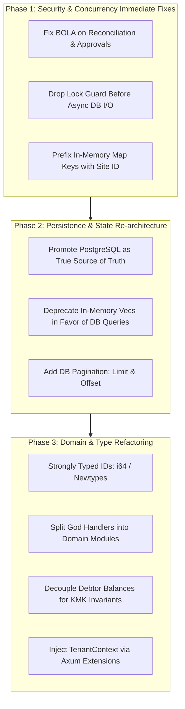

# SitePulse Backend Architecture Evaluation & Flaws Report

**Target System:** `apps/development-time/SitePulse/backend` (Rust, Axum 0.7, Tokio, PostgreSQL, deadpool-postgres, rust_decimal)  
**Evaluation Scope:** System Architecture, Concurrency Model, Multi-Tenancy Isolation, Data Flow & Persistence, API & Middleware Design, Domain Integrity  
**Date:** November 2026

---

## Executive Summary

The SitePulse backend was engineered as a high-performance Rust service using Axum, Tokio, and PostgreSQL to handle residential property and dues accounting under Turkish Condominium Law (Kat Mülkiyeti Kanunu - KMK). While recent remediation cycles resolved several severe cryptographic and authentication issues (e.g., implementing Argon2id, signed JWTs, and HMACS), the **underlying architecture retains critical structural defects**.

The system suffers from an **In-Memory State Paradox**: PostgreSQL is not treated as the true system of record for operational queries; instead, the entire database is eagerly loaded into RAM on startup and held inside an `Arc<RwLock<AppStateInner>>`. This fundamental architectural choice creates severe bottlenecks in concurrency, eliminates horizontal scalability, induces multi-tenant data leaks, and creates dual-write state divergence.

---

## Architectural Flaw Matrix

| # | Flaw Category | Architectural Impact | Severity | Primary Files |
|---|---|---|---|---|
| **AF-01** | **In-Memory Dual-State Paradox** | Zero horizontal scalability; OOM risk on large datasets; dual-write state drift. | **CRITICAL** | `state.rs`, `db/sync.rs`, `handlers/mod.rs` |
| **AF-02** | **Coarse Global Lock Contention & Starvation** | Single global `RwLock`; holding write lock across async DB I/O risks server-wide deadlock/freeze. | **CRITICAL** | `state.rs`, `scheduler.rs`, `services/saas_tenant_service.rs` |
| **AF-03** | **Multi-Tenant Authorization & BOLA Leaks** | `get_reconciliation_queue` and `approve_registration` allow cross-tenant data exfiltration & unauthorized actions. | **CRITICAL** | `handlers/mod.rs`, `auth.rs`, `registration_approval_service.rs` |
| **AF-04** | **Un-namespaced In-Memory Multi-Tenant Collisions** | `unit_members` keyed by un-prefixed flat numbers (`"14"`, `"d-14"`), causing cross-site data overwrites. | **HIGH** | `site_admin_service.rs`, `state.rs` |
| **AF-05** | **Middleware Wire-Tampering (Body Rewriting)** | Intercepts, buffers, parses, mutates, and re-serializes JSON payloads in middleware; double deserialization. | **HIGH** | `auth.rs` |
| **AF-06** | **Domain Invariant & Accounting Logic Violations** | Advance balances coalesce owner and tenant funds, violating KMK statutory rules during auto-offset. | **HIGH** | `handlers/mod.rs`, `dues_repository.rs` |
| **AF-07** | **Destructive Semantic Deletion (Cascade of Physical Entities)** | Deleting a home-owner drops the physical `IndependentUnit` and purges financial history. | **HIGH** | `site_admin_service.rs` |
| **AF-08** | **ID Representation & Schema Impedance Mismatch** | Rust models use `String` while DB uses `BIGINT`; fragile 21-prefix parsing logic (`parse_id_to_i64`). | **MEDIUM** | `db/base.rs`, `models/mod.rs` |
| **AF-09** | **God Modules & Layering Leakage** | 4,000+ line handlers file; services execute raw SQL directly, bypassing repository layer. | **MEDIUM** | `handlers/mod.rs`, `site_admin_service.rs` |
| **AF-10** | **Unbounded Queries & Missing Pagination** | Payment streams and reconciliation queues clone and return unbounded vectors into JSON. | **MEDIUM** | `payment_tracking_service.rs`, `handlers/mod.rs` |

---

## Detailed Architectural Findings

### 1. In-Memory Dual-State Paradox & Horizontal Scalability Block (AF-01)
- **Location:** `state.rs` 31–68, `db/sync.rs` 25–60
- **Mechanism:**
  `AppState` maintains an in-memory representation of nearly all database entities (`Vec<Site>`, `Vec<User>`, `Vec<IndependentUnit>`, `Vec<DuesLiability>`, `Vec<PaymentReceipt>`, `Vec<PaymentEntry>`, etc.) wrapped in `Arc<RwLock<AppStateInner>>`. At startup, `load_all_from_db` executes unbounded queries (`SELECT * FROM sites`, `SELECT * FROM users`, etc.) loading all tenants' history into memory.
- **Architectural Consequences:**
  1. **Zero Horizontal Scalability:** The backend cannot be scaled horizontally. If two replicas run behind an Application Load Balancer (ALB), each maintains its own isolated in-memory cache without distributed cache invalidation. A write on Node 1 is invisible to Node 2.
  2. **High Memory Overhead & OOM:** In an enterprise or SaaS deployment with 10,000 units and 500,000 dues/payments, loading everything into RAM consumes gigabytes of heap and dramatically lengthens boot times.
  3. **Linear Scan Penalties:** Read endpoints perform linear scans ($O(N)$) over `Vec` collections (e.g., `inner.dues.iter().filter(...)`), discarding PostgreSQL's indexed B-Tree access paths ($O(\log N)$).

---

### 2. Coarse-Grained Lock Contention & Starvation Cascade (AF-02)
- **Location:** `services/saas_tenant_service.rs` 34–81, `scheduler.rs` 56–128
- **Mechanism:**
  Services acquire an exclusive `RwLockWriteGuard` on `AppStateInner` and **hold it across `.await` suspension points** while communicating over the network with PostgreSQL:
  ```rust
  let mut inner = self.state.inner.write().await;
  // ...
  let reg = crate::db::create_site_with_manager_and_blocks(pool, ...).await?; // ASYNC DB CALL UNDER LOCK
  ```
- **Architectural Consequences:**
  1. **Connection Pool Starvation Deadlock:** If the database pool is temporarily saturated or under heavy load, `pool.get().await` pauses the thread while holding the global in-memory write lock. All subsequent incoming read and write requests across all tenants immediately block on acquiring the lock, resulting in an application-wide hang.
  2. **Batch Accrual Monopolization:** In `scheduler.rs`, `run_periodic_accrual_for_all_sites` holds `state.inner.write().await` while sequentially inserting dues for all units across all sites and persisting ledger snapshots. During this batch cycle, the web server is unresponsive to API traffic.

---

### 3. Multi-Tenancy Leaks & Broken Object-Level Authorization (AF-03)
- **Location:** `handlers/mod.rs` 1052–1057, 799–809
- **Mechanism:**
  1. **Reconciliation Queue Exposure:**
     Endpoint `GET /api/v1/bank/statements/reconciliation-queue` requires `SiteStaff` role, but its handler simply clones the entire queue without filtering by `site_id`:
     ```rust
     pub async fn get_reconciliation_queue(State(state): State<AppState>) -> Json<Vec<ReconciliationMatch>> {
         let inner = state.inner.read().await;
         Json(inner.reconciliation_queue.clone())
     }
     ```
     A site manager from Site B calling this endpoint sees all bank transactions, sender IBANs, payer names, and debt matches of Site A.
  2. **BOLA in Registration Approvals:**
     `POST /api/v1/registration/approve/:id` and `POST /api/v1/registration/reject/:id` do not validate that the requested `request_id` belongs to the site administered by the caller's JWT token. Any site manager can approve or reject tenant registrations across any site on the platform.

---

### 4. Un-Namespaced In-Memory Multi-Tenant Key Collisions (AF-04)
- **Location:** `services/site_admin_service.rs` 577–584, 996–1001
- **Mechanism:**
  To accommodate multiple ID conventions, the service inserts member DTOs into `inner.unit_members` under multiple keys:
  ```rust
  inner.unit_members.entry(unit_id.clone()).or_default().push(member_dto.clone());
  inner.unit_members.entry(request.unit_no.to_string()).or_default().push(member_dto.clone());
  inner.unit_members.entry(format!("d-{}", request.unit_no)).or_default().push(member_dto);
  ```
- **Architectural Consequences:**
  Unit numbers (e.g. `14` or `d-14`) are not globally unique; they exist within almost every site. Storing them in a single global `HashMap<String, Vec<UnitMemberDto>>` without a `site_id` prefix causes cross-site data collision: residents from Site 1 appear in the household list of Flat 14 in Site 2.

---

### 5. Middleware Wire-Tampering Anti-Pattern (AF-05)
- **Location:** `auth.rs` 489–508
- **Mechanism:**
  In `require_auth`, for every mutating HTTP request (`POST`, `PUT`, `PATCH`), the middleware:
  1. Consumes the incoming body stream into an in-memory buffer (`to_bytes`).
  2. Deserializes the buffer into a `serde_json::Value`.
  3. Mutates the JSON AST in-place to enforce/inject `site_id` and `unit_id`.
  4. Serializes the JSON value back into bytes and replaces the request body.
- **Architectural Consequences:**
  - **Double Deserialization Overhead:** Every API write payload is deserialized twice (first by the middleware, then by the Axum route handler's `Json<T>` extractor).
  - **Violation of Layering:** Multi-tenant boundaries should be asserted by injecting validated claims (`Extension<Claims>` or `TenantContext`) into handlers and letting domain repositories enforce tenancy, not by rewriting raw HTTP bodies on the wire.
  - **Incompatibility with Streaming:** Breaks streaming requests, multipart file uploads, or non-JSON payloads.

---

### 6. KMK Accounting Invariant Violations: Advance Balance Coalescing (AF-06)
- **Location:** `handlers/mod.rs` 85–128, `db/dues_repository.rs` 205–238
- **Mechanism:**
  While PostgreSQL maintains `advance_balances` partitioned by `(unit_id, debtor_type)` (`OWNER` vs `TENANT`), `AppStateInner` coalesces this into `HashMap<String, Decimal>` (one balance per unit).
  When `apply_advance_payments_offset` runs:
  - It iterates over all unpaid dues of the unit regardless of whether `due.debtor_type` is `OWNER` or `TENANT`.
  - It applies the unit's single advance balance to clear whichever debt is oldest.
  - In `save_advance_balance`, any surplus is assumed to be `TENANT` credit.
- **Architectural Consequences:**
  Under the Turkish Condominium Law (KMK Article 20), **tenants are strictly liable only for operational dues**, whereas **owners are liable for capital improvements and fixture investments**. Coalescing these funds in memory allows a tenant's advance money to pay off the landlord's capital dues, violating legal and statutory accounting invariants.

---

### 7. Destructive Entity Deletion Semantics (AF-07)
- **Location:** `services/site_admin_service.rs` 1356–1400
- **Mechanism:**
  In `delete_home_owner`, when removing an owner:
  ```rust
  inner.units.retain(|u| !(target_unit_ids.contains(&u.id) || target_unit_nos.contains(&u.unit_number)));
  inner.dues.retain(|d| !target_unit_ids.contains(&d.unit_id));
  ```
- **Architectural Consequences:**
  The domain action is intended to dissociate an owner or resident from a unit. Instead, the backend purges the physical `IndependentUnit` itself from the system, while also deleting all historical debts, dues, and advance accounts associated with the unit. This violates relational integrity and accounting audit retention.

---

### 8. ID Representation & Schema Impedance Mismatch (AF-08)
- **Location:** `db/base.rs` 64–85, `models/mod.rs`
- **Mechanism:**
  Rust models define IDs as `String` (`id: String`, `site_id: String`, `unit_id: String`), whereas PostgreSQL tables define primary and foreign keys as `BIGINT`.
  To bridge the gap, the application relies on `parse_id_to_i64` and `require_id` across 60+ call sites, inspecting a hard-coded list of 21 prefixes:
  `["site-", "unit-", "d-", "b-", "borc-", "person-", "kisi-", "blk-", "blok-", "sba-", "txn-", "cproj-", ...]`
- **Architectural Consequences:**
  - Fragile type conversion throughout all repository and service boundaries.
  - Inability to utilize Rust's type system to distinguish entity IDs at compile time.
  - Redundant string allocations and parsing operations on every request and database query.

---

### 9. Monolithic Modules & Layering Leaks (AF-09)
- **Location:** `handlers/mod.rs` (4,030 lines), `services/site_admin_service.rs` (2,257 lines)
- **Mechanism:**
  1. Handlers directly implement domain logic, mutate state, and trigger database queries.
  2. Services frequently execute ad-hoc SQL strings (`client.query`, `client.query_opt`) rather than delegating to repository interfaces in `src/db/`.
  3. Services tightly couple to the concrete `AppState` struct rather than abstract repository traits (`dyn UserRepository`, `dyn DuesRepository`), making isolated unit testing impossible without instantiating the complete global state.

---

### 10. Unbounded Queries & Lack of API Pagination (AF-10)
- **Location:** `services/payment_tracking_service.rs` 80–185, `handlers/mod.rs` 550, 625
- **Mechanism:**
  Endpoints querying payment streams, dues liabilities, units, and reconciliation queues lack pagination parameters (`page`, `page_size`, or cursor-based pagination).
  In `get_payment_stream`, the service clones all payment entries from memory, filters them using in-memory predicates, and serializes the entire vector into JSON.
- **Architectural Consequences:**
  Under normal operational growth, response payload size and JSON serialization latency will degrade linearly, exhausting client memory and network bandwidth.

---

## Architectural Remediation Roadmap



---

## Verification Review & Reviewer Comments

**Review date:** 2026-11-07
**Method:** Static re-reading of every cited file and line range against the current `master` working tree (`backend/src`, `backend/migrations`). Every claim was traced to the code. Nothing was reproduced at runtime, and no test suite was run for this review: only this document changed, and no source code. Paths below are relative to `backend/src/` unless they say otherwise.

### Verdict Summary

| # | Verdict | Line refs | Severity (original → reviewed) | Note |
|---|---|---|---|---|
| AF-01 | **Confirmed** | Accurate | CRITICAL → CRITICAL | `AppStateInner` holds 27 collections; `load_all_from_db` loads every tenant with no filters. |
| AF-02 | **Confirmed, wording corrected** | Accurate | CRITICAL → CRITICAL | This is an indefinite stall, not a deadlock. No pool wait timeout makes it worse (see below). |
| AF-03 | **Confirmed, wider than reported** | Accurate | CRITICAL → CRITICAL | The model has no `site_id`. `confirm_reconciliation` is also unscoped. |
| AF-04 | **Confirmed, mechanism corrected** | Accurate | HIGH → HIGH | Entries are appended, not overwritten. Collisions also happen *within* one site and reach JWT issuance. |
| AF-05 | **Partially confirmed** | Accurate | HIGH → MEDIUM | Re-serialisation happens only when `site_id` is missing. Non-JSON bodies pass through unchanged. |
| AF-06 | **Confirmed, worse than reported** | Accurate | HIGH → HIGH | Each restart also silently drops one debtor's balance bucket. |
| AF-07 | **Confirmed, understated** | Accurate | HIGH → **CRITICAL** | The delete is non-transactional and leaves partial data behind. In-memory filters cross tenants. |
| AF-08 | **Confirmed, count corrected** | Accurate | MEDIUM → MEDIUM | 184 call sites, not "60+". The parser ignores prefixes, which causes ID type confusion. |
| AF-09 | **Confirmed** | Accurate | MEDIUM → MEDIUM | 4,029 / 2,257 lines. There are no repository traits anywhere. |
| AF-10 | **Confirmed** | Accurate | MEDIUM → MEDIUM | `PaymentStreamFilter` has no paging fields. |

### Per-Finding Comments

**AF-01: In-memory dual state.** Confirmed in `state.rs:37-68` and `db/sync.rs` (20+ unfiltered `SELECT`s, e.g. lines 30, 143, 266, 399, 478). One addition: dual writes are not atomic. For example, `approve_registration` (`services/registration_approval_service.rs:148-170`) sets the status to `APPROVED` in memory, releases the lock, and then writes to PostgreSQL. If that DB write fails, the request returns an error but memory still says `APPROVED` until the next restart.

**AF-02: Lock held across `.await`.** Confirmed in `services/saas_tenant_service.rs:34-81` and `scheduler.rs:56-128`. Corrections and additions:
- "Deadlock" is the wrong term. The effect is head-of-line blocking or an indefinite stall. Tokio's `RwLock` is fair (FIFO), so one queued writer blocks every reader that arrives after it.
- `db/base.rs` sets **no deadpool wait timeout**, so `pool.get().await` can wait forever. The stall therefore has no upper bound. Set `PoolConfig::timeouts.wait` regardless of other fixes.
- The scheduler takes the global write lock **every 60 seconds** (`scheduler.rs:136`). It then runs an O(units × dues) existence scan, even in months when nothing needs to accrue.
- **Caveat on roadmap item F2 ("Drop Lock Guard Before Async DB I/O"):** today the held write guard is what serialises the memory and DB writes. Dropping it on its own allows lost updates and double accrual between the snapshot and persist steps. F2 should ship together with DB-first writes (Phase 2), or with per-site locking. It should not be a standalone quick fix.

**AF-03: BOLA / tenant leaks.** Confirmed in `handlers/mod.rs:799-821` and `1052-1057`. The middleware (`auth.rs:258-279`) only extracts tenant IDs from `residents/`, `units/`, `home-residents/…`, `site-admin/units|home-owners/…` and `site-admin/bank-account/…` paths. `/registration/approve|reject/:id` is not in that list, so no check runs. Additional observations:
- **Root cause:** `ReconciliationMatch` (`models/mod.rs:931-945`) has **no `site_id` field**, even though the DB column exists and is `NOT NULL` (`migrations/V12__financial_and_tenancy_remediation.sql:70-82`). The handler *cannot* filter by tenant without first changing the model. Unmatched items have no `matched_unit_id`, so a join through units cannot fix this either.
- **New, same class:** `confirm_reconciliation` (`handlers/mod.rs:1058+`) looks up `payload.match_ids` across the global queue with no site check. A manager of Site B can therefore confirm Site A's matches, which **mutates Site A's dues ledger and advance balances**. This is more severe than the read leak.
- `reject_registration` (`registration_approval_service.rs:399-418`) does not check that the status is still `PENDING`, so an already-approved application can be flipped to `REJECTED`.

**AF-04: Un-namespaced `unit_members` keys.** Confirmed in `services/site_admin_service.rs:577-583` and `996-1001`. Corrections:
- Entries are **appended** (`entry().or_default().push`), not overwritten. The leak comes from the read side's fallback chain at `996-1001`. If a unit has no entry under its own ID, it shows the list stored under a bare flat number, which may belong to any site.
- The collision also happens **within a single site**. The DB-ID key (`unit_numeric_id.to_string()`, e.g. `"14"`) and the flat-number key (`request.unit_no.to_string()`, e.g. `"14"`) share one namespace.
- After a restart, `db/sync.rs:569-597` rebuilds the map using DB-ID keys only, so the legacy keys disappear. The same query can return different households before and after a restart.
- **Security impact (plausible, not reproduced):** `AuthService::resolve_unit_id` (`services/auth_service.rs:53-59`) iterates `unit_members` in `HashMap` order, which is non-deterministic. It returns the *first key* whose members match the user's email, and that key becomes the JWT `unit_id` (`auth_service.rs:96, 306, 404`). For a household member, this could be a flat-number key such as `"14"`. `check_unit_access` would then authorise access to DB unit 14, which may be a different unit.

**AF-05: Body-rewriting middleware.** Partially confirmed in `auth.rs:489-519`. Corrections:
- The body is **re-serialised only when `site_id`/`siteId` is absent**. Otherwise the original bytes are forwarded unchanged. Requests from SaaS admins are not inspected at all.
- Non-JSON bodies, including multipart, fail `serde_json::from_slice` and are forwarded unchanged. So "breaks multipart" is not accurate. The real restriction is that every non-admin `POST/PUT/PATCH` is buffered and rejected with **413 above 2 MiB** (`MAX_INSPECTED_BODY_BYTES`, `auth.rs:37`). That blocks large statement or file uploads, and it rules out streaming.
- The double parse is real. On its own, though, it is a cost and layering problem rather than a HIGH defect, hence the downgrade to MEDIUM.
- **Security gap not in the original report:** `check_body_scope` (`auth.rs:410-428`) inspects **top-level keys only**. A tenant ID nested inside an object or array (e.g. `items[].unit_id`) is never checked. This matters because AF-03 shows handlers rely on the middleware rather than checking tenancy themselves.

**AF-06: Advance balance coalescing.** Confirmed in `handlers/mod.rs:73-128` (the offset ignores `debtor_type`) and `db/dues_repository.rs:205-238`. It is worse than described:
- **Lossy reload:** `db/sync.rs:682-688` runs `SELECT unit_id, balance FROM advance_balances`, which has no `debtor_type`, no `SUM` and no `ORDER BY`, and stores the rows with `HashMap::insert`. Because the primary key is `(unit_id, debtor_type)` (`V12…sql:49`), a unit with both an OWNER and a TENANT row keeps only one of them in memory, chosen arbitrarily, after every restart.
- **The persisted OWNER bucket never decreases:** `save_advance_balance` only rewrites the TENANT row, as `max(total − others, 0)`. Once the TENANT bucket reaches zero, any further consumption of owner credit in memory is never written to the DB. The DB then overstates owner credit, and `advance_ledger_entries` records every change as TENANT.
- The KMK Art. 20 reading (tenants liable for operating expenses, owners for capital and fixtures) matches the debtor model already in the schema. This review did not independently check it against the legal text.

**AF-07: Destructive deletion.** Confirmed in `services/site_admin_service.rs:1293-1420`. Several problems make it worse than reported, so the severity is raised to CRITICAL:
- **Not transactional:** the DB branch (`1299-1350`) runs about 8 separate `DELETE`s with no transaction. `payment_receipts`, `advance_ledger_entries` and `payment_allocations` are `RESTRICT` FKs (`V14…sql:57-62`) and are never deleted. For any unit with receipts, `DELETE FROM units` fails *after* the dues, payment entries, occupancies and advance balances are already gone. The result is a permanent partial deletion that returns an error to the caller.
- **Errors are swallowed:** if `pool.get()` fails (`if let Ok(client)`), the DB step is skipped silently and the in-memory deletion still runs. `query_opt(...).ok().flatten()` also hides the error `query_opt` raises when more than one row matches.
- **Mixed ID spaces:** `WHERE id = $1 OR owner_person_id = $1 OR tenant_person_id = $1` compares a unit ID against person IDs. In memory, `u.id` is compared against `owner_user_id` (a user ID, which is a third ID space). A numeric ID can therefore match an unrelated unit.
- **Cross-unit and cross-tenant purge in memory:** `units.retain` (`1379-1385`) removes every unit in the site with the same *flat number*, including units in other blocks. `dues.retain` (`1388-1391`) also removes dues where `d.unit_id == n.to_string()` **with no site filter**. That deletes, in memory, the dues of whichever unit in any tenant has a DB ID equal to the flat number.

**AF-08: ID impedance mismatch.** Confirmed in `db/base.rs:70-85`. There are **184** call sites of `parse_id_to_i64` / `require_id`, not "60+". The more important point is that the parser **ignores prefixes**: `"site-5"`, `"usr-5"`, `"d-5"` and `"5"` all resolve to `5`. Likewise `auth::same_id` treats `"d-14"`, `"unit-14"` and `"14"` as equal. ID type confusion therefore reaches authorisation decisions (see AF-04 and AF-07), not just performance. Typed newtypes (roadmap T1) are a correctness fix, not just a cleanup.

**AF-09: God modules and layering.** Confirmed. Line counts are 4,029 (`handlers/mod.rs`) and 2,257 (`site_admin_service.rs`). Raw `client.query/execute` calls outside `db/` number 33 in `site_admin_service.rs`, 11 in `handlers/mod.rs`, and 2 each in `auth_service`, `payment_tracking_service` and `site_bank_account_service`. `db/` exposes only free functions and defines no repository traits.

**AF-10: No pagination.** Confirmed. `PaymentStreamFilter` (`models/mod.rs:1314+`) has filter fields but no `limit`/`page`/cursor. `get_reconciliation_queue` returns the whole global queue.

### Additional Findings Surfaced During Verification

| ID | Finding | Severity | Location |
|---|---|---|---|
| **NV-01** | `confirm_reconciliation` confirms any `match_id` platform-wide, so it can mutate another tenant's ledger. | CRITICAL | `handlers/mod.rs:1058+` |
| **NV-02** | `delete_home_owner` is a non-transactional multi-table delete. RESTRICT FKs cause partial deletions. | CRITICAL | `services/site_admin_service.rs:1299-1350` |
| **NV-03** | `advance_balances` reload drops one debtor bucket per unit on each restart. | HIGH | `db/sync.rs:682-688` |
| **NV-04** | The JWT `unit_id` may be resolved from a non-deterministic, un-namespaced `unit_members` key. | HIGH (plausible) | `services/auth_service.rs:53-59` |
| **NV-05** | Tenant-scope checks on bodies cover top-level keys only, so nested IDs are unchecked. | MEDIUM | `auth.rs:410-428` |
| **NV-06** | No deadpool wait timeout, so `pool.get()` can block forever while the global lock is held. | MEDIUM | `db/base.rs` |
| **NV-07** | `reject_registration` skips the `PENDING` check, so an approved application can be re-rejected. | LOW | `services/registration_approval_service.rs:399-418` |

### Comments on the Remediation Roadmap

1. **Phase 1 order:** fix NV-01 alongside the AF-03 items. It is a write-side BOLA, so it is more urgent than the read leak. AF-03 cannot be fixed without first adding `site_id` to `ReconciliationMatch`, so plan for that model and sync change.
2. **Phase 1, F2:** see the AF-02 caveat. Releasing the guard before DB I/O is unsafe without DB-first writes or per-site locks. A safer quick win is to configure a pool wait timeout (NV-06) and move the scheduler's existence scan out of the write lock.
3. **Phase 1, add an item:** wrap `delete_home_owner` in a single DB transaction, and change it from a hard delete to dissociation or soft-delete (NV-02, AF-07). This stops data loss right away.
4. **Phase 1, F3 ("Prefix map keys with Site ID"):** prefixing alone is not enough. The DB-ID and flat-number namespaces must also be separated, or the map should be keyed only by DB unit ID. `resolve_unit_id` must stop iterating the map.
5. **Phase 3, T1 (typed IDs):** move this earlier, or at least add prefix-aware parsing. Several authorisation paths depend on ID equality.
6. **Testing:** each confirmed finding should get a regression test in the existing harness. Cross-tenant tests should cover AF-03, NV-01 and AF-04. A restart round-trip test should cover NV-03, and a delete-with-receipts test should cover NV-02. That way each fix gets checked by the Maker-Checker gates.

---

## Remediation Status & Multi-Tenancy Guardrails (8 November 2026)

This section covers a second review on top of commit `258eedc` ("migrate in-memory state and
lookups to database persistence") and the changes made after it. Every item below was reproduced
against the code first. The confirmed leaks also have regression tests that **fail on `258eedc`
and pass now**.

### New findings (not in the matrix above)

| ID | Finding | Severity | Status |
|---|---|---|---|
| **NF-01** | `GET /residents/:unit/dashboard` and `GET /site-admin/overview` took the global **write** lock, ran the advance offset (settling dues from advances), and wrote the result back. The overview did this for every tenant on each load. | CRITICAL | Fixed: GETs take a read lock and never write |
| **NF-02** | Ledger persistence wrote **absolute** values from memory (`sync_due_payment_state`, `save_advance_balance`, `sync_all_in_memory_to_db`). A stale cache could overwrite a committed payment. A balance "rise" was booked as `ADJUSTMENT_CREDIT`, creating advance money that was never paid. `version` was incremented but never checked. | CRITICAL | Fixed: all three removed. Offsets are now same-debtor virman receipts (receipt, entry, allocations, `VIRMAN_DEBIT`) in one locked, tenant-bound transaction. `v_integrity_violations` stays clean, and offsets can be reversed |
| **NF-03** | `GET /payments/homeowner-records` ignored `site_id`. Any site manager received **every tenant's** payment records (payer names, amounts, references). | CRITICAL (leak) | Fixed: scoped through `TenantScope`, filtered in SQL. Tests: `homeowner_payment_records_are_confined_to_their_site`, `tenant_data_never_crosses_sites` |
| **NF-04** | `/capital-projects/:id` (read, installments, unit shares, disbursements) and its writes (`accrue-installment`, `disbursements`) never checked the project's site. Another site's manager could read a project (contractor IBAN included), accrue dues on that site's units, or record payouts against it. | CRITICAL (leak) | Fixed: `scoped_capital_project` returns 404 for a foreign project. Test: `capital_projects_are_confined_to_their_site` |
| **NF-05** | The global lock was held across database I/O in 10 places. The worst, `provision_site_units`, re-upserted every tenant's data while holding it. | HIGH | Fixed: reloads build the state outside the lock and swap it in, and provisioning persists only its own site's rows |
| **NF-06** | Financial reads hid database errors. The payment stream returned `[]`, and debt aging fell back to the stale cache. | HIGH | Fixed: `LedgerReadError` becomes a 503 |
| **NF-07** | Hard-coded tenant fallbacks put unattributable data into site 1: `unwrap_or_else(|| "1")` in 5 places, plus `"site-begonya"` as the default site for dues periods. | HIGH | Fixed: unknown sites stay empty, so no tenant can see the data |
| **NF-08** | `auth::same_id` treated `d-5`, `site-5` and `5` as equal across entity kinds. | MEDIUM | Fixed: the comparison is kind-aware (a bare number still matches) |
| **NF-09** | `/system/clear-all-data` (a platform-wide wipe) had no production guard, and the reset handlers reported success after database errors. | MEDIUM | Fixed |
| **NF-10** | The scheduler had no cross-instance guard. | MEDIUM | Fixed: `pg_try_advisory_lock` around each tick |

### Guardrails added (defence in depth)

1. **`TenantScope` extractor** (`src/tenancy.rs`) is built from the verified token only. It fails
   closed (401 without claims, 403 for an empty site claim). All 36 handlers that accept a
   `site_id` pin it through the scope, and handlers for path object ids check ownership and return
   404 for foreign objects.
2. **PostgreSQL row-level security** (migration V19) covers 32 tenant-keyed tables.
   `db::tx_bind_tenant` sets `app.tenant_site_id` for the transaction only and runs
   `SET LOCAL ROLE sitepulse_tenant`, a role without BYPASSRLS. RLS therefore applies even
   though the service connects as a superuser or as the table owner, and it rejects foreign
   writes through `WITH CHECK`. The payment, transfer, reversal and home-owner delete
   transactions, and the single-site payment read, are tenant-bound.
3. **Static gates:** `tenant_isolation_lint.py` (`tenant-lint`) and `lock_scope_lint.py`
   (`lock-lint`). Run on `258eedc`, they report 83 tenant findings and 10 lock findings; the
   current tree has none.
4. **PostgreSQL tests:** `tests/db_tenant_isolation_tests.rs` (gate `rust-db-test`) covers RLS
   isolation and write rejection, read-only GETs, transactional accrual offsets with zero
   integrity violations, cross-site listing isolation, and 503 on database loss.
5. **Structure:** `handlers/mod.rs` is down from 4,391 lines to a 69-line index over domain
   modules (`dashboard`, `reconciliation`, `dues`, `payments`, `system`, `capital`, …).

### Status of the original matrix

| ID | Status |
|---|---|
| AF-01 | **Partly fixed.** PostgreSQL is now authoritative for every ledger write and no path writes memory back over it. The in-memory read model still exists and is loaded whole at start-up, so the service remains single-instance. |
| AF-02 | **Fixed** for database I/O (`lock-lint`). The lock is still global (one lock for all tenants). |
| AF-03 / NV-01 | Fixed earlier; the scope now also guards it at the handler level. |
| AF-05 / NV-05 | Fixed earlier (nested body scan). The handler-level `TenantScope` makes the middleware a second line of defence. |
| AF-08 | **Partly fixed:** kind-aware id comparison. Typed id newtypes are still open. |
| AF-09 | **Partly fixed:** handlers split by domain. `site_admin_service.rs` (2,799 lines, raw SQL) is still open. |
| AF-10 | **Open:** the payment stream paginates in memory after an unbounded SQL read. |

### Still open (recommended next steps)

1. **Remove the in-memory read model (AF-01).** Introduce repository traits (PostgreSQL plus an
   in-memory fake for unit tests), then migrate one aggregate at a time (dues and payments, then
   units and users, registrations, budgets, capital), deleting each `AppStateInner` field as it
   goes. After that, `load_all_from_db` and the start-up full load go away, and the service can
   run as several instances.
2. **Make RLS fail-closed.** Policies are permissive when no tenant is bound, because the
   start-up load and the platform jobs read across tenants. Once (1) is done, give platform jobs
   an explicit platform role and drop the `sp_tenant_site() IS NULL` branch.
3. **Use typed ids** (`SiteId(i64)`, `UnitId(i64)`) in `TenantScope` and the repositories, so a
   unit id cannot be passed where a site id is expected.
4. **Paginate in SQL** (`LIMIT`/keyset) for the payment stream and reconciliation queue.
5. **Make provisioning atomic.** `provision-site-units` now persists only its own site and
   reports errors, but it still uses one statement per row rather than one transaction.
