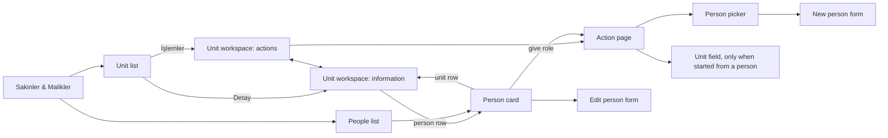
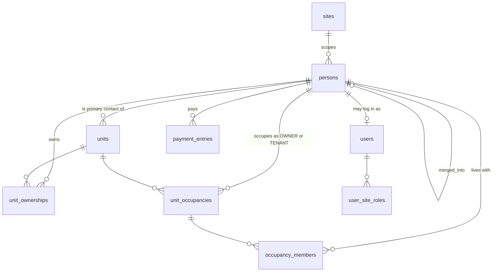

# Sakinler & Malikler: unit directory and person card, one design

Date: 14 November 2026

Status: proposed design for review; application implementation is outside this change

This document is the single reference for developing two proposals together:

- the compact unit directory with an actions-first unit workspace ([COMPACT_UNIT_DIRECTORY_ANALYSIS.md](COMPACT_UNIT_DIRECTORY_ANALYSIS.md), now a source document), and
- the person card (create a person once, use them as user, resident, owner or tenant).

Companion: [combined interactive draft](ux-reference/owners_residents_unified.html). It follows this document. The earlier single-topic drafts ([unit directory](ux-reference/compact_unit_directory.html), [its phone preview](ux-reference/mobile_unit_directory_preview.html), [person card](ux-reference/person_card.html)) are kept as sources.

## Recommendation

Build one module with two ways in and one set of parts.

1. **Find by unit.** A compact unit list. Every row has two entries: **İşlemler** opens a full-screen list of actions for that unit, and **Detay** opens its information. Actions are never hidden behind details.
2. **Find by person.** A people list and a person card. The card shows every role the person holds and offers the same actions from the person's side.
3. **One way to supply a person.** Every action that needs a person (move-in, title transfer, household, primary contact, registration) uses the same person field: search existing people first, create a card only when there is no match. No action screen has name, phone or email inputs.
4. **One way to write a person.** All backend flows resolve a person through one service with server-side duplicate rules.
5. **One list pattern.** The unit list and the people list share search, filter, sort, paging, state restoration and the mobile layout.

The two proposals depend on each other. The unit workspace moves every person-entering workflow to a new full-screen destination; that is the moment to replace their person inputs instead of moving nine sets of text fields and replacing them later.

## Evidence and limits

This analysis reads the source on master at `87ac7ac`. No running application, production data or user session was inspected. Row heights, task times, duplicate rates and data volumes are not measured; dimensions and criteria below are design targets. Counts are counts of code sites, not of records. All people in the drafts are fictional.

## How the two designs fit

| Topic | Unit directory proposal | Person card proposal | Unified decision |
| --- | --- | --- | --- |
| Starting point | A unit | A person | Both. The unit list is the default view of the module; the people list is its second tab. |
| "Kişiler" action group | Edit resident, edit or register owner, add household member, select primary contact | Person data is edited only on the card | The group becomes: open resident card, open owner card, register owner, add household member, select primary contact. "Edit" means opening the card. |
| Action destination | A full-screen page per action | A person field inside each workflow | The action page holds the unit context, the effective date and one person field. |
| Choosing a person | Not covered | Full-screen picker, then a create form | The picker and the form are further levels of the same back stack, with the same top and bottom return buttons. |
| Person from the card to a unit | Not covered | "Give this person a role" opens a workflow | The workflow needs a unit. Add a unit field (`SpUnitField`) that reuses the unit list's search. This is new work that neither proposal listed. |
| Detail tabs (residents, owners) | Lists of names and contacts | Person card rows | The tabs show person rows; a row opens the person card. The card's unit rows open the unit workspace. |
| Primary contact | A column and a "select" action | Not covered | A reference to a person, not a copy of their name and phone (gap G12). |
| Search | Client-side over all loaded units, including people and contacts | Server-side over people | One normalization (Turkish folding, phone key) for both. Client-side first for units; server-side for people from the start, for units after the benchmark. |
| List behavior | Paging, sort, density, filter page on phones, state restoration | Basic list with chips | One shared list scaffold; the people list gains the same behavior. |
| Contact data in lists | Not in the unit row; shown in detail | Shown on every person row | Unit rows show names only. Person rows and the card show contact data. |

Nothing in either proposal has to be dropped.

## Current state

### What already works

| Area | Evidence | Meaning for this design |
| --- | --- | --- |
| One person table, scoped to a site | [V21](../backend/migrations/V21__person_tenant_scope_and_account_activation.sql): `persons.site_id`, triggers `trg_person_site_*` | Keep. The card is a site-level record. |
| Roles are derived | [V23](../backend/migrations/V23__derived_person_roles.sql), [V30](../backend/migrations/V30__release_identity_uniqueness_for_archived_records.sql): view `v_person_roles` | Keep. `persons.person_type` is only a fallback. |
| Ownership and occupancy are separate facts; commands depend on state | [V31](../backend/migrations/V31__unit_state_model.sql), [unit_state.dart](../flutter/lib/domain/models/unit_state.dart), [EPIC-08](../.specify/requirements/EPIC-08-occupancy-lifecycle-and-dual-ledger-management.md) | The action list shows `allowed_commands`. Vacancy never implies a missing owner. |
| Identity uniqueness | Partial unique indexes on `(site_id, lower(email))` and `(site_id, national_id_hash)` | These are the hard duplicate rules. |
| Duplicate detection | [person_record_service.rs](../backend/src/services/person_record_service.rs): `match_reasons`; `POST /site-admin/persons/duplicate-check` | Reuse as the soft duplicate rule. |
| People directory, profile, import, export | [people_directory_page.dart](../flutter/lib/ui/residents/people_directory_page.dart), [person_profile_page.dart](../flutter/lib/ui/residents/person_profile_page.dart) | The profile page becomes the full card. |
| Unit search helpers | [resident_directory.dart](../flutter/lib/ui/residents/resident_directory.dart): owner, tenant, primary contact, household, contacts, unit, block | Keep this coverage in the compact list. |
| Full-screen navigation | [app_fullscreen_page.dart](../flutter/lib/ui/components/app_fullscreen_page.dart) | Reuse for the unit workspace, picker and card. Its 640 px default width must be widened for the desktop table. |
| Primary contact selection saved by the server | [responsible_contact_selection.dart](../flutter/lib/ui/residents/responsible_contact_selection.dart), `PUT /site-admin/units/:id/responsible-contact` | Keep the action; change what it stores (G12). |

### Gaps: unit directory

| # | Finding | Evidence | Effect |
| --- | --- | --- | --- |
| D1 | Every matching unit is rendered as a fully expanded card. | [owners_residents_module_page.dart](../flutter/lib/ui/residents/owners_residents_module_page.dart) maps the whole filtered list | The manager scrolls through complete workspaces before choosing a unit. All cards are built eagerly. |
| D2 | Each card mixes finding and operating. | [owners_residents_unit_card.dart](../flutter/lib/ui/residents/owners_residents_unit_card.dart): metadata, dues, primary contact, contacts, tabs, household, management actions | Units cannot be compared at a glance. Actions are far from the row on phones. |
| D3 | The page container is 640 px wide. | `AppFullscreenPage` default | A table does not fit without an explicit wider layout. |
| D4 | All units are held in the client. | The controller loads the site's units once | Client-side filtering is fine as a first step; it is not a statement about large sites. |

### Gaps: person data

| # | Finding | Evidence | Effect |
| --- | --- | --- | --- |
| G1 | Persons are inserted by 12 statements in 8 files, each with its own match rule. | `INSERT INTO persons` in `site_admin_service.rs` (488, 563, 1692), `occupancy_service.rs` (254), `registration_approval_service.rs` (225), `auth_service.rs` (562), `unit_repository.rs` (78, 109, 198), `user_repository.rs` (59, 218), `site_repository.rs` (214) | The same human becomes two rows when one flow has an email and another does not. |
| G2 | Every write path matches an existing person by email only. | e.g. `occupancy_service.rs:236`, `site_admin_service.rs:475` | A tenant entered without an email is always a new row. |
| G3 | The duplicate check is advisory and called from one screen. | `findPossibleDuplicates` is called only at `owners_residents_registration.dart:143` | Move-in, title transfer, household and tenant edits create people with no warning. |
| G4 | Only two commands accept an existing `person_id`. | `OccupancyTransitionRequest.person_id`, `TransferOwnershipRequest.new_owner_person_id`; registration, unit edit and household requests carry text only | The client cannot say "this person" in most flows. |
| G5 | The title transfer dialog does not use the `new_owner_person_id` the backend supports. | `owners_residents_occupancy.dart:545-567` | An existing tenant who buys the unit is typed again. |
| G6 | The one existing picker loads a single page of 100 people and has no search. | `owners_residents_occupancy.dart:139`; `MAX_PAGE_SIZE = 100` | In a larger site the rest cannot be picked. |
| G7 | A person cannot be created without a unit, and core fields are edited through the unit. | No `POST /site-admin/persons`; name and phone change through `PUT /site-admin/home-owners/:id` | Editing "the tenant of A-3" silently changes that person in every other unit. |
| G8 | Household members keep their own copy of name, phone and email; the link to the person is optional. | `occupancy_members.full_name/phone/email`, `person_id` nullable | The copy and the card can disagree. |
| G9 | A legacy path inserts a person with a user ID as the person ID and without a site. | `unit_repository.rs:78`, `:109` | Two ID spaces are mixed. |
| G10 | A person may have several active login accounts. | `idx_users_person_id` is not unique | "Has login" is ambiguous on the card. |
| G11 | Nine separate person field groups exist in three Flutter files. | `owners_residents_registration.dart` (owner, tenant, household entries), `owners_residents_edit.dart` (owner, tenant, add member, edit member), `owners_residents_occupancy.dart` (move-in, new owner) | Validation, labels and duplicate handling differ. |
| G12 | The primary contact is stored as a JSON copy of name, role, phone and email, and is selected by role and name. | [V32](../backend/migrations/V32__unit_responsible_contact.sql): `units.primary_responsible_contact JSONB`; `SelectResponsibleContactRequest { role, resident_name, member_id }` | A third copy of person data. It does not follow a later edit of the person, and two household members with the same name are ambiguous. |

## Design principles

1. **A unit row is for finding; a workspace is for acting.** Nothing is repeated per row that the manager has not asked for.
2. **Actions first.** On every screen size the action list is one tap from the row.
3. **A person is who; a role is what they hold.** Roles are never typed into the card.
4. **Reference, do not copy.** Workflows send a person reference. Tables store `person_id`.
5. **Search before create.** Creating is always possible, never the first thing offered.
6. **The server decides.** Allowed actions, role eligibility and duplicates come from the server; the client explains them.
7. **Edits are global and say so.** Changing a card states how many units it affects.
8. **Returning restores.** Query, filters, sort, page, scroll and focus survive every round trip.
9. **History is not rewritten.** Ledger rows keep the person ID they were written with.

## Information architecture



Each arrow is one level of a single back stack. The top back button, the persistent bottom return button on phones and browser Back/Forward all walk the same stack. The deepest path is five levels: list, actions, action page, picker, new person form. Saving the form returns to the action page with the person filled in, not to the picker.

### Unit list

- Header: title, site identity, entry to unit registration. Tabs: Daireler, Kişiler. House types stay reachable as secondary navigation.
- Summary in one line: total, occupied, vacant. On phones only the total.
- Toolbar: search always visible. Desktop: block, occupancy, sort, comfortable or compact density. Phone: a **Filtrele** button opens a full-screen filter and sort page; selections apply only on confirmation; the applied count stays visible on the list. Changing a filter resets to page 1. Clear resets search and filters.
- Result caption such as "1–25 / 240 daire", in a live region. The site summary and the filtered count are labelled separately.
- Desktop columns: unit, occupancy, resident, owner, primary contact, then separate İşlemler and Detay buttons.
- Unit cell: block and number in strong text; floor and housing type as secondary text.
- Resident cell: the tenant when rented, the owner when owner-occupied, "İkamet eden yok" when vacant. A missing owner is "Malik kaydı yok". Several owners show the first name and a count.
- Primary contact cell: the referenced person's name and role. It is never inferred from the tenant flag. The same person may appear in several columns.
- Names in these cells come from person cards. Phone, email, household, IBAN, history and ledgers are not in the list.
- No financial total by default. If added later, operating and capital are separate columns using the existing Decimal formatters; monthly dues are not relabelled as debt.
- Sort: unit number numerically within naturally ordered blocks, stable unit ID as tie-breaker.

### Unit workspace

İşlemler opens the action list with the unit identity and the current resident and owner as context. Detay opens the information mode. A switch (İşlemler / Daire bilgileri) moves between them on the same unit.

The information mode keeps the tabs overview, residents, owners, history; production financials keep separate operating and capital ledgers. Resident and owner tabs list person rows that open the person card.

### Action catalog

Only actions the server allows for the unit's state and the user's permissions are shown. Rows are about 72 px high on phones, with a label and a short explanation.

| Group | Action | Person input | Backend command | Shown when |
| --- | --- | --- | --- | --- |
| Kişiler | Open resident card | none | `GET /persons/:id` | An active occupancy exists |
| Kişiler | Open owner card | none | `GET /persons/:id` | An owner is on record |
| Kişiler | Register owner | person field | occupancy transition `RegisterOwner` | No owner on record |
| Kişiler | Add household member | person field + relationship | `POST /home-residents/members/:unit_id` | An active occupancy exists |
| Kişiler | Select primary contact | choose among owner, occupant, members | `PUT /units/:id/responsible-contact` with `person_id` | At least one person on the unit |
| İkamet | Tenant move-in, replace tenant, rent out | person field + date | occupancy transition | Per the EPIC-08 state matrix |
| İkamet | Owner move-in, owner takes back | choose among owners on record | occupancy transition | Per the state matrix |
| İkamet | Move-out | none (date, notes) | occupancy transition | An active occupancy exists |
| Mülkiyet | Title transfer | person field + date; step-up | `POST /units/:id/transfer-ownership` | An owner is on record |
| Daire | History, virtual IBAN | none | existing reads | Always |
| Diğer | Delete unit | none; full-screen confirmation | existing delete | Per existing eligibility; separated at the end |

The same catalog is reachable from the person card under "give this person a role": place as tenant, make owner, add to a household. From there the person is fixed and the unit is chosen with the unit field.

### People list and person card

The people list uses the list pattern above: search, role filters (owners, tenants, household members, no role, no login, activation pending), paging, a "new person" entry, import and export.

The person card has a header (name, role badges, login state), contact, masked identity number, login account, a timeline of units and roles (active first), and the allowed role actions. Unit rows open the unit workspace.

## Entity design

### Roles as relationships

| Role shown on the card | Stored as | Created by |
| --- | --- | --- |
| Kat maliki (owner) | active `unit_ownerships` row | registration, title transfer |
| Malik sakin (owner occupant) | active `unit_occupancies` row, type `OWNER` | owner move-in |
| Kiracı (tenant) | active `unit_occupancies` row, type `TENANT` | tenant move-in |
| Hane üyesi (household member) | `occupancy_members` row | add member, invite link |
| Birincil muhatap (primary contact) | `units.primary_contact_person_id` (proposed) | select primary contact |
| Kullanıcı (login user) | active `users` row with `person_id` | invitation, activation |
| Yönetici / denetçi | `users.role`, `user_site_roles` | site administration |
| Ödeyen (payer) | `payment_entries.payer_person_id`, `payment_receipts.payer_person_id` | payments |
| No role | person with none of the above | direct card creation |

The same person can hold several rows at once: owner of A-12, tenant of D-1, primary contact of both and a login user.



### Schema changes (proposed migration V33)

V32 is taken by the primary contact column on master.

| Change | Reason | Precondition |
| --- | --- | --- |
| `persons.phone_key VARCHAR(10)`, `persons.name_key VARCHAR(120)`; index `(site_id, phone_key)`; trigram or prefix index on `(site_id, name_key)` | Person search, unit search by person and duplicate matching run in SQL with one normalization. Values come from the existing `phone_key` and `name_key` functions. | Backfill. |
| `persons.version INTEGER NOT NULL DEFAULT 0`, `created_at`, `updated_at` | Optimistic concurrency for card edits; `units.version` is the precedent. | None. |
| `persons.merged_into_person_id BIGINT REFERENCES persons(id)` | Merge leaves a tombstone instead of rewriting the append-only payment ledger. | None. |
| `CHECK (site_id IS NOT NULL OR person_type = 'SAAS_ADMIN')` | Closes G9. | Report rows with `site_id IS NULL`; fix `unit_repository.rs:78/109`. |
| `occupancy_members.person_id NOT NULL`; drop `full_name`, `phone`, `email` after one release | Closes G8. | Backfill a person per unlinked member. |
| `units.primary_contact_person_id BIGINT REFERENCES persons(id)`; `primary_responsible_contact` JSONB becomes a read projection, then is dropped after one release | Closes G12. A commit check requires the person to be an owner, the occupant or a member of that unit; when that stops being true the reference is cleared. | Backfill by matching the stored `member_id` or the role to the unit's current people. Report rows that match nobody. |
| Unique index `users (person_id) WHERE is_active AND person_id IS NOT NULL` | Closes G10. | Count violations first; list them for a manual decision. |
| `persons.person_type` nullable, no longer written for residents | The role is derived. A card with no role is valid. | `v_person_roles` returns `NONE` for such residents. |

Not proposed now: splitting `full_name`, sharing a person across sites (V21 removed that on purpose), organization owners (see open questions). Phone is deliberately not unique: families share a number, so a phone match is a warning.

### Views

| View | Columns | Used by |
| --- | --- | --- |
| `v_unit_directory` (new) | one row per non-deleted unit: block, number, floor, housing type, ownership and occupancy state, occupant `person_id` and name, owner count and first owner `person_id` and name, primary contact `person_id`, name and role, `search_keys` (folded names, phone keys and emails of owner, occupant, members and primary contact) | unit list rows, sort, filter and, later, server-side search |
| `v_person_roles` (exists; extend) | add `is_owner`, `is_owner_occupant`, `is_tenant`, `is_member`, `is_primary_contact`, `login_state` | role badges, filters |
| `v_person_card` (new) | one row per non-archived, non-merged person: contact, masked national ID, role flags, unit counts, `unit_labels text[]`, `login_state`, `version` | people list, picker search, card header. Replaces the `SUMMARY_SELECT` string in `person_directory_service.rs`. |
| `v_person_unit_relations` (new) | one row per period: `person_id`, `unit_id`, `relation`, `start_date`, `end_date`, `active` | card timeline; residents and owners tabs of the unit |
| `v_integrity_violations` (exists; add checks) | person without site, member without person, several active users per person, reference to a merged person, primary contact not on the unit | schema integrity gate |

All views filter by `site_id` and run under the row-level security of V25.

## Backend design

### One write path

```text
handlers  ->  services::PersonService            ->  db::person_repository
              resolve(tx, site, PersonRef, ctx)       the only module containing
              create / update / merge / archive       INSERT INTO persons or
              search / duplicates                     UPDATE persons (core fields)
```

```rust
pub enum PersonRef {
    Existing { person_id: i64 },
    New { card: NewPerson, confirm_distinct: bool },
}
pub struct NewPerson {
    pub full_name: String,
    pub phone: Option<String>,
    pub email: Option<String>,
    pub national_id: Option<String>,
}
```

`resolve` runs inside the caller's transaction, so an action and the person it creates commit or roll back together. `Existing`: select `FOR UPDATE` in the caller's site; reject archived or merged cards. `New`: normalize, validate, run the duplicate rules, insert; on a unique-index conflict, re-read and report it.

A rule in `scripts/rust_standards_lint.py` fails the build when `INSERT INTO persons` appears outside `db/person_repository.rs`.

### Endpoints

| Method and path | Purpose | Permission |
| --- | --- | --- |
| `GET /site-admin/persons/search?q=&context=&unit_id=&limit=` | Type-ahead for the picker. Returns card summaries and `eligibility` for the context. | `PersonRead` |
| `POST /site-admin/persons` | Create a card with no role. | `PersonManage` |
| `GET /site-admin/persons/:id` (exists) | Add role flags, `version`, `allowed_actions`. | `PersonRead` |
| `PATCH /site-admin/persons/:id` | Edit name, phone, email. Requires `version`. | `PersonManage` |
| `POST`, `DELETE /site-admin/persons/:id/login` | Open or remove the login account. | `PersonManage`; removal needs step-up |
| `POST /site-admin/persons/:id/merge` | Merge this card into another. | `PersonManage` + step-up |
| `DELETE /site-admin/persons/:id` | Archive. Refused while a relationship is active. | `PersonManage` |
| `GET /site-admin/units/directory?q=&block=&occupancy=&sort=&page=&page_size=` | Paged unit rows and counts from `v_unit_directory`. Introduced only after the benchmark calls for it; until then the client filters the list it already loads, with rows shaped like this response. | `PersonRead` |
| `GET /site-admin/units/:id/occupancy-state` (exists) | `allowed_commands` drives the action list. | `PersonRead` |
| existing `national-id`, `preferences`, `import`, `export`, `duplicate-check` | Unchanged. | unchanged |

Action commands gain a `PersonRef` and keep their inline fields for one release (mapped to `PersonRef::New` on the server):

| Command | New field |
| --- | --- |
| `POST /site-admin/home-owners` | `owner: PersonRef`, `tenant: Option<PersonRef>`, `members: [{person: PersonRef, relationship}]` |
| `PUT /site-admin/home-owners/:id` | unit data only; person fields removed after the deprecation release |
| `POST /site-admin/units/:id/occupancy-transitions` | `person: PersonRef` |
| `POST /site-admin/units/:id/transfer-ownership` | `new_owner: PersonRef` |
| `POST /home-residents/members/:unit_id` | `person: PersonRef`, `relationship` |
| `PUT /site-admin/units/:id/responsible-contact` | `person_id` (replaces role + name) |
| `POST /registration/approve/:id` | optional `person_id` to link the request to an existing card |

Search response item:

```json
{
  "person_id": 42, "full_name": "Ayşe Demir", "email": "ayse@example.test", "phone": "0555 000 00 01",
  "roles": ["OWNER", "OCCUPANT_OWNER"], "unit_labels": ["A-12", "D-1"], "login": "ACTIVE", "version": 3,
  "eligibility": { "allowed": false, "code": "ALREADY_OWNER_OF_UNIT" }
}
```

Duplicate response (`409`): `PERSON_POSSIBLE_DUPLICATE` with `overridable: true`, candidates and reasons (`PHONE`, `NAME`); or `PERSON_IDENTITY_TAKEN` (same email or national ID) with `overridable: false`. Both carry `trace_id`.

### Controls

| Control | Rule |
| --- | --- |
| Site scope | `site_id` comes from the authorization context, never from the body. RLS (V25) and the `trg_person_site_*` triggers remain the second line. |
| Normalization | Email through `NormalizedEmail`; phone through `validate_phone` and `phone_key`; name trimmed and collapsed, `name_key` through `fold_turkish`. Unit search and person search use the same keys. |
| Required data | Name always. Email only when a login is requested. No contact data is required for a household member. |
| Hard duplicate | Same email or national ID hash in the site: rejected, with the existing card returned. |
| Soft duplicate | Same phone key, same folded name, or name within one edit: rejected with candidates unless `confirm_distinct`. The override is audited. |
| Action availability | `allowed_commands` from the unit state machine, plus permissions. The client shows only these; the server checks again on submit. |
| Role eligibility | The unit state machine and the V31 commit checks: a tenant is not an owner of the same unit; an owner session belongs to an owner on record. Search reports the same answer in `eligibility`. |
| Primary contact | Must be an owner, the occupant or a member of the unit. Does not change the owner, tenant or debtor. |
| Concurrency | `PATCH` requires `version`. `resolve` locks the person row; unit commands lock the unit as today. |
| Email change | A person with an active login goes through the existing pending-email-change flow; sessions are invalidated. |
| Step-up | Title transfer (as today), merge, login removal, national ID changes. |
| Privacy | National ID is returned masked; searching by it needs `PersonIdentityManage`. Unit rows carry names only. Public flows match by email only and never reveal whether a person exists. Personal data is not logged. |
| Audit | The row trigger records before and after. Merge and duplicate override add explicit events with actor and `trace_id`. |

### DML by operation

Every operation runs in one transaction.

| Operation | `persons` | `users` | `unit_ownerships` | `unit_occupancies` | `occupancy_members` | Other |
| --- | --- | --- | --- | --- | --- | --- |
| Create card | INSERT | | | | | audit |
| Edit card | UPDATE (version + 1) | UPDATE email through pending change | | | | audit |
| Open login | | INSERT, or reactivate | | | | `account_activations` INSERT |
| Remove login | | UPDATE `is_active`, `auth_version` | | | | `auth_sessions` revoke |
| Register unit with owner | resolve | optional INSERT | INSERT | INSERT when the owner resides | INSERT per member | `units` INSERT; projections by trigger |
| Tenant move-in | resolve | optional INSERT | | INSERT `TENANT` | | `occupancy_transitions` INSERT |
| Owner move-in | SELECT (must be owner on record) | | | INSERT `OWNER` | | `occupancy_transitions` INSERT |
| Move-out | | | | UPDATE end date | closed with the session | exit balance; `units.primary_contact_person_id` cleared when that person leaves |
| Title transfer | resolve new owner | optional INSERT | UPDATE old (end), INSERT new | per `new_owner_moves_in` | | dues liability split as today; primary contact cleared when it was the old owner |
| Add household member | resolve | | | | INSERT `(occupancy_id, person_id)` | |
| Edit household member | | | | | UPDATE relationship only | name and phone are edited on the card |
| Remove household member | | | | | DELETE | person stays; primary contact cleared when it was this member |
| Select primary contact | SELECT (must be on the unit) | | | | | `units` UPDATE `primary_contact_person_id` |
| Approve self-registration | resolve, or link to chosen card | INSERT | INSERT when needed | INSERT when needed | | `pending_registrations` UPDATE |
| Merge A into B | UPDATE A: `merged_into_person_id`, `deleted_at`; fill B's empty fields | repoint; deactivate A's login when B has one | repoint | repoint | repoint; drop rows that would duplicate | `units.primary_contact_person_id` repointed; payment tables not updated |
| Archive | UPDATE `deleted_at` | deactivate | | | | refused while a relationship is active |

**Merge and the ledger.** `payment_entries` and `payment_receipts` are append-only and guarded by triggers. Merge does not touch them. The ledger keeps the old person ID, and `sp_canonical_person(id)` follows `merged_into_person_id` when a reader needs the current card. Merge is refused when both cards hold active, conflicting roles on the same unit.

## Frontend design

### Components

| Component | Responsibility | Replaces |
| --- | --- | --- |
| `SpDirectoryScaffold` | Shared list page: search, desktop toolbar or phone filter page, result caption, paging (25, 50, 100), lazy rows, loading, empty and error states, and restoration of query, filters, sort, page, scroll and focus | the eager card list; the people list's own layout |
| `UnitDirectoryRow` | Desktop table row and phone card for one unit, with İşlemler and Detay | `_buildUnitCard` in the list |
| `UnitWorkspacePage` | Actions and information modes for one unit; builds the action list from `allowed_commands` | the management part of the unit card |
| `UnitActionPage` | Full-screen page per action: unit context, effective date ([sp_effective_date_field.dart](../flutter/lib/ui/components/sp_effective_date_field.dart)), person field where needed, confirm | the dialogs in `owners_residents_occupancy.dart` and `owners_residents_edit.dart` |
| `PersonRef` (domain model) | `existing(id)` or `draft(fields, confirmDistinct)`; serializes to the API shape | text controllers |
| `SpPersonField` | Form field. Empty: "choose or add a person". Filled: compact card with change and open. Takes `context` and `unitId`. | nine field groups (G11) |
| `showSpPersonPicker` | Full-screen page. Debounced server search, stale responses cancelled, "create new" row. Returns a `PersonRef`. | `showSpSelection<PersonSummary>` at `owners_residents_occupancy.dart:141` |
| `SpPersonForm` | The only widget with name, phone and email inputs. Shows server duplicate candidates. Create and edit. | all inline person inputs |
| `SpPersonCard` | Display in three sizes: row, compact, full | ad hoc person rows in unit detail and lists |
| `SpUnitField` | Choose a unit when an action starts from a person; reuses the unit search helpers | new |
| `PersonProfilePage` (extend) | The full card with edit, login, roles and role actions | read-mostly profile |

All are registered in the `flutter-reusable-components` skill. `scripts/flutter_reuse_inventory.py --check` gains a rule: a text field labelled as a person name outside `SpPersonForm` fails the gate.

### Screens that change

| Screen | Today | Proposed |
| --- | --- | --- |
| Module page | summary, chips, every unit expanded | tabs Daireler and Kişiler; compact unit list |
| Unit card | finding and operating in one card | list row; workspace with actions and information |
| Unit registration | owner, tenant and household text fields | person fields, occupancy choice, a summary of what will be created |
| Tenant move-in | dialog; pick from first 100 or type | action page with a person field |
| Title transfer | dialog; type the new owner | action page with a person field; an existing tenant can be chosen |
| Edit unit | edits owner and tenant text | unit data only; person rows open the card |
| Household | type name and phone | person field + relationship; edit changes the relationship only |
| Primary contact | choose by role and name | choose a person on the unit |
| People directory | list, two role filters | shared list pattern; "new person"; more filters |
| Person profile | national ID, preferences, resend activation | adds edit, login, unit links, role actions, merge |
| Registration approval | approve or reject | shows matching cards; "link to this person" |

## UX rules

### Choosing or creating a person

1. The field opens a picker with one search box. With no text it lists people recently used by this manager.
2. Typing searches name, phone, email and unit label. A row shows name, contact, role badges and units.
3. A person who cannot take the role is listed, disabled, with the reason. Hiding them would lead to a duplicate.
4. The last row is always "create a new person". The search text is carried into the form: text with `@` fills email, digits fill phone, anything else fills the name.
5. Candidates appear under the form while it is filled. Same email: creation is blocked and "use this person" is offered. Same phone or similar name: use the existing person, or tick "this is a different person".
6. After choosing, the field shows the compact card and the consequence, for example whether a login invitation will be sent. The invitation is a visible choice.

### Editing a person

The card is edited in one place. The form states the scope: "Bu değişiklik kişinin 3 dairesinde görünür." Action pages show no editable person text.

### Navigation on phones

- Unit cards show unit and status, resident, owner, then separate İşlemler and Detay targets of at least 48 px. No swipe gestures and no icon-only overflow menu.
- A persistent bottom return button on workspace, action, picker, form and filter pages, plus a top back button. Space is reserved below the content so the bar never covers the last action, including at large text sizes.
- The picker and the form are full-screen. Destructive confirmation is a full-screen page.

### Responsive behavior and accessibility

| Width | Presentation |
| --- | --- |
| 1200 px and wider | Full table, content up to about 1440 px wide; 56 px compact or 72 px comfortable row target. |
| 800–1199 px | Table without the primary contact column; it stays searchable and visible in the workspace. |
| Under 800 px | Compact cards; search on the list; filters full-screen; no horizontal scroll. |

Comfortable density is the default; compact is a desktop control. Text scaling may grow rows. Status colors always have labels. Use semantic table headers, labelled controls, visible focus and keyboard-operable buttons and tabs. In the picker, arrow keys move through results, Enter selects, Escape closes and returns focus to the field. Test at 200% text size and 320 px width.

### State, scale and edge cases

- On return, keep query, block, occupancy, density, sort, page, scroll and focus. After a successful action, refresh and keep state; when the unit no longer matches the filter, say so and focus the nearest remaining row. Clamp the page when results shrink. A deep link to a unit reveals and focuses it, or explains why it is unavailable.
- Start with 25 rows per page; allow 50 and 100. Build only the visible page.
- Unit filtering starts client-side. Before supporting very large sites, benchmark 1,000 and 10,000 units, then decide on the server directory endpoint. Household search coverage must not change in that move.
- Remote searches are debounced; stale responses are discarded; the latest input wins.
- Matching uses Turkish-aware folding (I/İ/ı/i) and normalized phone digits. Unit 2 sorts before unit 10.
- Loading: short row skeletons. Empty site: how to register the first unit. No matches: explain the filters and offer reset, or offer "create new" in the picker. Error: inline retry that keeps input. Missing contact: explicit text. Long names wrap. A match on a hidden field shows a short reason without exposing the value.
- Stale person card on save: "changed by someone else"; reload and keep the manager's input for comparison.
- No bulk move-out, deletion or title transfer in this design.

## Alternatives considered

| Option | Assessment |
| --- | --- |
| Smaller existing cards | Cosmetic. Repeated controls and eager rendering remain. |
| Collapsible cards | Better first view, but uneven heights and a growing scroll burden. |
| Grid of unit tiles | Good occupancy overview; weak for comparing resident, owner and contact. Possible later view. |
| Person picker as a dropdown inside dialogs | Smallest change, but cannot show roles, reasons or a create form, and does not work on phones. |
| Deliver the two proposals one after the other | Each workflow would be moved to an action page with its old text fields and then rewritten. Higher cost and two rounds of E2E selector changes. |
| Compact list + actions-first workspace + person field everywhere | Recommended. |

## Delivery plan

Tracks A and B have no shared files and can run in parallel. Track C needs both.

| Step | Track | Content | Verification |
| --- | --- | --- | --- |
| 0 | — | Measure. Person integrity report (site-less persons, unlinked members, several logins per person, primary contacts that match nobody, likely duplicates), crystallized as `scripts/person_integrity_report.py`. Record current row heights and manager task times on the existing screen. | Numbers reviewed before any constraint or density claim. |
| A1 | Backend | `person_repository`, `PersonService::resolve`; move the 12 inserts; server applies duplicate rules; lint rule. No API or UI change. | Existing Rust and API system tests; tests for each resolve branch and the insert race. |
| A2 | Backend | V33: keys, version, tombstone, `primary_contact_person_id`, views. Constraints only where step 0 found no violations. | Schema integrity gate; migration test on the baseline. |
| A3 | Backend | Person search, create, edit, login; `PersonRef` on action commands with old fields still accepted; primary contact by `person_id`; OpenAPI regenerated. | API system checks; tenant isolation tests for every new route. |
| B1 | Frontend | `SpDirectoryScaffold`; compact unit list (client-side filter, sort, paging, state restoration); validate column order with managers. | Widget tests for filter, sort, paging and restoration; overflow checks at 320–1440 px. |
| B2 | Frontend | `UnitWorkspacePage` with actions and information; existing dialogs relocated unchanged as action pages. | Occupancy workflows behave as before; E2E selectors revised deliberately. |
| C1 | Frontend | `PersonRef`, `SpPersonField`, picker, `SpPersonForm`, `SpPersonCard`. Replace person inputs on action pages: move-in and title transfer first, then household, primary contact, registration, unit edit. | Widget tests; `flutter-reuse` gate. |
| C2 | Frontend | People list on the shared scaffold; person card with edit, login, unit links; `SpUnitField` and role actions from the card; person rows in the unit's resident and owner tabs. | Round trips unit → person → unit keep state and focus. |
| D | Both | Merge with step-up. Server unit directory endpoint if the benchmark requires it. | Merge tests including ledger rows and conflicting roles; 1,000 and 10,000 unit timings. |
| E | Both | Remove inline person fields from requests; drop `occupancy_members` copies and the primary contact JSON; make `person_type` nullable. | One release after A3. |

A1 and A2 stop new duplicates in the existing screens without any UI work. B1 and B2 improve the list without any backend work.

## Acceptance criteria

Unit directory and workspace:

1. At 1440×900, target at least eight complete compact rows above the fold with the toolbar visible. Record the baseline first; claim no density ratio before measuring.
2. At 320, 390, 768, 1024 and 1440 px there is no page-level horizontal overflow or overlapping control. At 200% text size content stays reachable.
3. Search finds owners, tenants, primary contacts, household members and normalized contact values. Combined filters and clear behave predictably.
4. Unit 2 sorts before 10. Changing a filter resets paging; changing density keeps query and page. Counters are right for zero, one and many results.
5. Every unit row has separate İşlemler and Detay entries. İşlemler shows actionable rows immediately. Filter cancel keeps applied settings; apply resets paging. Browser Back/Forward and the top and bottom return buttons restore view, position and focus. Missing, stale and deep-linked units have explicit outcomes.
6. Vacant owned units keep their owner. Unowned units do not offer tenant move-in. State and permission checks, history, ledgers and destructive confirmations behave as today.
7. On an agreed reference device with 1,000 units, target local filter and sort updates below 200 ms; collect timings.

Person card:

8. `INSERT INTO persons` exists in one module, and the lint gate fails on any other.
9. Creating a person with an email or national ID that exists in the site returns `PERSON_IDENTITY_TAKEN` with the existing card, from every workflow.
10. Creating a person with a matching phone or similar name returns candidates and succeeds only with `confirm_distinct`; the override is in the audit log.
11. A person who owns A-12 can be chosen as the tenant of D-1 without typing personal data; the people list shows one card with both roles.
12. A person who owns A-12 cannot be chosen as its tenant; the picker shows the reason before submit and the server rejects the same request.
13. A card can be created with no role and later given one from its own page.
14. The picker finds a person beyond the first 100 in the site. A person from another site is never returned and cannot be referenced by ID.
15. Merging two cards leaves payment rows unchanged, and reports for either original ID resolve to the surviving card.

Together:

16. No action page, unit page or registration page contains name, phone or email inputs.
17. Editing a phone number on the card changes it in the unit workspace, household list and primary contact display of every unit of that person.
18. The primary contact shown in the unit list is a person reference. Renaming the person changes the cell; removing them from the unit clears it.
19. From a unit: İşlemler → tenant move-in → pick an existing person → confirm, then return, lands on the same list page and row with focus restored. From a person: card → place as tenant → pick a unit → confirm, returns to the card with the new role shown.
20. Observe managers completing find-person, identify-owner, filter-vacant, move-in with an existing person and return-from-workspace tasks on the current and the new screens. Compare time, mistakes and scrolling before accepting the redesign.

## Open questions

1. **Scanning target.** Is the primary contact or the owner the more frequent thing managers look for in the list? This decides column order.
2. **Organization owners.** Should the card support a legal entity (name, tax number, contact person)?
3. **Duplicate strictness.** Is a phone match a warning (proposed) or a rejection?
4. **Login per card.** May one person have two login accounts? The proposal assumes one.
5. **Primary contact rules.** May the primary contact be someone who is not on the unit (for example a relative who handles payments)? The proposal says no.
6. **Self-edit.** May a resident edit their own card, and does that need approval? `user_repository.rs:25` already lets a user change name and phone.
7. **Household members without contact data.** Full cards (proposed) or a lighter record for children?
8. **Cross-site people.** An owner in two sites has two cards by design (V21). Is a login-level link wanted later?

## Draft review guide

Open [owners_residents_unified.html](ux-reference/owners_residents_unified.html) directly in a browser; it needs no server or network. It holds 60 fictional units and about 90 fictional people, stored the way this document proposes: each person once, each unit referencing people.

Paths to try:

- **Unit first.** On Daireler, press İşlemler on a vacant unit (A-6), choose Kiracı girişi, open the person field, search, pick a person, confirm. The action page has no name, phone or email inputs. Return with the back button or browser Back; the list keeps its page, filters and focus.
- **Blocked choice.** In that picker, search the unit's owner: the row is disabled and says why.
- **Create with duplicate handling.** In a picker, type "Ayse Demir" and choose the create row: the similar-name warning appears. Reuse an existing email: creation is blocked.
- **Owner actions without person input.** Malik taşınıyor and Birincil muhatabı seç offer only people already on the unit.
- **State-dependent actions.** D-15 (last page) has no owner: it offers Malik kaydet and no tenant move-in or title transfer.
- **Person first.** On Kişiler, open a card, choose "Haneye ekle" or "Kiracı olarak yerleştir": the same action page opens with the person fixed and a unit field. Units that cannot take the action are listed with the reason.
- **Cross links.** Detay → Sakinler → a person row opens the card; a unit row on the card opens the unit.
- **Search.** "ayse" matches "Ayşe"; a household member's name finds the unit and shows why it matched; phone digits work in both lists.
- **Phone width.** Unit cards with İşlemler and Detay, a full-screen Filtrele page that applies only on confirmation, and a bottom return bar on every inner page.
- **Registration.** "+ Daire kaydı" uses the same person field for owner and tenant and lists what saving will do.

What the draft does not show: step-up verification, merge, login removal, import and export, financial data, IBAN, deletion, real history, and server paging. Rules run in the browser as stand-ins for the server. Nothing is sent or stored; "Taslağı sıfırla" restores the starting data.

## Draft verification

The combined draft was exercised in the browser with scripted runs, all passing except one check that was wrong about the draft's ordering, not the draft:

- Desktop width (1280 px), 44 checks: numeric unit order, folded search, household match reason, state-dependent action lists for vacant, tenant-occupied, owner-occupied and unowned units, tenant move-in with an existing person, the disabled owner in the tenant picker, creating a person from the picker with similar-name and same-email handling, tenant replacement and its history, owner move-in without person input, title transfer and primary contact reassignment, registration and its same-person block, the person card, a role started from a person with the unit field, people filters and phone search, list state after return (filter, page, notice when the unit no longer matches) and no horizontal overflow.
- Phone width (320 px), 17 checks: cards instead of the table, 48 px row targets, 72 px action rows, the filter page (cancel keeps, apply sets), the last action scrolling clear of the bottom bar, and no horizontal overflow in any of the ten views.

Not tested: dark mode, 200% text size, screen readers, keyboard-only use, real devices, and browser Forward after an action has been applied. The earlier drafts were not re-run.

These results cover the draft only, not the Flutter application or the backend. Gate results for this change are in the accompanying PR.
