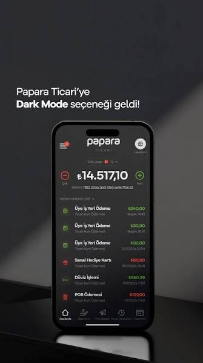
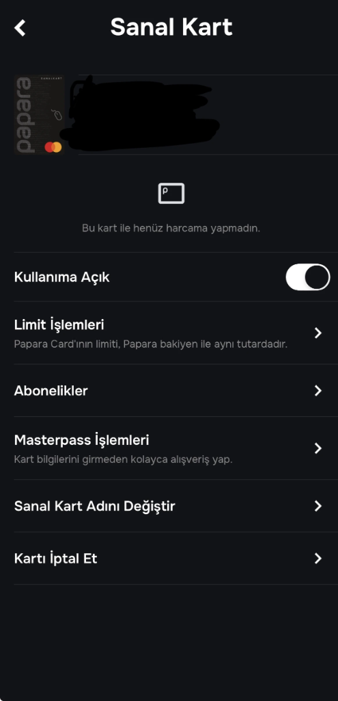
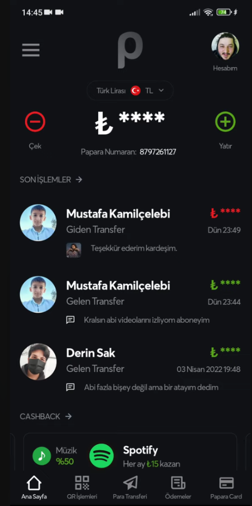
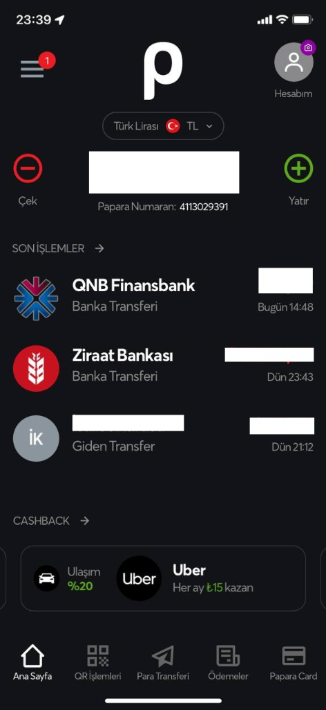
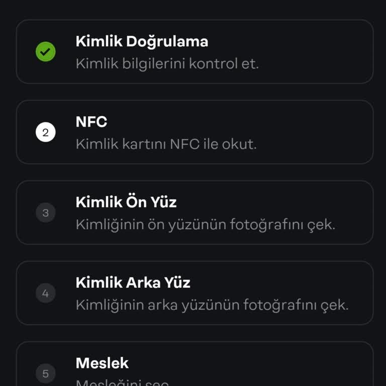
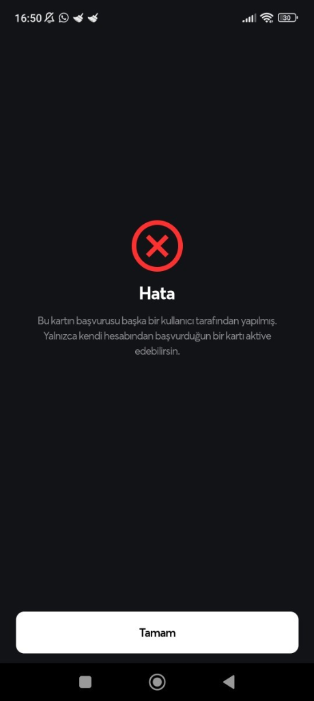

# Papara Design Guidelines & Principles
## SitePulse Residential Management Platform Design System

> **Source of Truth:** Analyzed directly from official Papara mobile application interfaces (Dashboard, Money Transfer, Card Showcase, Cashback Program, and Portfolio screens).  
> **Platform Scope:** Mobile (Flutter / Material 3) & Desktop/Mobile Web Prototypes.  
> **Target Aesthetic:** High-End Fintech • Ultra-Clean Light Canvas • Deep Jet Black Accents • Crisp Contrast • Zero Visual Clutter.

---

## 1. Core Visual Principles & Philosophy

```
┌────────────────────────────────────────────────────────────────────────┐
│                      PAPARA DESIGN PHILOSOPHY                          │
│                                                                        │
│   1. Ultra-Clean Canvas       2. Pure Black & Crisp White Contrast     │
│   3. Razor-Thin Borders (1px) 4. Soft Micro-Elevation (4px blur)       │
│   5. Circular Story Actions   6. Authoritative Financial Typography    │
└────────────────────────────────────────────────────────────────────────┘
```

1. **Light & Crisp First (The Pure Canvas)**:
   - Papara's primary identity is an immaculate, high-contrast, pure-white card surface (`#FFFFFF`) sitting on a calm, subtle off-white canvas (`#F8F9FA`).
   - High legibility is prioritized over decorative backgrounds: zero heavy neon glows, zero harsh drop shadows, zero chromatic aberration.

2. **Black & White Dominance with Intentional Semantic Color**:
     - **Emerald Green (`#10B981`)**: Income, positive balances, successful verification, and `[+] Yatır` action.
     - **Coral Crimson (`#EF4444`)**: Unread notification badges, overdue debt alerts, negative balances, and `[-] Çek` action.
     - **Muted Bank/Brand Accents (`#2563EB`, `#F59E0B`)**: Reserved strictly for quick-contact avatar badges and category chips.

3. **Curved Geometry Scale**:
   - **Hero Account & Action Cards**: `20px` radius.
   - **Input Fields & Bottom Sheets**: `12px` to `16px` radius.
   - **Story & Contact Badges**: `50%` (Perfect Circle).
   - **Filter Chips & Action Pills**: `9999px` (Full Capsule).

---

## 2. Color Palette & Design Tokens

### 2.1 Dual-Theme Core Palette (Light & Dark Black/White)

| Token | Light Theme Value | Dark (Black/White) Value | Usage in Papara Architecture |
| :--- | :--- | :--- | :--- |
| `paparaCanvas` | `#F8F9FA` | `#121317` (Matte Obsidian) | Root scaffold background canvas |
| `paparaSurface` | `#FFFFFF` | `#1C1D24` (Dark Graphite) | Primary cards, modal dialogs, bottom sheets |
| `paparaCardStacked` | `#F1F3F5` | `#181920` | Stacked card depth underneath notice cards |
| `paparaBorder` | `#E5E7EB` | `#282A33` | 1.0px hairline separator / outline |
| `paparaActionPrimary` | `#0B0F19` | `#FFFFFF` | Primary pill button fill or contrast text |
| `paparaWithdrawRed` | `#EF4444` | `#E53935` | Negative action: `[-] Çek` / `Aidat Öde` circular button |
| `paparaDepositGreen` | `#10B981` | `#43A047` | Positive action: `[+] Yatır` circular button, `+₺` transfers |
| `paparaBadgeRed` | `#EF4444` | `#E53935` | Notification counter badges (`1`, `2`), campaign pills |

### 2.2 Papara Black & White (Dark Mode) Architectural Patterns



*Figure 2.1: Official Papara Ticari Dark Mode production interface illustrating the floating balance, circular action buttons, clean typography, transaction list, and bottom navigation bar.*

```
┌────────────────────────────────────────────────────────┐
│  [ ☰ (2) ]               papara               (Store)  │
│                          TİCARİ               Hesabım  │
│                                                        │
│                  ( Türk Lirası 🇹🇷 TL ⌵ )               │
│                                                        │
│        (-)            ₺14.517,10                 (+)   │
│        Çek                                      Yatır  │
│        IBAN'ın TR62 0006 2001 0160 6626 7106 22        │
│                                                        │
│  HESAP HAREKETLERİ →                                   │
│  ┌──────────────────────────────────────────────────┐  │
│  │ [🛍️]  Üye İş Yeri Ödeme                  ₺240,00  │  │
│  │       Ticari Kart Ödemesi             Bugün 19:30│  │
│  ├──────────────────────────────────────────────────┤  │
│  │ [🛍️]  Üye İş Yeri Ödeme                   ₺30,00  │  │
│  │       Ticari Kart Ödemesi             Bugün 15:20│  │
│  ├──────────────────────────────────────────────────┤  │
│  │ [🎁]  Sanal Hediye Kartı                   ₺50,00  │  │
│  │       Ticari Kart Ödemesi        12.07.2024 12:45│  │
│  ├──────────────────────────────────────────────────┤  │
│  │ [💱]  Döviz İşlemi                       ₺560,28  │  │
│  │       Ticari Kart Ödemesi        12.07.2024 11:02│  │
│  ├──────────────────────────────────────────────────┤  │
│  │ [💳]  POS Ödemesi                         ₺129,00  │  │
│  │       Ticari Kart Ödemesi        11.07.2024 21:00│  │
│  └──────────────────────────────────────────────────┘  │
│                                                        │
│  [ ⌂ ]      [ 🤲 ]       [ ➤ ]        [ 🕒 ]     [ 💳 ] │
│Ana Sayfa   Ödeme Al   Para Gönder  Hareketler  Ticari Kart│
└────────────────────────────────────────────────────────┘
```

#### Key Black & White Principles:
1. **Floating Hero Balance without Card Border**:
   - In Dark Mode, the hero balance (`₺1,38` or `₺1.423,33`) floats directly on the matte obsidian canvas (`#121317`) in massive bold pure white typography (`40-44px ExtraBold`).
   - Flanked directly on the left and right by circular action buttons:
     - **Left `[-]` (Red `#E53935`)**: Withdraw / Pay (`Çek` / `Aidat Öde`).
     - **Right `[+]` (Green `#43A047`)**: Deposit / Top-up (`Yatır`).
   - Account / Papara / Flat number is centered below the amount in subtle `#8E9297`.

2. **Top Utility Capsules**:
   - Small rounded dark pills (`#1C1D24` background with `#282A33` border):
     - Quick bonus badge (e.g. `🎁 ₺45`).
     - Account currency selector dropdown (e.g. `Türk Lirası 🇹🇷 TL ⌵` or `SitePulse Dairem A-14 ⌵`).

3. **Pinned Announcement Card with Stacked Elevation**:
   - High-contrast dark container (`#1C1D24`, `border-radius: 16px`, `border: 1px solid #282A33`).
   - Stacked card edge visible below to indicate active carousel of announcements.
   - Micro date (`11px` `#8E9297`), bold title (`15px` `#FFFFFF`), and body snippet (`13px` `#9E9E9E`).

4. **Uppercase Navigation Micro-Headers with Chevrons**:
   - `SON İŞLEMLER →` and `CASHBACK →` in bold uppercase gray tracking (`#8E9297`).

5. **Chat / Transfer Message Snippets**:
   - Transaction list items include a preview note with speech bubble icon `💬` below the transaction type, rendering user remarks in `#8E9297`.

### 2.3 Papara Virtual Card & Settings Architecture



*Figure 2.2: Official Papara Virtual Card management screen showing top back navigation, embedded visual card mockup, iOS-style toggle switch, and hairline-divided settings rows with trailing chevrons.*

```
┌────────────────────────────────────────────────────────┐
│  <                     Sanal Kart                      │
│                                                        │
│     ┌────────────────────────────────────────────┐     │
│     │ [papara]                     [mastercard]  │     │
│     │                                            │     │
│     │               ( Card Artwork )             │     │
│     └────────────────────────────────────────────┘     │
│                          [ 💳 ]                        │
│             Bu kart ile henüz harcama yapmadın.        │
│ ────────────────────────────────────────────────────── │
│  Kullanıma Açık                                 ( ● )  │
│ ────────────────────────────────────────────────────── │
│  Limit İşlemleri                                    >  │
│  Papara Card'ının limiti, Papara bakiyen ile aynı...   │
│ ────────────────────────────────────────────────────── │
│  Abonelikler                                        >  │
│ ────────────────────────────────────────────────────── │
│  Masterpass İşlemleri                               >  │
│  Kart bilgilerini girmeden kolayca alışveriş yap.      │
│ ────────────────────────────────────────────────────── │
│  Sanal Kart Adını Değiştir                          >  │
│ ────────────────────────────────────────────────────── │
│  Kartı İptal Et                                     >  │
└────────────────────────────────────────────────────────┘
```

#### Key Virtual Card & Settings Principles:
1. **Header**: Minimalist back chevron `<` left aligned, centered bold title (`20px Bold #FFFFFF`).
2. **Card Visual**: High-fidelity embossed card preview centered with empty-state icon and hint below.
3. **Toggle Switch**: iOS/Papara-standard pill switch (`#FFFFFF` thumb, `#1C1D24` track in off, `#10B981` in active) embedded seamlessly in full-width row.
4. **List Rows**:
   - Primary label: `15px SemiBold #FFFFFF`.
   - Explanatory sublabel: `13px Regular #8E9297`.
   - Hairline separator: `1.0px solid #282A33`.
   - Trailing accessory: Right chevron `>` (`#8E9297`).

---

### 2.4 Papara Personal Home, Social Transfers & Privacy Masking

<div style="display: flex; gap: 16px;">
  
  
</div>

*Figure 2.3: Official Papara Personal Dark Mode screens illustrating privacy masking (`₺ ****`), user avatar chat bubbles, bank logos, and cashback promotional banners.*

```
┌────────────────────────────────────────────────────────┐
│  14:45                                          [74%]  │
│  [ ☰ ]¹                    ( P )              (Avatar) │
│                                                Hesabım │
│                  ( Türk Lirası 🇹🇷 TL ⌵ )               │
│                                                        │
│        (-)                 ₺ ****                (+)   │
│        Çek                                      Yatır  │
│                   Papara Numaran: 8797261127           │
│                                                        │
│  SON İŞLEMLER →                                        │
│  ┌──────────────────────────────────────────────────┐  │
│  │ (Avatar)  Mustafa Kamilçelebi             ₺ **** │  │
│  │           Giden Transfer                 Dün 23:49│ │
│  │           💬 Teşekkür ederim kardeşim.           │  │
│  ├──────────────────────────────────────────────────┤  │
│  │ (Avatar)  Mustafa Kamilçelebi             ₺ **** │  │
│  │           Gelen Transfer                 Dün 23:44│ │
│  │           💬 Kralsın abi videolarını izliyom...  │  │
│  ├──────────────────────────────────────────────────┤  │
│  │ (QNB)     QNB Finansbank                  ₺ **** │  │
│  │           Banka Transferi             Bugün 14:48│  │
│  └──────────────────────────────────────────────────┘  │
│                                                        │
│  CASHBACK →                                            │
│  ┌──────────────────────────────────────────────────┐  │
│  │ [Müzik %50]  (Spotify)  Spotify                  │  │
│  │                         Her ay ₺15 kazan         │  │
│  └──────────────────────────────────────────────────┘  │
│                                                        │
│  [ ⌂ ]      [ ▣ ]        [ ➤ ]        [ ☰ ]     [ 💳 ] │
│Ana Sayfa  QR İşlem    Para Trans     Ödemeler  Papara Card│
└────────────────────────────────────────────────────────┘
```

#### Key Social & Personal Home Principles:
1. **Privacy Masking Mode (`₺ ****`)**:
   - The user can mask their balance and transaction amounts with asterisks (`₺ ****`) for privacy in public environments.
   - Account identifier (Papara No or Flat No) remains displayed in subtle `#8E9297`.
2. **Transaction Item Variations**:
   - **P2P Social Transfer**: 40x40dp circular avatar photo of contact, transfer direction (`Giden Transfer` in red / `Gelen Transfer` in green), and an embedded chat comment bubble (`💬`).
   - **Bank Transfer**: Official circular bank brand logo (e.g. QNB Finansbank, Ziraat Bankası) with transaction description `Banka Transferi`.
3. **Cashback Banner**:
   - Squircle partner logo (`Spotify`, `Uber`, `Netflix`).
   - Category incentive tag (`Müzik %50`, `Ulaşım %20`) in green accent.
   - Reward summary (`Her ay ₺15 kazan`).

---

### 2.5 Papara Multi-Step Verification Wizard Architecture



*Figure 2.4: Official Papara identity verification wizard featuring individual step cards, completion status badges, and clear action instructions.*

```
┌────────────────────────────────────────────────────────┐
│  ┌──────────────────────────────────────────────────┐  │
│  │ [ ✔ ]   Kimlik Doğrulama                         │  │
│  │         Kimlik bilgilerini kontrol et.           │  │
│  └──────────────────────────────────────────────────┘  │
│                                                        │
│  ┌──────────────────────────────────────────────────┐  │
│  │  (2)    NFC                                      │  │
│  │         Kimlik kartını NFC ile okut.             │  │
│  └──────────────────────────────────────────────────┘  │
│                                                        │
│  ┌──────────────────────────────────────────────────┐  │
│  │  (3)    Kimlik Ön Yüz                            │  │
│  │         Kimliğinin ön yüzünün fotoğrafını çek.   │  │
│  └──────────────────────────────────────────────────┘  │
│                                                        │
│  ┌──────────────────────────────────────────────────┐  │
│  │  (4)    Kimlik Arka Yüz                          │  │
│  │         Kimliğinin arka yüzünün fotoğrafını çek. │  │
│  └──────────────────────────────────────────────────┘  │
│                                                        │
│  ┌──────────────────────────────────────────────────┐  │
│  │  (5)    Meslek                                   │  │
│  │         Mesleğini seç.                           │  │
│  └──────────────────────────────────────────────────┘  │
└────────────────────────────────────────────────────────┘
```

#### Key Multi-Step Wizard Principles:
1. **Individual Card Containers**:
   - Each step is rendered in a discrete, elevated graphite container (`#1C1D24` background, `16px` border-radius, `1px solid #282A33`).
2. **Step State Indicators**:
   - **Completed Step**: Emerald green circle (`#10B981`) with pure white checkmark `[✔]`.
   - **Active Current Step**: High-contrast white circle (`#FFFFFF`) with dark step number `[2]`.
   - **Pending Inactive Step**: Subtle muted graphite circle (`#282A33`) with gray step number `[3]`, `[4]`, `[5]`.
3. **Step Typography**:
   - Step Title: `16px SemiBold #FFFFFF`.
   - Step Action Instruction: `13px Regular #8E9297`.

---

### 2.6 Papara Fullscreen Alert & Error Architecture



*Figure 2.5: Official Papara error screen displaying centered error iconography, concise diagnostic explanation, and bottom full-width primary CTA pill button.*

```
┌────────────────────────────────────────────────────────┐
│  16:50                                           [30%] │
│                                                        │
│                                                        │
│                        ╭─────╮                         │
│                        │  ✕  │  (Red Circle #EF4444)   │
│                        ╰─────╯                         │
│                                                        │
│                         Hata                           │
│                                                        │
│          Bu kartın başvurusu başka bir kullanıcı        │
│          tarafından yapılmış. Yalnızca kendi            │
│          hesabından başvurduğun bir kartı aktive       │
│          edebilirsin.                                  │
│                                                        │
│                                                        │
│                                                        │
│  ┌──────────────────────────────────────────────────┐  │
│  │                      Tamam                       │  │
│  └──────────────────────────────────────────────────┘  │
└────────────────────────────────────────────────────────┘
```

#### Key Alert & Error Dialog Principles:
1. **Iconography**:
   - Centered large circular glyph (`64px - 72px` diameter) with `2.5px` border in Coral Crimson (`#EF4444`) containing a bold `✕` symbol.
2. **Headline**:
   - `22px - 24px Bold #FFFFFF`, centered directly beneath the icon.
3. **Body Explanation**:
   - `14px Regular #8E9297` with `line-height: 1.5`, max-width `300dp`, centered text explaining the exact operational constraint without technical jargon.
4. **Primary CTA Pill Button**:
   - Full-width pill button (`height: 52px`, `border-radius: 14px - 16px`).
   - Solid pure white fill (`#FFFFFF`), bold jet black text (`#000000`, `15px Bold`).
   - Pinned to the bottom of the viewport with safe-area padding.

---

### 2.7 Elevation & Shadows
- **Card Soft Elevation**: `box-shadow: 0 4px 20px rgba(0, 0, 0, 0.03);`
- **Dropdown / Action Sheet Shadow**: `box-shadow: 0 10px 30px rgba(0, 0, 0, 0.08);`
- **Floating Button Shadow**: `box-shadow: 0 4px 12px rgba(11, 15, 25, 0.12);`

---

## 3. Typography Hierarchy

| Level | Size | Weight | Line Height | Example Content |
| :--- | :--- | :--- | :--- | :--- |
| **Hero Balance** | `32px - 34px` | ExtraBold (800) | `1.1` | `₺27.870,45` / `₺1.423,33` |
| **Screen Title** | `20px - 22px` | Bold (700) | `1.2` | `Para Gönder`, `Cashback` |
| **Section Header** | `11px - 12px` | Bold (700) | `1.3` | `SOHBET →`, `HESAP HAREKETLERİ →` (Uppercase + Letter Spacing 0.5px) |
| **Card Title / Name** | `15px - 16px` | SemiBold (600) | `1.3` | `Deniz Korkmaz`, `Türk Lirası Hesabı` |
| **Body / Description**| `13px - 14px` | Regular (400) | `1.4` | `Faturaları ben ödedim, haberin olsun.` |
| **Micro Caption / IBAN**| `11px - 12px` | Medium (500) | `1.2` | `IBAN'ın: TR52 0082...`, `Bugün, 19:30` |

---

## 4. Architectural Component Specifications

### 4.1 Top App Bar & Profile Module
```
┌────────────────────────────────────────────────────────┐
│  [ ☰ ]¹   [ 💬 ]²                Duru Demir            │
│                            Papara No: 6696710622   (O) │
└────────────────────────────────────────────────────────┘
```
- **Left Action Buttons**:
  - Two `40x40dp` rounded squircle buttons (`border-radius: 12px`, `#F3F4F6` background).
  - Menu icon (`☰`) with red notification badge (`#EF4444`, `16x16dp` circle, white text `1`).
  - Chat icon (`💬`) with red notification badge (`2`).
- **Right Profile Stack**:
  - Top line: User full name (`14px`, SemiBold `#0B0F19`).
  - Bottom line: Account identifier (`Papara No: 6696710622` or `Daire No: Blok A / No 14`), `11px` subtle gray, underlined clickable link.
  - Avatar: `38x38dp` circular photo container with 1px border `#E5E7EB`.

---

### 4.2 Quick Action "Story" Row (Circular Carousel)
```
  ╭───╮        ╭───╮        ╭───╮        ╭───╮        ╭───╮
  │ ★ │        │ 💬│        │ 🎁│        │ ☵ │        │ ✈ │
  ╰───╯        ╰───╯        ╰───╯        ╰───╯        ╰───╯
 Cashback    Sohbetler   Davet Et,     Kıymetli    Yurt Dışı
                           Kazan       Madenler  Para Transferi
```
- **Container**: `56x56dp` circle (`border-radius: 50%`), pure white background, 1.5px border `#E5E7EB`.
- **Icon Artwork**: Clean, thin 2px line illustration with subtle pastel accent.
- **Label**: `11px` medium weight `#374151`, centered, 2-line wrapped, max-width `68dp`.

---

### 4.3 Hero Financial Card (Swipeable Account Carousel)
```
┌────────────────────────────────────────────────────────┐
│  🇹🇷  Türk Lirası Hesabı                                │
│                                                        │
│  ₺27.870,45                                            │
│  IBAN'ın: TR52 0082 9000 0949 1234 5678 90             │
│                                                        │
│  ┌───────────────────────┐  ┌───────────────────────┐  │
│  │ 💳  Yatır / Çek       │  │  Gönder            ✈  │  │
│  └───────────────────────┘  └───────────────────────┘  │
└────────────────────────────────────────────────────────┘
                       ● ○ ○ ○ ○ ○
```
- **Card Surface**:
  - Pure white background (`#FFFFFF`), `20px` border radius, `1px solid #ECEFF1` border.
  - Soft shadow: `0 4px 16px rgba(0, 0, 0, 0.04)`.
  - Internal padding: `20dp`.
- **Card Elements**:
  - Currency badge: `18x18dp` circular flag/icon + `13px` medium text `#6B7280` ("Türk Lirası Hesabı" or "SitePulse Aidat Hesabı").
  - Large Bold Amount: `32px` ExtraBold tabular numbers (`₺27.870,45` or `₺1.423,33`).
  - Account/IBAN Subtitle: `12px` font `#6B7280` with underlined clickable link.
- **Dual In-Card Action Buttons**:
  - **Left Button (Secondary Action - "Yatır / Çek" or "Detay / Makbuz")**:
    - White background, `1px solid #E5E7EB`, `12px` radius.
    - Icon on left, `13px` SemiBold `#0B0F19`.
  - **Right Button (Primary Action - "Gönder" or "Hemen Öde")**:
    - Solid Jet Black (`#0B0F19`), `12px` radius.
    - Text: `13px` SemiBold `#FFFFFF`, paper plane / card icon on right.
- **Carousel Pagination**:
  - `6dp` circle dots centered `12dp` below the card.
  - Active dot: Solid black (`#0B0F19`), elongated pill or solid dot.
  - Inactive dots: `#D1D5DB`.

---

### 4.4 Feed & Activity List Pattern (With Uppercase Micro-Headers)
```
 SOHBET →
┌────────────────────────────────────────────────────────┐
│  (Avatar)  Deniz Korkmaz                  Bugün, 19:30 │
│            Faturaları ben ödedim, haber...         [2] │
└────────────────────────────────────────────────────────┘

 HESAP HAREKETLERİ →
┌────────────────────────────────────────────────────────┐
│  (Avatar)  Nehir Demir                        +₺19,93  │
│            Para Transferi • Papara ile... Bugün, 19:30 │
└────────────────────────────────────────────────────────┘
```
- **Section Micro-Header**:
  - `11px - 12px`, Bold, uppercase (`letter-spacing: 0.5px`).
  - Text color: `#6B7280` with trailing chevron arrow (`→`).
- **Activity Item Card**:
  - Pure white rounded card (`border-radius: 16px`, `border: 1px solid #E5E7EB`).
  - Left: `40x40dp` circular avatar or soft-tinted icon container.
  - Middle: Primary title (`14px` SemiBold `#0B0F19`) + Subtitle (`12px` Regular `#6B7280`).
  - Right:
    - Amount: `14px` ExtraBold (Green `#10B981` for positive `+₺`, Black `#0B0F19` for negative `-₺`).
    - Timestamp: `11px` Regular `#9CA3AF`.

---

### 4.5 Money Transfer & FAST Form Pattern
```
┌────────────────────────────────────────────────────────┐
│  <  Para Gönder                                    ⓘ   │
├────────────────────────────────────────────────────────┤
│        Cep Numarası       |   Papara No / IBAN         │
│                           |   ────────────────         │
├────────────────────────────────────────────────────────┤
│  Hızlı İşlemler                          Ekle/Düzenle  │
│    (Garanti)    (YapıKredi)    (Vakıf)                 │
│      Kızım        Demir         Duru                   │
├────────────────────────────────────────────────────────┤
│  [ Papara No / IBAN ]        ( Kolay Adres )           │
│                                                        │
│  ┌──────────────────────────────────────────────────┐  │
│  │ Papara Numarası ya da IBAN                    📷 │  │
│  └──────────────────────────────────────────────────┘  │
├────────────────────────────────────────────────────────┤
│  ┌──────────────────────────────────────────────────┐  │
│  │                    Devam Et                      │  │
│  └──────────────────────────────────────────────────┘  │
└────────────────────────────────────────────────────────┘
```
- **Header**: Navigation back arrow (`<`), centered title (`17px` Bold), info button (`ⓘ`).
- **Top Segmented Tabs**: Text tabs with active black underline bar (`height: 2px`).
- **Quick Recipients ("Hızlı İşlemler")**: Circular contact avatars with embedded mini bank logo badges on the bottom-right.
- **Secondary Capsule Switcher**: Solid black active capsule vs white inactive capsule.
- **Input Field**: `14px` radius, `1.5px solid #E5E7EB` border, camera/QR scanner shortcut icon on right.
- **Full-Width Bottom CTA**: `16px` radius, fixed at the bottom with safe-area padding.

---

### 4.6 Gamified Cashback & Progress Metric Pattern
```
┌────────────────────────────────────────────────────────┐
│  Bu ay kazandığın               Bu ay kazanabileceğin  │
│  ₺50,00                         ₺960,00                │
│  ───────────[ P ]───────────────────────────────────── │
│             Bugüne dek toplam kazancın: ₺3.450,00      │
└────────────────────────────────────────────────────────┘
  [ (P) Tümü ]    [ ♡ Sana Özel ]    [ ✦ Online Alışveriş ]
```
- **Progress Gauge**: Clean horizontal line with branded thumb indicator `[ P ]`.
- **Pill Filters**:
  - Active: Solid black capsule (`#0B0F19`), white text.
  - Inactive: White capsule, colored outline, colored icon, dark text.
- **Cashback Card Item**: Rounded card with brand imagery, category badge (`Yeme & İçme %5`), logo, and reward calculation (`₺50 kazan`).

---

### 4.7 Bottom Navigation Bar
```
┌────────────────────────────────────────────────────────┐
│   ⌂          ▣           ➤           ☰           💳    │
│ Ana Sayfa   QR İşlem  Para Transfer  Ödemeler  Papara Card│
└────────────────────────────────────────────────────────┘
```
- **Canvas**: Pure white background (`#FFFFFF`), `height: 64dp` + bottom safe area.
- **Top Divider**: Razor-thin `1.0px solid #E5E7EB`.
- **5 Icon Slots**:
  1. `Ana Sayfa` (Home outline) — Active: Solid Black `#0B0F19`.
  2. `QR İşlemleri` (Scan/Grid icon).
  3. `Para Transferi` (Paper plane icon).
  4. `Ödemeler` (Receipt/bill icon).
  5. `Papara Card` (Card icon).
- **Text Label**: `10px - 11px`, Medium. Active is `#0B0F19`, Inactive is `#94A3B8`.

---

## 5. SitePulse Residential Translation Matrix

How Papara's fintech patterns map directly to SitePulse's residential management features:

| Papara Pattern | SitePulse Residential Equivalent | Functional Purpose |
| :--- | :--- | :--- |
| **"Türk Lirası Hesabı" Card** | **"SitePulse Aidat & Bakiye" Card** | Shows total dues, overdue penalties (KMK %5), and quick pay button |
| **"Yatır / Çek" Button** | **"Detay / KMK Makbuz" Button** | Opens statutory dues calculation breakdown modal |
| **"Gönder" Action Button** | **"Aidat Öde" Action Button** | Launches 3D Secure payment gateway / FAST transfer |
| **"Hızlı İşlemler" Contacts** | **"Sık Kullanılan İşlemler"** | Quick access: Dues Pay, Virtual IBAN, Receipts, Household Invite |
| **"Papara No / IBAN" Input** | **"Daireye Özel Sanal IBAN"** | Unit-specific deterministic IBAN with 1-tap copy and FAST badge |
| **"Cashback" Metric Slider** | **"Aylık Tahsilat İlerlemesi"** | Shows Site Manager collection rate (e.g. 76% paid, overdue list) |
| **"SOHBET" Card** | **"YÖNETİM DUYURULARI" Feed** | Broadcast notices (water outage, elevator maintenance, general assembly) |
| **"HESAP HAREKETLERİ" Feed** | **"AİDAT & MAKBUZ HAREKETLERİ"** | Real-time immutable fiscal audit ledger with green `+₺` and black `-₺` |

---

## 6. Implementation Checklist for Developers

- [x] Use **pure white (`#FFFFFF`)** cards on **soft off-white (`#F8F9FA`)** canvas.
- [x] Use **Solid Jet Black (`#0B0F19`)** for primary action pills and active navigation states.
- [x] Use **Emerald Green (`#10B981`)** strictly for positive financial events (`+₺`, paid status).
- [x] Use **Coral Crimson (`#EF4444`)** for overdue debt warnings and unread counter badges.
- [x] Zero neon colors (no `#00D2FF`, `#00E5A3`, `#FF4B72` glowing shadows).
- [x] Card corner radius: `20px`; Button radius: `12px - 16px`; Badges: `50%` circle.
- [x] All typography must be English in code, cleanly formatted with Turkish Lira (`₺`) currency symbols.
- [x] All financial calculations must use high-precision decimals (`Decimal` / `rust_decimal`).

---

## 7. Dual-Theme Implementation Specification

*Sourced from official Papara Ticari "Dark Mode seçeneği geldi!" launch screens (dark & light side-by-side toggle).*

### 7.1 Theme Toggle Architecture

```
┌──────────────────────────────────────────────────────────────────────┐
│               PAPARA TICARI DUAL-THEME SPECIFICATION                 │
│                                                                      │
│   DARK (Midnight)          │   LIGHT (Clean Canvas)                  │
│   ───────────────────────  │   ─────────────────────────────────     │
│   Canvas:    #121317       │   Canvas:    #F8F9FA                    │
│   Surface:   #1C1D24       │   Surface:   #FFFFFF                    │
│   Card Well: #181920       │   Card Well: #F1F3F5                    │
│   Border:    #282A33       │   Border:    #E5E7EB                    │
│   Text P:    #FFFFFF       │   Text P:    #0B0F19                    │
│   Text S:    #8E9297       │   Text S:    #6B7280                    │
└──────────────────────────────────────────────────────────────────────┘
```

**Invariant Semantic Colors (Same in Both Themes):**

| Color | Hex | Usage |
| :--- | :--- | :--- |
| Withdraw Red | `#EF4444` | [-] Cek circular button, overdue badge |
| Deposit Green | `#10B981` | [+] Yatir circular button, income amounts |
| Brand Blue | `#0284C7` | Active nav tab, primary CTA, IBAN copy button |
| Alert Amber | `#F59E0B` | Offline mode, "Link Uret" badge |

### 7.2 CSS Variable Inheritance Model

Scope ALL color tokens as CSS custom properties on `.phone-screen`. Adding class `.theme-light` rebinds them for every descendant automatically — no per-component `if (isDark)` branching needed.

**Critical Rule:** Never use hardcoded `rgba(0,0,0,N)` for track fills or inset wells — always use `var(--card-dark)`. The only permitted hardcoded black is the modal backdrop: `rgba(0,0,0,0.75)`.

### 7.3 Component-Specific Light-Mode Overrides

| Component | Dark Default | Light Override |
| :--- | :--- | :--- |
| `.status-bar` | `var(--bg-dark)` | `background: #FFFFFF; color: #0B0F19` |
| `.flutter-appbar` | `var(--bg-dark)` | `background: #FFFFFF; border: 1px solid #E5E7EB` |
| `.flutter-bottom-nav` | `var(--surface-dark)` | `background: #FFFFFF; border-top: 1px solid #E5E7EB` |
| `.circular-btn-*` | `var(--surface-dark)` | `background: #FFFFFF` |
| `.resident-row` | `var(--bg-dark)` | `background: #F8F9FA` |
| `.iban-display-box` | `var(--bg-dark)` | `background: #F1F3F5` |
| progress track | `rgba(0,0,0,0.4)` ❌ | `background: var(--card-dark)` ✅ |

---

## 8. Social P2P Transfer Message Bubble Pattern

*Sourced from Papara "Son Islemler" feed with P2P social messaging.*

```
┌─────────────────────────────────────────────────────────────────────┐
│  [Avatar] Mustafa Kamilcelebi        TL ****        Dun 23:49      │
│           Giden Transfer                                            │
│           [chat] Tesekkur ederim kardesim.   <- message bubble      │
│                                                                     │
│  [Avatar] Derin Sak                  TL ****        03 Nisan 19:48 │
│           Gelen Transfer                                            │
│           [chat] Abi fazla biseyy degil ama bir atayim dedim        │
└─────────────────────────────────────────────────────────────────────┘
```

**Implementation Rules:**
- Avatar: 40dp circle, real user photo or initials monogram.
- Amount: `TL ****` privacy masking when balance-hiding is active.
- Message bubble: `padding-left: 50px` indent below transaction row.
  - Icon: `chat_bubble_outline` Material Symbol, `13px`, `var(--text-secondary)`.
  - Text: `11px`, contained in `var(--card-dark)` pill (`border-radius: 8px; padding: 4px 8px`).
- Positive (Gelen Transfer): `var(--accent-green)`.
- Negative (Giden Transfer): `var(--accent-red)`.

---

## 9. Fullscreen Error & Confirmation State Pattern

*Sourced from Papara "Hata" card activation error screen.*

```
┌──────────────────────────────────┐
│                                  │
│         [ X circle - 64dp ]      │
│             Hata                 │
│                                  │
│  Bu kartin basvurusu baska bir   │
│  kullanici tarafindan yapilmis.  │
│                                  │
│  ┌────────────────────────────┐  │
│  │          Tamam             │  │  <- full-width white, 56dp
│  └────────────────────────────┘  │
└──────────────────────────────────┘
```

**Specifications:**
- Background: Jet black `#0A0A0A`, pure fullscreen — no card container.
- Icon Container: `64dp` circle, `background: rgba(239,68,68,0.15)`, `border: 2px solid #EF4444`.
  - Icon: `close`, `32px`, `#EF4444`.
- Title: `20px`, `font-weight: 700`, `#FFFFFF`, centered.
- Body: `14px`, `#8E9297`, centered, `max-width: 280px`, `line-height: 1.5`.
- CTA: Full-width white, `border-radius: 16px`, `height: 56dp`, fixed bottom with `16dp` margin.
  - Text: `"Tamam"`, `16px`, `font-weight: 700`, `#0B0F19`.
- **SitePulse Equivalent**: "Odeme Basarisiz" state, "Sistem Hatasi" modal.

---

## 10. Verification Wizard Step List Pattern

*Sourced from Papara "Kimlik Dogrulama" step-based identity verification screen.*

**Step State Indicators:**

| State | Step Indicator | Border | Title Color |
| :--- | :--- | :--- | :--- |
| **Completed** | Green circle `check`, `32dp` | `1px solid var(--border-dark)` | Bold `var(--text-primary)` |
| **Current** | White circle with step number | `2px solid var(--primary)` | Bold `var(--text-primary)` |
| **Pending** | Grey circle with step number | `1px solid var(--border-dark)` | `var(--text-secondary)` |

- Container: `border-radius: 16px`, full-width, `padding: 14px 16px`.
- Gap between steps: `8dp`.
- **SitePulse Equivalent**: Resident onboarding wizard (ID verify → IBAN link → Address confirm → Welcome).
