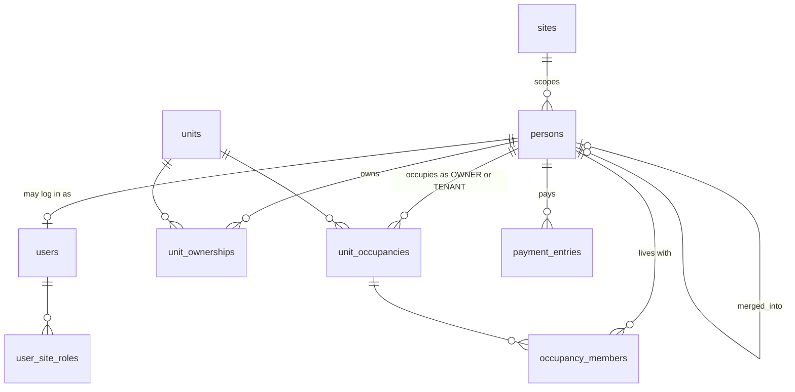

# Person card: create a person once, use them in every role

Date: 14 November 2026

Status: proposed design for review; application implementation is outside this change

Companion: [interactive design draft](ux-reference/person_card.html)

## Recommendation

SitePulse already stores people in one `persons` table and already derives their role from what they hold. What it lacks is a single way to *write* and *choose* a person. Today every workflow carries its own name, phone and email fields, and each one decides separately whether that text matches an existing person.

Make the person card the only place where personal data is entered or edited, and make every role workflow take a reference to a card:

1. **Entity:** keep `persons` as the party of record. A role is a relationship row (ownership, occupancy, household membership, login account), never a field on the person. Tighten the few places where the schema still allows a copy or a loose link.
2. **Backend:** add person create, edit, search, login and merge endpoints. Route every person write through one `PersonService::resolve` function. Every role command accepts a `PersonRef`: an existing `person_id`, or a new card that goes through the same duplicate controls.
3. **Frontend:** one `SpPersonField` (choose or create), one `SpPersonCard` (show), one `SpPersonForm` (the only widget with name, phone and email inputs). Replace the nine hand-written field groups with them.
4. **UX:** search first, create second. The manager types a name, phone or email into one box; existing people appear with their current roles; "create new" is the last row and is checked for duplicates before it saves.

## Evidence and limits

This analysis reads the source on master at `2f7e04f`. No running application, production data or user session was inspected, so duplicate rates, data volumes and task times are not measured. Counts below are counts of code sites, not of records. All people in the draft are fictional.

## Current state

### What already works

| Area | Evidence | Meaning for this design |
| --- | --- | --- |
| One person table, scoped to a site | [V21](../backend/migrations/V21__person_tenant_scope_and_account_activation.sql): `persons.site_id`, triggers `trg_person_site_*` reject a reference from another site | Keep. The card is a site-level record. |
| Roles are derived | [V23](../backend/migrations/V23__derived_person_roles.sql), [V30](../backend/migrations/V30__release_identity_uniqueness_for_archived_records.sql): view `v_person_roles` | Keep. `persons.person_type` is only a fallback. |
| Ownership and occupancy are separate facts | [V31](../backend/migrations/V31__unit_state_model.sql): `unit_ownerships`, `unit_occupancies`; unit columns are projections | Role commands stay as they are; only how they receive the person changes. |
| Identity uniqueness | Partial unique indexes on `(site_id, lower(email))` and `(site_id, national_id_hash)` for non-archived people | These are the hard duplicate rules. |
| Duplicate detection | [person_record_service.rs](../backend/src/services/person_record_service.rs): `match_reasons` on email, phone key, folded name, edit distance; `POST /site-admin/persons/duplicate-check` | Reuse as the soft duplicate rule. |
| Directory, profile, import, export | `GET /site-admin/persons`, `/persons/:person_id`, `/persons/import`, `/persons/export`; [people_directory_page.dart](../flutter/lib/ui/residents/people_directory_page.dart), [person_profile_page.dart](../flutter/lib/ui/residents/person_profile_page.dart) | The profile page becomes the full card. |
| Audit and archive | `audit_domain_change` trigger on `persons`; `deleted_at` soft delete | Keep. |

### Gaps

| # | Finding | Evidence | Effect |
| --- | --- | --- | --- |
| G1 | Persons are inserted by 12 statements in 8 files, each with its own match rule. | `INSERT INTO persons` in `site_admin_service.rs` (488, 563, 1666), `occupancy_service.rs` (254), `registration_approval_service.rs` (225), `auth_service.rs` (562), `unit_repository.rs` (78, 109, 198), `user_repository.rs` (59, 218), `site_repository.rs` (214) | The same human becomes two rows when one flow has an email and another does not. |
| G2 | Every write path matches an existing person by email only. Phone, name and national ID are not used. | e.g. `occupancy_service.rs:236`, `site_admin_service.rs:475` | A tenant entered without an email is always a new row. The existing duplicate check is not applied by the server. |
| G3 | The duplicate check is advisory and called from one screen. | `findPossibleDuplicates` is called only at `owners_residents_registration.dart:263` | Move-in, title transfer, household and tenant edits create people with no warning. |
| G4 | Only two commands accept an existing `person_id`. | `OccupancyTransitionRequest.person_id`, `TransferOwnershipRequest.new_owner_person_id`; `RegisterHomeOwnerRequest`, `UpdateHomeOwnerRequest` and `AddUnitMemberRequest` carry text only | The client cannot say "this person" in registration, edit or household flows. |
| G5 | The title transfer dialog does not use the `new_owner_person_id` the backend supports. | `owners_residents_occupancy.dart:545-567` has text fields only | An existing tenant who buys the unit is typed again. |
| G6 | The one existing picker loads a single page of 100 people and has no search. | `owners_residents_occupancy.dart:139`; `MAX_PAGE_SIZE = 100` | In a site with more than 100 people, the rest cannot be picked. |
| G7 | A person cannot be created without a unit, and the core fields cannot be edited on the person. | No `POST /site-admin/persons`; name and phone are changed through `PUT /site-admin/home-owners/:id` (`site_admin_service.rs:1614-1715`) | Editing "the tenant of A-3" silently changes that person in every other unit, and the screen does not say so. |
| G8 | Household members keep their own copy of name, phone and email, and the link to the person is optional. | `occupancy_members.full_name/phone/email`, `person_id` nullable | The copy and the card can disagree. |
| G9 | A legacy path inserts a person with a user ID as the person ID and without a site. | `unit_repository.rs:78`, `:109`: `INSERT INTO persons (id, …) VALUES ($1 …)` where `$1` comes from `owner_user_id` | Two ID spaces are mixed. The row is bound to a site only later by trigger. |
| G10 | A person may have several active login accounts. | `idx_users_person_id` is not unique | "Has login" is ambiguous on the card. Needs a data check before it is constrained. |
| G11 | Nine separate person field groups exist in three Flutter files. | `owners_residents_registration.dart` (owner, tenant, household entries), `owners_residents_edit.dart` (owner, tenant, add member, edit member), `owners_residents_occupancy.dart` (move-in, new owner) | Validation, labels and duplicate handling differ between them. |

## Design principles

1. **A person is who; a role is what they hold.** Roles are never typed into the card. They appear on it because a relationship exists.
2. **One write path.** Only one module inserts or updates `persons`.
3. **Reference, do not copy.** Workflows send a person reference. Tables store `person_id`.
4. **Search before create.** Creating is always possible, but never the first thing offered.
5. **The server decides duplicates.** The client shows the server's candidates; it does not run a second rule.
6. **Edits are global and say so.** Changing a card states how many units it affects.
7. **History is not rewritten.** Ledger rows keep the person ID they were written with.

## Entity design

### Roles as relationships

| Role shown on the card | Stored as | Created by |
| --- | --- | --- |
| Kat maliki (owner) | active `unit_ownerships` row | registration, title transfer |
| Malik sakin (owner occupant) | active `unit_occupancies` row, type `OWNER` | owner move-in |
| Kiracı (tenant) | active `unit_occupancies` row, type `TENANT` | tenant move-in |
| Hane üyesi (household member) | `occupancy_members` row | add member, invite link |
| Kullanıcı (login user) | active `users` row with `person_id` | invitation, activation |
| Yönetici / denetçi | `users.role`, `user_site_roles` | site administration |
| Ödeyen (payer) | `payment_entries.payer_person_id`, `payment_receipts.payer_person_id` | payments |
| No role | person with none of the above | new: direct card creation |

The same person can hold several rows at once: owner of A-12, tenant of D-1 and a login user. Nothing in the model needs to change for that; it only has to become reachable from the UI.



### Schema changes (proposed migration V32)

| Change | Reason | Precondition |
| --- | --- | --- |
| `persons.phone_key VARCHAR(10)`, `persons.name_key VARCHAR(120)`; index `(site_id, phone_key)`; trigram or prefix index on `(site_id, name_key)` | Search and duplicate matching run in SQL instead of loading the site's people. Values come from the existing `phone_key` and `name_key` functions. | Backfill from current rows. |
| `persons.version INTEGER NOT NULL DEFAULT 0`, `created_at`, `updated_at` | Optimistic concurrency for card edits; `units.version` is the precedent. | None. |
| `persons.merged_into_person_id BIGINT REFERENCES persons(id)` | Merge leaves a tombstone instead of rewriting the append-only payment ledger. | None. |
| `CHECK (site_id IS NOT NULL OR person_type = 'SAAS_ADMIN')` | Closes G9: no site-less resident. | Report rows with `site_id IS NULL` first; fix `unit_repository.rs:78/109`. |
| `occupancy_members.person_id NOT NULL`; drop `full_name`, `phone`, `email` after one release | Closes G8. | Backfill: create or match a person per member with no link. Readers move to a join. |
| Unique index `users (person_id) WHERE is_active AND person_id IS NOT NULL` | Closes G10: one active login per card. | Count violations first. If any exist, list them for a manual decision; do not auto-merge accounts. |
| `persons.person_type` becomes nullable and is no longer written for residents | The role is derived (V23). A card with no role is valid. | `v_person_roles` returns `NONE` instead of the fallback for residents. |

Not proposed now: splitting `full_name` (payer matching works on the full name), sharing one person across sites (V21 removed that on purpose), and organization owners. An owner that is a company is a real case; see open questions.

Phone is deliberately not unique. Family members share a number, so a phone match is a warning, not a rejection.

### Views

| View | Columns | Used by |
| --- | --- | --- |
| `v_person_roles` (exists; extend) | add `is_owner`, `is_owner_occupant`, `is_tenant`, `is_member`, `login_state` | role badges, filters |
| `v_person_card` (new) | one row per non-archived, non-merged person: contact, masked national ID, role flags, unit counts, `unit_labels text[]`, `login_state`, `version` | directory, picker search, card header. Replaces the `SUMMARY_SELECT` string in `person_directory_service.rs`. |
| `v_person_unit_relations` (new) | one row per period: `person_id`, `unit_id`, `relation` (`OWNER`, `OCCUPANT_OWNER`, `TENANT`, `MEMBER`), `start_date`, `end_date`, `active` | card timeline. Promotes the query at `person_directory_service.rs:331` to the schema. |
| `v_integrity_violations` (exists; add checks) | person without site, member without person, several active users per person, reference to a merged person | schema integrity gate |

All views filter by `site_id` and run under the row-level security of V25.

## Backend design

### One write path

```text
handlers  ->  services::PersonService            ->  db::person_repository
              resolve(tx, site, PersonRef, ctx)       the only module containing
              create / update / merge / archive       INSERT INTO persons or
              search / duplicates                     UPDATE persons (core fields)
```

`PersonRef` is the shared input type of every role command:

```rust
pub enum PersonRef {
    Existing { person_id: i64 },
    New { card: NewPerson, confirm_distinct: bool },
}
pub struct NewPerson {
    pub full_name: String,
    pub phone: Option<String>,
    pub email: Option<String>,
    pub national_id: Option<String>,
}
```

`resolve` runs inside the caller's transaction, so a role command and the person it creates commit or roll back together:

1. `Existing`: select the person `FOR UPDATE` in the caller's site; reject archived or merged cards.
2. `New`: normalize, validate, run the duplicate rules, insert. On a unique-index conflict (a concurrent insert), re-read and report the conflict.

A lint rule in `scripts/rust_standards_lint.py` fails the build when `INSERT INTO persons` appears outside `db/person_repository.rs`. This keeps G1 closed.

### Endpoints

| Method and path | Purpose | Permission |
| --- | --- | --- |
| `GET /site-admin/persons/search?q=&context=&unit_id=&limit=` | Type-ahead. Ranked by exact identifier, name prefix, name contains. Returns card summaries plus `eligibility` for the context. | `PersonRead` |
| `POST /site-admin/persons` | Create a card with no role. | `PersonManage` |
| `GET /site-admin/persons/:id` (exists) | Add role flags, `version` and `allowed_actions`. | `PersonRead` |
| `PATCH /site-admin/persons/:id` | Edit name, phone, email. Requires `version`. | `PersonManage` |
| `POST /site-admin/persons/:id/login` | Open a login account and send activation. Replaces the unit-scoped `home-owners/:id/resend-activation`. | `PersonManage` |
| `DELETE /site-admin/persons/:id/login` | Deactivate the login; revoke sessions. | `PersonManage` + step-up |
| `POST /site-admin/persons/:id/merge` | Merge this card into another. | `PersonManage` + step-up |
| `DELETE /site-admin/persons/:id` | Archive. Refused while any relationship is active. | `PersonManage` |
| existing `national-id`, `preferences`, `import`, `export`, `duplicate-check` | Unchanged. `duplicate-check` stays for the form's live hint. | unchanged |

Role commands gain a `PersonRef` and keep their inline fields for one release (mapped to `PersonRef::New` on the server):

| Command | New field |
| --- | --- |
| `POST /site-admin/home-owners` | `owner: PersonRef`, `tenant: Option<PersonRef>`, `members: [{person: PersonRef, relationship}]` |
| `PUT /site-admin/home-owners/:id` | unit data only; person fields are removed after the deprecation release |
| `POST /site-admin/units/:id/occupancy-transitions` | `person: PersonRef` (replaces `person_id` + text) |
| `POST /site-admin/units/:id/transfer-ownership` | `new_owner: PersonRef` |
| `POST /home-residents/members/:unit_id` | `person: PersonRef`, `relationship` |
| `POST /registration/approve/:id` | optional `person_id` to link the request to an existing card |

Search response item:

```json
{
  "person_id": 42, "full_name": "Ayşe Demir", "email": "ayse@example.test", "phone": "0555 000 00 01",
  "roles": ["OWNER", "OCCUPANT_OWNER"], "unit_labels": ["A-12", "D-1"], "login": "ACTIVE", "version": 3,
  "eligibility": { "allowed": false, "code": "ALREADY_OWNER_OF_UNIT" }
}
```

Duplicate response (`409`):

```json
{
  "code": "PERSON_POSSIBLE_DUPLICATE", "overridable": true, "trace_id": "…",
  "candidates": [ { "person": { "person_id": 42, "full_name": "Ayşe Demir" }, "reasons": ["PHONE", "NAME"] } ]
}
```

`PERSON_IDENTITY_TAKEN` (same email or national ID) has `overridable: false`.

### Controls

| Control | Rule |
| --- | --- |
| Site scope | `site_id` comes from the authorization context, never from the body. RLS (V25) and the `trg_person_site_*` triggers remain the second line. |
| Normalization | Email through `NormalizedEmail`; phone through `validate_phone` and `phone_key`; name trimmed, inner spaces collapsed, `name_key` through `fold_turkish`. |
| Required data | Name always. Email only when a login is requested. No contact data is required for a household member. The response lists what is missing for each role (`allowed_actions`). |
| Hard duplicate | Same email or same national ID hash in the site: rejected, with the existing card returned so the client can offer "use this person". |
| Soft duplicate | Same phone key, same folded name, or name within one edit: rejected with candidates unless `confirm_distinct` is true. The override is written to `audit_events`. |
| Role eligibility | Decided by the existing unit state machine (`domain/unit_state.rs`) and the V31 commit checks: a tenant is not an owner of the same unit, an owner session belongs to an owner on record. Search reports the same answer in `eligibility` so the picker can explain it before submit. |
| Concurrency | `PATCH` requires `version`; a stale value returns `409 PERSON_VERSION_CONFLICT`. `resolve` locks the row. |
| Email change | A person with an active login goes through the existing pending-email-change flow (`PendingEmailChange`); sessions are invalidated as in V21. |
| Step-up | Merge, login removal and national ID changes require recent password verification, as title transfer does today. |
| Privacy | National ID is returned masked. Searching by national ID needs `PersonIdentityManage`. Public flows (invite link, self-registration) match by email only and never reveal whether a person exists. Personal data is not written to logs. |
| Audit | The existing row trigger records before and after. Merge and duplicate override add explicit events with the actor and `trace_id`. |

### DML by operation

Every operation runs in one transaction.

| Operation | `persons` | `users` | `unit_ownerships` | `unit_occupancies` | `occupancy_members` | Other |
| --- | --- | --- | --- | --- | --- | --- |
| Create card | INSERT | | | | | audit |
| Edit card | UPDATE (version + 1) | UPDATE email through pending change | | | | audit |
| Open login | | INSERT, or reactivate | | | | `account_activations` INSERT |
| Remove login | | UPDATE `is_active`, `auth_version` | | | | `auth_sessions` revoke |
| Register unit with owner | resolve | optional INSERT | INSERT | INSERT when the owner resides | INSERT per member | `units` INSERT; projections by trigger |
| Tenant move-in | resolve | optional INSERT | | INSERT `TENANT` | | `occupancy_transitions` INSERT |
| Owner move-in | SELECT (must be owner on record) | | | INSERT `OWNER` | | `occupancy_transitions` INSERT |
| Move-out | | | | UPDATE end date | closed with the session | exit balance |
| Title transfer | resolve new owner | optional INSERT | UPDATE old (end), INSERT new | per `new_owner_moves_in` | | dues liability split as today |
| Add household member | resolve | | | | INSERT `(occupancy_id, person_id)` | |
| Edit household member | | | | | UPDATE relationship only | name and phone are edited on the card |
| Remove household member | | | | | DELETE | person stays |
| Approve self-registration | resolve, or link to chosen card | INSERT | INSERT when needed | INSERT when needed | | `pending_registrations` UPDATE |
| Merge A into B | UPDATE A: `merged_into_person_id`, `deleted_at`; fill B's empty fields | repoint; deactivate A's login when B has one | repoint | repoint | repoint; drop rows that would duplicate | payment tables are not updated |
| Archive | UPDATE `deleted_at` | deactivate | | | | refused while a relationship is active |

**Merge and the ledger.** `payment_entries` and `payment_receipts` are append-only and guarded by triggers; V21 had to disable them for a one-off repair. Merge must not do that. The ledger keeps the old person ID, and a function `sp_canonical_person(id)` follows `merged_into_person_id` when a reader needs the current card. Merge is refused when both cards hold active, conflicting roles on the same unit (for example owner and tenant of A-12).

## Frontend design

### Components

| Component | Responsibility | Replaces |
| --- | --- | --- |
| `PersonRef` (domain model) | `PersonRef.existing(id)` or `PersonRef.draft(fields, confirmDistinct)`; serializes to the API shape | the `chosen` variable and text controllers in move-in |
| `SpPersonField` | Form field. Empty: a "choose or add a person" button. Filled: a compact card with change and open actions. Takes `context` (owner, tenant, member, new owner) and `unitId` for eligibility. Validates as a `FormField<PersonRef>`. | nine field groups (G11) |
| `showSpPersonPicker` | Full-screen page built on `AppFullscreenPage`. Debounced server search, stale responses cancelled, keyboard navigation, "create new" row. Returns a `PersonRef`. | `showSpSelection<PersonSummary>` at `owners_residents_occupancy.dart:141` |
| `SpPersonForm` | The only widget with name, phone and email inputs. Uses `person_validators.dart`. Shows server duplicate candidates inline. Used for create and edit. | all inline person inputs |
| `SpPersonCard` | Read-only display in three sizes: row (lists, picker results), compact (inside a form), full (profile header). Role badges use `SpStatusBadge`. | ad hoc person rows |
| `PersonProfilePage` (extend) | The full card: header, contact, identity, login, units and roles timeline, and "add role" actions that open the existing workflows with the person already filled in. | current read-mostly profile |

All of these are registered in the `flutter-reusable-components` skill, and `scripts/flutter_reuse_inventory.py --check` gains a rule: a text field labelled as a person name outside `SpPersonForm` fails the gate.

`PersonDirectoryApi` gains `search`, `create`, `update`, `openLogin` and `merge`. Controllers send `PersonRef` values; they no longer hold person text.

### Screens that change

| Screen | Today | Proposed |
| --- | --- | --- |
| Unit registration | owner text fields, tenant text fields, household text rows | `SpPersonField` for owner; occupancy choice (owner lives here, tenant, vacant); `SpPersonField` for tenant; member rows of `SpPersonField` + relationship; a summary of what will be created |
| Tenant move-in | pick from first 100, or type | `SpPersonField` |
| Title transfer | type the new owner | `SpPersonField`; an existing tenant can be chosen |
| Edit unit | edits owner and tenant text | unit data only; "open card" link on each person |
| Household | type name, phone | `SpPersonField` + relationship; edit changes relationship only |
| People directory | list, role filters, import, export | adds "new person", filters for tenant, member, no role |
| Person profile | national ID, preferences, resend activation | adds edit, login management, role actions, merge |
| Registration approval | approve or reject | shows matching cards; "link to this person" |

## UX design

### Choosing or creating

1. The field opens a picker with one search box. With no text it lists people recently used by this manager.
2. Typing searches name, phone, email and unit label. A result row shows name, contact, role badges and units, for example "Kat maliki · A-12, D-1".
3. A person who cannot take the role is still listed, disabled, with the reason: "Bu dairenin maliki. 'Malik oturuyor' seçeneğini kullanın." Hiding them would make the manager create a duplicate.
4. The last row is always "create a new person". The search text is carried into the form: text with `@` fills email, digits fill phone, anything else fills the name.
5. While the form is filled, candidates appear under it. Same email: creation is blocked and "use this person" is offered. Same phone or similar name: the manager either uses the existing person or ticks "this is a different person".
6. After choosing, the field shows the compact card and the consequence: "E-posta var, giriş hesabı yok: davet gönderilsin mi?" The invitation is a visible choice, not a side effect.

### Editing

The card is edited in one place. The form states the scope: "Bu değişiklik kişinin 3 dairesinde görünür." Role workflows no longer show editable person text, so a manager cannot change a person while believing they are changing a unit.

### Roles from the card

The full card lists actions the server allows for this person: place as tenant, make owner (title transfer), add to a household, open a login. Each opens the existing workflow with the person field filled. This is the reverse direction of the same flows, not new business logic.

### States

| State | Behavior |
| --- | --- |
| Loading | Skeleton rows in the picker; the search box stays usable. |
| No match | "No person matches" and the create row, focused. |
| Search error | Inline retry; typed text is kept. |
| Stale card on save | "This card was changed by someone else"; reload and keep the manager's input for comparison. |
| Missing contact | Explicit text ("Telefon yok"), never an empty cell. |
| Narrow screen | Picker and form are full-screen; targets are at least 44 px; no horizontal scroll at 320 px. |
| Keyboard | Arrow keys move through results, Enter selects, Escape closes and returns focus to the field. |

## Migration and delivery plan

| Phase | Content | Verification |
| --- | --- | --- |
| 0. Measure | Read-only report: site-less persons, members without a person, several active users per person, likely duplicates per site (existing `match_reasons`). Crystallize it as `scripts/person_integrity_report.py`. | Numbers reviewed before any constraint is added. |
| 1. One write path | `person_repository`, `PersonService::resolve`; move the 12 inserts; server applies duplicate rules; lint rule. No API or UI change. | Existing Rust and API system tests; new tests for each resolve branch and the insert race. |
| 2. Schema | V32: keys, version, tombstone, view changes. Constraints only where phase 0 found no violations. | Schema integrity gate; migration test on the baseline. |
| 3. API | Search, create, edit, login endpoints; `PersonRef` on role commands with the old fields still accepted; OpenAPI regenerated. | API system checks; tenant isolation tests for every new route. |
| 4. Components | `SpPersonField`, picker, form, card; replace move-in and title transfer first (smallest dialogs), then household, then registration and edit. | Widget tests; `flutter-reuse` gate; GUI E2E selectors updated on purpose. |
| 5. Card actions and merge | Role actions on the profile; merge with step-up. | Merge tests including ledger rows and conflicting roles. |
| 6. Cleanup | Remove inline person fields from requests; drop `occupancy_members` copies; make `person_type` nullable. | One release after phase 3. |

Phases 1 and 2 are valuable without any UI work: they stop new duplicates in the existing screens.

## Acceptance criteria for implementation

1. `INSERT INTO persons` exists in one module, and the lint gate fails on any other.
2. Creating a person with an email or national ID that exists in the site returns `PERSON_IDENTITY_TAKEN` with the existing card, from every workflow.
3. Creating a person with a matching phone or similar name returns candidates, and succeeds only with `confirm_distinct`; the override is in the audit log.
4. A person who owns A-12 can be chosen as the tenant of D-1 without typing any personal data; the directory shows one card with both roles.
5. A person who owns A-12 cannot be chosen as its tenant; the picker shows the reason before submit and the server rejects the same request.
6. Editing a phone number on the card changes it in every unit view and household list; no other screen offers a second place to edit it.
7. A card can be created with no role and later given one from its own page.
8. The picker finds a person beyond the first 100 in the site.
9. A person from another site is never returned by search and cannot be referenced by ID.
10. Merging two cards leaves payment rows unchanged, and reports for either original ID resolve to the surviving card.
11. At 320 px width and 200% text size the picker and form have no horizontal scroll and remain operable by keyboard.

## Open questions

1. **Organization owners.** A company can own a unit. Should the card support a legal entity (name, tax number, a contact person), or stay individual-only for now?
2. **Duplicate strictness.** Is a phone match a warning (proposed) or a rejection? Families sharing a number argue for a warning.
3. **Login per card.** May one person have two login accounts (for example local and Google kept separate)? The proposal assumes one.
4. **Self-edit.** May a resident edit their own card (name, phone) from their profile, and does that need manager approval? `user_repository.rs:25` already lets a user change name and phone.
5. **Household members without contact data.** Children are listed by name only. Should they be full cards (proposed, for one model) or remain a lighter record?
6. **Cross-site people.** An owner with units in two sites has two cards. V21 chose this for isolation. Is a login-level link between them wanted later?

## Draft review guide

Open the companion HTML directly in a browser; it needs no server or network. It has four views:

- **Daire kaydı:** choose the owner, set the occupancy, add a tenant. Read the "Kaydedince" summary before saving.
- **Daire işlemleri:** tenant move-in for B-7, title transfer for A-12, household member for A-12. Each uses the same person field.
- **Kişiler:** search, filter by role, create a card with no role.
- **Kişi kartı:** roles, units, login state, edit, and role actions that open a workflow with the person filled in.

Things to try: search "ayse" (matches "Ayşe"), a unit such as "A-3", or "0002" (phone digits); choose Mehmet Kaya as the tenant of B-7 (blocked: he owns it); create a new person named "Ayse Demir" (similar name) or with an email that is already used (blocked); edit a card and read the scope note; resize to phone width.

The draft simulates the rules in the browser. Nothing is sent or stored. Contact values are placeholders.

## Draft verification

The standalone draft was exercised in the browser with a scripted run of 27 checks, all passing: Turkish-folded search ("ayse"), phone-digit and unit search, choosing an existing owner, the owner-equals-tenant block, search text carried into the new-person form, the similar-name warning and its confirmation, the same-email block, creating and selecting a new person, the registration summary and save, the disabled owner in the tenant picker with its reason, tenant move-in, title transfer (old owner and household closed), the no-role filter, opening a card, a role action from the card, and the duplicate warning while editing. At 320 px width none of the four views scrolls horizontally and the picker is full-screen. Dark mode, 200% text size and screen readers were not tested.

This verifies the draft only. It is not evidence about the Flutter application or the backend, which this change does not modify.

`python3 -m unittest discover -s apps/development-time/SitePulse/harness/tests` ran 91 tests, all passing. `python3 apps/development-time/SitePulse/scripts/run_tests.py --skip-db --skip-gui --summary` ran 15 gates, all passing. Schema integrity, Rust database tests, API system checks and GUI E2E were skipped, not passed.
