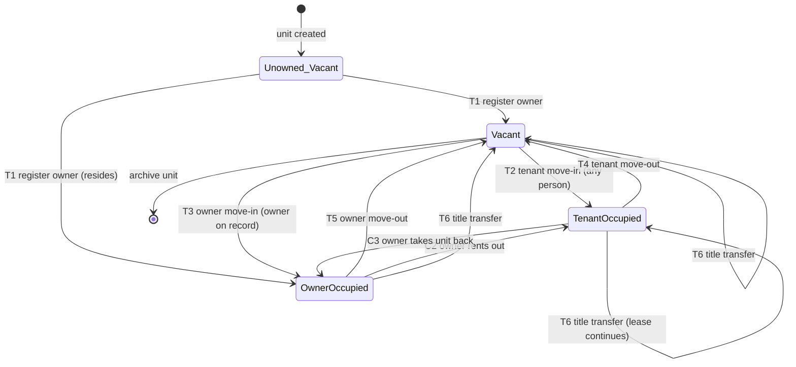

# Unit State & Transition Analysis

> **Scope:** EPIC-08 (Unit Occupancy Lifecycle), with effects on EPIC-04 (registration approval) and EPIC-09 (move-out settlement).
> **Status:** Analysis only. Nothing in this document is implemented. The normative model is in
> [EPIC-08 §3](../.specify/requirements/EPIC-08-occupancy-lifecycle-and-dual-ledger-management.md#3-unit-state-model-normative); this document explains why it looks that way and what the current code does instead.
> **Date:** 2026-11-13

---

## 1. Problem statement

After a tenant moves out, the unit becomes `VACANT`. From there the manager opens one move-in form, picks a role (tenant or owner) and types any person in free format.

That is right for a tenant and wrong for an owner. A tenant leaving does not mean the unit was sold. The owner is still the same person, so the owner moving in is a change of **who lives there**, not of **who owns it**. Today the form treats "owner moves in" as "a new owner arrives", and the typed person silently replaces the owner on record.

The underlying cause is that the system has one state field for two independent facts.

## 2. The two facts a unit carries

| Dimension | Question it answers | Source of truth | Changed by |
| :--- | :--- | :--- | :--- |
| **Ownership** | Who holds the title deed? | `unit_ownerships` (active row) | Owner registration, title deed transfer. Nothing else. |
| **Occupancy** | Who lives in the unit? | `unit_occupancies` (active row) | Move-in, move-out. Nothing else. |

`units.owner_person_id`, `units.tenant_person_id` and `units.occupancy_status` are projections of these two tables (migration V15 already says so for the two person columns).

The rule that follows, and the one the user's report comes down to:

> **A move-in or move-out never changes ownership. A title transfer is the only way the owner changes.**

## 3. States

### 3.1 Ownership

| State | Meaning |
| :--- | :--- |
| `UNOWNED` | No owner on record. The unit was created (onboarding, bulk import) and nobody has been registered yet. |
| `OWNED` | At least one active `unit_ownerships` row. |

### 3.2 Occupancy

| State | Active `unit_occupancies` row | Operational dues debtor |
| :--- | :--- | :--- |
| `VACANT` | none | Owner |
| `OWNER_OCCUPIED` | type `OWNER`, person is an active owner | Owner |
| `TENANT_OCCUPIED` | type `TENANT`, person is not an active owner | Tenant |

Capital dues go to the owner in every state.

### 3.3 Valid combinations

| | `VACANT` | `OWNER_OCCUPIED` | `TENANT_OCCUPIED` |
| :--- | :---: | :---: | :---: |
| `UNOWNED` | valid (initial state) | impossible | not allowed (assumption A2) |
| `OWNED` | valid | valid | valid |

A unit can also be **archived** (`units.deleted_at`). That is a terminal state reachable only from `VACANT`, and it is outside this analysis beyond that precondition.

## 4. Transitions

Each command has a precondition. A command whose precondition does not hold is rejected with an error; it never "fixes" the state on the way.

| # | Command | From | To | Who is the person | Ownership effect |
| :-- | :--- | :--- | :--- | :--- | :--- |
| T1 | Register owner | `UNOWNED` + `VACANT` | `OWNED` + `VACANT`, or `OWNED` + `OWNER_OCCUPIED` if the owner resides | Free format or existing person | Opens ownership |
| T2 | Tenant move-in | `OWNED` + `VACANT` | `TENANT_OCCUPIED` | Free format or existing person; must not be an active owner | None |
| T3 | Owner move-in | `OWNED` + `VACANT` | `OWNER_OCCUPIED` | **Fixed: the owner on record.** No name, phone or email input | None |
| T4 | Tenant move-out | `TENANT_OCCUPIED` | `VACANT` | The active tenant | None |
| T5 | Owner move-out | `OWNER_OCCUPIED` | `VACANT` | The active owner-occupant | None. The owner keeps the deed |
| T6 | Title deed transfer | `OWNED` + any occupancy | see below | New owner: free format or existing person | Closes old ownership, opens new |

Title transfer (T6) by current occupancy:

| Occupancy before | Occupancy after | Note |
| :--- | :--- | :--- |
| `VACANT` | `VACANT` | New owner may then use T3. |
| `TENANT_OCCUPIED`, buyer is someone else | `TENANT_OCCUPIED` | Lease continues untouched (existing STORY-08-05). |
| `TENANT_OCCUPIED`, buyer is the tenant | `OWNER_OCCUPIED` | Tenant session closes with exit balance, owner session opens the same day. |
| `OWNER_OCCUPIED` | `VACANT` by default, `OWNER_OCCUPIED` if "new owner moves in" is chosen | The old owner's session always closes. |

Compound transitions are shortcuts that run two commands in one database transaction with one effective date. The first command's settlement is never skipped.

| # | Shortcut | Equals |
| :-- | :--- | :--- |
| C1 | Replace tenant (`TENANT_OCCUPIED` → `TENANT_OCCUPIED`) | T4 + T2 |
| C2 | Owner rents out (`OWNER_OCCUPIED` → `TENANT_OCCUPIED`) | T5 + T2 |
| C3 | Owner takes the unit back (`TENANT_OCCUPIED` → `OWNER_OCCUPIED`) | T4 + T3 |

All states in the diagram except `Unowned_Vacant` are `OWNED`.

### 4.1 What every transition must do

1. Run in one database transaction with the unit row locked.
2. Check the precondition against the source-of-truth tables, not against the request.
3. Take an effective date. It cannot be in the future and cannot be before the start of the session being closed.
4. On any session close: freeze `exit_balance` for **that person's own** unpaid liabilities, and archive household members under the closed session.
5. Update the projections on `units` in the same transaction.
6. Write an audit record (who, when, command, from-state, to-state).

## 5. Current behaviour and gaps

Findings from reading the code on `master` at `9afbdd4`. None of these were reproduced by running the application.

| # | Gap | Where | Consequence |
| :-- | :--- | :--- | :--- |
| G1 | Move-in with role `OWNER` accepts any person and writes it to `units.owner_person_id`. `unit_ownerships` is not touched. | `site_admin_service.rs` `move_in_resident` (owner branch); form in `owners_residents_occupancy.dart` | **The reported problem.** An owner move-in acts as an unrecorded sale: no transfer date, no closing balance for the previous owner, and the projection disagrees with `unit_ownerships`. |
| G2 | Move-in has no precondition. It closes whatever session is active without computing an exit balance. | `move_in_resident`; the unit card offers move-in on owner-occupied and tenant-occupied units | Replacing a tenant this way loses the exit settlement that move-out would have recorded. |
| G3 | Move-out has no precondition. On a `VACANT` unit with an owner it "moves out" the owner and inserts a closed session that started 30 days ago. | `move_out_resident` (fallback insert) | Invented history rows. |
| G4 | Move-in and move-out are several separate statements with no transaction and no row lock. | both functions | A failure halfway leaves the session tables and `units` disagreeing. Title transfer already does this correctly. |
| G5 | Exit balance is summed per unit, not per person. | `move_out_resident` | A departing tenant's exit balance can include dues that accrued to the owner while the unit was vacant earlier. |
| G6 | Title transfer on an owner-occupied unit closes the owner's session but leaves `occupancy_status = OWNER_OCCUPIED`. | `unit_repository.rs` `transfer_unit_ownership_db` | The unit reports an occupant with no active session. |
| G7 | The "edit owner" dialog is a second path that adds and removes tenants, with its own rules and no exit balance. | `site_admin_service.rs` `update_home_owner` (`remove_tenant`, tenant fields) | Two code paths for the same transition, with different results. |
| G8 | Registration approval writes owner or tenant onto the unit and opens a session without checking the unit's state or setting `occupancy_status`. | `registration_approval_service.rs` | An approval can overwrite an existing owner, or leave the status field stale. |
| G9 | `occupancy_status` is stored and written by hand in each path. Nothing ties it to `unit_occupancies`. | `units` table | G3, G6 and G8 are all instances of this. |
| G10 | The UI offers one move-in form with a role switch, and labels the vacant-unit action "Yeni Kiracı / Sakin Girişi". | `owners_residents_unit_card.dart`, `owners_residents_occupancy.dart` | The form itself suggests an owner is a new person to be typed in. |

G1 and G10 are what the user reported. G2 to G9 are the same weakness (no guarded state machine) showing up elsewhere, and fixing G1 alone would leave them in place.

## 6. Requirement changes

Made in [EPIC-08](../.specify/requirements/EPIC-08-occupancy-lifecycle-and-dual-ledger-management.md):

| Change | Closes |
| :--- | :--- |
| New §3 "Unit State Model (Normative)": dimensions, states, transition table, invariants | defines the target |
| STORY-08-02, 08-03, 08-04 marked as amended by the new stories; their text is unchanged | |
| **STORY-08-06** Owner move-in uses the owner on record and never changes ownership | G1, G10 |
| **STORY-08-07** Guarded transitions: illegal commands are rejected | G2, G3, G8 |
| **STORY-08-08** Compound transitions keep the exit settlement | G2, G7 |
| **STORY-08-09** Title transfer keeps occupancy consistent | G6 |
| **STORY-08-10** Atomic transitions, derived status, per-person exit balance, audit | G4, G5, G9 |

EPIC-08 goes from 5 stories (all completed) to 10 stories (5 completed, 5 pending).

## 7. Assumptions to confirm

The requirements were written with these defaults. Each one changes a story if the answer is different.

| # | Question | Default taken |
| :-- | :--- | :--- |
| A1 | A unit can have several owners (`unit_ownerships.share_percentage`). Which one moves in? | The manager picks one of the active owners. With a single owner there is nothing to pick. |
| A2 | Can a tenant move into a unit that has no owner on record? | No. An owner must be registered first, because vacant-period and capital dues need a debtor. |
| A3 | Is a move mid-month prorated between the outgoing and incoming debtor? | No. The debtor for a period is whoever the state says on the accrual date, as today. |
| A4 | When an owner-occupied unit is sold, what is the default occupancy? | `VACANT`, with an explicit "new owner moves in" option. |
| A5 | A relative of the owner lives in the unit without a lease. Which state? | `OWNER_OCCUPIED`, with the relative as a household member. No fourth state. |
| A6 | Correcting a move entered by mistake (undo). | Out of scope here. It needs its own story because it rewrites history. |

## 8. Implementation impact (for planning only)

| Layer | Expected change |
| :--- | :--- |
| Database | Migration: derive `occupancy_status` from `unit_occupancies` (trigger, as V15 does for the person columns), a check that an `OWNER` session's person is an active owner, and a drift view for existing data. Existing rows where `owner_person_id` and `unit_ownerships` disagree need a one-time reconciliation. |
| Backend | One occupancy transition service with the commands in §4, used by move-in, move-out, title transfer, owner edit and registration approval. Move-in request loses free-format fields when the role is `OWNER`. |
| Flutter | Vacant unit card offers two actions: "Kiracı Girişi" (form) and "Kat Maliki Taşınsın" (confirmation showing the owner on record, no form). Actions shown per state follow the transition table. |
| Tests | One test per row of the transition table, one per illegal command, and the e2e flow tenant-out then owner-in asserting the owner is unchanged. |
