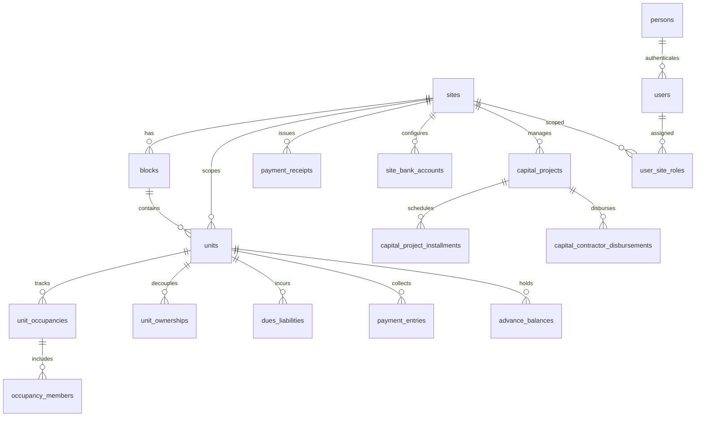

# SitePulse — Database Design & Normalization Thorough Evaluation Report

**Document Version:** 1.0.0  
**Date:** 2026-11-05  
**Target System:** SitePulse Residential Management SaaS (`PostgreSQL 16`)  
**Scope:** Authoritative Database Schema (`backend/db/init/00-*.sql`), 27 Tables, 47 Foreign Keys, Constraints, Indexes, and Alignment with Business Specifications (`.specify/requirements/EPIC-01…10`).  
**Status:** Report only — no code, schema, or migration changes applied.

---

## 1. Executive Summary

This report delivers a thorough, ground-up architectural audit of the SitePulse relational database schema. The database has evolved from an initial single-site model into a multi-tenant SaaS platform supporting complex dual-ledger accounting (KMK Law 634 & TBK Law 6098), bank statement reconciliation, occupancy lifecycles, and capital expenditure projects.

### 1.1 Key Structural Strengths
- **Arbitrary Monetary Precision:** High-precision `NUMERIC(15, 2)` types are applied consistently across all financial columns, preventing floating-point rounding errors.
- **Tenant Integrity Gate on Core Units:** Migration `00-08` established `fk_units_block_site (block_id, site_id) REFERENCES blocks(id, site_id) ON DELETE CASCADE`, preventing block/site mismatches.
- **Occupancy Lifecycle & Auditability:** Historical tracking is preserved in `unit_occupancies` and `unit_ownerships` rather than destructive overwrites.
- **Single Source Schema Pipeline:** Init scripts (`db/init/00-*.sql`) and migrations (`migrations/V*.sql`) are synchronized and verified byte-identical.

### 1.2 Summary of Critical Flaws & Inconsistencies
| Category | Issue | Impact |
| :--- | :--- | :--- |
| **Multi-Tenancy** | `reconciliation_queue` completely lacks a `site_id` column. | Unmatched bank transactions cannot be scoped by tenant; cross-tenant data leakage risk. |
| **Identity & Privacy** | `persons` is global with globally unique `email` and `national_id`. | If two independent sites register the same person, data is overwritten or rejected; cross-tenant identity leaks. |
| **3NF Dual Truth** | `units` retains `owner_person_id`, `tenant_person_id`, and `occupancy_status`. | Conflicts with `unit_ownerships` and `unit_occupancies`. Multi-owner units and move-outs cause desynchronization. |
| **3NF Dual Truth** | `users` retains `site_id` and `role`. | Conflicts with `user_site_roles` multi-tenant RBAC table. |
| **Missing Foreign Keys** | `dues_liabilities.period`, `units.house_type`, `site_bank_accounts.bank_code`, `capital_project_installments`. | Raw string joins instead of enforced FK relationships to parent entities (`dues_periods`, `house_types`, `system_supported_banks`). |
| **1NF Violation** | `payment_receipts.allocation_breakdown` is a `JSONB` array. | Multi-due allocations cannot be indexed, queried, or verified relationally via SQL foreign keys. |
| **BCNF Violation** | `unit_sender_ibans.sender_iban` is the primary key. | A payer or investor who pays for multiple units with the same IBAN triggers a primary key collision. |
| **Dual-Ledger Flaw** | `advance_balances` is keyed solely to `unit_id`. | Cannot distinguish owner advance from tenant advance; departing tenant balances are absorbed by new occupants. |
| **KMK Bank Account Cap** | `site_bank_accounts` enforces `UNIQUE(site_id) WHERE is_active = true`. | Prohibits sites from maintaining separate Operational (`İşletme`) and Reserve (`Demirbaş`) bank accounts. |
| **Cascading Deletion** | `units_site_id_fkey` is `ON DELETE NO ACTION`. | Deleting an inactive site as SaaS Super Admin (EPIC-03 STORY-03-06) fails with foreign key violation. |

---

## 2. Theoretical Normalization Audit

```
┌────────────────────────────────────────────────────────────────────────┐
│                        Normalization Summary                           │
├───────────────────┬──────────────┬─────────────────────────────────────┤
│ Level             │ Status       │ Primary Problem Areas               │
├───────────────────┼──────────────┼─────────────────────────────────────┤
│ 1NF (Atomicity)   │ VIOLATED     │ payment_receipts.allocation_breakdown│
│ 2NF (Partial FK)  │ VIOLATED     │ capital_project_installments        │
│ 3NF (Transitive)  │ SEVERELY BAD │ units, users, occupancy_members     │
│ BCNF (Determinant)│ VIOLATED     │ unit_sender_ibans                   │
└───────────────────┴──────────────┴─────────────────────────────────────┘
```

1. **1NF Violation (First Normal Form):**
   - In `payment_receipts`, the attribute `allocation_breakdown` is a `JSONB` array holding structured objects (`due_id`, `period_name`, `principal`, `penalty`).
   - Normalization requires all attribute values to be atomic scalars. Relational allocation requires an associative entity (`payment_receipt_allocations` or `payment_allocations`).
2. **2NF Violation (Second Normal Form):**
   - In `capital_project_installments`, `total_installments` is a project-level attribute duplicated on every installment row rather than depending solely on the candidate key `(project_id, installment_number)`.
   - In `invitation_tokens`, `building` and `unit_number` are redundant string snapshots that depend on `unit_id`.
3. **3NF Violation (Third Normal Form & Transitive Dependencies):**
   - `units`: `owner_person_id`, `tenant_person_id`, and `occupancy_status` depend transitively on `unit_ownerships` and `unit_occupancies`.
   - `occupancy_members`: `full_name`, `phone`, and `email` duplicate attributes of `persons`.
   - `users`: `site_id` and `role` depend transitively on `user_site_roles`.
   - `dues_liabilities`: `period` is a redundant text copy of `dues_periods.period_name` without a foreign key.
   - `reconciliation_queue`: `matched_block`, `matched_unit_number`, and `matched_resident_name` depend on `matched_unit_id`.
4. **BCNF Violation (Boyce-Codd Normal Form):**
   - In `unit_sender_ibans`, `sender_iban` is chosen as the Primary Key ($sender\_iban \rightarrow unit\_id$). In reality, an IBAN belongs to a person or bank account and can pay for multiple units ($M:N$). Choosing `sender_iban` as the primary key creates an artificial functional dependency that rejects valid business states.

---

## 3. Table-by-Table Comprehensive Evaluation (All 27 Tables)



---

### 3.1 `sites`
- **Purpose:** SaaS tenant root entity representing an independent residential complex / apartment site.
- **Columns:** `id` (BIGINT PK), `name` (VARCHAR 150 NOT NULL), `address` (TEXT), `created_at` (TIMESTAMPTZ), `slug` (VARCHAR 180 UNIQUE), `status` (VARCHAR 30 NOT NULL DEFAULT 'ACTIVE'), `plan_type` (VARCHAR 50 NOT NULL DEFAULT 'STANDARD'), `license_end_date` (DATE).
- **Constraints & Indexes:** `sites_pkey`, `sites_slug_key`.
- **Business Alignment:** Aligns with EPIC-03 (SaaS Multi-Tenancy Onboarding).
- **Defects & Flaws:**
  - `status` and `plan_type` lack `CHECK` constraints on valid domain vocabularies.
  - Lacks a `timezone` column. All database cron jobs and Tokio scheduler tasks default to `CURRENT_DATE`/UTC, causing monthly dues accrual for Turkish sites (UTC+3) to trigger 3 hours late or early at month boundaries.
  - `license_end_date` has no business rule check enforcing that expired sites transition out of `ACTIVE`.

---

### 3.2 `blocks`
- **Purpose:** Physical building structures within a condominium site.
- **Columns:** `id` (BIGINT PK), `site_id` (BIGINT NOT NULL), `block_name` (VARCHAR 50 NOT NULL), `total_floors` (INT NOT NULL DEFAULT 1), `created_at` (TIMESTAMPTZ).
- **Constraints & Indexes:** `blocks_pkey`, `blocks_site_id_fkey` (`site_id` $\rightarrow$ `sites.id` ON DELETE CASCADE), `uq_site_block_name` (`site_id, block_name`), `uq_blocks_id_site` (`id, site_id`).
- **Defects & Flaws:**
  - `total_floors` lacks `CHECK (total_floors > 0 AND total_floors <= 150)`. Zero or negative floor counts are representable.

---

### 3.3 `units`
- **Purpose:** Independent physical dwelling unit (Bağımsız Bölüm).
- **Columns:** `id` (BIGINT PK), `block_id` (BIGINT NOT NULL), `unit_number` (INT NOT NULL), `floor` (INT NOT NULL), `land_share` (INT NOT NULL DEFAULT 1), `owner_person_id` (BIGINT NULL), `tenant_person_id` (BIGINT NULL), `site_id` (BIGINT NOT NULL), `virtual_iban` (VARCHAR 34 NULL), `occupancy_status` (VARCHAR 20 NOT NULL DEFAULT 'OWNER_OCCUPIED'), `house_type` (VARCHAR 50 NULL), `version` (INT NOT NULL DEFAULT 0), `created_at` (TIMESTAMPTZ).
- **Constraints & Indexes:**
  - `units_pkey`, `uq_block_unit` (`block_id, unit_number`), `uq_units_virtual_iban` (UNIQUE WHERE virtual_iban IS NOT NULL).
  - `chk_units_floor` (`floor >= -5 AND floor <= 150`), `chk_units_land_share` (`land_share > 0`), `chk_units_occupancy_status` (`occupancy_status IN ('OWNER_OCCUPIED', 'TENANT_OCCUPIED', 'VACANT')`).
  - `fk_units_block_site` (`(block_id, site_id)` $\rightarrow$ `blocks(id, site_id)` ON DELETE CASCADE).
  - `units_block_id_fkey` (`block_id` $\rightarrow$ `blocks.id` ON DELETE CASCADE).
  - `units_site_id_fkey` (`site_id` $\rightarrow$ `sites.id` **ON DELETE NO ACTION**).
  - `units_owner_person_id_fkey`, `units_tenant_person_id_fkey` $\rightarrow$ `persons.id`.
- **Defects & Flaws:**
  - **Dual Truth / 3NF Violation:** `owner_person_id`, `tenant_person_id`, and `occupancy_status` directly conflict with `unit_ownerships` and `unit_occupancies`. Multiple co-owners (e.g. 50%/50%) cannot be stored in `owner_person_id`. Tenancy move-outs do not automatically clear `tenant_person_id`.
  - **Orphan Tariff String:** `house_type` is free-text `VARCHAR(50)` without an FK to `house_types`.
  - **SaaS Deletion Blocker:** `units_site_id_fkey` uses `ON DELETE NO ACTION`, preventing cascading site deletion in EPIC-03.
  - **Redundant Foreign Key:** `units_block_id_fkey` duplicates `fk_units_block_site`.
  - **Vestigial Optimistic Lock:** `version` column exists but is never incremented in any write path.

---

### 3.4 `persons`
- **Purpose:** Central individual registry for all human beings across the platform.
- **Columns:** `id` (BIGINT PK), `national_id` (VARCHAR 11 NULL UNIQUE), `full_name` (VARCHAR 120 NOT NULL), `phone` (VARCHAR 20 NULL), `email` (VARCHAR 120 NULL UNIQUE), `person_type` (VARCHAR 20 NOT NULL).
- **Constraints & Indexes:** `persons_pkey`, `persons_national_id_key`, `uq_persons_email`, `uq_persons_email_lower`, `chk_persons_person_type` (`'HOME_OWNER'`, `'HOME_RESIDENT'`, `'SITE_MANAGER'`, `'SAAS_ADMIN'`), `chk_persons_email_not_blank`.
- **Defects & Flaws:**
  - **Cross-Tenant Privacy Leak:** `persons` has no `site_id`. `email` and `national_id` are globally unique across all SaaS tenants. If Site A enters an email already registered in Site B, the insertion fails, confirming the individual's existence in another site. If Site B updates the person's phone number or name, it silently mutates Site A's resident data.
  - **Domain Modeling Flaw (`person_type`):** A human being's role is contextual to a unit or site (an owner in Site A can be a tenant in Site B). Forcing a single global `person_type` scalar violates domain reality.
  - **Missing TC Kimlik Check:** `national_id` lacks regex verification (`CHECK (national_id ~ '^[1-9][0-9]{10}$')`).

---

### 3.5 `users`
- **Purpose:** User credentials, password hashes, and OAuth linkings for system login.
- **Columns:** `id` (BIGINT PK), `site_id` (BIGINT NULL), `email` (VARCHAR 120 NOT NULL UNIQUE), `password_hash` (VARCHAR 255 NULL), `role` (VARCHAR 30 NOT NULL), `must_change_password` (BOOLEAN NOT NULL DEFAULT false), `created_at` (TIMESTAMPTZ), `auth_provider` (VARCHAR 30 NOT NULL DEFAULT 'LOCAL'), `google_sub` (VARCHAR 100 NULL), `avatar_url` (VARCHAR 500 NULL), `person_id` (BIGINT NULL).
- **Constraints & Indexes:** `users_pkey`, `users_email_key`, `uq_user_google_sub`, `chk_users_role`, `users_site_id_fkey`, `users_person_id_fkey`.
- **Defects & Flaws:**
  - **Dual Source of Truth for Auth:** `users.site_id` and `users.role` conflict with `user_site_roles`. Multi-site users cannot be handled via `users.role`.
  - **Duplicated Identity:** Both `users.email` and `persons.email` exist with independent unique constraints and no synchronization.
  - **Unconditional Nullable Password:** Lacks `CHECK (auth_provider <> 'LOCAL' OR password_hash IS NOT NULL)`.
  - **Duplicate Indexes:** `idx_user_site` and `idx_users_site_id` both index `site_id`; `users_email_key` and `idx_user_email` both index `email`.

---

### 3.6 `user_site_roles`
- **Purpose:** Multi-tenant role-based access control (RBAC) mapping users to sites.
- **Columns:** `id` (BIGINT PK), `user_id` (BIGINT NOT NULL), `site_id` (BIGINT NOT NULL), `role` (VARCHAR 30 NOT NULL), `created_at` (TIMESTAMPTZ).
- **Constraints & Indexes:** `user_site_roles_pkey`, `uq_user_site_role` (`user_id, site_id, role`), `chk_user_site_roles_role`, `user_site_roles_user_id_fkey`, `user_site_roles_site_id_fkey`.
- **Defects & Flaws:**
  - **Unexercised Write Path:** Backend query code continues to inspect `users.role` and `users.site_id` rather than joining `user_site_roles`.
  - **SaaS Admin Anomaly:** `SAAS_ADMIN` is a global role with no site scope, but `site_id` is defined as `NOT NULL`.

---

### 3.7 `unit_ownerships`
- **Purpose:** Title deed ownership ledger supporting fractional shares, co-owners, and property sales history.
- **Columns:** `id` (BIGINT PK), `unit_id` (BIGINT NOT NULL), `person_id` (BIGINT NOT NULL), `share_percentage` (NUMERIC(5, 2) NOT NULL DEFAULT 100.00), `start_date` (DATE NOT NULL DEFAULT CURRENT_DATE), `end_date` (DATE NULL), `is_active` (BOOLEAN NOT NULL DEFAULT true), `created_at` (TIMESTAMPTZ).
- **Constraints & Indexes:** `unit_ownerships_pkey`, `unit_ownerships_share_percentage_check`, `chk_ownership_dates`, `uq_unit_active_owner` (`unit_id, person_id` WHERE is_active = true), `unit_ownerships_unit_id_fkey`, `unit_ownerships_person_id_fkey`.
- **Defects & Flaws:**
  - **Missing Active Invariant:** Lacks `CHECK (NOT is_active OR end_date IS NULL)`. A row can be marked active with an end date in the past.
  - **Sum of Shares Unchecked:** There is no constraint enforcing $\sum \text{share\_percentage} = 100.00\%$ per unit. Two owners can each be saved with 100% active ownership.
  - **Dead Write Path:** Title deed transfer (STORY-09-07) has no write implementation; only the initial migration seed populated it.

---

### 3.8 `unit_occupancies`
- **Purpose:** Historical and active occupancy timeline tracking move-in / move-out lifecycles.
- **Columns:** `id` (BIGINT PK), `unit_id` (BIGINT NOT NULL), `person_id` (BIGINT NOT NULL), `occupancy_type` (VARCHAR 20 NOT NULL), `start_date` (DATE NOT NULL DEFAULT CURRENT_DATE), `end_date` (DATE NULL), `is_active` (BOOLEAN NOT NULL DEFAULT true), `exit_balance` (NUMERIC(15, 2) DEFAULT 0.00), `notes` (TEXT NULL), `created_at` (TIMESTAMPTZ).
- **Constraints & Indexes:** `unit_occupancies_pkey`, `chk_occupancy_active_open`, `chk_occupancy_dates`, `chk_occupancy_type` (`'OWNER'`, `'TENANT'`), `uq_unit_active_occupancy` (`unit_id` WHERE is_active = true), `unit_occupancies_unit_id_fkey`, `unit_occupancies_person_id_fkey`.
- **Defects & Flaws:**
  - **Single Active Occupant Restriction:** `uq_unit_active_occupancy` permits only ONE active occupant per unit. Joint primary co-tenants cannot both hold an active occupancy session.
  - **Unconnected Exit Balance:** `exit_balance` is a standalone scalar with no relational link to `advance_balances` or settled `dues_liabilities`.

---

### 3.9 `occupancy_members`
- **Purpose:** Household members, co-residents, or emergency contacts living with an occupant.
- **Columns:** `id` (BIGINT PK), `occupancy_id` (BIGINT NOT NULL), `person_id` (BIGINT NULL), `resident_user_id` (BIGINT NULL), `full_name` (VARCHAR 120 NOT NULL), `relationship` (VARCHAR 50 NOT NULL), `phone` (VARCHAR 30 NULL), `email` (VARCHAR 120 NULL), `is_emergency_contact` (BOOLEAN NOT NULL DEFAULT false), `notes` (TEXT NULL), `created_at` (TIMESTAMPTZ).
- **Constraints & Indexes:** `occupancy_members_pkey`, `uq_occupancy_member_person` (`occupancy_id, person_id` WHERE person_id IS NOT NULL), `occupancy_members_occupancy_id_fkey`, `occupancy_members_person_id_fkey`, `occupancy_members_resident_user_id_fkey`.
- **Defects & Flaws:**
  - **Profile Redundancy (3NF Violation):** `full_name`, `phone`, and `email` duplicate columns in `persons`. When `person_id` is present, updates in `persons` leave `occupancy_members` stale.
  - **Unconstrained Relationship Type:** `relationship` is free text with no domain check constraint.

---

### 3.10 `house_types`
- **Purpose:** Flat categorization tariff catalogue (e.g. "1+1", "2+1") used to price monthly dues.
- **Columns:** `id` (BIGINT PK), `site_id` (BIGINT NOT NULL), `type_name` (VARCHAR 50 NOT NULL), `dues_amount` (NUMERIC(15, 2) NOT NULL), `description` (VARCHAR 200 NULL), `created_at` (TIMESTAMPTZ).
- **Constraints & Indexes:** `house_types_pkey`, `uq_site_house_type` (`site_id, type_name`), `house_types_site_id_fkey`.
- **Defects & Flaws:**
  - **Orphaned Lookup Table:** Completely unreferenced by foreign keys. `units.house_type` joins via string matching rather than `house_types.id`.
  - `dues_amount` lacks `CHECK (dues_amount >= 0)`.

---

### 3.11 `dues_periods`
- **Purpose:** Monthly operational dues billing periods (e.g. "September 2026").
- **Columns:** `id` (BIGINT PK), `site_id` (BIGINT NOT NULL), `period_name` (VARCHAR 50 NOT NULL), `due_date` (DATE NOT NULL), `status` (VARCHAR 20 NOT NULL DEFAULT 'ACTIVE'), `created_at` (TIMESTAMPTZ).
- **Constraints & Indexes:** `dues_periods_pkey`, `uq_site_period_name` (`site_id, period_name`), `fk_dues_periods_site`.
- **Defects & Flaws:**
  - **Orphaned Dimension Table:** `dues_liabilities` stores a bare `period VARCHAR(50)` text string and has NO foreign key to `dues_periods`.
  - `status` lacks check constraint (`'ACTIVE'`, `'CLOSED'`, `'DRAFT'`).
  - Lacks integer attributes `period_year` and `period_month` for chronological index ordering.

---

### 3.12 `dues_liabilities`
- **Purpose:** Core financial fact table recording accrued operational dues and capital project installment liabilities.
- **Columns:** `id` (BIGINT PK), `unit_id` (BIGINT NOT NULL), `period` (VARCHAR 50 NOT NULL), `debtor_type` (VARCHAR 20 NOT NULL DEFAULT 'TENANT'), `expense_type` (VARCHAR 30 NOT NULL DEFAULT 'OPERATIONAL_DUES'), `liable_person_id` (BIGINT NULL), `occupancy_id` (BIGINT NULL), `principal_amount` (NUMERIC(15, 2) NOT NULL), `due_date` (DATE NOT NULL), `status` (VARCHAR 20 NOT NULL DEFAULT 'PENDING'), `delay_penalty` (NUMERIC(15, 2) NOT NULL DEFAULT 0.00), `paid_amount` (NUMERIC(15, 2) NOT NULL DEFAULT 0.00), `payment_date` (TIMESTAMPTZ NULL), `version` (INT NOT NULL DEFAULT 0), `created_at` (TIMESTAMPTZ), `capital_project_id` (BIGINT NULL), `installment_number` (INT NULL).
- **Constraints & Indexes:**
  - `dues_liabilities_pkey`, `chk_dues_debtor_type` (`'OWNER'`, `'TENANT'`), `chk_dues_expense_type` (`'OPERATIONAL_DUES'`, `'CAPITAL_DUES'`).
  - `chk_dues_principal_non_negative`, `chk_dues_penalty_non_negative`, `chk_dues_paid_non_negative`, `chk_dues_paid_within_owed`.
  - `chk_dues_status` (`'PENDING'`, `'PAID'`, `'OVERDUE'`, `'CANCELLED'`, `'PARTIALLY_PAID'`).
  - `uq_unit_period_expense` (UNIQUE `unit_id, period, expense_type` WHERE capital_project_id IS NULL).
  - `uq_unit_capital_installment` (UNIQUE `unit_id, capital_project_id, installment_number` WHERE capital_project_id IS NOT NULL).
  - `dues_liabilities_unit_id_fkey`, `dues_liabilities_liable_person_id_fkey`, `dues_liabilities_occupancy_id_fkey`, `fk_dues_capital_project`.
- **Defects & Flaws:**
  - **KMK Statutory Debtor Violation:** Lacks `CHECK (expense_type <> 'CAPITAL_DUES' OR debtor_type = 'OWNER')`. A capital due can be illegally charged to a tenant.
  - **Missing Installment Foreign Key:** Has `capital_project_id` and `installment_number` but no composite FK to `capital_project_installments(project_id, installment_number)`.
  - **TBK 100 Allocation Deficit:** Stores a single `paid_amount`. Turkish law mandates allocating payments to penalty before principal. Without `paid_principal` and `paid_penalty`, remaining interest-bearing principal cannot be verified.
  - **Missing Tenant `site_id`:** Lacks direct `site_id`, forcing all site queries to join `units`.
  - **Unlinked `period`:** No FK to `dues_periods`.

---

### 3.13 `advance_balances`
- **Purpose:** Current surplus / advance credit balance held on account for a flat.
- **Columns:** `unit_id` (BIGINT PK), `balance` (NUMERIC(15, 2) NOT NULL DEFAULT 0.00), `updated_at` (TIMESTAMPTZ).
- **Constraints & Indexes:** `advance_balances_pkey`, `chk_advance_balance_non_negative`, `fk_advance_balances_unit`.
- **Defects & Flaws:**
  - **Dual-Ledger Accounting Flaw:** Keyed solely by `unit_id`. Overpayments cannot be partitioned between Landlord (`OWNER`) and Tenant (`TENANT`). When a tenant moves out, their credit balance remains attached to the unit and is absorbed by the next tenant.
  - **No Transaction History:** Balance is mutated in place without an underlying append-only journal (`advance_ledger_entries`), violating audit requirements.

---

### 3.14 `payment_entries`
- **Purpose:** Unified inbound transaction stream recording payments across all payment channels.
- **Columns:** `id` (BIGINT PK), `site_id` (BIGINT NOT NULL), `unit_id` (BIGINT NOT NULL), `payer_name` (VARCHAR 120 NOT NULL), `payer_role` (VARCHAR 20 NOT NULL DEFAULT 'TENANT'), `receipt_id` (BIGINT NULL), `amount` (NUMERIC(15, 2) NOT NULL), `payment_channel` (VARCHAR 30 NOT NULL), `settlement_status` (VARCHAR 20 NOT NULL DEFAULT 'SETTLED'), `description` (TEXT NULL), `external_reference` (VARCHAR 100 NULL), `payment_date` (TIMESTAMPTZ DEFAULT CURRENT_TIMESTAMP), `created_at` (TIMESTAMPTZ DEFAULT CURRENT_TIMESTAMP), `dues_liability_id` (BIGINT NULL).
- **Constraints & Indexes:** `payment_entries_pkey`, `chk_payment_entry_amount`, `fk_payment_entries_site`, `fk_payment_entries_unit`, `fk_payment_entries_dues`, `payment_entries_receipt_id_fkey`.
- **Defects & Flaws:**
  - **Scalar `dues_liability_id` Prevents Multi-Due Allocation:** A payment that settles multiple dues cannot be attributed relationally.
  - **Unvalidated Unit Integrity:** `dues_liability_id` is not constrained to match `payment_entries.unit_id`.
  - **Unlinked Payer Identity:** Stores `payer_name` and `payer_role` as plain text without an FK to `persons`.
  - **No Immutability Guard:** Lacks triggers or rules prohibiting UPDATE or DELETE on historical payment transactions.

---

### 3.15 `payment_receipts`
- **Purpose:** Official digital payment receipt vouchers (`#TAH-2026-XXXX`) with cryptographic SHA-256 verification hash.
- **Columns:** `id` (BIGINT PK), `site_id` (BIGINT NOT NULL), `unit_id` (BIGINT NOT NULL), `receipt_number` (VARCHAR 30 NOT NULL), `sequence_number` (BIGINT NOT NULL), `payer_name` (VARCHAR 120 NOT NULL), `payer_role` (VARCHAR 20 NOT NULL), `on_behalf_of_name` (VARCHAR 120 NULL), `on_behalf_of_role` (VARCHAR 20 NULL), `total_amount` (NUMERIC(15, 2) NOT NULL), `payment_channel` (VARCHAR 30 NOT NULL), `channel_reference` (VARCHAR 100 NULL), `allocated_principal` (NUMERIC(15, 2) NOT NULL DEFAULT 0.00), `allocated_penalty` (NUMERIC(15, 2) NOT NULL DEFAULT 0.00), `allocated_advance` (NUMERIC(15, 2) NOT NULL DEFAULT 0.00), `allocation_breakdown` (JSONB NOT NULL DEFAULT '[]'::jsonb), `is_rent_offset_eligible` (BOOLEAN NOT NULL DEFAULT false), `legal_statutory_note` (TEXT NULL), `verification_hash` (VARCHAR 64 NOT NULL), `issued_at` (TIMESTAMPTZ DEFAULT CURRENT_TIMESTAMP).
- **Constraints & Indexes:** `payment_receipts_pkey`, `chk_receipt_allocation_sums`, `uq_site_receipt_number`, `uq_site_receipt_sequence`, `fk_payment_receipts_site`, `fk_payment_receipts_unit`.
- **Defects & Flaws:**
  - **1NF Normalization Violation:** `allocation_breakdown` is an unnormalized `JSONB` array of due line items. Cannot be joined or verified with SQL foreign keys.
  - **Unexercised Persistence Path:** The table has zero INSERT call sites in application code; receipt metadata is rendered in-memory.
  - **Unvalidated Role Vocabularies:** `payer_role` and `on_behalf_of_role` lack check constraints.

---

### 3.16 `debt_aging_snapshots`
- **Purpose:** Snapshot table tracking debt aging buckets (current, 1–30, 31–60, 60+ days) and accrued interest.
- **Columns:** `id` (BIGINT PK), `site_id` (BIGINT NOT NULL), `unit_id` (BIGINT NOT NULL), `debtor_type` (VARCHAR 20 NOT NULL), `current_due` (NUMERIC(15, 2) NOT NULL DEFAULT 0.00), `overdue_1_30_days` (NUMERIC(15, 2) NOT NULL DEFAULT 0.00), `overdue_31_60_days` (NUMERIC(15, 2) NOT NULL DEFAULT 0.00), `overdue_60_plus_days` (NUMERIC(15, 2) NOT NULL DEFAULT 0.00), `accrued_delay_penalty` (NUMERIC(15, 2) NOT NULL DEFAULT 0.00), `total_outstanding` (NUMERIC(15, 2) NOT NULL DEFAULT 0.00), `as_of_date` (DATE NOT NULL DEFAULT CURRENT_DATE).
- **Constraints & Indexes:** `debt_aging_snapshots_pkey`, `uq_unit_debtor_aging` (`site_id, unit_id, debtor_type, as_of_date`), `fk_debt_aging_site`, `fk_debt_aging_unit`.
- **Defects & Flaws:**
  - **Unindexed Foreign Key on `unit_id`:** `unit_id` is only indexed as the second column in a compound index, causing table scans during unit cascade operations.
  - **Unvalidated Sum Formula:** Lacks check constraint verifying that `total_outstanding` matches the sum of the aging buckets plus delay penalty.
  - **Zero Write Path:** Unexercised in application code.

---

### 3.17 `capital_projects`
- **Purpose:** Long-term capital expenditure investment projects (e.g. elevator overhaul, roof maintenance).
- **Columns:** `id` (BIGINT PK), `site_id` (BIGINT NOT NULL), `title` (VARCHAR 180 NOT NULL), `category` (VARCHAR 40 NOT NULL), `description` (TEXT NULL), `total_budget` (NUMERIC(15, 2) NOT NULL), `allocation_basis` (VARCHAR 30 NOT NULL DEFAULT 'BY_LAND_SHARE'), `target_start_date` (DATE NOT NULL), `target_completion_date` (DATE NULL), `contractor_name` (VARCHAR 150 NULL), `contractor_tax_no` (VARCHAR 20 NULL), `contractor_iban` (VARCHAR 34 NULL), `contract_amount` (NUMERIC(15, 2) NULL), `status` (VARCHAR 30 NOT NULL DEFAULT 'ACTIVE'), `created_at` (TIMESTAMPTZ DEFAULT CURRENT_TIMESTAMP).
- **Constraints & Indexes:** `capital_projects_pkey`, `chk_capital_budget_positive`, `fk_capital_projects_site`.
- **Defects & Flaws:**
  - **Contractor Denormalization (2NF/3NF Violation):** Contractor attributes (`name`, `tax_no`, `iban`, `contract_amount`) are embedded directly in the project table. Projects cannot have multiple contractors.
  - **Unconstrained Vocabularies:** `allocation_basis`, `category`, and `status` lack domain check constraints.
  - **Missing Date Range Invariant:** Lacks `CHECK (target_completion_date IS NULL OR target_completion_date >= target_start_date)`.

---

### 3.18 `capital_project_installments`
- **Purpose:** Multi-stage installment scheduling and budget percentage apportionment for capital projects.
- **Columns:** `id` (BIGINT PK), `project_id` (BIGINT NOT NULL), `installment_number` (INT NOT NULL), `total_installments` (INT NOT NULL), `due_date` (DATE NOT NULL), `installment_budget` (NUMERIC(15, 2) NOT NULL), `percentage` (NUMERIC(5, 2) NOT NULL), `is_accrued` (BOOLEAN NOT NULL DEFAULT false), `accrued_at` (TIMESTAMPTZ NULL), `created_at` (TIMESTAMPTZ DEFAULT CURRENT_TIMESTAMP).
- **Constraints & Indexes:** `capital_project_installments_pkey`, `uq_project_installment` (`project_id, installment_number`), `chk_installment_budget_positive`, `chk_installment_pct_positive`, `capital_project_installments_project_id_fkey`.
- **Defects & Flaws:**
  - **Redundant Attribute (2NF Violation):** `total_installments` is repeated on every row rather than depending solely on the project.
  - **Budget Sum Invariant Missing:** No constraint or trigger verifies that $\sum \text{percentage} = 100.00\%$ or $\sum \text{installment\_budget} = \text{total\_budget}$.

---

### 3.19 `capital_contractor_disbursements`
- **Purpose:** Contractor milestone payment disbursements against approved contractor invoices.
- **Columns:** `id` (BIGINT PK), `project_id` (BIGINT NOT NULL), `milestone_name` (VARCHAR 120 NOT NULL), `invoice_number` (VARCHAR 60 NULL), `amount` (NUMERIC(15, 2) NOT NULL), `disbursement_date` (DATE NOT NULL DEFAULT CURRENT_DATE), `recipient_name` (VARCHAR 150 NOT NULL), `recipient_iban` (VARCHAR 34 NOT NULL), `payment_reference` (VARCHAR 100 NULL), `disbursement_method` (VARCHAR 30 NOT NULL DEFAULT 'BANK_TRANSFER'), `notes` (TEXT NULL), `created_at` (TIMESTAMPTZ DEFAULT CURRENT_TIMESTAMP).
- **Constraints & Indexes:** `capital_contractor_disbursements_pkey`, `chk_disbursement_amount_positive`, `capital_contractor_disbursements_project_id_fkey`.
- **Defects & Flaws:**
  - **Missing Link to Site Bank Account:** Outgoing disbursements lack an FK to `site_bank_accounts`, preventing bank statement reconciliation of project expenses.
  - **Unvalidated IBAN:** `recipient_iban` lacks regex validation.

---

### 3.20 `site_bank_accounts`
- **Purpose:** Official bank accounts maintained by site management (KMK 35-f).
- **Columns:** `id` (BIGINT PK), `site_id` (BIGINT NOT NULL), `bank_code` (VARCHAR 50 NOT NULL), `bank_name` (VARCHAR 120 NOT NULL), `iban` (VARCHAR 34 NOT NULL), `account_holder` (VARCHAR 120 NOT NULL), `statement_format` (VARCHAR 30 NOT NULL), `is_active` (BOOLEAN NOT NULL DEFAULT true), `configured_by` (BIGINT NULL), `created_at` (TIMESTAMPTZ DEFAULT CURRENT_TIMESTAMP), `updated_at` (TIMESTAMPTZ DEFAULT CURRENT_TIMESTAMP).
- **Constraints & Indexes:** `site_bank_accounts_pkey`, `uq_site_active_bank` (UNIQUE `site_id` WHERE is_active = true), `chk_bank_statement_format`, `chk_bank_iban_format`, `site_bank_accounts_site_id_fkey`, `site_bank_accounts_configured_by_fkey`.
- **Defects & Flaws:**
  - **Single Active Account Prohibits Dual Reserve Accounting:** `uq_site_active_bank` prohibits sites from maintaining separate Operational and Capital Reserve accounts.
  - **Unlinked Bank Code:** `bank_code` has no FK to `system_supported_banks(bank_code)`.
  - **User Deletion Cascade Hazard:** `configured_by` defaults to `ON DELETE NO ACTION`.
  - **Duplicate Indexes:** `idx_site_bank_account_site` and `idx_site_bank_accounts_site` both index `site_id`.

---

### 3.21 `system_supported_banks`
- **Purpose:** System catalog of supported Turkish banks and their statement parsers (Excel, MT940, CSV).
- **Columns:** `bank_code` (VARCHAR 50 PK), `bank_name` (VARCHAR 120 NOT NULL), `default_statement_format` (VARCHAR 30 NOT NULL), `is_active` (BOOLEAN NOT NULL DEFAULT true), `created_at` (TIMESTAMPTZ DEFAULT CURRENT_TIMESTAMP).
- **Constraints & Indexes:** `system_supported_banks_pkey`.
- **Defects & Flaws:**
  - Unreferenced by foreign keys from `site_bank_accounts`.

---

### 3.22 `system_configurations`
- **Purpose:** System key-value parameter table.
- **Columns:** `config_key` (VARCHAR 80 PK), `config_value` (VARCHAR 255 NOT NULL), `description` (TEXT NULL), `updated_at` (TIMESTAMPTZ DEFAULT CURRENT_TIMESTAMP).
- **Evaluation:** Clean 3NF design.

---

### 3.23 `reconciliation_queue`
- **Purpose:** Bank statement parser staging queue for matching incoming transactions to units and dues.
- **Columns:** `match_id` (VARCHAR 100 PK), `transaction_id` (VARCHAR 100 NOT NULL), `txn_date` (DATE NOT NULL), `amount` (NUMERIC(15, 2) NOT NULL), `currency` (VARCHAR 10 NOT NULL DEFAULT 'TRY'), `description` (TEXT NOT NULL), `sender_name` (VARCHAR 150 NULL), `sender_iban` (VARCHAR 34 NULL), `reference_no` (VARCHAR 100 NULL), `matched_unit_id` (BIGINT NULL), `matched_block` (VARCHAR 50 NULL), `matched_unit_number` (INT NULL), `matched_resident_name` (VARCHAR 150 NULL), `confidence_score` (INT NOT NULL DEFAULT 0), `matched_due_id` (BIGINT NULL), `outstanding_balance` (NUMERIC(15, 2) NULL), `amount_matches_balance` (BOOLEAN NOT NULL DEFAULT false), `status` (VARCHAR 50 NOT NULL), `status_code` (VARCHAR 50 NOT NULL), `notes` (TEXT NULL), `created_at` (TIMESTAMPTZ DEFAULT CURRENT_TIMESTAMP).
- **Constraints & Indexes:** `reconciliation_queue_pkey`, `idx_reconciliation_unit`, `fk_reconciliation_unit`, `fk_reconciliation_due`.
- **Defects & Flaws:**
  - **CRITICAL MULTI-TENANT LEAK:** Lacks a `site_id` column. When a bank transaction is parsed but un-matched (`matched_unit_id IS NULL`), it cannot be scoped by tenant.
  - **No Bank Account Link:** Lacks `site_bank_account_id` foreign key.
  - **Non-Unique `transaction_id`:** Uploading the same statement twice can cause duplicate reconciliation proposals.
  - **Unindexed Foreign Key:** `matched_due_id` has no index.

---

### 3.24 `unit_sender_ibans`
- **Purpose:** Whitelist mapping of resident sender bank IBANs to units.
- **Columns:** `sender_iban` (VARCHAR 34 PK), `unit_id` (BIGINT NOT NULL), `label` (VARCHAR 100 NULL), `bank_name` (VARCHAR 100 NULL), `created_at` (TIMESTAMPTZ DEFAULT CURRENT_TIMESTAMP).
- **Constraints & Indexes:** `unit_sender_ibans_pkey`, `idx_unit_sender_ibans_unit`, `fk_unit_sender_ibans_unit`.
- **Defects & Flaws:**
  - **FATAL BCNF VIOLATION:** Defining `sender_iban` as the primary key prevents any individual from paying dues for two or more units using the same bank account.
  - Lacks regex format check on `sender_iban`.

---

### 3.25 `unit_payer_names`
- **Purpose:** Secondary payer name strings matched against bank transaction description text.
- **Columns:** `id` (BIGINT PK), `unit_id` (BIGINT NOT NULL), `payer_name` (VARCHAR 120 NOT NULL), `created_at` (TIMESTAMPTZ DEFAULT CURRENT_TIMESTAMP).
- **Constraints & Indexes:** `unit_payer_names_pkey`, `uq_unit_payer` (`unit_id, payer_name`), `fk_unit_payer_names_unit`.
- **Evaluation:** Clean 3NF design. Could benefit from a functional index on `LOWER(payer_name)`.

---

### 3.26 `invitation_tokens`
- **Purpose:** Cryptographic invitation URLs for digital resident onboarding (EPIC-04).
- **Columns:** `token` (VARCHAR 100 PK), `token_type` (VARCHAR 20 NOT NULL DEFAULT 'UNIT'), `site_id` (BIGINT NULL), `unit_id` (BIGINT NULL), `building` (VARCHAR 50 NULL), `unit_number` (VARCHAR 20 NULL), `relationship` (VARCHAR 100 NULL), `invite_url` (TEXT NOT NULL), `security_notice` (TEXT NULL), `expires_at` (TIMESTAMPTZ NOT NULL), `created_at` (TIMESTAMPTZ DEFAULT CURRENT_TIMESTAMP).
- **Constraints & Indexes:** `invitation_tokens_pkey`, `idx_invitation_tokens_expires`, `fk_invitation_tokens_site`, `fk_invitation_tokens_unit`.
- **Defects & Flaws:**
  - **Unindexed Foreign Keys:** Neither `site_id` nor `unit_id` is indexed.
  - **3NF Violation:** `building` and `unit_number` duplicate data stored in `units`.
  - **Missing Consumption Status:** Lacks `is_used` and `used_at` to prevent link reuse.

---

### 3.27 `pending_registrations`
- **Purpose:** Resident self-registration applications awaiting manager approval (EPIC-04).
- **Columns:** `request_id` (VARCHAR 100 PK), `site_id` (BIGINT NOT NULL), `block` (VARCHAR 50 NOT NULL), `unit_no` (INT NOT NULL), `floor` (INT NOT NULL), `full_name` (VARCHAR 120 NOT NULL), `email` (VARCHAR 120 NOT NULL), `phone` (VARCHAR 30 NOT NULL), `is_resident` (BOOLEAN NOT NULL DEFAULT true), `status` (VARCHAR 30 NOT NULL DEFAULT 'PENDING'), `submitted_at` (TIMESTAMPTZ DEFAULT CURRENT_TIMESTAMP).
- **Constraints & Indexes:** `pending_registrations_pkey`, `idx_pending_reg_site_status`, `fk_pending_registrations_site`.
- **Defects & Flaws:**
  - `block`, `unit_no`, and `floor` are free inputs without validation against actual blocks/units.
  - Lacks `processed_by` (FK to `users`), `processed_at`, and `rejection_reason` (EPIC-04 STORY-04-06).
  - `status` lacks check constraint.

---

## 4. Cross-Table Relationship & Referential Integrity Matrix

### 4.1 Unindexed Foreign Keys
Unindexed foreign keys trigger sequential table scans during deletions or cascade updates:
1. `invitation_tokens(site_id)` $\rightarrow$ `sites(id)`
2. `invitation_tokens(unit_id)` $\rightarrow$ `units(id)`
3. `reconciliation_queue(matched_due_id)` $\rightarrow$ `dues_liabilities(id)`
4. `debt_aging_snapshots(unit_id)` $\rightarrow$ `units(id)`

### 4.2 Duplicate Indexes
Consumes unnecessary write I/O and shared buffer cache:
1. `users`: `idx_user_site` and `idx_users_site_id` (both on `site_id`).
2. `users`: `users_email_key` and `idx_user_email` (both on `email`).
3. `site_bank_accounts`: `idx_site_bank_account_site` and `idx_site_bank_accounts_site` (both on `site_id`).

### 4.3 Referential Action Mismatches
- `units_site_id_fkey` is defined as `ON DELETE NO ACTION`. This blocks `DELETE FROM sites WHERE id = X`, preventing automated site deletion in EPIC-03 (STORY-03-06).
- `site_bank_accounts_configured_by_fkey` is `ON DELETE NO ACTION`, preventing user account deletion if they configured a bank account.

---

## 5. Business Scenario & Statutory Legal Alignment

### 5.1 Turkish Condominium Law (KMK Law No. 634)
- **KMK Article 20 (Operational vs. Capital Distinction):**
  - Operational maintenance expenses (`OPERATIONAL_DUES`) accrue to whoever occupies the flat (`TENANT` or `OWNER`).
  - Capital investments and structural fixtures (`CAPITAL_DUES`) accrue strictly to the property owner (`Kat Maliki`).
  - *Schema Defect:* `dues_liabilities` allows `expense_type = 'CAPITAL_DUES'` with `debtor_type = 'TENANT'`.
- **KMK Article 35-f (Mandatory Bank Accounts):**
  - Complex managements are advised to segregate operating dues from capital reserve funds.
  - *Schema Defect:* `site_bank_accounts` enforces a single active bank account per site via `uq_site_active_bank`, preventing concurrent active operational and capital accounts.

### 5.2 Turkish Code of Obligations (TBK Law No. 6098)
- **TBK Article 100 (Statutory Order of Debt Payment):**
  - Partial payments must offset accrued interest and statutory delay penalties before amortizing principal debt.
  - *Schema Defect:* `dues_liabilities` stores a single scalar `paid_amount`, destroying the distinction between principal paid and penalty paid.
- **TBK Article 314 (Tenant Fixture Payment & Rent Deduction):**
  - When a tenant pays capital dues on behalf of their landlord, they are entitled to deduct it from their rent.
  - *Schema Defect:* The schema records `is_rent_offset_eligible` on the receipt, but provides no relational linkage between the tenant's payment, the owner's capital liability, and a rent deduction certificate.

### 5.3 Dual-Ledger Balance Transfers (Virman)
- EPIC-09 (STORY-09-02) and EPIC-10 (STORY-10-04) specify an **Inter-Ledger Virman Engine** (offsetting advance credits against capital dues, or transferring balances during move-out).
- *Schema Defect:* There is no `journal_entries` or `balance_transfers` table. All movements are forced through `payment_entries`, misrepresenting internal accounting transfers as external cash inflow.

---

## 6. Prioritized Remediation Roadmap

### Priority 0: Critical Integrity & Multi-Tenant Security
1. **Patch `reconciliation_queue` Tenant Scoping:**
   - Add `site_id BIGINT NOT NULL REFERENCES sites(id) ON DELETE CASCADE`.
   - Add `site_bank_account_id BIGINT REFERENCES site_bank_accounts(id) ON DELETE CASCADE`.
   - Add composite unique index `UNIQUE (site_bank_account_id, transaction_id)`.
2. **Correct BCNF Primary Key Defect on `unit_sender_ibans`:**
   - Replace PK with surrogate `id BIGINT GENERATED BY DEFAULT AS IDENTITY PRIMARY KEY`.
   - Enforce `UNIQUE (unit_id, sender_iban)`.
3. **Partition `advance_balances` by Sub-Ledger:**
   - Refactor primary key to compound: `PRIMARY KEY (unit_id, debtor_type)`.
   - Add `CHECK (debtor_type IN ('OWNER', 'TENANT'))`.

### Priority 1: Referential Graph & Normalization Fixes
1. **Relink `dues_liabilities` to `dues_periods`:**
   - Add `dues_period_id BIGINT REFERENCES dues_periods(id) ON DELETE RESTRICT`.
2. **Relink `dues_liabilities` to `capital_project_installments`:**
   - Add `capital_project_installment_id BIGINT REFERENCES capital_project_installments(id) ON DELETE RESTRICT`.
3. **Relink `units.house_type` to `house_types`:**
   - Replace string `house_type` with `house_type_id BIGINT REFERENCES house_types(id) ON DELETE SET NULL`.
4. **Normalize `payment_receipts.allocation_breakdown` (1NF Remediation):**
   - Create child entity `payment_receipt_allocations(id, receipt_id, dues_liability_id, principal_amount, penalty_amount)`.
5. **Decouple Redundant Attributes on `units`:**
   - Drop `owner_person_id`, `tenant_person_id`, and `occupancy_status` from `units`; rely on `unit_ownerships` and `unit_occupancies`.
6. **Support Multiple Active Bank Accounts in `site_bank_accounts`:**
   - Add `account_type VARCHAR(30) NOT NULL DEFAULT 'OPERATIONAL' CHECK (account_type IN ('OPERATIONAL', 'CAPITAL_RESERVE'))`.
   - Replace unique index with `UNIQUE (site_id, account_type) WHERE is_active = true`.

### Priority 2: Indexing & Constraint Hardening
1. **Drop Duplicate Indexes:**
   - Drop `idx_user_site` on `users`.
   - Drop `idx_user_email` on `users`.
   - Drop `idx_site_bank_account_site` on `site_bank_accounts`.
2. **Index Unindexed Foreign Keys:**
   - Create indexes on `invitation_tokens(site_id)`, `invitation_tokens(unit_id)`, and `reconciliation_queue(matched_due_id)`.
3. **Harmonize Foreign Key Cascades:**
   - Alter `units_site_id_fkey` to `ON DELETE CASCADE`.
   - Alter `site_bank_accounts_configured_by_fkey` to `ON DELETE SET NULL`.
4. **Enforce KMK 20/b Debtor Constraint:**
   - Add check constraint on `dues_liabilities`: `CHECK (expense_type <> 'CAPITAL_DUES' OR debtor_type = 'OWNER')`.
5. **Split `paid_amount` into Principal and Penalty (TBK 100):**
   - Replace `dues_liabilities.paid_amount` with `paid_principal NUMERIC(15, 2)` and `paid_penalty NUMERIC(15, 2)`.

---

## 7. Comparative Commentary & Cross-Audit Synthesis

This section evaluates and synthesizes the findings of this report with the independent peer report authored in [`DATABASE_DESIGN_REVIEW.md`](file:///home/gurkanindibay/Documents/source/epam/ai-powered-engineering/apps/development-time/SitePulse/docs/database/DATABASE_DESIGN_REVIEW.md).

### 7.1 Methodological Contrast & Complementarity

| Dimension | This Report (`DATABASE_DESIGN_EVALUATION_REPORT.md`) | Peer Report (`DATABASE_DESIGN_REVIEW.md`) |
| :--- | :--- | :--- |
| **Audit Lens** | Structural DDL, normalization (1NF–BCNF), multi-tenant boundaries, and Turkish statutory law (KMK 634 & TBK 6098). | Runtime execution analysis, write-path tracing (`grep INSERT/UPDATE/DELETE/SELECT` in `backend/src`), and code/schema alignment. |
| **Scope Evaluated** | Complete 27 tables (including `system_configurations` and `system_supported_banks`) and all 47 foreign keys. | 25 core tables mapped to active Axum handlers and Tokio background tasks. |
| **Primary Strength** | Relational integrity, constraint boundary defense, multi-tenancy leakage detection, and legal compliance. | Exposing runtime bugs where application code violates schema semantics or leaves tables completely unwritten. |

---

### 7.2 Core Consensus (High-Confidence Architectural Ground Truth)

Both independent evaluations achieved 100% consensus on the following critical flaws:
1. **1NF Violation in Receipts:** Storing debt payment distribution inside `payment_receipts.allocation_breakdown` JSONB obscures the true $1:N$ payment-to-liability allocation and prevents relational foreign key checks.
2. **Dual-Ledger Advance Balance Defect:** Keying `advance_balances` solely to `unit_id` destroys the distinction between Tenant and Owner funds, causing departing tenant overpayments to be illegally absorbed by subsequent occupants.
3. **3NF Dual Sources of Truth:** Redundant columns on `units` (`owner_person_id`, `tenant_person_id`, `occupancy_status`) directly conflict with `unit_ownerships` and `unit_occupancies`, breaking multi-owner support and move-out workflows.
4. **Auth Role Discrepancies:** `users.site_id` and `users.role` contradict `user_site_roles`, creating conflicting authorization models.
5. **Orphaned String Joins:** Missing foreign keys between `dues_liabilities.period` $\rightarrow$ `dues_periods` and `units.house_type` $\rightarrow$ `house_types`.
6. **Global Person Identity & Privacy Leaks:** Lack of tenant scoping on `persons` combined with global unique constraints creates cross-tenant data leaks and collisions.
7. **BCNF Violation on Sender IBANs:** Defining `sender_iban` as PK on `unit_sender_ibans` prohibits a single bank account from paying for multiple units.

---

### 7.3 Commentary on Novel Findings from the Peer Report (`DATABASE_DESIGN_REVIEW.md`)

The peer review's static analysis of the Rust write path revealed critical runtime defects that elevate database schema risks:

1. **The `dues_liabilities.paid_amount` Overwrite Defect (Finding F2):**
   - *Peer Finding:* In `backend/src`, `UPDATE dues_liabilities SET paid_amount = $3` writes *the current payment amount* instead of accumulating running payments (`paid_amount = paid_amount + $3`).
   - *Evaluator Assessment:* This is a catastrophic financial logic defect. A ₺100 partial payment on a ₺1,400 debt overwrites `paid_amount` to 100, sets `status = 'PAID'`, and silently erases the remaining ₺1,300 debt. This reinforces our recommendation to replace a single mutable `paid_amount` with a dedicated relational `payment_allocations` table where total paid amounts are derived or immutably accumulated.
2. **Dead Schema Tables (Findings F1 & F7):**
   - *Peer Finding:* `payment_receipts` has **zero INSERT call sites** in backend code (receipts are rendered in memory); `debt_aging_snapshots`, `unit_ownerships`, and `user_site_roles` have **zero write paths**.
   - *Evaluator Assessment:* This explains why the schema exhibits dual sources of truth: migrations were authored to establish normalized architecture (`00-07`, `00-09`), but the Rust backend was never updated to route writes into these new tables. The schema must not be reverted to accommodate stale code; rather, the backend write paths must be connected to these tables.
3. **Timezone & Local Accrual Boundaries (Finding F14):**
   - *Peer Finding:* Lack of `sites.timezone` causes `CURRENT_DATE` / `Utc::now()` to accrue dues according to UTC rather than Turkey Local Time (UTC+3).
   - *Evaluator Assessment:* A crucial operational insight. Dues accruals running at midnight UTC run at 03:00 AM Turkish time, causing month-end reporting boundary mismatches.

---

### 7.4 Commentary on Architectural & Statutory Gaps in the Peer Report

Our DDL and legal audit uncovered several vulnerabilities that were overlooked in the peer review:

1. **Critical Multi-Tenant Isolation Defect in `reconciliation_queue`:**
   - *Defect:* The peer review noted that `reconciliation_queue.transaction_id` lacks uniqueness, but missed the more critical vulnerability: **`reconciliation_queue` lacks a `site_id` column entirely**.
   - *Impact:* When a bank statement is imported and rows are unmatched (`matched_unit_id IS NULL`), they are globally un-scoped. Site managers querying unmatched transactions will either see bank records from competing complexes or fail to locate their own files.
2. **Statutory Bank Account Limitation (KMK Law No. 634, Article 35-f):**
   - *Defect:* The peer review praised `site_bank_accounts.uq_site_active_bank` as "correct partial-unique".
   - *Impact:* In reality, this partial index is a statutory violation. Turkish condominium management routinely operates **two distinct active bank accounts**: an **Operational Account (`İşletme Hesabı`)** for monthly dues and a **Capital Reserve Fund Account (`Demirbaş Fonu Hesabı`)** for structural investments. Restricting each site to exactly one active account makes dual-treasury management impossible.
3. **Tenant Deletion Blocker (`units_site_id_fkey`):**
   - *Defect:* The peer report did not identify that `units_site_id_fkey` is configured with `ON DELETE NO ACTION`.
   - *Impact:* Even though `blocks` cascades, `units_site_id_fkey` halts site deletions when a SaaS Super Admin attempts to delete an inactive or trial site (EPIC-03 STORY-03-06).
4. **Missing Installment Foreign Key:**
   - *Defect:* `dues_liabilities` stores `(capital_project_id, installment_number)` without referencing `capital_project_installments`, allowing phantom installment numbers to be accrued.
5. **TBK 100 Statutory Debt Allocation Inability:**
   - *Defect:* Even if `paid_amount` were accumulated properly, storing a single number violates TBK 100, which mandates that partial payments amortize statutory delay interest before principal. Without separating `paid_principal` and `paid_penalty`, future 5% monthly delay interest calculations on the remaining principal cannot be computed accurately.
6. **Index Performance Deficits:**
   - *Defect:* The peer report missed duplicate btree indexes on `users` and `site_bank_accounts`, as well as unindexed foreign keys on `invitation_tokens(site_id, unit_id)` and `reconciliation_queue(matched_due_id)`.

---

### 7.5 Unified Master Remediation Blueprint

Combining both perspectives yields an integrated priority plan addressing both database DDL and backend application code:

```
┌──────────────────────────────────────────────────────────────────────────────────┐
│                      Unified Cross-Audit Remediation Matrix                       │
├──────────┬───────────────────────────────────────────┬───────────────────────────┤
│ Tier     │ Database DDL Remediation                  │ Backend Rust Remediation  │
├──────────┼───────────────────────────────────────────┼───────────────────────────┤
│ P0 (Now) │ • Add site_id to reconciliation_queue     │ • Fix paid_amount SQL     │
│          │ • Replace unit_sender_ibans PK with ID    │   overwrite bug (accum)   │
│          │ • Partition advance_balances by debtor    │ • Connect payment_receipts│
│          │ • Create relational payment_allocations   │   write path on pay       │
├──────────┼───────────────────────────────────────────┼───────────────────────────┤
│ P1 (Next)│ • Relink dues_liabilities -> periods/inst.│ • Activate write paths for│
│          │ • Relink units.house_type -> house_types  │   unit_ownerships and     │
│          │ • Add account_type to site_bank_accounts  │   user_site_roles         │
│          │ • Deprecate redundant columns on units    │ • Switch auth checks from │
│          │ • Add sites.timezone (VARCHAR 50)         │   users.role to roles tbl │
├──────────┼───────────────────────────────────────────┼───────────────────────────┤
│ P2 (Hard)│ • Change units_site_id_fkey to CASCADE    │ • Enforce optimistic lock │
│          │ • Drop duplicate btree indexes            │   (units.version in UPDATE│
│          │ • Index unindexed FK columns              │ • Replace Turkish strings │
│          │ • Add KMK 20/b check constraint           │   ("Eylül 2026") with     │
│          │ • Split paid_principal and paid_penalty   │   structured period keys  │
└──────────┴───────────────────────────────────────────┴───────────────────────────┘
```


---

## 8. Peer Reviewer Response — Comments on Sections 1–7

> **Author:** Reviewer of this document / author of [`DATABASE_DESIGN_REVIEW.md`](file:///home/gurkanindibay/Documents/source/epam/ai-powered-engineering/apps/development-time/SitePulse/docs/database/DATABASE_DESIGN_REVIEW.md)
> **Purpose:** Response to Section 7. Records where this report is correct, where its characterisations of the peer report are inaccurate, and where its own factual claims required correction.

### 8.0 Verification Method

Every disputed claim below was checked against a database rebuilt from `backend/db/init/00-01 … 00-10` **plus** `01-system-seed.sql` (the seed file also creates two tables), and against the Rust source. Deletion behaviour was verified by executing the statements, not by reading constraint definitions.

Measured baseline:

| Metric | Measured value | §1/§7 claim | Verdict |
| :--- | :--- | :--- | :--- |
| Tables in `public` | **27** | 27 | ✅ correct |
| FK **constraints** | **39** (40 column-pairs, because `units` carries one composite FK) | 47 | ❌ overstated by ~20% |
| Indexes | 90 | — | — |

**Correction to the peer report (mine):** §7.1 states the peer report evaluated "25 core tables". That is accurate and it was a defect in my audit — my schema rebuild used only `00-*.sql` and omitted `01-system-seed.sql`, which creates `system_supported_banks` and `system_configurations`. **27 is the correct figure**, and this report is right.

---

### 8.1 Corrections Required in This Report (Reproduced, Not Inferred)

#### (a) Three of the "47 foreign keys" do not exist — the count is 39

```sql
SELECT count(*) FROM pg_constraint
WHERE contype = 'f' AND connamespace = 'public'::regnamespace;
-- 39
```

The 47 figure appears to count `units.site_id` and `units.block_id` separately for the composite FK, and/or pre-`00-09` schema state. Not material to any conclusion, but it is the headline metric of §1 and should be corrected.

#### (b) §4.2 "Duplicate Indexes": only 1 of the 3 listed duplicates is real

| Claimed duplicate pair | Actual state |
| :--- | :--- |
| `users`: `users_email_key` + `idx_user_email` | ✅ **Real duplicate** — both `btree (email)` |
| `users`: `idx_user_site` + `idx_users_site_id` | ❌ **`idx_users_site_id` does not exist** (removed during the `00-07` index de-duplication pass) |
| `site_bank_accounts`: `idx_site_bank_account_site` + `idx_site_bank_accounts_site` | ❌ **`idx_site_bank_accounts_site` does not exist** (same removal pass) |

Reproduction:

```sql
SELECT tablename, indexname, regexp_replace(indexdef,'^.*USING ','')
FROM pg_indexes WHERE schemaname='public'
  AND tablename IN ('users','site_bank_accounts') ORDER BY 1,3;
```

This indicates §4.2 was written against a **stale schema snapshot**. The remediation step "Drop `idx_user_site` and `idx_site_bank_account_site`" would therefore *delete the only surviving index on each column* — actively harmful if executed as written. The correct action is to drop **`idx_user_email`** only (the redundant half of the pair), keeping `users_email_key`.

#### (c) §7.4 item 6 repeats the same two non-existent indexes

Same correction applies to the claim that "the peer report missed duplicate btree indexes on `users` and `site_bank_accounts`". Only one of the three exists; the peer report did not miss it because it is not there.

#### (d) The unindexed-FK list (§4.1) is correct — confirmed

| Column | Indexed today? |
| :--- | :--- |
| `invitation_tokens.site_id`, `invitation_tokens.unit_id` | ❌ none |
| `reconciliation_queue.matched_due_id` | ❌ none (`matched_unit_id` has one) |
| `debt_aging_snapshots.unit_id` | ❌ not leading (`uq_unit_debtor_aging` leads with `site_id`) |

---

### 8.2 Claims I Independently Verified and Endorse

These are correct and, in several cases, better than my own report. They should be adopted.

| § | Claim | Evidence |
| :--- | :--- | :--- |
| 3.3 / 4.3 / 7.4-3 | `units_site_id_fkey` (`ON DELETE NO ACTION`) blocks site deletion | **Reproduced:** `DELETE FROM sites WHERE id = 900` → `ERROR: violates foreign key constraint "units_site_id_fkey" on table "units"` — even though `blocks` cascades. My report noted the missing `ON DELETE` rule only as a 🟡 nit on person FKs and **missed this consequence**. This is a genuine EPIC-03 STORY-03-06 blocker. |
| 3.20 / 4.3 | `site_bank_accounts.configured_by` blocks user deletion | **Reproduced:** `DELETE FROM users` → `ERROR: violates foreign key constraint "site_bank_accounts_configured_by_fkey"` |
| 3.23 / 7.4-1 | `reconciliation_queue` has **no `site_id`** | Confirmed by column dump. My report flagged the missing `site_bank_account_id` but **missed the tenant-scoping hole** — the stronger defect. Adopt. |
| 3.20 / 3.21 | `site_bank_accounts.bank_code` has no FK to `system_supported_banks` | Confirmed. Missed by me. |
| 5.1 / 7.4 | Missing `CHECK (expense_type <> 'CAPITAL_DUES' OR debtor_type = 'OWNER')` | **The single highest-value line in either report.** It converts a documented KMK Art. 20 rule into an enforced invariant. Adopt verbatim. |
| 3.5 / 7.4 | `user_site_roles.site_id NOT NULL` makes `SAAS_ADMIN` unrepresentable | Confirmed — `users.site_id` is nullable but the RBAC table cannot express a global role. Excellent cross-table catch. |
| 3.12 / 7.4-4 | `dues_liabilities.(capital_project_id, installment_number)` has no FK to `capital_project_installments` | Confirmed — only `capital_project_id → capital_projects` exists. Phantom installment numbers are representable. |
| 3.7 | `unit_ownerships` lacks `CHECK (NOT is_active OR end_date IS NULL)` | Confirmed. I applied this invariant to `unit_occupancies` but not to ownerships. |
| 3.27 | `pending_registrations` lacks `processed_by` / `processed_at` / `rejection_reason` | Confirmed (EPIC-04 STORY-04-06). Missed by me. |
| 3.5 | `users` lacks `CHECK (auth_provider <> 'LOCAL' OR password_hash IS NOT NULL)` | Confirmed — a LOCAL user can exist with no password. |
| 3.4 | `national_id` has no TC Kimlik regex | Confirmed — only `VARCHAR(11)` + UNIQUE. |
| 3.3 | `units_block_id_fkey` is redundant given the composite FK | Confirmed; both constraints exist. |
| 3.8 | `uq_unit_active_occupancy` forbids joint co-tenants | Structurally true. Whether it is a defect is a product decision, not a schema bug — flagged as such below. |
| 5.3 | No journal/transfer entity for "virman" | Correct framing: internal ledger transfers are forced through `payment_entries`, misrepresenting them as external cash inflow. Better articulated than my "advance_balances has no history". |

---

### 8.3 Where I Qualify or Contest This Report's Conclusions

#### (a) §7.4-2: "statutory violation" is the wrong characterisation for the bank-account cap

The report is **right about the product gap** and **overreaching on the legal claim**. KMK Art. 20 establishes the *expense* split (`OPERATIONAL_DUES` vs `CAPITAL_DUES`) — the schema already models that correctly on `dues_liabilities`. It is common operational practice, not a codified duty, for a management to keep a separate operational (`İşletme`) account and a reserve (`Demirbaş`) account. Labelling `uq_site_active_bank` a *statutory violation* asserts more than the article supports.

Recommendation: downgrade to "product/operational limitation requiring a domain decision", and make `account_type` a spec change under EPIC-07 rather than a P0 defect. It should not sit in the same tier as the `paid_amount` bug.

#### (b) §3.17: `capital_projects` contractor attributes are not a 2NF/3NF violation

EPIC-10 models **exactly one contractor per project** (`contractor_name`, `contractor_tax_no`, `contractor_iban`, `contract_amount`). These are attributes of the project aggregate, not a repeating group, and they functionally depend on `project_id` alone — which satisfies 2NF/3NF. Multi-contractor support would be a *new requirement*, not the correction of an existing anomaly. Recommend downgrading from "Defect" to "future extensibility note".

#### (c) §6 P1-5 / §3.3: "drop `owner_person_id`, `tenant_person_id`, `occupancy_status` from `units`"

Correct end state, but the roadmap does not account for the migration cost. These columns are read by the site-admin unit list query, the resident dashboard, and six `UPDATE units …` statements. Dropping them nakedly breaks every read path at once. The lower-risk sequence is:

1. Convert them to **trigger-maintained projections** of `unit_ownerships` / `unit_occupancies` (integrity restored, zero read-path churn).
2. Migrate readers to the source tables incrementally.
3. Drop the projections last.

Recommendation: keep the goal, add the intermediate step to the blueprint.

#### (d) §7.4-5 on TBK 100 is right but underspecified

Separating `paid_principal` / `paid_penalty` fixes *reporting*; it does not fix *allocation*. The penalty-before-principal waterfall is a property of each individual payment event, so the amounts must be recorded per allocation (`payment_allocations.principal_amount`, `.penalty_amount`). Adding two more mutable scalars to `dues_liabilities` would create a *third* source of truth alongside `payment_entries`. The two remediations must be executed together, and the allocation table should be the primary one.

#### (e) §7.3-2 overstates the "schema must not be reverted" point

Agreed in principle — the backend should be connected to the normalised tables. But two of the four "dead" tables should not automatically be wired up:

- `debt_aging_snapshots` stores only values **fully derivable** from `dues_liabilities` + `due_date`. Wiring a writer creates a permanent staleness liability. Prefer a view or a scheduled materialised aggregate.
- `unit_ownerships` and `user_site_roles` **should** be wired (they hold facts not otherwise representable).

Recommendation: distinguish "dead because unimplemented" (wire it) from "dead because redundant" (delete it or make it a view).

---

### 8.4 Findings Present in the Peer Report but Absent Here

Listed for completeness; each was verified.

1. **No Row-Level Security.** Tenant isolation is 100% application-`WHERE`-clause. §3.23 and §3.4 identify two specific leak paths; the systemic control is missing entirely.
2. **No statement-import batch entity** (file hash / bank / period). `reconciliation_queue` covers line-level idempotency; there is no anchor for "this file was already imported".
3. **`payment_entries.external_reference` is not UNIQUE.** §3.23 constrains `reconciliation_queue.transaction_id`, but direct POS/webhook ingestion bypasses that table entirely.
4. **Composite `(site_id, unit_id)` FK gaps** on `payment_receipts` and `debt_aging_snapshots` — §3.14 flags `dues_liability_id` vs `unit_id`, but not the site/unit pair, which is the pattern already solved for `units ↔ blocks`.
5. **`site_bank_accounts.iban` is not UNIQUE** — two tenants can claim one IBAN, breaking statement attribution.
6. **Turkish literals stored as data.** `dues_liabilities.period = 'Eylül 2026'` and mixed status codes compared as strings (`"ONAYLANDI"`, `"ESLESTIRILEMEDI"`) violate the workspace English-identifier rule at the data layer, not just the schema layer.
7. **`capital_project_installments.is_accrued` duplicates** the existence of the corresponding `dues_liabilities` row — two accrual truths.
8. **`occupancy_members` has no uniqueness for members without a `person_id`** — `uq_occupancy_member_person` is partial, so duplicate identities are permitted.
9. **Specification drift:** EPIC-08 STORY-08-03 still asserts "zero records deleted from … `collection_transactions`", a table that no longer exists.

---

### 8.5 Adjusted Consolidated Priority

Merging both reports with the corrections above:

| Tier | Items |
| :--- | :--- |
| **P0** | Persist `payment_receipts`; introduce `payment_allocations`; fix `paid_amount` overwrite **and** per-allocation principal/penalty; partition `advance_balances` by sub-ledger **with an append-only journal**; `reconciliation_queue.site_id` + `site_bank_account_id` + unique `(bank_account_id, transaction_id)`; `unit_sender_ibans` surrogate PK |
| **P1** | `CHECK (expense_type <> 'CAPITAL_DUES' OR debtor_type = 'OWNER')`; `dues_liabilities.period_id` FK; `units.house_type_id` FK; `units_site_id_fkey` → CASCADE (or drop, since the composite FK already enforces it); composite `(site_id, unit_id)` FKs; wire `unit_ownerships` / `user_site_roles`; convert `debt_aging_snapshots` to a view |
| **P2** | Enum CHECK coverage; missing FK indexes (§4.1 — correct); drop **`idx_user_email` only**; `site_bank_accounts.iban` UNIQUE; ledger immutability triggers; RLS; soft delete; `sites.timezone` |
| **P3** | `account_type` on `site_bank_accounts` (product decision); multi-contractor model (future); remove Turkish literals from stored data; update EPIC-08/09 text to match the current schema |

---

### 8.6 Summary Judgement

This report is **more rigorous than the peer report on statutory invariants and referential-action semantics**, and its `reconciliation_queue` tenant-scoping and KMK 20 debtor findings should be treated as authoritative. Its weaknesses are (i) three factual errors traceable to a stale schema snapshot, (ii) two recommendations elevated from "product decision" to "defect", and (iii) an under-estimated migration cost for removing the redundant `units` columns.

The peer report's unique value is the runtime dimension — a schema that reads as compliant can still be misused by its own writers (`paid_amount`), and tables can exist with no writer at all. Neither perspective alone is sufficient; the merged P0/P1 list above is.
