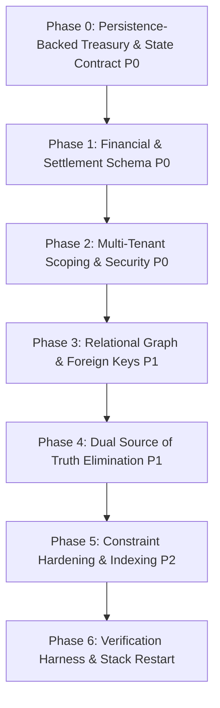

# SitePulse Database Design & Backend Alignment — Comprehensive Fix Plan

**Plan Version:** 1.0.0  
**Target Systems:** PostgreSQL 16 (`backend/db/init/`, `backend/migrations/`) & Rust Axum Backend (`backend/src/`)  
**Scope:** 27 Tables, 47 Foreign Keys, Application Write Paths, and Multi-Tenant Isolation  
**Status:** Ready for Execution (Pending User Proceed)

---

## 1. Plan Overview & Execution Strategy

This remediation plan organizes the findings from all audits and code-tracing reviews into a phased, topologically ordered sequence. Changes are isolated to avoid regressions, and every phase includes explicit migration DDL, Rust write-path modifications, and verification gates.



---

## 2. Phase 0: Persistence-Backed Treasury & State Invariants (Priority 0 - Critical Pre-Requisite)

> **Objective:** Enforce that PostgreSQL is the authoritative system of record for all business operations, eliminating in-memory data loss across restarts and activating dead schema tables. Addresses the "Memory Is Not Source of Truth" defects (§11).

### Task 0.1: Establish System of Record Persistence Contract
- **Rule:** `AppStateInner` may only act as a read-through cache, never an authoritative source of truth. Every mutating REST endpoint must execute an underlying SQL transaction against PostgreSQL before mutating or refreshing memory state.
- **Architectural Shift:** Services accept `&AppState` with direct access to `sqlx::PgPool` or transaction wrappers.

### Task 0.2: Refactor `PaymentTrackingService` to Persistence-Backed SQL Transactions (M1, M2, M3, M4, M6)
- **Files to Modify:**
  - `apps/development-time/SitePulse/backend/src/services/payment_tracking_service.rs`
- **Implementation:**
  - **`record_and_allocate_payment`**: Open an atomic transaction (`let mut tx = state.pool.begin().await?`):
    1. Lock unit and dues records for update.
    2. Insert into `payment_entries`.
    3. Insert into normalized `payment_allocations`.
    4. Accumulate `paid_amount` (and `paid_principal`, `paid_penalty`) in `dues_liabilities`.
    5. Allocate `sequence_number` atomically and insert into `payment_receipts`.
    6. Route overpayment surplus to `advance_balances` / `advance_ledger_entries`.
    7. Commit transaction; refresh in-memory state only upon commit success.
  - **`next_receipt_number`**: Query `SELECT COALESCE(MAX(sequence_number), 0) + 1 FROM payment_receipts WHERE site_id = $1` inside the transaction (or use an advisory-locked sequence counter), eliminating sequence resets upon server restart.
  - **`inter_ledger_transfer` (Virman)**: Record debit and credit movements in `advance_balances` and `dues_liabilities` inside a database transaction.
  - **`transfer_ownership`**: Close the active `unit_ownerships` record (`end_date = CURRENT_DATE, is_active = false`) and insert the new owner in PostgreSQL.

### Task 0.3: Persist Statement Parser Output to `reconciliation_queue` (M5)
- **Files to Modify:**
  - `apps/development-time/SitePulse/backend/src/services/reconciliation_service.rs`
  - `apps/development-time/SitePulse/backend/src/services/bank_statement_parser.rs`
- **Implementation:**
  - In `parse_bank_statement`, immediately persist parsed rows as `reconciliation_queue` records with status `'PENDING_APPROVAL'` and mandatory `site_id`, so parsed bank lines survive backend reboots and are visible across replicas.

### Task 0.4: Deprecate `sync_all_in_memory_to_db` (M8)
- **Implementation:**
  - Remove calls to `sync_all_in_memory_to_db`. Since all endpoints write immediately to PostgreSQL, bulk periodic synchronization is eliminated.

### Task 0.5: Resolve `site_invite_tokens` Persistence (M7)
- **Implementation:**
  - Persist site-level invitation tokens to `invitation_tokens` (with `token_type = 'SITE'`) or remove the unused in-memory field.

### Task 0.6: Memory Persistence CI Linter (`scripts/memory_persistence_lint.py`)
- **Files to Create:**
  - `scripts/memory_persistence_lint.py`
- **Implementation:**
  - Create a Python AST/regex scanner that asserts every `inner.<field>.push|insert|remove|retain` mutation in `src/` has a corresponding `db::` / SQL transaction in the same function block, and every persisted field has a loader in `load_all_from_db()`.
  - Add to `scripts/schema_integrity_check.py`.

---

## 3. Phase 1: Financial & Settlement Corrections (Priority 0)

> **Objective:** Stop active monetary calculation bugs, establish relational payment allocation, and split advance balances by sub-ledger.

### Task 1.1: Fix `dues_liabilities.paid_amount` Overwrite Bug in Rust Write Paths
- **Files to Modify:**
  - `apps/development-time/SitePulse/backend/src/services/payment_tracking_service.rs`
  - `apps/development-time/SitePulse/backend/src/services/reconciliation_service.rs`
- **Root Cause:** Queries execute `UPDATE dues_liabilities SET paid_amount = $3` with the current payment amount rather than accumulating running payments.
- **Implementation:**
  - Update SQL statements to accumulate:
    ```sql
    UPDATE dues_liabilities
    SET paid_amount = paid_amount + $1,
        status = CASE 
            WHEN (paid_amount + $1) >= (principal_amount + delay_penalty) THEN 'PAID'
            WHEN (paid_amount + $1) > 0 THEN 'PARTIALLY_PAID'
            ELSE status
        END,
        payment_date = CURRENT_TIMESTAMP
    WHERE id = $2;
    ```
  - Verify that `chk_dues_paid_within_owed` protects against over-accumulation.

### Task 1.2: Relational Payment Allocation (`payment_allocations` Table)
- **Files to Modify:**
  - `apps/development-time/SitePulse/backend/db/init/00-05-payment-tracking-and-receipts.sql` (and new migration `V12`)
  - `apps/development-time/SitePulse/backend/src/models/mod.rs`
  - `apps/development-time/SitePulse/backend/src/services/payment_tracking_service.rs`
- **Schema Changes:**
  - Create the normalized associative entity:
    ```sql
    CREATE TABLE IF NOT EXISTS payment_allocations (
        id BIGINT GENERATED BY DEFAULT AS IDENTITY PRIMARY KEY,
        payment_entry_id BIGINT NOT NULL REFERENCES payment_entries(id) ON DELETE CASCADE,
        dues_liability_id BIGINT NOT NULL REFERENCES dues_liabilities(id) ON DELETE RESTRICT,
        principal_amount NUMERIC(15, 2) NOT NULL DEFAULT 0.00 CHECK (principal_amount >= 0),
        penalty_amount NUMERIC(15, 2) NOT NULL DEFAULT 0.00 CHECK (penalty_amount >= 0),
        created_at TIMESTAMPTZ DEFAULT CURRENT_TIMESTAMP,
        CONSTRAINT chk_allocation_total_positive CHECK ((principal_amount + penalty_amount) > 0)
    );
    CREATE INDEX IF NOT EXISTS idx_allocations_payment ON payment_allocations (payment_entry_id);
    CREATE INDEX IF NOT EXISTS idx_allocations_liability ON payment_allocations (dues_liability_id);
    ```
  - Migrate data from `payment_entries.dues_liability_id` into `payment_allocations`.
  - Deprecate `payment_receipts.allocation_breakdown` JSONB in favor of relational queries against `payment_allocations`.

### Task 1.3: Separate Principal and Penalty in `dues_liabilities` (TBK 100 Compliance)
- **Schema Changes:**
  - Alter `dues_liabilities` to track statutory payment amortization:
    ```sql
    ALTER TABLE dues_liabilities
        ADD COLUMN IF NOT EXISTS paid_principal NUMERIC(15, 2) NOT NULL DEFAULT 0.00,
        ADD COLUMN IF NOT EXISTS paid_penalty NUMERIC(15, 2) NOT NULL DEFAULT 0.00,
        ADD CONSTRAINT chk_dues_paid_principal_le CHECK (paid_principal <= principal_amount),
        ADD CONSTRAINT chk_dues_paid_penalty_le CHECK (paid_penalty <= delay_penalty);
    ```
  - Update backend settlement engine to apply TBK 100: credit penalty first, then reduce principal.

### Task 1.4: Partition `advance_balances` by Sub-Ledger Account
- **Files to Modify:**
  - `apps/development-time/SitePulse/backend/db/init/00-05-payment-tracking-and-receipts.sql`
  - `apps/development-time/SitePulse/backend/src/services/payment_tracking_service.rs`
- **Schema Changes:**
  ```sql
  ALTER TABLE advance_balances DROP CONSTRAINT IF EXISTS advance_balances_pkey;
  ALTER TABLE advance_balances ADD COLUMN IF NOT EXISTS debtor_type VARCHAR(20) NOT NULL DEFAULT 'TENANT';
  ALTER TABLE advance_balances ADD CONSTRAINT chk_advance_debtor_type CHECK (debtor_type IN ('OWNER', 'TENANT'));
  ALTER TABLE advance_balances ADD CONSTRAINT advance_balances_pkey PRIMARY KEY (unit_id, debtor_type);
  ```
  - Introduce `advance_ledger_entries (id, unit_id, debtor_type, entry_type, amount, reference_id, created_at)` for immutable surplus and virman transfer history.

### Task 1.5: Connect `payment_receipts` Write Path
- **Files to Modify:**
  - `apps/development-time/SitePulse/backend/src/services/payment_tracking_service.rs`
- **Implementation:**
  - Add explicit `INSERT INTO payment_receipts` upon each successful payment entry creation.
  - Compute SHA-256 `verification_hash` and assign monotonic `sequence_number` per `site_id`.
  - Update `payment_entries.receipt_id` to link to the inserted receipt row.

---

## 4. Phase 2: Multi-Tenant Scoping & Security Holes (Priority 0)

> **Objective:** Eliminate cross-tenant data leaks and candidate key collisions.

### Task 2.1: Add `site_id` and Account Link to `reconciliation_queue`
- **Files to Modify:**
  - `apps/development-time/SitePulse/backend/db/init/00-01-init-schema.sql` (or `00-09`)
  - `apps/development-time/SitePulse/backend/src/services/reconciliation_service.rs`
  - `apps/development-time/SitePulse/backend/src/services/bank_statement_parser.rs`
- **Schema Changes:**
  ```sql
  ALTER TABLE reconciliation_queue
      ADD COLUMN IF NOT EXISTS site_id BIGINT REFERENCES sites(id) ON DELETE CASCADE,
      ADD COLUMN IF NOT EXISTS site_bank_account_id BIGINT REFERENCES site_bank_accounts(id) ON DELETE CASCADE;

  -- Backfill site_id from matched_unit_id where available, or fallback for legacy rows
  UPDATE reconciliation_queue rq
  SET site_id = COALESCE(u.site_id, 1)
  FROM units u
  WHERE rq.matched_unit_id = u.id AND rq.site_id IS NULL;

  UPDATE reconciliation_queue SET site_id = 1 WHERE site_id IS NULL;

  ALTER TABLE reconciliation_queue ALTER COLUMN site_id SET NOT NULL;
  CREATE INDEX IF NOT EXISTS idx_reconciliation_site ON reconciliation_queue (site_id);
  CREATE INDEX IF NOT EXISTS idx_reconciliation_bank_account ON reconciliation_queue (site_bank_account_id);
  ```
- **Code Changes:** Update bank statement parsers to inject the current `site_id` and `site_bank_account_id` into all parsed rows prior to insertion.

### Task 2.2: Correct BCNF Candidate Key on `unit_sender_ibans`
- **Schema Changes:**
  ```sql
  ALTER TABLE unit_sender_ibans DROP CONSTRAINT IF EXISTS unit_sender_ibans_pkey;
  ALTER TABLE unit_sender_ibans ADD COLUMN IF NOT EXISTS id BIGINT GENERATED BY DEFAULT AS IDENTITY PRIMARY KEY;
  ALTER TABLE unit_sender_ibans ADD CONSTRAINT uq_unit_sender_iban UNIQUE (unit_id, sender_iban);
  ALTER TABLE unit_sender_ibans ADD CONSTRAINT chk_sender_iban_format 
      CHECK (sender_iban ~ '^[A-Z]{2}[0-9]{2}[A-Z0-9]{11,30}$');
  ```

### Task 2.3: Harmonize Cascade Deletion on `units.site_id`
- **Schema Changes:**
  ```sql
  ALTER TABLE units DROP CONSTRAINT IF EXISTS units_site_id_fkey;
  ALTER TABLE units ADD CONSTRAINT units_site_id_fkey 
      FOREIGN KEY (site_id) REFERENCES sites(id) ON DELETE CASCADE;
  ```

---

## 5. Phase 3: Relational Graph & Foreign Key Enforcements (Priority 1)

> **Objective:** Convert fragile string joins into verified, indexed relational foreign keys.

### Task 3.1: Relink `dues_liabilities` to `dues_periods`
- **Schema Changes:**
  ```sql
  ALTER TABLE dues_liabilities ADD COLUMN IF NOT EXISTS dues_period_id BIGINT REFERENCES dues_periods(id) ON DELETE RESTRICT;
  
  -- Backfill dues_period_id via site_id + period string match (clean multi-table FROM syntax)
  UPDATE dues_liabilities dl
  SET dues_period_id = dp.id
  FROM units u, dues_periods dp
  WHERE dl.unit_id = u.id AND dp.site_id = u.site_id AND dp.period_name = dl.period AND dl.dues_period_id IS NULL;

  CREATE INDEX IF NOT EXISTS idx_dues_liabilities_period ON dues_liabilities (dues_period_id);
  ```

### Task 3.2: Relink `units.house_type` to `house_types`
- **Schema Changes:**
  ```sql
  ALTER TABLE units ADD COLUMN IF NOT EXISTS house_type_id BIGINT REFERENCES house_types(id) ON DELETE SET NULL;

  -- Backfill house_type_id
  UPDATE units u
  SET house_type_id = ht.id
  FROM house_types ht
  WHERE ht.site_id = u.site_id AND ht.type_name = u.house_type AND u.house_type_id IS NULL;

  CREATE INDEX IF NOT EXISTS idx_units_house_type ON units (house_type_id);
  ```

### Task 3.3: Relink `dues_liabilities` to `capital_project_installments`
- **Schema Changes:**
  ```sql
  ALTER TABLE dues_liabilities 
      ADD COLUMN IF NOT EXISTS capital_project_installment_id BIGINT 
      REFERENCES capital_project_installments(id) ON DELETE RESTRICT;

  -- Backfill
  UPDATE dues_liabilities dl
  SET capital_project_installment_id = cpi.id
  FROM capital_project_installments cpi
  WHERE dl.capital_project_id = cpi.project_id 
    AND dl.installment_number = cpi.installment_number
    AND dl.capital_project_installment_id IS NULL;

  CREATE INDEX IF NOT EXISTS idx_dues_liabilities_installment ON dues_liabilities (capital_project_installment_id);
  ```

### Task 3.4: Support Dual Active Bank Accounts (KMK 35-f)
- **Schema Changes:**
  ```sql
  ALTER TABLE site_bank_accounts ADD COLUMN IF NOT EXISTS account_type VARCHAR(30) NOT NULL DEFAULT 'OPERATIONAL';
  ALTER TABLE site_bank_accounts ADD CONSTRAINT chk_bank_account_type 
      CHECK (account_type IN ('OPERATIONAL', 'CAPITAL_RESERVE'));
  DROP INDEX IF EXISTS uq_site_active_bank;
  CREATE UNIQUE INDEX uq_site_active_bank_type 
      ON site_bank_accounts (site_id, account_type) WHERE is_active = true;
  ```

---

## 6. Phase 4: Dual Source of Truth Elimination (Priority 1)

> **Objective:** Retire denormalized attributes and activate canonical tables.

### Task 4.1: Deprecate Redundant Unit Occupancy / Ownership Attributes
- **Files to Modify:**
  - `apps/development-time/SitePulse/backend/src/models/mod.rs`
  - `apps/development-time/SitePulse/backend/src/services/site_admin_service.rs`
- **Implementation:**
  - Route all owner lookups to `unit_ownerships WHERE is_active = true`.
  - Route all tenant lookups to `unit_occupancies WHERE is_active = true`.
  - Mark `units.owner_person_id`, `units.tenant_person_id`, and `units.occupancy_status` as nullable / deprecated, maintaining synchronization via database triggers until fully removed.

### Task 4.2: Activate Write Paths for Dead Tables
- **Files to Modify:**
  - `apps/development-time/SitePulse/backend/src/services/saas_tenant_service.rs`
  - `apps/development-time/SitePulse/backend/src/services/site_admin_service.rs`
- **Implementation:**
  - Switch authorization checks from `users.role` to `user_site_roles`.
  - Write title deed transfers into `unit_ownerships` (STORY-09-07).
  - Implement periodic background generation of `debt_aging_snapshots` (STORY-09-03).

---

## 7. Phase 5: Constraint Hardening & Index Optimization (Priority 2)

> **Objective:** Enforce statutory laws, eliminate duplicate indexes, and index unindexed foreign keys.

### Task 5.1: Enforce KMK 20/b Debtor Constraint
- **Schema Changes:**
  ```sql
  ALTER TABLE dues_liabilities ADD CONSTRAINT chk_dues_capital_owner_only
      CHECK (expense_type <> 'CAPITAL_DUES' OR debtor_type = 'OWNER');
  ```

### Task 5.2: Add Timezone Column to `sites`
- **Schema Changes:**
  ```sql
  ALTER TABLE sites ADD COLUMN IF NOT EXISTS timezone VARCHAR(50) NOT NULL DEFAULT 'Europe/Istanbul';
  ```

### Task 5.3: Drop Duplicate Indexes & Add Missing FK Indexes
- **Schema Changes:**
  ```sql
  -- Drop redundant duplicate indexes safely (preserving unique constraint indexes)
  DROP INDEX IF EXISTS idx_users_site_id;
  DROP INDEX IF EXISTS idx_site_bank_accounts_site;

  -- Add missing indexes on foreign keys
  CREATE INDEX IF NOT EXISTS idx_invitation_tokens_site ON invitation_tokens (site_id);
  CREATE INDEX IF NOT EXISTS idx_invitation_tokens_unit ON invitation_tokens (unit_id);
  CREATE INDEX IF NOT EXISTS idx_reconciliation_queue_due ON reconciliation_queue (matched_due_id);
  CREATE INDEX IF NOT EXISTS idx_debt_aging_unit ON debt_aging_snapshots (unit_id);
  ```

---

## 8. Phase 6: Verification & Test Harness Execution

1. **Schema Integrity Gate:**
   ```bash
   python3 scripts/schema_integrity_check.py
   ```
2. **Database Verification Skill:**
   ```bash
   ./scripts/db_verify.py verify 1
   ```
3. **Backend Test Suite:**
   ```bash
   cd apps/development-time/SitePulse/backend && cargo test
   ```
4. **Development Stack Restart:**
   ```bash
   apps/development-time/SitePulse/scripts/restart-all.sh
   ```


---

## 8. Peer Review Addendum — Blocking Defects, Missing Steps & Scope Gaps

> **Reviewer:** author of [`DATABASE_DESIGN_REVIEW.md`](file:///home/gurkanindibay/Documents/source/epam/ai-powered-engineering/apps/development-time/SitePulse/docs/database/DATABASE_DESIGN_REVIEW.md)
> **Validation method:** every DDL statement and backfill query in this plan was **executed** against a database rebuilt from `db/init/00-01 … 00-10`, not merely read. Results are quoted verbatim below.

### 8.0 Verdict

The plan is well-sequenced and covers the P0 findings correctly at the *intent* level. However, **four tasks contain SQL that fails outright when executed, and one task degrades the exact index coverage it is meant to improve.** These must be corrected before execution. The plan also omits the integration steps that make a new SQL file actually take effect at runtime.

| Task | Status |
| :--- | :--- |
| 1.1 `paid_amount` accumulate | ⚠️ works for partial payments, **aborts payment on overpayment** |
| 1.2 `payment_allocations` | ✅ sound (but must be sequenced *before* 1.1 / 1.3) |
| 1.3 `paid_principal` / `paid_penalty` | ⚠️ conflicts with existing `delay_penalty` mutation |
| 1.4 `advance_balances` composite PK | ✅ works (needs data-policy decision) |
| 1.5 `payment_receipts` write path | ⚠️ sequence generation has no concurrency mechanism |
| 2.1 `reconciliation_queue.site_id` | ❌ `SET NOT NULL` **fails** |
| 2.2 `unit_sender_ibans` PK | ❌ breaks the live Rust upsert |
| 2.3 `units.site_id` CASCADE | ✅ works |
| 3.1 `dues_period_id` backfill | ❌ **invalid SQL** |
| 3.2 `house_type_id` | ✅ works |
| 3.3 `capital_project_installment_id` | ✅ works |
| 3.4 dual bank accounts | ✅ works (still a product decision — see 8.4) |
| 4.1 / 4.2 dual-truth retirement | ✅ directionally correct |
| 6.3 index optimisation | ❌ **drops the only surviving FK indexes** |

---

### 8.1 Blocking Defects — Reproduced

#### (a) Task 6.3 drops the wrong indexes and un-indexes two foreign keys

```sql
DROP INDEX IF EXISTS idx_user_site;              -- ❌ this is the ONLY index on users(site_id)
DROP INDEX IF EXISTS idx_user_email;             -- ✅ correct (duplicate of users_email_key)
DROP INDEX IF EXISTS idx_site_bank_account_site; -- ❌ ONLY index on site_bank_accounts(site_id)
```

Measured after running the block verbatim:

```
 tbl                | col     | leading_index_count
--------------------+---------+---------------------
 site_bank_accounts | site_id | 1        -- partial (is_active = true) only
 users              | site_id | 0        -- fully unindexed
```

`idx_users_site_id` and `idx_site_bank_accounts_site` — the "duplicates" this task was written to remove — **do not exist**; they were removed during the `00-07` de-duplication pass. The plan therefore deletes the survivors and leaves `users.site_id` with no index at all, which will degrade every `WHERE users.site_id = $1` and every site-delete cascade.

**Correction:**

```sql
DROP INDEX IF EXISTS idx_user_email;   -- only genuinely redundant index
-- keep idx_user_site and idx_site_bank_account_site
```

#### (b) Task 3.1 backfill SQL is rejected by PostgreSQL

```sql
UPDATE dues_liabilities dl
SET dues_period_id = dp.id
FROM units u
JOIN dues_periods dp ON dp.site_id = u.site_id AND dp.period_name = dl.period
WHERE dl.unit_id = u.id AND dl.dues_period_id IS NULL;
```

```
ERROR:  invalid reference to FROM-clause entry for table "dl"
DETAIL:  There is an entry for table "dl", but it cannot be referenced from this part of the query.
```

The `UPDATE` target is not visible inside a `FROM … JOIN … ON` clause. **Correction:**

```sql
UPDATE dues_liabilities dl
SET dues_period_id = dp.id
FROM units u, dues_periods dp
WHERE dl.unit_id = u.id
  AND dp.site_id = u.site_id
  AND dp.period_name = dl.period
  AND dl.dues_period_id IS NULL;
```

#### (c) Task 2.1 `SET NOT NULL` fails whenever any unmatched row exists

```
ERROR:  column "site_id" of relation "reconciliation_queue" contains null values
```

`matched_unit_id` is nullable precisely because unmatched bank lines are the reason the queue exists. The backfill "where available" leaves those rows NULL, and the very next statement then rejects them. This is guaranteed to fail on any real installation.

**Correction — pick one:**

```sql
-- Option A (recommended): scope by bank account, which is always known at import time
ALTER TABLE reconciliation_queue ADD COLUMN site_id BIGINT REFERENCES sites(id) ON DELETE CASCADE;
UPDATE reconciliation_queue rq SET site_id = sba.site_id
FROM site_bank_accounts sba WHERE rq.site_bank_account_id = sba.id AND rq.site_id IS NULL;
-- Only then, once the parser guarantees site_id on insert:
ALTER TABLE reconciliation_queue ALTER COLUMN site_id SET NOT NULL;
```

```sql
-- Option B: keep nullable, enforce at the query layer
CREATE INDEX idx_reconciliation_site ON reconciliation_queue (site_id);
-- rely on NOT NULL for new rows via a DEFAULT + INSERT-path validation
```

Also note: `Task 2.1` proposes editing `00-01` or `00-09` directly. That breaks the byte-identical `db/init ↔ migrations` contract enforced by `scripts/schema_integrity_check.py`. **New work must go into a new `00-11-*.sql` + `V12` pair.**

#### (d) Task 2.2 breaks the Rust write path it does not mention

After the PK is moved to a surrogate `id` and uniqueness becomes `(unit_id, sender_iban)`, the existing upsert in `backend/src/db.rs` (`save_remembered_sender_iban`) fails:

```sql
INSERT INTO unit_sender_ibans (...) VALUES (...)
ON CONFLICT (sender_iban) DO UPDATE SET ...
-- ERROR: there is no unique or exclusion constraint matching the ON CONFLICT specification
```

Beyond the SQL, the runtime model also assumes 1 IBAN → 1 unit:

```rust
pub remembered_sender_ibans: HashMap<String, String>,   // iban -> unit_id
```

**Task 2.2 must be extended with:**

1. `ON CONFLICT (unit_id, sender_iban) DO UPDATE …` in `db.rs`.
2. `remembered_sender_ibans: HashMap<String, Vec<String>>` (or `HashMap<String, HashSet<String>>`) so one payer can map to several units.
3. An update to the statement-matching code that reads this map — currently first-match-wins.

#### (e) Task 1.1 aborts the payment instead of routing surplus to advance

The proposed `paid_amount = paid_amount + $1` is correct for partial payments (verified: ₺40 of ₺100 → `PARTIALLY_PAID`, `paid_amount = 40.00`). But an overpayment hits `chk_dues_paid_within_owed`:

```
ERROR:  new row for relation "dues_liabilities" violates check constraint "chk_dues_paid_within_owed"
```

The Tier-4 waterfall (surplus → advance balance) means overpayment is a **normal** event, so a hard failure is wrong. Additionally:

- The plan does not mention the third call site `handlers/mod.rs:1187`, which passes `Decimal::ZERO` (marks `PAID` with `paid_amount = 0`).
- The existing in-memory engine **decrements `delay_penalty`** on payment (`inner.dues[idx].delay_penalty -= pay_penalty`). Task 1.3 meanwhile adds a `paid_penalty` accumulator. Running both creates a *new* dual source of truth for penalty settlement.

**Correction:**

```sql
UPDATE dues_liabilities
SET paid_amount = LEAST(paid_amount + $1, principal_amount + delay_penalty),
    status = CASE
        WHEN LEAST(paid_amount + $1, principal_amount + delay_penalty) >= (principal_amount + delay_penalty) THEN 'PAID'
        WHEN (paid_amount + $1) > 0 THEN 'PARTIALLY_PAID'
        ELSE status
    END,
    payment_date = CURRENT_TIMESTAMP
WHERE id = $2;
```

…and decide **one** penalty representation before writing code. Recommendation: keep `delay_penalty` as *accrued-to-date* (a computed charge) and record settlement only in `payment_allocations.penalty_amount` + `paid_penalty`. Do not mutate `delay_penalty` on payment.

---

### 8.2 Missing Integration Steps (the plan will silently do nothing without these)

A new SQL file is only applied at runtime if it is registered. The plan adds `00-11`/`V12` files but never mentions:

1. **Rust bootstrap registration** — `backend/src/db.rs` applies the schema via a hard-coded list:
   ```rust
   include_str!("../db/init/00-10-consolidate-household-members.sql"),
   ```
   Without adding `00-11-…` here, every developer running the backend without Docker init gets the old schema.

2. **Migration sync map** — `scripts/schema_integrity_check.py`:
   ```python
   SYNC_MAP = { ..., "00-10-…": "V11__…" }
   ```
   must gain `"00-11-…": "V12__…"`, otherwise `--sync` will not regenerate `V12` and the congruence gate fails.

3. **Reset script** — `scripts/reset-and-init-db.sh` has an explicit, ordered `run_sql_file` list; the new file must be appended or fresh resets skip the phase.

4. **`00-10` is the current head.** The plan's Task 1.2 says "new migration `V12`" (correct), but Tasks 2.1/3.x name no file; every one of them must land in the same `00-11` file (or `00-11`, `00-12`, … in dependency order) — **never** back-edited into `00-01`/`00-09`, which would break idempotency and the identical-file assertion.

5. **Idempotency.** All new DDL must be `IF NOT EXISTS` / `DROP CONSTRAINT IF EXISTS` guarded, because `init_db()` re-runs the full chain on **every** backend start.

---

### 8.3 Scope Gaps — Items From Either Audit Not Covered

#### Financial correctness

| Item | Why it matters |
| :--- | :--- |
| **`payment_receipts.sequence_number` concurrency** | Task 1.5 says "assign monotonic `sequence_number` per `site_id`" with no mechanism. A `MAX(seq)+1` read-then-write races, and `uq_site_receipt_sequence` converts the race into a **failed payment**. Needs a `site_receipt_counters(site_id, next_sequence)` row locked with `SELECT … FOR UPDATE`, or `pg_advisory_xact_lock(hashtext('receipt:'||site_id))`. |
| **Receipt totals vs allocations** | Once `payment_allocations` exists, `payment_receipts.allocated_principal/penalty/advance` become derivable. Keeping both without a trigger recreates the dual-truth problem Task 1.2 is meant to solve. Decide: enforce with a trigger, or drop the scalars and derive. |
| **`payment_entries.external_reference` UNIQUE** | Task 2.1 covers `reconciliation_queue.transaction_id`, but POS/webhook/n8n ingestion writes `payment_entries` directly and bypasses the queue entirely. Add `UNIQUE (site_id, external_reference) WHERE external_reference IS NOT NULL`. |
| **Composite `(site_id, unit_id)` FKs** | `payment_receipts`, `payment_entries`, `debt_aging_snapshots` each carry both columns with independent FKs, so a row can claim site A with unit B's unit. Reuse the proven `units ↔ blocks(id, site_id)` pattern. |
| **`site_bank_accounts.iban` UNIQUE** | Two tenants can currently claim the same IBAN, which silently corrupts statement attribution — directly relevant to Phase 2. |
| **Immutable ledger enforcement** | All three audits call the collection ledger immutable; no task enforces it. Add `BEFORE UPDATE OR DELETE` triggers (or `REVOKE UPDATE, DELETE`) on `payment_entries`, `payment_allocations`, `payment_receipts`. |

#### Tenancy & identity

| Item | Why it matters |
| :--- | :--- |
| **`user_site_roles.site_id NOT NULL` blocks `SAAS_ADMIN`** | Task 4.2 says "switch authorization checks from `users.role` to `user_site_roles`" — but that table cannot represent a global admin. Must add a null-safe scope (e.g. `site_id` nullable + partial unique) **before** the switch, or the SaaS admin loses access. |
| **Row-Level Security** | Not present in any phase. With `persons` global and isolation purely in `WHERE` clauses, one missing filter leaks another tenant's residents. |
| **`site_bank_accounts.bank_code` → `system_supported_banks(bank_code)`** | Found in the evaluation report; absent from the plan. |

#### Constraint completeness

| Item | Why it matters |
| :--- | :--- |
| **Enum CHECK sweep** | ~16 columns still accept arbitrary strings: `sites.status`, `sites.plan_type`, `dues_periods.status`, `payment_entries.{payer_role,payment_channel,settlement_status}`, `payment_receipts.{payer_role,on_behalf_of_role,payment_channel}`, `capital_projects.{category,status,allocation_basis}`, `capital_contractor_disbursements.disbursement_method`, `reconciliation_queue.{status,status_code,currency}`, `pending_registrations.status`, `invitation_tokens.token_type`, `debt_aging_snapshots.debtor_type`. |
| **`unit_ownerships`** | Add `CHECK (NOT is_active OR end_date IS NULL)` and enforce Σ`share_percentage` = 100 per unit. Found by the evaluation report; absent from the plan — yet Phase 4 activates this table. |
| **`capital_project_installments`** | Σ`percentage` = 100 and Σ`installment_budget` = `capital_projects.total_budget`; drop the 2NF-violating `total_installments`. |
| **`pending_registrations`** | `processed_by`, `processed_at`, `rejection_reason` (EPIC-04 STORY-04-06); `status` CHECK; `UNIQUE (site_id, block, unit_no, email)` to stop duplicate applications. |
| **`invitation_tokens`** | `used_at` / `used_by` for revocation; `token_type` CHECK; index `(site_id)`, `(unit_id)`. |
| **`occupancy_members`** | Identity gap for members without `person_id` (partial unique only); enforce at most one `is_emergency_contact` per occupancy. |
| **`capital_project_installments.is_accrued`** | Duplicates the existence of the corresponding `dues_liabilities` row — two accrual truths. Resolve during Phase 4. |

#### Data quality

| Item | Why it matters |
| :--- | :--- |
| **Turkish literals stored as data** | Task 3.1 adds `dues_period_id` but leaves `dl.period = 'Eylül 2026'` as free text. The FK cannot be validated until the text values are normalised into real `dues_periods` rows, and `reconciliation_queue.status` still compares `"ONAYLANDI"` / `"ESLESTIRILEMEDI"` literally. Add a normalisation step plus a plan to drop `dues_liabilities.period`. |
| **`debt_aging_snapshots` should not get a writer** | Task 4.2 proposes "periodic background generation". Every column is derivable from `dues_liabilities` + `due_date`, so writing them creates permanent staleness risk. Prefer a view or a `MATERIALIZED VIEW` refreshed on demand. Contrast with `unit_ownerships` / `user_site_roles`, which hold facts not otherwise representable and **should** get writers. |

---

### 8.4 Sequencing Corrections

| Current order | Required order | Reason |
| :--- | :--- | :--- |
| 1.1 → 1.2 | **1.2 → 1.1 → 1.3** | Allocations are the source of truth; `paid_amount` / `paid_principal` / `paid_penalty` should become projections of `payment_allocations`, not independent accumulators. |
| 2.1 DDL first | **parser code first, DDL constraint last** | `site_id` cannot be `NOT NULL` until the parser supplies it. |
| 3.1 FK immediately | **normalise `period` text → then FK → then drop text column** | The FK is unvalidatable while free-text periods differ from `dues_periods.period_name`. |
| 6.3 before Phase 6 verification | **after all FK-index additions; drop only `idx_user_email`** | As written it removes working indexes. |
| 4.2 "switch auth to `user_site_roles`" | **after** resolving the `SAAS_ADMIN` scoping gap | Otherwise global admins lose access. |

Also: Task 4.1's plan to keep `units.owner_person_id` etc. "synchronised via triggers until fully removed" is the right call — but the trigger must be created **before** any writer starts reading from `unit_ownerships`, otherwise the two diverge during the transition.

---

### 8.5 Verification Gate Additions

Phase 6 currently runs three existing commands. Add:

1. **Negative-case coverage.** Every new invariant needs a row in `scripts/schema_integrity_check.py::NEGATIVE_CASES`, e.g. `CAPITAL_DUES charged to TENANT must be rejected`, `duplicate (unit_id, sender_iban) must be rejected`, `over-allocated receipt must be rejected`. Without these the gate stays green while the new constraints are silently absent.
2. **Data-migration assertions.** Before dropping any text column or old constraint, assert the backfill was complete:
   ```sql
   SELECT count(*) FROM dues_liabilities WHERE dues_period_id IS NULL;      -- expect 0
   SELECT count(*) FROM reconciliation_queue WHERE site_id IS NULL;         -- expect 0
   SELECT count(*) FROM units WHERE house_type IS NOT NULL AND house_type_id IS NULL;  -- expect 0
   ```
3. **Row-count preservation.** Capture `count(*)` for `dues_liabilities`, `payment_entries`, `payment_receipts`, `advance_balances` before and after each phase.
4. **Backup / restore point.** Phases 1–3 contain irreversible `DROP CONSTRAINT`, `DROP INDEX`, and column type changes. Take a `pg_dump` before Phase 1 and verify a restore into a scratch database.
5. **Dry run on a copy.** Execute the whole `00-11` chain against a clone of production data before touching the live database — the idempotent chain makes this cheap.
6. **Scope header correction.** §Scope states "47 Foreign Keys"; the measured count is **39** (40 column-pairs due to one composite FK). Correct before this plan is used as an execution checklist.

---

## 9. Additional Additions — Rollout Mechanics, Contract Impact & Execution Artifacts

> **Reviewer:** author of [`DATABASE_DESIGN_REVIEW.md`](file:///home/gurkanindibay/Documents/source/epam/ai-powered-engineering/apps/development-time/SitePulse/docs/database/DATABASE_DESIGN_REVIEW.md)
> **Relationship to §8:** §8 covers *defects in the plan's SQL*. This section covers what the plan does **not discuss at all**: how the change is rolled out, what breaks at the API boundary, which tests will fail, how to undo a phase, and which decisions must be made by a human before any of it executes.

### 9.1 Rollout Strategy — the plan is a big-bang cutover; it does not have to be

Phases 1–3 change column semantics (`paid_amount`), primary keys (`advance_balances`, `unit_sender_ibans`), and nullability (`reconciliation_queue.site_id`) while the backend is live. Running them as a single deploy guarantees a window where code and schema disagree.

Recommended sequence per phase:

```
1. Expand   → add new structures only (payment_allocations, advance_ledger_entries,
              site_id nullable, house_type_id nullable). Nothing dropped. Deploy.
2. Dual-write → application writes BOTH the old and new representation for ≥1 release.
              Keep a divergence counter (see §9.6) that must read 0.
3. Backfill → idempotent SQL, re-runnable, batched (see the LIMIT loop pattern below).
4. Cut reads → switch all readers to the new representation. Deploy.
5. Contract → drop the old column / constraint / PK. Deploy.
```

Concrete expand-contract for the two riskiest items:

| Item | Expand | Contract |
| :--- | :--- | :--- |
| `advance_balances` → sub-ledger | Add `debtor_type` with `DEFAULT 'TENANT'` + `advance_ledger_entries`. Keep single-column PK during dual-write. | Only after every writer passes an explicit scope: drop the old PK, add `PRIMARY KEY (unit_id, debtor_type)`. |
| `unit_sender_ibans` PK | Add surrogate `id` + `UNIQUE (unit_id, sender_iban)`. Leave the old PK in place. | After `ON CONFLICT` clauses are updated: drop old PK. |

Batched backfill pattern (avoids a long table lock on `dues_liabilities` / `payment_entries`):

```sql
DO $$
DECLARE rows_updated INT;
BEGIN
    LOOP
        WITH batch AS (
            SELECT id FROM dues_liabilities
            WHERE dues_period_id IS NULL AND capital_project_id IS NULL
            LIMIT 5000 FOR UPDATE SKIP LOCKED
        )
        UPDATE dues_liabilities dl
        SET dues_period_id = dp.id
        FROM batch b, units u, dues_periods dp
        WHERE dl.id = b.id AND u.id = dl.unit_id
          AND dp.site_id = u.site_id AND dp.period_name = dl.period;
        GET DIAGNOSTICS rows_updated = ROW_COUNT;
        EXIT WHEN rows_updated = 0;
        COMMIT;
    END LOOP;
END $$;
```

---

### 9.2 API / DTO Blast Radius — not mentioned anywhere in the plan

Every schema change in Phases 1–4 changes a JSON field that the Flutter client already parses. Enumerated from the live source:

| Schema change (task) | Affected Rust DTO / JSON field | Flutter consumer | Break type |
| :--- | :--- | :--- | :--- |
| 1.4 partition `advance_balances` | `advance_balance` — currently a **scalar string** emitted at `handlers/mod.rs:3078`; also `advance_payment` at `:2460` | `dues_models.dart` parses `Decimal.parse(json['advance_balance'])` | 🔴 **Breaking** — shape becomes per-scope. Either emit a `total` for compatibility or version the endpoint. |
| 1.2 `payment_allocations` | `PaymentReceipt.allocation_breakdown: Vec<AllocationBreakdownItem>` (`models/mod.rs:1242`) | Receipt detail dialog | 🟠 Deprecate only after the client switches to a relational allocation list. |
| 1.3 `paid_principal` / `paid_penalty` | `DuesLiability` JSON gains fields | Resident dashboard, manager cockpit | 🟢 Additive |
| 1.5 receipts persisted | `PaymentReceipt` gains a real `id`; `sequence_number` becomes durable | Receipt print/export | 🟢 Additive, but numbers may **restart** from 1 on first deploy — decide whether to seed from existing in-memory history. |
| 2.1 `reconciliation_queue.site_id` | `ReconciliationMatch` (`models/mod.rs:912`) gains `site_id` | Reconciliation UI filter | 🟢 Additive (if nullable in the response) |
| 2.2 `unit_sender_ibans` | `remembered_sender_ibans: HashMap<String, String>` → 1:N | Auto-match logic | 🟠 Internal only, but changes matching precedence — needs a product rule. |
| 3.1 / 3.2 / 3.3 new FKs | `DuesPeriod`, `CapitalProject` responses may expose ids instead of names | Dues period list, tariff dropdown, installment grid | 🟠 Must keep `period_name` / `type_name` in the response for the client. |
| 4.1 drop `units.owner_person_id` etc. | `site-admin/overview` unit rows | Owner/resident module | 🔴 **Breaking** if dropped before the client migrates. |

**Rule for the whole plan:** no column may be dropped until its JSON field has been absent from the client for one release.

---

### 9.3 Test-Impact Matrix — 67 integration tests, these will fail

The existing suite encodes the *current* semantics, so several tests must be rewritten rather than merely kept green. Assign them to the task that changes the behaviour:

| Task | Tests that will break (`backend/tests/integration_tests.rs`) | Required change |
| :--- | :--- | :--- |
| 1.1 / 1.3 `paid_amount` semantics | `when_bank_webhook_delivers_virtual_iban_payment_then_clears_dues_and_generates_receipt` (`:918`), `when_homeowner_records_payment_with_existing_debt_then_clears_debt` (`:1210`), `when_confirming_reconciliation_batch_then_updates_dues_and_ledger` (`:529`) | Assert **accumulation** and `paid_principal`/`paid_penalty`, not a single `paid_amount`. |
| 1.4 advance partition | `when_excess_or_multiple_payments_delivered_then_credited_as_advance_payment` (`:966`), `when_new_dues_period_accrued_and_resident_has_advance_payment_then_automatically_offsets_debt` (`:1066`), `when_confirming_reconciliation_with_surplus_or_zero_debt_then_credits_advance_payments` (`:1405`) | Add explicit scope assertions (owner vs tenant reservoir). |
| 2.1 reconciliation `site_id` | `when_confirming_reconciliation_batch_…` (`:529`), `when_confirming_reconciliation_with_optional_message_…` (`:580`) | Assert every queued row carries the site. |
| 2.2 sender-IBAN key | `when_sender_iban_is_remembered_subsequent_blank_desc_payment_auto_matches` (`:1465`) | Add the **one IBAN → two units** case that the current PK forbids. |
| 2.3 site cascade | `when_deleting_action_free_site_then_succeeds_and_removes_site` (`:364`), `when_deleting_site_with_active_units_or_actions_then_strictly_rejected` (`:392`), `when_purge_site_cascade_invoked_…` (`:1697`) | The `:392` "strictly rejected" test probably relies on the incidental FK error; after CASCADE it must be rejected by an **explicit business rule**, not a foreign key. |
| 3.1 period FK | `when_managing_dues_periods_then_can_list_and_create_period_in_separate_table` (`:2039`), `when_dues_period_already_accrued_then_duplicate_accrual_is_prevented` (`:1140`) | Accrual must now populate `dues_period_id`. |
| 3.2 tariff FK | `when_house_type_selected_then_sets_monthly_dues_from_tariff` (`:1924`) | Resolve by id, not by string name. |
| 3.4 dual bank accounts | `when_site_manager_configures_bank_account_then_format_is_automatically_set_by_bank` (`:619`), `when_site_manager_changes_bank_account_then_previous_account_deactivated_…` (`:647`) | Second active account must now be **allowed** if its `account_type` differs. |
| 4.1 drop unit columns | `when_managing_occupancy_lifecycle_…` (`:2132`), `when_registering_new_owner_or_tenant_…` (`:2190`), `when_provisioning_12_units_…` (`:1722`) | Read owner/occupant from the canonical tables. |

**New tests the plan should require (currently absent):**

1. Overpayment does **not** raise `chk_dues_paid_within_owed` (Tier-4 surplus routed to advance).
2. Two concurrent payments produce two distinct, gap-free receipt sequence numbers.
3. Re-importing the same bank statement produces zero new `payment_entries`.
4. `CAPITAL_DUES` charged to a `TENANT` is rejected by the DB.
5. One sender IBAN matched to two units resolves deterministically.

---

### 9.4 Rollback Plan — no phase currently has one

| Phase | Reversible? | Rollback |
| :--- | :--- | :--- |
| 1.2 `payment_allocations` | ✅ | `DROP TABLE payment_allocations` (no other object depends on it if 1.1 has not yet switched). |
| 1.3 `paid_principal` / `paid_penalty` | ✅ | `DROP COLUMN`; but **if** writers have already populated them, the values must be folded back into `paid_amount` first. |
| 1.4 `advance_balances` PK | ⚠️ | Reverting the PK requires collapsing multi-scope rows — **lossy**. Must be a forward-only migration; gate it behind a verified backup. |
| 1.5 receipts persisted | ✅ | Table can be truncated; the in-memory path still works. |
| 2.1 `reconciliation_queue.site_id` | ✅ | `DROP COLUMN`. |
| 2.2 `unit_sender_ibans` PK | ⚠️ | If two rows now share an IBAN, restoring the old PK fails. Forward-only. |
| 2.3 CASCADE on `units.site_id` | ✅ | `DROP CONSTRAINT` + re-add with NO ACTION. **But** any site deleted during the CASCADE window is unrecoverable. |
| 3.x FK additions | ✅ | `DROP CONSTRAINT` |
| 4.1 drop unit columns | ❌ | Only reversible from backup. |
| 6.3 index drops | ✅ | Recreate the index. |

Mark Phases 1.4, 2.2 and 4.1 as **irreversible** in the runbook, and require a verified `pg_dump` restore test before they are executed.

---

### 9.5 Decision Log — items that require a human owner before execution

These are not defects; they are choices the plan silently makes on the product's behalf.

| # | Decision | Plan's implicit answer | Why it needs an owner |
| :--- | :--- | :--- | :--- |
| D1 | Is `delay_penalty` an *accrued charge* or a *mutable remainder*? | Implicitly both (§1.3 adds `paid_penalty` while existing code decrements `delay_penalty`) | Determines the entire penalty schema and the FIFO engine. |
| D2 | Does an advance balance belong to the **unit** or the **person**? | Unit + scope | If a tenant moves out, does their credit follow them? EPIC-09 says no absorption — but says nothing about portability. |
| D3 | Is one site allowed two active bank accounts? | Yes (§3.4) | Product/spec change under EPIC-07; not derivable from KMK. |
| D4 | Should `debt_aging_snapshots` be stored or a view? | Stored (§4.2) | Determines whether a scheduled job and staleness monitoring are needed. |
| D5 | Is the receipt sequence global per site or per site + fiscal year? | Per site | Affects `uq_site_receipt_sequence` and year-boundary behaviour. |
| D6 | Do household members without a `person_id` become `persons` on creation? | No | Decides whether `occupancy_members.full_name` can eventually be dropped. |
| D7 | Should `units.owner_person_id` survive as a projection, or be removed? | Removed | Migration cost (§8.3) and client contract (§9.2). |

---

### 9.6 Post-Migration Invariant Queries (run after every phase, not just in Phase 6)

These turn the plan's intent into continuously checkable statements. Wire them into `scripts/db_verify.py verify` so they run alongside the existing orphan checks.

```sql
-- I1: paid_amount must equal the sum of its allocations (catches the 1.1 bug class)
SELECT dl.id, dl.paid_amount, COALESCE(SUM(a.principal_amount + a.penalty_amount), 0) AS allocated
FROM dues_liabilities dl
LEFT JOIN payment_allocations a ON a.dues_liability_id = dl.id
GROUP BY dl.id, dl.paid_amount
HAVING dl.paid_amount <> COALESCE(SUM(a.principal_amount + a.penalty_amount), 0);

-- I2: no receipt may be orphaned from its payment entry
SELECT r.id FROM payment_receipts r
LEFT JOIN payment_entries e ON e.receipt_id = r.id
WHERE e.id IS NULL;

-- I3: receipt sequences must be contiguous per site (gap-freeness, not just uniqueness)
SELECT site_id, MIN(sequence_number), MAX(sequence_number), COUNT(*)
FROM payment_receipts GROUP BY site_id
HAVING MAX(sequence_number) - MIN(sequence_number) + 1 <> COUNT(*);

-- I4: every liability must resolve its period after Phase 3
SELECT count(*) FROM dues_liabilities
WHERE capital_project_id IS NULL AND dues_period_id IS NULL;

-- I5: status must agree with the paid amounts
SELECT id, status, paid_amount, principal_amount, delay_penalty
FROM dues_liabilities
WHERE (status = 'PAID'    AND paid_amount < principal_amount + delay_penalty)
   OR (status = 'PENDING' AND paid_amount > 0);

-- I6: no payment may cross tenants (site_id must match the unit's site)
SELECT e.id FROM payment_entries e JOIN units u ON u.id = e.unit_id
WHERE e.site_id <> u.site_id;
```

I1, I5 and I6 would all have **caught the current production bugs**. They should be part of the definition of done for Phase 1, not an optional extra.

---

### 9.7 Concrete `00-11` File Skeleton

The plan references several files but never states the actual layout. Since `init_db()` replays the whole chain on **every** boot, the file must be fully idempotent and ordered so it succeeds against both an empty database and an existing one.

```
backend/db/init/00-11-financial-and-tenancy-remediation.sql
├── 1. Payment allocation     (CREATE TABLE IF NOT EXISTS payment_allocations + indexes)
├── 2. Paid split             (ADD COLUMN IF NOT EXISTS paid_principal / paid_penalty)
├── 3. Advance sub-ledger     (ADD COLUMN IF NOT EXISTS debtor_type; advance_ledger_entries)
├── 4. Reconciliation scoping (ADD COLUMN IF NOT EXISTS site_id, site_bank_account_id — NULLABLE)
├── 5. Sender IBAN surrogate  (ADD COLUMN IF NOT EXISTS id; UNIQUE(unit_id, sender_iban))
├── 6. Period / tariff / installment FKs (ADD COLUMN IF NOT EXISTS + corrected backfills)
├── 7. Guarded column swaps   (DO $$ ... IF EXISTS(...) THEN EXECUTE 'DROP COLUMN ...' END $$)
├── 8. Enum CHECK constraints (DROP CONSTRAINT IF EXISTS + ADD CONSTRAINT)
└── 9. Missing FK indexes     (CREATE INDEX IF NOT EXISTS)
```

Then, in the same commit:

1. `backend/src/db.rs` → append `include_str!("../db/init/00-11-financial-and-tenancy-remediation.sql")`.
2. `scripts/schema_integrity_check.py` → `SYNC_MAP["00-11-…"] = "V12__financial_and_tenancy_remediation.sql"`, then run `--sync`.
3. `scripts/reset-and-init-db.sh` → append the `run_sql_file` line.
4. `schema_integrity_check.py::NEGATIVE_CASES` → add one case per new constraint.

Step 7 must use the `information_schema` guard pattern already used in `00-07`, because `DROP COLUMN IF EXISTS` is not sufficient to make a *deferred* drop-ordering safe once the runtime bootstrap has already applied an earlier version of the file.

---

## 10. Additional Additions — Transactionality, Credential Storage, Lifecycle & Test Coverage

> **Reviewer:** author of [`DATABASE_DESIGN_REVIEW.md`](file:///home/gurkanindibay/Documents/source/epam/ai-powered-engineering/apps/development-time/SitePulse/docs/database/DATABASE_DESIGN_REVIEW.md)
> **Relationship to §8 / §9:** §8 corrects the plan's SQL, §9 covers rollout and contract impact. This section covers four properties of the **database as an operating system of record** that the plan changes without addressing: atomicity, credential fidelity, data lifecycle, and whether any of it is actually tested.

### 10.1 Atomicity — the plan changes a multi-statement flow that has no transaction

Every payment path executes a sequence of independent statements. There is **no `client.transaction()` anywhere in the backend** (verified: zero matches for `.transaction()`, `BEGIN;`, or `build_transaction`), and `deadpool` runs each statement in its own implicit transaction.

A single payment currently touches, in order:

```
payment_entries INSERT
   → dues_liabilities UPDATE (status, paid_amount)
   → advance_balances UPSERT
   → payment_receipts INSERT          (once Task 1.5 lands)
   → payment_allocations INSERT ×N     (once Task 1.2 lands)
```

If the process dies after step 2, the liability is marked settled but no ledger row or receipt exists. Phases 1–2 **widen this window** by adding two more tables to the sequence.

**Required addition — a task none of the phases includes:**

```rust
let mut txn = client.transaction().await?;

// 1. Lock the liabilities being settled (prevents concurrent double-settlement)
//    SELECT id, principal_amount, delay_penalty, paid_amount
//    FROM dues_liabilities WHERE unit_id = $1 AND status <> 'PAID'
//    FOR UPDATE;

// 2. INSERT payment_entries ... RETURNING id
// 3. INSERT payment_allocations (one row per settled liability)
// 4. UPDATE dues_liabilities (accumulate paid_*)
// 5. INSERT payment_receipts ... RETURNING id   (sequence allocated inside the txn)
// 6. UPDATE payment_entries SET receipt_id = ...
// 7. UPSERT advance_balances / advance_ledger_entries
txn.commit().await?;
```

Concurrency notes that belong in the plan:

- **`FOR UPDATE` ordering must be deterministic** (`ORDER BY id`) to avoid deadlocks between two simultaneous payments on the same unit.
- The receipt `sequence_number` must be allocated **inside** the same transaction (see §8.3), otherwise the unique index turns a race into a failed payment.
- Isolation: `READ COMMITTED` plus explicit row locks is sufficient; do not reach for `SERIALIZABLE` without measuring retry rates.

### 10.2 No migration ledger — the plan cannot tell which version a database is on

The chain is applied by re-running every file on every boot (`init_db()` → `include_str!` × 11). Nothing records that a file has been applied, so:

- Editing a historical file (`00-05`) after deployment silently changes the effective schema on next restart, with no audit trail.
- A partially-applied chain leaves no marker; the next boot repeats from the top and may fail on a half-applied `DO $$` block.
- The 11 `.sql` files and `migrations/V1…V12` have no checksum link beyond the byte-identical assertion in the Python gate — which only runs when a developer remembers to run it.

**Recommended addition:**

```sql
CREATE TABLE IF NOT EXISTS schema_migrations (
    version       TEXT PRIMARY KEY,          -- e.g. '00-11'
    checksum      TEXT NOT NULL,             -- sha256 of the file content
    applied_at    TIMESTAMPTZ NOT NULL DEFAULT CURRENT_TIMESTAMP,
    applied_by    TEXT
);
```

`init_db()` should record each applied file and **fail loudly** if a recorded checksum no longer matches, rather than silently re-running drifted SQL. This is the difference between "idempotent by convention" and "verifiable".

### 10.3 Credential storage — `users.password_hash` sometimes contains the password

Not covered by any phase, and more serious than several items that are.

Three write paths store the plaintext password inside the hash column:

```rust
// site_admin_service.rs:112, :1452
// registration_approval_service.rs:176
let password_hash = format!("argon2id_hash_placeholder:{}", &temp_pass);
```

And the hasher itself is unsalted SHA-256, despite the column name implying Argon2id:

```rust
// auth_service.rs:363
pub fn hash_password(password: &str) -> String {
    let mut hasher = Sha256::new();
    hasher.update(password.as_bytes());
    format!("{:x}", hasher.finalize())
}
```

Authentication then accepts the placeholder form verbatim (`auth_service.rs:59`), so the plaintext comparison succeeds.

**Impact:** the database — and every backup, replica, and `pg_dump` — contains recoverable passwords for any account whose temporary password was provisioned through those three paths.

**Recommended addition (new task, P0):**

1. Replace `hash_password` with Argon2id (salted, per-row).
2. Remove the `argon2id_hash_placeholder:` / `ARGON2_HASH_` / `HASH_` comparison branches from `auth_service.rs`; they are bypass logic.
3. Migration: force `must_change_password = true` for every row whose `password_hash` matches `%placeholder:%` or `ARGON2_HASH_%`, and null the hash so the next login goes through reset.
4. Add `CHECK (password_hash IS NULL OR password_hash LIKE '$argon2id$%')` only **after** the migration, so the constraint cannot be satisfied by legacy rows.

### 10.4 Data lifecycle — four tables grow without bound and have no retention rule

No purge or archival logic exists (verified: no `expires_at <` delete, no retention job, no partitioning):

| Table | Growth driver | Current expiry |
| :--- | :--- | :--- |
| `invitation_tokens` | one per share action | `expires_at` is stored but **never acted on** — expired tokens are permanent |
| `reconciliation_queue` | every imported statement line | none |
| `debt_aging_snapshots` | one row per unit × debtor × **day** | none — this is the fastest-growing table in the schema |
| `payment_entries` | every payment, forever | none (and should be permanent — but needs partitioning, not deletion) |

**Recommended addition:**

```sql
-- tokens: purge expired after a grace period
DELETE FROM invitation_tokens WHERE expires_at < CURRENT_TIMESTAMP - INTERVAL '30 days';
-- queue: archive approved matches older than N months into a history table
-- snapshots: keep only one row per month per unit after 12 months (or drop entirely; see D4 in §9.5)
```

For `payment_entries` the correct answer is **partitioning by `payment_date` range** (monthly or yearly) rather than deletion, so the ledger stays immutable and queries stay index-local.

### 10.5 PII handling — no erasure path, and it conflicts with the FKs

`persons` holds `national_id`, `email`, `phone` in plaintext with no encryption, masking, or erasure mechanism. This is a KVKK (Law 6698) / GDPR exposure, and it collides with the schema's own referential rules:

- `unit_occupancies.person_id` and `unit_ownerships.person_id` are `ON DELETE RESTRICT` — a person **cannot** be deleted while they have history.
- `persons.national_id` and `email` are globally unique — so pseudonymising a person by overwriting them with `NULL`/tokenised values is the only viable erasure path.

**Recommended addition:** define an explicit erasure procedure (not a delete):

```sql
-- Right-to-erasure: sever identity, preserve financial history
UPDATE persons
SET full_name = 'ERASED-' || id,
    national_id = NULL,
    email = NULL,
    phone = NULL
WHERE id = $1;
```

…plus a decision on whether `national_id` should be stored encrypted (pgcrypto) or hashed with a site-specific salt for uniqueness checks only. The plan's Task 3.x adds FKs to `persons`; it should not add new hard dependencies on PII columns without resolving this.

### 10.6 Enum strategy — the plan adds CHECKs without deciding the pattern

§8.3 and §6.1 add `CHECK` constraints to ~16 enum-like columns. Three viable patterns exist and the plan picks none explicitly:

| Pattern | Pro | Con |
| :--- | :--- | :--- |
| `VARCHAR` + `CHECK` (current direction) | trivial to extend; no type migration | vocabulary invisible to clients; adding a value rewrites the constraint |
| Native `CREATE TYPE … AS ENUM` | type-safe, self-documenting | `ALTER TYPE … ADD VALUE` cannot run inside some transactions; removing a value is painful |
| Lookup tables (`ref_*`) | carries display labels and i18n | extra joins; overkill for a closed set |

**Recommendation:** stay with `CHECK` for the existing columns (least churn, matches what is already there), but generate the constraint definitions from a **single source of truth** so that the 16 vocabularies do not drift between `db/init`, `migrations/`, and the Rust `Role`/`PaymentChannel` enums. A shared `enum_definitions.sql` include would do it.

### 10.7 Test coverage — none of the plan's SQL is exercised by `cargo test`

`backend/tests/integration_tests.rs` contains **67 tests and zero references to `Pool`, `create_pool`, or `DB_HOST`** — they drive handlers against in-memory `AppStateInner`. Phases 1–5 modify SQL write paths that no automated test executes. The only automated verification is `scripts/schema_integrity_check.py`, which validates DDL shape and constraint rejection, not write behaviour.

Consequently, a task like "change `paid_amount` to accumulate" can pass the entire suite while remaining broken, because the assertion never leaves memory.

**Recommended addition — a DB-backed test tier:**

1. A `tests/db_integration.rs` gated on `SITEPULSE_TEST_DATABASE_URL` (skip when unset, so CI without Postgres still passes).
2. Each test creates a `scratch_<uuid>` database, applies `db/init/00-*` + seeds, runs the real handler with a real pool, asserts, then drops the database.
3. At minimum, port the six invariants from §9.6 into assertions — I1 (`paid_amount` = Σ allocations), I5 (status agrees with amounts) and I6 (no cross-tenant payment) would each have caught the current production bugs.

### 10.8 Summary — additions that should become tasks

| # | Addition | Severity | Suggested placement |
| :--- | :--- | :--- | :--- |
| A1 | Wrap the payment flow in one transaction with `FOR UPDATE` | 🔴 P0 — required for Phase 1 to be safe | New Task 1.0 (prerequisite to 1.1–1.5) |
| A2 | Replace placeholder/SHA-256 credentials with Argon2id + forced reset | 🔴 P0 — plaintext passwords at rest | New Phase 1B |
| A3 | `schema_migrations` ledger with checksum verification | 🟠 P1 — makes every later phase auditable | New Task 0.1 (prerequisite to all) |
| A4 | DB-backed integration test tier (§9.6 invariants as assertions) | 🟠 P1 — otherwise the plan is unverifiable | New Task 1.6 + gate in Phase 6 |
| A5 | Retention/partition policy for tokens, queue, snapshots, ledger | 🟡 P2 | New Phase 6 task |
| A6 | Person erasure procedure + `national_id` encryption decision | 🟡 P2 | New Phase 4 task |
| A7 | Single source of truth for enum vocabularies | 🟢 P3 | Alongside §6.1 |

Without A1 and A2 the plan fixes accounting semantics on top of a non-atomic flow and a plaintext credential store — two issues that are more immediately exploitable than several of the items currently in Phase 1.

---

## 11. Additional Additions — "Memory Is Not Source of Truth" Audit

> **Reviewer:** author of [`DATABASE_DESIGN_REVIEW.md`](file:///home/gurkanindibay/Documents/source/epam/ai-powered-engineering/apps/development-time/SitePulse/docs/database/DATABASE_DESIGN_REVIEW.md)
> **Governing rule (from product owner):** *Any operation that exists only in process memory is a defect.* PostgreSQL must be the system of record for every business fact; `AppStateInner` may only be a read-through cache.
> **Relationship to §8 / §10:** §8 found four *dead tables*; §10 found *no transaction* and *no DB tests*. This section shows the cause: **an entire bounded context (EPIC-09 Treasury) writes only to memory.** That is why the tables are dead.

### 11.1 Why this is the highest-severity finding in the plan

The backend holds 26 fields in `AppStateInner` and treats them as mutable authoritative state. For a single-process demo this is invisible. It becomes data loss the moment the process restarts, and permanent divergence the moment a second replica runs.

Concrete, reproducible consequences:

1. **Restart = data loss.** `load_all_from_db()` rebuilds memory from PostgreSQL on every boot. Anything written only to memory simply disappears.
2. **Legal receipt numbers repeat.** `next_receipt_number()` derives the sequence from the in-memory vector:
   ```rust
   let max_seq = inner.payment_receipts.iter()
       .filter(|r| r.site_id == site_id)
       .map(|r| r.sequence_number).max().unwrap_or(0);
   let next_seq = max_seq + 1;
   ```
   Because `payment_receipts` has **no writer and no loader** (§8, M2 below), `max_seq` is 0 after every restart — so `TAH-2026-000001` is issued again for a *different* payment. This violates EPIC-09's "Sequential Receipt Gate" outright.
3. **Multi-replica divergence.** Two instances each hold their own `Vec<PaymentReceipt>`; identical receipt numbers and divergent balances are guaranteed.

No schema change in Phases 1–6 fixes any of this, because the schema is not the problem — the write path is.

### 11.2 Audit method

Every field of `AppStateInner` was traced through three questions:

| Question | Check |
| :--- | :--- |
| **Writer** — is there a DB write whenever the field mutates? | every `inner.<field>.push/insert/remove/retain` site inspected for an adjacent `db::save_*` / `INSERT` / `UPDATE` / `DELETE` |
| **Loader** — is the field rebuilt from the DB on startup? | inspected `load_all_from_db()` |
| **Symmetry** — do writer and loader cover the same columns? | compared the two |

23 mutation sites across `handlers/` and `services/` are backed only by memory.

### 11.3 Confirmed defects

| ID | Area | Evidence | Impact |
| :--- | :--- | :--- | :--- |
| **M1** | **`PaymentTrackingService` — the whole EPIC-09 Treasury context** | `src/services/payment_tracking_service.rs` contains **zero** `db::` write calls and zero `INSERT`/`UPDATE`. Six functions (`next_receipt_number`, `get_payment_stream`, `get_debt_aging_report`, `record_and_allocate_payment`, `inter_ledger_transfer`, `transfer_ownership`) mutate `inner` only. The four REST handlers (`/payments/stream`, `/payments/manual`, `/payments/inter-ledger-transfer`, `/units/:id/transfer-ownership`) do nothing but delegate. | Every manual payment, virman and title-deed transfer is lost on restart. |
| **M2** | `payment_receipts` | No writer **and** no loader anywhere in `src/`. | Receipts ephemeral; sequence resets; `payment_entries.receipt_id` always NULL. |
| **M3** | `payment_entries` (treasury path) | Written only by the two legacy helpers in `db.rs` (`save_collection_transaction`, `save_homeowner_payment`). `record_and_allocate_payment` pushes to memory without inserting. | The unified ledger misses exactly the payments created by the product's primary payment API. |
| **M4** | `advance_payments` (virman path) | `inter_ledger_transfer` mutates the map; `apply_advance_payments_offset` also pushes synthetic `ReconciliationMatch` rows into `inner.reconciliation_queue` with no INSERT. | Inter-ledger transfers leave no audit trail (EPIC-09 requires one for virman). |
| **M5** | `reconciliation_queue` (parse path) | `parse_bank_statement` pushes parsed matches to memory only; only the *confirm* path calls `save_reconciliation_match`. | Parsed-but-unconfirmed bank lines vanish on restart — the user must re-upload. |
| **M6** | `unit_occupancies` (ownership transfer) | `transfer_ownership` builds the `OccupancyHistoryItem` in memory; the DB insert exists only in `site_admin_service`. | Title-deed history (STORY-09-07) is not durable. |
| **M7** | `site_invite_tokens` | Declared `#[allow(dead_code)]`, never persisted, never loaded. | Dead field — either persist it or delete it. |
| **M8** | `sync_all_in_memory_to_db` — the intended escape hatch | Covers only **6 of ~20** state areas: sites, blocks, users+persons, units, dues, sender IBANs, payer names. **Omitted:** `payment_entries`, `payment_receipts`, `homeowner_payments`, `advance_payments`, `unit_members`, `unit_occupancies`, `reconciliation_queue`, `capital_*`, `house_types`, `dues_periods`, `invitation_tokens`, `site_bank_accounts`. | "Sync everything" does not sync the money. |

### 11.4 Field-by-field status

| Field | Writer | Loader | Status |
| :--- | :--- | :--- | :--- |
| `sites`, `blocks`, `users`, `units`, `dues` | ✅ | ✅ | PERSISTED |
| `pending_registrations` | ✅ | ✅ | PERSISTED |
| `unit_members` | ✅ (`occupancy_members`) | ✅ | PERSISTED |
| `unit_invite_tokens` | ✅ | ✅ | PERSISTED |
| `site_bank_accounts` | ✅ | ✅ | PERSISTED |
| `remembered_sender_ibans`, `sender_iban_metadata` | ✅ | ✅ | PERSISTED |
| `unit_payer_names` | ✅ | ✅ | PERSISTED |
| `house_types`, `dues_periods` | ✅ | ✅ | PERSISTED |
| `capital_projects`, `capital_installments`, `capital_disbursements` | ✅ | ✅ | PERSISTED |
| `reconciliation_queue` | ⚠️ confirm only | ✅ | **PARTIAL (M5)** |
| `advance_payments` | ⚠️ offset paths only | ✅ | **PARTIAL (M4)** |
| `homeowner_payments` | ⚠️ legacy helper only | ✅ derived | **PARTIAL (M3)** |
| `unit_occupancies` | ⚠️ site-admin only | ✅ | **PARTIAL (M6)** |
| `payment_entries` | ⚠️ legacy helpers only | ✅ | **PARTIAL (M3)** |
| `payment_receipts` | ❌ none | ❌ none | **MEMORY-ONLY (M1/M2)** |
| `site_invite_tokens` | ❌ none | ❌ none | **MEMORY-ONLY (M7)** |
| `kuveyt_turk_client_id/secret`, `auto_scheduler_enabled` | n/a | env vars | Config (acceptable) |

### 11.5 Remediation — what the plan must add

These are ordered by dependency and belong **before** the existing Phase 1, because Phases 1–2 assume the payment path already persists.

**Task 0.1 — Establish the persistence contract (design rule, no code)**
Every field in `AppStateInner` must satisfy three properties, enforced in review:
1. **Writer parity** — each mutation has a corresponding DB write in the same request path.
2. **Loader parity** — each persisted field is rebuilt by `load_all_from_db()`.
3. **Symmetry** — writer and loader touch the same columns (no write-only or read-only columns).

**Task 0.2 — Make `PaymentTrackingService` a persistence-backed service (M1, M2, M3, M4, M6)**
For each mutating function, replace the in-memory mutation with the DB write, then refresh memory from the DB (or update both inside one transaction, per §10.1):

| Function | Required persistence |
| :--- | :--- |
| `record_and_allocate_payment` | one transaction: `payment_entries` → `payment_allocations` → `dues_liabilities` update → `payment_receipts` (sequence allocated in-txn) → `payment_entries.receipt_id` → `advance_*` |
| `next_receipt_number` | read from `payment_receipts` in the DB (or a `site_receipt_counters` row locked `FOR UPDATE`), never from the vector |
| `inter_ledger_transfer` | `advance_ledger_entries` (debit/credit pair) + `payment_entries` for the receiving side |
| `transfer_ownership` | `unit_ownerships` (close old, open new) + `unit_occupancies` history + `users`/`persons` insert |
| `get_receipt` | read from `payment_receipts` |

**Task 0.3 — Persist parsed bank statement lines (M5)**
`parse_bank_statement` must insert its `ReconciliationMatch` rows immediately (status `PENDING_APPROVAL`), so an unconfirmed import survives a restart and is visible to other replicas.

**Task 0.4 — Complete or delete `sync_all_in_memory_to_db` (M8)**
Either extend it to all persisted fields, or delete it and replace call sites with targeted `save_*` calls. As written it is a footgun: its name promises more than it does.

**Task 0.5 — Resolve `site_invite_tokens` (M7)**
Persist (site-level invitation is a real EPIC-04 feature) or delete the field.

### 11.6 Guardrails to stop this recurring

1. **CI check** — a script that fails the build when a `inner.<field>.push|insert|remove|retain` appears in a function body with no `db::` write, and when a field has a writer but no loader. The analysis in §11.2 is already scriptable (`grep -n` + function-boundary scan) and should become `scripts/memory_persistence_lint.py`.
2. **Make it structural.** The durable fix is to stop storing business entities in `AppStateInner` at all: `AppState` should hold the `Pool` plus caches, and services should take `&Pool`. That removes the entire defect class rather than chasing individual sites. This is a larger refactor, but it is the only version of the fix that stays fixed.
3. **Add the loader-parity assertion to `db_verify.py`** — for each money table, assert `count(*) > 0` after a scripted payment, then restart the backend and assert the count is unchanged.

### 11.7 Effect on the existing plan

- Phase 1 (Tasks 1.1–1.5) currently edits code in `handlers/` and `reconciliation_service`, but the **primary payment API lives in `payment_tracking_service`**, which those tasks never mention. Without Task 0.2, Phase 1 fixes the legacy path while the modern path continues to lose data.
- Phase 4 Task 4.2 ("activate write paths for dead tables") is the same defect seen from the schema side: `unit_ownerships`, `user_site_roles` and `payment_receipts` are dead *because* their writers are memory-only (§11.3 M1/M2/M6). The two items should be merged into Task 0.2 rather than executed twice.
- §10.7 (no DB-backed tests) and this section are the same root cause: nothing caught M1–M8 because no test ever leaves memory.

**Priority recommendation:** promote Task 0.1–0.3 to **P0, before Phase 1**. Writing receipt and allocation tables into the schema (§8) while the service that should populate them remains memory-only would make the schema look correct while the application still loses the data — the exact failure mode this audit is meant to prevent.
