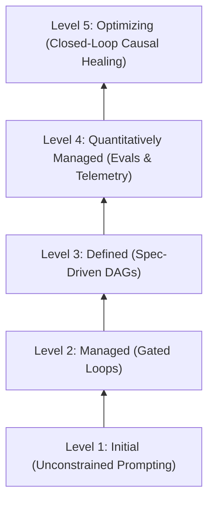

# Agentic CMMI Software Development Pipeline (A-CMMI) Specification

> **Version:** 1.0.0  
> **Standard Grounding:** Capability Maturity Model Integration (CMMI® V2.0)  
> **Domain:** Autonomous Multi-Agent Software Engineering & Stochasticity Mitigation  
> **Workspace Context:** Dual-Stack Agentic Architecture (Python + .NET) & Spec-Driven Development  

---

## 1. Executive Summary & Problem Formulation

Large Language Models (LLMs) are **fundamentally stochastic and non-deterministic**. In software engineering, unconstrained prompting produces:
1. **Architectural Drift:** Components hallucinate signatures, violate layering rules, and invent transient DTOs.
2. **Silent Regressions:** Fixes in one module break invariants in another without notification.
3. **Loss of Precision:** Introducing `float`/`double` in financial calculations, corrupting domain integrity.
4. **Token Resource Exhaustion:** Infinite retry loops attempting to fix compile errors without contextual memory.

The **Capability Maturity Model Integration (CMMI)** is an industry-proven framework for establishing process predictability, measurement, and continuous optimization. **A-CMMI (Agentic CMMI)** maps classical CMMI process discipline directly into an autonomous agent pipeline, providing deterministic boundaries that turn probabilistic LLMs into reliable software manufacturing systems.

---

## 2. The 5 A-CMMI Maturity Levels



### Level 1: Initial (Ad-Hoc / Stochastic Prompting)
- **Characteristics:** Developers prompt general-purpose models with arbitrary prompts (e.g. "Build me an expense app"). No formal requirements, no automated verification gates, no architectural boundaries.
- **Process Predictability:** Near zero. Outcomes depend entirely on model temperature, random sampling, and prompt luck.
- **Defect Mode:** Hallucinated syntax, inverted dependencies, broken types, and unbounded failure loops.

### Level 2: Managed (Project-Level Gated Loops)
- **Characteristics:** Basic engineering discipline introduced at the task level. Code generation is coupled with an in-loop compiler/test runner (Maker-Checker).
- **Core Practices:**
  - Git version control baselining.
  - Ephemeral sandbox execution (`pytest` or `dotnet test`).
  - Strict retry budget (e.g., maximum 3 attempts before escalation).
- **Stochasticity Reduction:** Syntax errors and immediate test assertion failures are caught deterministically before committing.

### Level 3: Defined (Organization-Wide Spec-Driven Architecture)
- **Characteristics:** Standardized, proactive development lifecycle across all modules and stacks.
- **Core Practices:**
  - **Constitutional Invariants:** Non-negotiable domain rules (`constitution.md`, e.g., KMK compliance, strict `rust_decimal::Decimal` / `Decimal` / `NUMERIC(15,2)` precision).
  - **Spec Kit Precedence:** Specifications (`spec.md`) with explicit Gherkin scenarios are the single source of truth.
  - **Topological Task Scheduling:** Decomposed into an acyclic directed graph (`task-dag.json`). No child task executes before prerequisites pass verification.
  - **Role Segregation:** Specialized agent personas (Requirements, Architect, Maker, Checker, Compliance).

### Level 4: Quantitatively Managed (Evals & Telemetry Baselines)
- **Characteristics:** Agentic performance is measured, benchmarked, and statistically controlled.
- **Core Practices:**
  - **Benchmark Evaluation Harness:** Automated Pass@1 and Pass@3 metrics across standardized problem sets.
  - **Resource Telemetry:** Tracking token expenditure, wall-clock duration, prompt-to-patch ratios, and iteration distributions.
  - **Defect Density Tracking:** Monitoring AST gate failure frequency and test assertion breakage rates.
  - **Automated Circuit Breakers:** Generation loops automatically pause if error rates exceed statistical control limits.

### Level 5: Optimizing (Continuous Self-Improvement & Causal Analysis)
- **Characteristics:** Closed-loop feedback mechanism that systematically eliminates the root causes of agent mistakes.
- **Core Practices:**
  - **Causal Analysis and Resolution (CAR):** When a gate fails repeatedly, a dedicated `CausalAnalysisAgent` analyzes execution traces to categorize the failure (e.g., spec ambiguity, missing contract rule, prompt hallucination).
  - **Dynamic Invariant Updates:** System automatically generates regression test cases and updates prompt guardrails to permanently prevent defect recurrence.
  - **Harness Self-Tuning:** Verification gates are dynamically adjusted based on empirical benchmark trends.

---

## 3. CMMI Process Areas Mapped to Agentic Pipeline Stages

The A-CMMI pipeline organizes development into five coordinated stages covering key CMMI Practice Areas:

```mermaid
flowchart LR
    subgraph S1 [Stage 1: Discovery & Requirements]
        direction TB
        RD[Requirements Development - RD]
        REQM[Requirements Management - REQM]
    end

    subgraph S2 [Stage 2: Architecture & Planning]
        direction TB
        TS_Arch[Technical Solution - TS]
        PLAN[Project Planning - PLAN]
        RSK[Risk Management - RSK]
    end

    subgraph S3 [Stage 3: Manufacturing & Integration]
        direction TB
        TS_Code[Technical Solution - TS]
        PI[Product Integration - PI]
        CM[Configuration Management - CM]
    end

    subgraph S4 [Stage 4: Verification & Validation]
        direction TB
        VER[Verification - VER]
        VAL[Validation - VAL]
        PPQA[Process & Product QA - PPQA]
    end

    subgraph S5 [Stage 5: Telemetry & Optimization]
        direction TB
        MA[Measurement & Analysis - MA]
        QPM[Quantitative Management - QPM]
        CAR[Causal Analysis - CAR]
    end

    S1 --> S2 --> S3 --> S4 --> S5
    S5 -. Closed-Loop Feedback .-> S1 & S2 & S3
```



### 3.1 Stage 1: Discovery & Requirements (RD & REQM)
- **Agent Assigned:** `RequirementsAgent` (PM Specialist)
- **Objectives:** Transform unstructured business intent or statutory laws (e.g. Turkish KMK 634) into formal specifications.
- **Inputs:** `intent.md`, legal regulations, stakeholder requests.
- **Outputs:** `.specify/specs/*/spec.md` with:
  - User Stories & Persona Journey Maps.
  - Concrete Gherkin Given-When-Then acceptance scenarios.
  - Explicit Non-Goals to constrain token generation.
- **Deterministic Gate:** `SpecCompletenessGate` (validates schema, Gherkin syntax, and absence of ambiguous requirements).

### 3.2 Stage 2: Architecture & Planning (TS, PLAN, RSK)
- **Agents Assigned:** `ArchitectAgent` & `PlannerAgent`
- **Objectives:** Formulate clean architecture boundaries, interface contracts, and dependency graphs before any code is written.
- **Outputs:**
  - Interface contracts, DTOs, entity definitions, and database schemas.
  - `task-dag.json`: Directed Acyclic Graph (DAG) with prerequisites and module assignments.
- **Deterministic Gate:** `DAGAcyclicityGate` (verifies topological validity and zero circular dependencies).

### 3.3 Stage 3: Manufacturing & Implementation (TS, PI, CM)
- **Agents Assigned:** `MakerAgent` (Developer) & `IntegrationAgent`
- **Objectives:** Implement task-scoped code matching architectural contracts.
- **Execution Mechanism:**
  - `TaskDagScheduler` picks eligible tasks where all parents are `COMPLETED`.
  - `MakerAgent` operates strictly within the task scope.
  - Code is committed against version-controlled baselines with clean diffs.
- **Deterministic Gate:** `DiffSanityGate` & `ContractIntegrityGate` (ensures changes do not mutate immutable shared interfaces).

### 3.4 Stage 4: Verification & Validation (VER, VAL, PPQA)
- **Agents Assigned:** `CheckerAgent`, `ValidationAgent`, `ComplianceAuditorAgent`
- **Distinction between Verification and Validation:**
  - **Verification (VER - "Did we build it right?"):**
    - `SyntaxGate`: AST parsing (Roslyn for C#, `ast.parse` for Python).
    - `FinancialIntegrityGate`: Decimal precision inspection (`rust_decimal` / `Decimal` / `NUMERIC(15,2)`).
    - `UnitGate`: 100% test assertions pass in an isolated ephemeral sandbox.
  - **Validation (VAL - "Did we build the right thing?"):**
    - `GherkinAcceptanceGate`: Executes end-to-end user journeys defined in `spec.md`.
    - `AccessibilityGate`: WCAG 2.1 AA touch target (48dp) and contrast check.
  - **PPQA (Process & Product Quality Assurance):**
    - Constitutional audit verifying adherence to `constitution.md`.

### 3.5 Stage 5: Telemetry, Measurement & Optimization (MA, QPM, CAR)
- **Agents Assigned:** `TelemetryEvalsAgent` & `CausalAnalysisAgent`
- **Objectives:** Continuously collect performance metrics and self-heal systemic issues.
- **Key Metrics:**
  - **Pass@1 / Pass@3:** Benchmark success rate on initial vs. retry generations.
  - **Repair Cost:** Number of tokens and iterations required to pass verification.
  - **Defect Escape Rate:** Defects caught in Validation that slipped through Verification.
- **Closed-Loop Action:** If an error pattern repeats $\ge 2$ times, `CausalAnalysisAgent` generates a rule update in `.agents/rules/` and creates a permanent regression unit test.

---

## 4. Pipeline Execution Protocol (The 5-Phase Loop)

When any task in the A-CMMI pipeline is executed, it runs through the standard **5-Phase Loop**:

```text
Phase 1: INSPECT   -> Read spec.md, contracts, and task-dag.json prerequisites
Phase 2: GENERATE  -> MakerAgent produces code and unit test fixtures
Phase 3: VERIFY    -> Run AST Gate, Compile Gate, Financial Gate, Test Gate
Phase 4: VALIDATE  -> Run Gherkin Acceptance Scenarios & PPQA Compliance
Phase 5: BASELINE  -> Update RTM status to VERIFIED and advance Task DAG
```

If Phase 3 or 4 fails, the error diagnostics are formatted into an anti-rot feedback prompt and routed back to Phase 2 for up to 3 bounded iterations. If the budget expires, the task is marked `ESCALATED` for human review or causal analysis.
