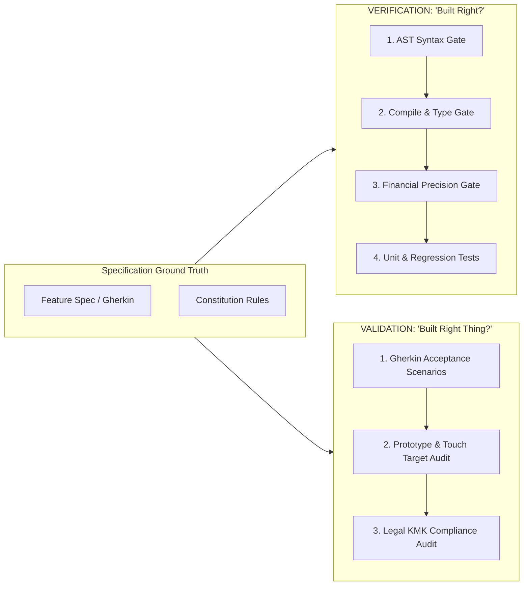
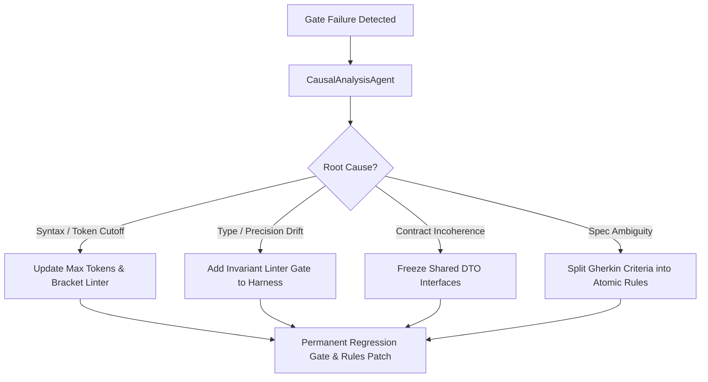

# Bidirectional Requirements Traceability Matrix (RTM) & CMMI Control Matrices

> **Standard Grounding:** CMMI® V2.0 Requirements Management (REQM), Verification (VER), Validation (VAL), and Causal Analysis & Resolution (CAR).  
> **Purpose:** Provide complete bidirectional traceability from business intent through architecture, task scheduling, source code, verification gates, validation sign-off, and causal defect feedback.

---

## 1. Bidirectional Requirements Traceability Matrix (RTM)

The matrix below provides complete **forward traceability** (from user intent down to code and test gates) and **backward traceability** (from test results back to requirements):

| Req ID | Business Goal & Intent | CMMI Spec Section | Architecture & Contract Ref | Task DAG ID | Implementation Artifacts | Verification Test Cases (VER) | Validation Acceptance Criteria (VAL) | Status |
| :--- | :--- | :--- | :--- | :--- | :--- | :--- | :--- | :--- |
| **REQ-001** | Accurate dues calculation without floating-point precision loss | `001-resident-dashboard/spec.md#1.1` | `AidatHesaplaService`, `Money` value object | `task-01` | `apps/development-time/SitePulse/flutter/lib/domain/models/money.dart` | `gate:money-fixtures`, `flutter:test/calculate_dues_usecase_test.dart` | Gherkin: "Given resident balance ₺1.450,00 When calculated Then balance has zero kuruş rounding drift" | **UNVERIFIED** |
| **REQ-002** | KMK Statutory 5% monthly delay fee pro-rated daily (Art. 20) | `001-resident-dashboard/spec.md#1.2` | `DelayCompensationCalculator`, `GecikmeTazminatiService` | `task-02` | `apps/development-time/SitePulse/flutter/lib/domain/usecases/calculate_dues_usecase.dart` | `gate:money-fixtures`, `rust:integration_tests::when_overdue_by_10_days_then_calculates_exact_5_percent_pro_rated_penalty`, `rust:integration_tests::when_not_overdue_then_penalty_remains_zero`, `flutter:test/financial_fixture_test.dart`, `rust:financial_fixtures::penalty_cases_match_the_fixture` | Gherkin: "Given 10 days overdue When penalty applied Then fee equals (P * 0.05 * 10/30)" | **UNVERIFIED** |
| **REQ-003** | Reactive Resident Dashboard State Management | `001-resident-dashboard/spec.md#2.1` | `DashboardUiState`, `DashboardViewModel` | `task-03` | `apps/development-time/SitePulse/flutter/lib/ui/dashboard/dashboard_controller.dart` | `flutter:test/dashboard_controller_test.dart` | Gherkin: "Given initial loading state When data loads Then emit Success with HeroCard data" | **UNVERIFIED** |
| **REQ-004** | Material 3 Resident Dashboard UI Screens | `001-resident-dashboard/spec.md#3.1` | `DashboardScreen`, Material 3 Tokens | `task-04` | `apps/development-time/SitePulse/flutter/lib/ui/dashboard/dashboard_screen.dart` | `flutter:test/widget_test.dart`, `flutter:test/zero_data_guidance_test.dart` | Gherkin: "When resident opens app Then Hero balance card, quick actions, and announcements are visible with >=48dp touch targets" | **UNVERIFIED** |
| **REQ-005** | PostgreSQL Relational Schema for Dues & Units | `001-resident-dashboard/spec.md#4.1` | `V1__init_schema.sql`, PostgreSQL Migrations | `task-05` | `apps/development-time/SitePulse/backend/migrations/V1__init_schema.sql` | `gate:schema-integrity`, `rust:lib::migrations::tests::every_migration_file_is_registered_in_order`, `system:restart_persistence`, `system:sequences_survive_restart` | Gherkin: "When migrations run Then tables siteler, bloklar, bagimsiz_bolumler exist with NUMERIC(15,2)" | **UNVERIFIED** |
| **REQ-006** | Rust High-Precision Domain Models & Decimal Invariants | `001-resident-dashboard/spec.md#4.2` | `rust_decimal::Decimal`, `AidatBorcu`, `User` | `task-06` | `apps/development-time/SitePulse/backend/src/models/mod.rs` | `gate:money-fixtures`, `rust:lib::services::dues_ledger::tests::payment_records_paid_amounts_and_never_reduces_the_debt`, `rust:financial_fixtures::waterfall_properties_hold_for_random_inputs` | Gherkin: "Given concurrent payment updates When validated Then domain models maintain zero float precision leak" | **UNVERIFIED** |
| **REQ-007** | High-Performance Axum / Tokio REST API for Resident Dashboard | `001-resident-dashboard/spec.md#4.3` | `axum::Router`, `get_resident_dashboard`, REST DTOs | `task-07` | `apps/development-time/SitePulse/backend/src/handlers/mod.rs` | `gate:api-system`, `rust:api_security_tests::every_protected_route_returns_401_without_a_token`, `rust:api_security_tests::site_managers_are_confined_to_their_site`, `rust:api_security_tests::residents_cannot_reach_admin_or_other_units`, `system:unauthenticated_routes_rejected`, `system:cross_site_forbidden` | Gherkin: "When GET /api/v1/residents/{unitId}/dashboard Then return 200 OK with total dues and delay fee" | **UNVERIFIED** |
| **REQ-008** | Offline Room Cache & Synchronization Layer | `constitution.md#3.3` | `ResidentDao`, `SitePulseDatabase` | `task-08` | `apps/development-time/SitePulse/flutter/lib/ui/dashboard/dashboard_controller.dart` | `flutter:test/e2e_quality_verification_test.dart` | Gherkin: "Given network unavailable When user opens dashboard Then show cached data with offline status banner" | **UNVERIFIED** |
| **REQ-009** | Action-Free Site Deletion Guard & Invariant Multi-Tenant Cleanup | `002-saas-multi-tenancy/saas-spec.md#3.3` | `SaasTenantService`, `delete_site` | `task-09` | `apps/development-time/SitePulse/flutter/lib/ui/dashboard/dashboard_controller.dart`, `apps/development-time/SitePulse/backend/src/services/saas_tenant_service.rs` | `rust:integration_tests::when_deleting_action_free_site_then_succeeds_and_removes_site`, `rust:integration_tests::when_deleting_site_with_active_units_or_actions_then_strictly_rejected` | Gherkin: "Given an action-free site When deleted Then remove from portfolio; Given site with actions When deleted Then reject" | **UNVERIFIED** |
| **REQ-010** | Temporary Password Renewal & Recovery for Site Managers | `002-saas-multi-tenancy/saas-spec.md#3.4` | `SaasTenantService`, `reset_site_admin_password` | `task-10` | `apps/development-time/SitePulse/flutter/lib/ui/dashboard/dashboard_controller.dart`, `apps/development-time/SitePulse/backend/src/services/saas_tenant_service.rs` | `rust:integration_tests::when_resetting_admin_password_then_generates_new_temporary_password_and_forces_change`, `rust:integration_tests::when_resetting_admin_password_for_non_existent_site_then_fails` | Gherkin: "Given a site manager When SaaS Admin renews password Then generate temporary password and set mustChangePassword to true" | **UNVERIFIED** |
| **REQ-011** | Zero-Approval Bank Statement (Excel / CSV / MT940) Parser & Reconciliation | `003-bank-statement-parser/spec.md#3.1` | `BankStatementParser`, `Mt940Engine`, `ReconciliationService` | `task-11` | `apps/development-time/SitePulse/backend/src/services/bank_statement_parser.rs`, `apps/development-time/SitePulse/backend/src/services/mt940_engine.rs`, `apps/development-time/SitePulse/backend/src/services/reconciliation_service.rs`, `apps/development-time/SitePulse/flutter/lib/ui/components/bank_statement_reconciliation_page.dart` | `rust:integration_tests::when_parsing_turkish_bank_excel_then_matches_flat_and_amount`, `rust:integration_tests::when_parsing_mt940_statement_then_extracts_transactions_and_matches_due`, `flutter:test/bank_file_parser_test.dart`, `flutter:test/bank_statement_reconciliation_test.dart` | Gherkin: "Given statement with 'HAVALE - AHMET YILMAZ A BLOK D:14 EYLUL AIDAT - ₺1.423,33' When processed Then identify unit A Blok D:14 with 100% confidence and match balance" | **UNVERIFIED** |
| **REQ-012** | Flat-Specific Virtual IBAN Allocation & Real-Time Bank Webhook Settlement | `004-virtual-iban-and-dues-accrual/spec.md#1.1` | `VirtualIbanService`, `KuveytTurkService`, `handle_bank_incoming_webhook` | `task-12` | `apps/development-time/SitePulse/backend/src/services/virtual_iban_service.rs`, `apps/development-time/SitePulse/backend/src/handlers/mod.rs` | `rust:integration_tests::when_unit_created_then_generates_unique_sanal_iban`, `rust:integration_tests::when_bank_webhook_delivers_virtual_iban_payment_then_clears_dues_and_generates_receipt`, `rust:integration_tests::when_webhook_is_unsigned_or_forged_then_it_is_rejected`, `rust:integration_tests::when_webhook_currency_is_not_try_then_it_is_rejected`, `system:webhook_signature_enforced` | Gherkin: "Given unit A Blok D:14 When webhook receives transfer Then dues transition to PAID and receipt is issued" | **UNVERIFIED** |
| **REQ-013** | Advance Payment Allocation & Dynamic Surplus Balance Display | `004-virtual-iban-and-dues-accrual/spec.md#1.3` | `apply_advance_payments_offset`, `HeroBalanceCard`, `advance_payment` | `task-13` | `apps/development-time/SitePulse/backend/src/handlers/mod.rs`, `apps/development-time/SitePulse/flutter/lib/ui/components/hero_balance_card.dart` | `rust:integration_tests::when_excess_or_multiple_payments_delivered_then_credited_as_advance_payment`, `rust:integration_tests::when_new_dues_period_accrued_and_resident_has_advance_payment_then_automatically_offsets_debt` | Gherkin: "Given payment exceeds debt When settled Then credit surplus to advance_payment and display +₺ on Hero Card" | **UNVERIFIED** |
| **REQ-014** | Automated Monthly Dues Batch Scheduler & Duplicate Accrual Guard | `004-virtual-iban-and-dues-accrual/spec.md#1.5` | `start_automated_dues_accrual_scheduler`, `accrue_monthly_dues`, `DuesManagementView` | `task-14` | `apps/development-time/SitePulse/backend/src/scheduler.rs`, `apps/development-time/SitePulse/backend/src/handlers/mod.rs`, `apps/development-time/SitePulse/flutter/lib/ui/components/dues_management_view.dart` | `rust:integration_tests::when_scheduler_batch_runs_then_accrues_and_prevents_duplicate_accrual`, `rust:integration_tests::when_utc_is_late_evening_then_accrual_uses_the_site_local_date`, `rust:integration_tests::when_dues_period_already_accrued_then_duplicate_accrual_is_prevented` | Gherkin: "Given period already accrued When accrual triggered Then reject duplicate and notify user without creating debt" | **UNVERIFIED** |
| **REQ-015** | Unified Multi-Channel Payment Inflow Stream & Centralized Transaction Ledger | `004-virtual-iban-and-dues-accrual/spec.md#2.1` | `PaymentTrackingService`, `PaymentEntry` | `task-15` | `apps/development-time/SitePulse/backend/src/services/payment_tracking_service.rs` | `gate:schema-integrity`, `rust:integration_tests::when_querying_payment_stream_then_returns_filtered_entries_and_volume_kpis`, `system:concurrent_receipts_unique` | Gherkin: "Given payments from Virtual IBAN, statement, and manual cash When queried Then display in unified transaction stream" | **UNVERIFIED** |
| **REQ-016** | Dual-Ledger FIFO Allocation & KMK Statutory Delay Penalty Waterfall | `004-virtual-iban-and-dues-accrual/spec.md#2.2` | `PaymentTrackingService::record_and_allocate_payment` | `task-16` | `apps/development-time/SitePulse/backend/src/services/payment_tracking_service.rs` | `gate:money-fixtures`, `rust:integration_tests::when_payment_is_allocated_then_amount_owed_is_preserved_and_penalty_is_recorded`, `rust:integration_tests::when_recording_payment_with_penalty_then_amortizes_penalty_first_per_tbk100_and_surplus_to_advance`, `rust:integration_tests::when_tenant_pays_without_capital_intent_then_owner_capital_dues_are_untouched`, `rust:financial_fixtures::allocation_cases_match_the_fixture` | Gherkin: "Given overdue dues and delay penalty When payment arrives Then allocate to penalty first, dues second, and surplus to advance" | **UNVERIFIED** |
| **REQ-017** | Monotonic Digital Payment Receipt Generation (`#TAH-YYYY-XXXXXX`) | `004-virtual-iban-and-dues-accrual/spec.md#2.3` | `PaymentTrackingService::next_receipt_number`, `compute_verification_hash` | `task-17` | `apps/development-time/SitePulse/backend/src/services/payment_tracking_service.rs` | `rust:integration_tests::when_tenant_pays_with_capital_dues_keyword_then_routes_to_capital_and_marks_rent_offset_eligible`, `system:concurrent_receipts_unique`, `system:idempotent_payment_retry` | Gherkin: "Given settled payment When receipt generated Then issue monotonic TAH-2026-XXXXXX sequence with SHA-256 hash" | **UNVERIFIED** |
| **REQ-018** | Site Manager Payment Tracking Dashboard & Debt Aging Brackets | `004-virtual-iban-and-dues-accrual/spec.md#2.4` | `PaymentTrackingPage`, `DebtAgingReportDto` | `task-18` | `apps/development-time/SitePulse/flutter/lib/ui/components/payment_tracking_page.dart` | `flutter:test/payment_tracking_and_aging_test.dart` | Gherkin: "When manager opens Payment Tracking Then view stream, aging brackets 0-30, 31-60, 60+, and receipt modals" | **UNVERIFIED** |
| **REQ-019** | Occupancy Lifecycle Financial Handover & Move-Out Balance Freeze Hook | `004-virtual-iban-and-dues-accrual/spec.md#2.5` | `PaymentTrackingService::transfer_ownership`, `OwnersResidentsModulePage` | `task-19` | `apps/development-time/SitePulse/backend/src/services/payment_tracking_service.rs`, `apps/development-time/SitePulse/flutter/lib/ui/residents/owners_residents_module_page.dart` | `rust:integration_tests::when_managing_occupancy_lifecycle_then_can_move_out_and_move_in_without_losing_history`, `rust:integration_tests::when_tenant_moves_out_then_household_members_are_archived_and_cleared_from_active_unit`, `flutter:test/occupancy_lifecycle_and_dual_ledger_test.dart` | Gherkin: "Given tenant moves out or property sold When finalized Then freeze old balance and preserve tenant lease" | **UNVERIFIED** |
| **REQ-020** | PostgreSQL is the system of record; versioned migrations; closed-loop harness with evidence. | `.specify/requirements/EPIC-05` | Backend Persistence, Migrations & Verification Harness | `task-20` | `apps/development-time/SitePulse/backend/src/migrations.rs` | `gate:harness-selftest`, `gate:persistence-lint`, `gate:schema-integrity`, `system:restart_persistence`, `system:sequences_survive_restart`, `rust:lib::migrations::tests::every_migration_file_is_registered_in_order` | All named gates and acceptance tests pass on the current commit, recorded in `.specify/evidence/task-20.json` | **UNVERIFIED** |
| **REQ-021** | Signed JWTs, argon2id passwords, verified Google ID tokens, role and tenant policy on every route. | `.specify/requirements/EPIC-06` | Identity, Authentication & Scoped Authorization | `task-21` | `apps/development-time/SitePulse/backend/src/auth.rs` | `gate:api-system`, `rust:integration_tests::when_valid_password_registration_then_can_authenticate`, `rust:integration_tests::when_wrong_password_then_throws_exception`, `rust:integration_tests::when_valid_google_id_token_then_authenticates_and_links_account`, `rust:integration_tests::when_google_token_is_unsigned_then_account_takeover_is_impossible`, `rust:integration_tests::when_using_former_backdoor_or_placeholder_passwords_then_login_fails`, `rust:integration_tests::when_changing_password_then_policy_is_uniform_and_errors_do_not_enumerate_users`, `rust:integration_tests::when_registering_without_invite_or_with_unknown_invite_then_rejected`, `rust:lib::auth::tests::token_round_trip_and_tamper_detection`, `rust:lib::auth::tests::passwords_only_verify_against_argon2`, `rust:api_security_tests::forged_and_unsigned_tokens_are_rejected`, `rust:api_security_tests::profile_comes_from_the_token_not_the_query`, `system:forged_token_rejected` | All named gates and acceptance tests pass on the current commit, recorded in `.specify/evidence/task-21.json` | **UNVERIFIED** |
| **REQ-022** | HMAC-signed bank webhooks, durable idempotency, reconciliation within the site. | `.specify/requirements/EPIC-07` | Bank Integration, Webhooks & Automated Reconciliation | `task-22` | `apps/development-time/SitePulse/backend/src/handlers/mod.rs` | `rust:integration_tests::when_confirming_reconciliation_batch_then_updates_dues_and_ledger`, `rust:integration_tests::when_site_manager_configures_bank_account_then_format_is_automatically_set_by_bank`, `rust:integration_tests::when_sender_iban_is_remembered_subsequent_blank_desc_payment_auto_matches`, `rust:integration_tests::when_transfer_cannot_be_matched_then_enters_unmatched_pool_successfully`, `system:webhook_signature_enforced` | All named gates and acceptance tests pass on the current commit, recorded in `.specify/evidence/task-22.json` | **UNVERIFIED** |
| **REQ-023** | Owner/tenant liabilities separated; transfers are transactional and keep history. | `.specify/requirements/EPIC-08` | Occupancy Lifecycle & Dual-Ledger Responsibility | `task-23` | `apps/development-time/SitePulse/backend/src/services/payment_tracking_service.rs` | `rust:integration_tests::when_registering_new_owner_or_tenant_to_existing_unit_then_archives_previous_occupant_in_history`, `rust:integration_tests::when_property_ownership_transferred_then_old_owner_debt_frozen_and_tenant_lease_preserved`, `rust:integration_tests::when_transferring_property_ownership_then_freezes_old_debt_and_creates_occupancy_history`, `flutter:test/occupancy_lifecycle_and_dual_ledger_test.dart` | All named gates and acceptance tests pass on the current commit, recorded in `.specify/evidence/task-23.json` | **UNVERIFIED** |
| **REQ-024** | Transactional payments, unique receipt numbers, idempotent retries, advance ledger per debtor. | `.specify/requirements/EPIC-09` | Payment Tracking, Receipts & Treasury | `task-24` | `apps/development-time/SitePulse/backend/src/services/dues_ledger.rs` | `gate:money-fixtures`, `rust:integration_tests::when_calculating_debt_aging_then_categorizes_into_current_30_60_and_90_brackets`, `rust:integration_tests::when_inter_ledger_transfer_executed_then_deducts_advance_credits_capital_and_issues_receipt`, `rust:integration_tests::when_querying_payment_stream_then_returns_filtered_entries_and_volume_kpis`, `system:concurrent_receipts_unique`, `system:idempotent_payment_retry` | All named gates and acceptance tests pass on the current commit, recorded in `.specify/evidence/task-24.json` | **UNVERIFIED** |
| **REQ-025** | Capital projects, installments and disbursements; capital dues are owner-only. | `.specify/requirements/EPIC-10` | Capital Expenditure & Fixture Dues | `task-25` | `apps/development-time/SitePulse/backend/src/services/capital_project_service.rs` | `rust:integration_tests::when_creating_capital_project_with_installments_then_calculates_plan_correctly`, `rust:integration_tests::when_accruing_capital_installment_then_reconciles_penny_drift_exactly`, `rust:integration_tests::when_contractor_disbursement_recorded_then_updates_fund_balance`, `flutter:test/capital_expenditure_and_dues_e2e_test.dart`, `flutter:test/capital_projects_view_test.dart` | All named gates and acceptance tests pass on the current commit, recorded in `.specify/evidence/task-25.json` | **UNVERIFIED** |
| **REQ-026** | Every payment channel settles through one transactional path with a TAH receipt; KMK 20 penalty accrues on the unpaid principal; TBK 101 payer designation; append-only payment ledger with payer identity (V16). | `.specify/specs/005-payment-compliance-phase1/spec.md` | Payment Compliance Phase 1 (SPEC-005) | `task-26` | `apps/development-time/SitePulse/backend/src/services/payment_tracking_service.rs`, `apps/development-time/SitePulse/backend/src/services/dues_calculation_service.rs`, `apps/development-time/SitePulse/backend/migrations/V16__payment_ledger_integrity.sql` | `gate:money-fixtures`, `rust:payment_compliance_tests::when_overdue_due_is_paid_by_webhook_then_penalty_is_collected_first_with_a_tah_receipt`, `rust:payment_compliance_tests::when_payer_designates_a_period_then_that_due_is_settled_before_older_dues`, `rust:payment_compliance_tests::when_match_all_settles_a_pending_payment_then_no_duplicate_ledger_row_is_created`, `system:match_all_settles_in_place`, `system:payer_identity_recorded`, `system:site_purge_is_atomic`, `system:ledger_integrity_clean` | All named gates and acceptance tests pass on the current commit, recorded in `.specify/evidence/task-26.json` | **UNVERIFIED** |
| **REQ-027** | Advance balances per debtor end to end with a TENANT->OWNER virman; IAD reversals with contra entries, un-allocation and advance refund; webhook claims scoped by bank account with receipt and payload hash; idempotency only in its own table; receipt issuer tax details (V17). | `.specify/specs/006-payment-ledger-hardening/spec.md` | Payment Ledger Hardening (SPEC-006) | `task-27` | `apps/development-time/SitePulse/backend/src/services/payment_tracking_service.rs`, `apps/development-time/SitePulse/backend/src/db/payment_repository.rs`, `apps/development-time/SitePulse/backend/migrations/V17__payment_ledger_hardening.sql` | `gate:money-fixtures`, `rust:payment_ledger_hardening_tests::when_tenant_surplus_is_transferred_to_owner_capital_then_the_tenant_advance_pays_on_behalf_of_the_owner`, `rust:payment_ledger_hardening_tests::when_advances_are_offset_then_each_due_is_paid_only_from_its_own_debtors_advance`, `rust:payment_ledger_hardening_tests::when_a_settled_payment_is_reversed_then_dues_reopen_the_advance_is_refunded_and_an_iad_receipt_is_issued`, `system:tenant_surplus_virman`, `system:reversal_restores_ledger`, `system:webhook_claim_scoped`, `system:ledger_integrity_clean` | All named gates and acceptance tests pass on the current commit, recorded in `.specify/evidence/task-27.json` | **UNVERIFIED** |
| **REQ-028** | Virman reversal restores the source advance; resident statement with aging; receipt PDF with public QR verification; card payments only through a licensed provider's hosted page with a signed webhook; işletme projesi lifecycle with the revaluation cap, and dues accrued from it as their legal basis (V18). | `.specify/specs/007-payments-phase2/spec.md` | Payments Phase 2 (SPEC-007) | `task-28` | `apps/development-time/SitePulse/backend/src/services/operating_budget_service.rs`, `apps/development-time/SitePulse/backend/src/services/card_payment_service.rs`, `apps/development-time/SitePulse/backend/src/services/receipt_document.rs`, `apps/development-time/SitePulse/backend/migrations/V18__payments_phase2.sql` | `gate:money-fixtures`, `rust:payments_phase2_tests::when_a_budget_is_in_force_then_dues_are_accrued_from_unit_shares_with_the_budget_as_legal_basis`, `rust:payments_phase2_tests::when_a_card_payment_is_captured_then_it_is_recorded_once_through_the_ingestion_path`, `system:virman_reversal_restores_advance`, `system:card_payment_via_provider`, `system:budget_accrual_legal_basis`, `system:ledger_integrity_clean` | All named gates and acceptance tests pass on the current commit, recorded in `.specify/evidence/task-28.json` | **UNVERIFIED** |
| **REQ-029** | Current identity, tenant-scoped authorization, revocable sessions and durable audit evidence | `008-authentication-authorization-audit/spec.md` | Typed route policies, server sessions, transactional audit triggers | `task-29` | `apps/development-time/SitePulse/backend/src/authorization.rs`, `apps/development-time/SitePulse/backend/src/security.rs`, `apps/development-time/SitePulse/backend/src/audit.rs` | `rust:aaa_security_tests::unknown_routes_and_cross_tenant_access_fail_closed`, `flutter:test/session_security_test.dart`, `system:security_session_lifecycle`, `system:transactional_audit`, `system:audit_scope_and_privileges`, `system:registration_repository_scope` | Revoked credentials and foreign resources are denied; audit failure rolls back domain writes | **UNVERIFIED** |

| **REQ-030** | Measure person integrity and directory baseline | `apps/development-time/SitePulse/docs/architecture/OWNERS_RESIDENTS_UNIFIED_DESIGN.md` | Integrity report and baseline measurements | `task-30` | `apps/development-time/SitePulse/scripts/person_integrity_report.py` | gate:schema-integrity, gate:harness-selftest | Report counts every precondition and records baseline row density and task times | **COMPLETED** |
| **REQ-031** | Centralize person writes and duplicate resolution | `apps/development-time/SitePulse/docs/architecture/OWNERS_RESIDENTS_UNIFIED_DESIGN.md` | Person repository and transactional resolver | `task-31` | `apps/development-time/SitePulse/backend/src/db/person_repository.rs` | gate:rust-test, gate:rust-standards-lint, gate:tenant-lint | Every person insert uses the repository; hard and soft duplicates and concurrent inserts are handled | **COMPLETED** |
| **REQ-032** | Add person and primary contact schema foundations | `apps/development-time/SitePulse/docs/architecture/OWNERS_RESIDENTS_UNIFIED_DESIGN.md` | V33 migration and card views | `task-32` | `apps/development-time/SitePulse/backend/migrations/V33__person_schema_foundations.sql` | gate:schema-integrity, gate:rust-db-test | Backfills and constraints preserve existing people and site isolation | **COMPLETED** |
| **REQ-033** | Expose person card API and reference-based commands | `apps/development-time/SitePulse/docs/architecture/OWNERS_RESIDENTS_UNIFIED_DESIGN.md` | Person APIs and PersonRef commands | `task-33` | `apps/development-time/SitePulse/backend/src/handlers/site_admin.rs` | gate:api-system, gate:tenant-lint | Scoped search, create, edit and login work; commands accept references and old bodies during transition | **COMPLETED** |
| **REQ-034** | Build shared directory scaffold and compact unit list | `apps/development-time/SitePulse/docs/architecture/OWNERS_RESIDENTS_UNIFIED_DESIGN.md` | Shared scaffold and responsive unit list | `task-34` | `apps/development-time/SitePulse/flutter/lib/ui/residents/owners_residents_module_page.dart` | gate:flutter-test, gate:flutter-reuse, gate:ui-style-lint | Unit rows filter, sort, page and restore state at phone and desktop widths | **COMPLETED** |
| **REQ-035** | Build actions-first unit workspace and action pages | `apps/development-time/SitePulse/docs/architecture/OWNERS_RESIDENTS_UNIFIED_DESIGN.md` | Unit workspace and action pages | `task-35` | `apps/development-time/SitePulse/flutter/lib/ui/residents/owners_residents_unit_card.dart` | gate:flutter-test, gate:flutter-reuse, gate:testid-lint | Workspace separates actions and information, actions follow allowed_commands and existing occupancy workflows still work | **COMPLETED** |
| **REQ-036** | Build person field, picker, form and card components | `apps/development-time/SitePulse/docs/architecture/OWNERS_RESIDENTS_UNIFIED_DESIGN.md` | Person reference picker and form components | `task-36` | `apps/development-time/SitePulse/flutter/lib/ui/residents/owners_residents_occupancy.dart` | gate:flutter-test, gate:flutter-reuse, gate:testid-lint | Picker searches beyond the first 100 people and explains duplicates and role eligibility against a fake repository | **COMPLETED** |
| **REQ-037** | Move people list onto the shared directory scaffold | `apps/development-time/SitePulse/docs/architecture/OWNERS_RESIDENTS_UNIFIED_DESIGN.md` | People list on shared scaffold | `task-37` | `apps/development-time/SitePulse/flutter/lib/ui/residents/person_profile_page.dart` | gate:flutter-test, gate:flutter-reuse, gate:testid-lint | People list searches, filters, pages and restores state on the shared scaffold | **COMPLETED** |
| **REQ-038** | Merge person cards on the server | `apps/development-time/SitePulse/docs/architecture/OWNERS_RESIDENTS_UNIFIED_DESIGN.md` | Step-up merge service | `task-38` | `apps/development-time/SitePulse/backend/src/services/person_record_service.rs` | gate:rust-test, gate:rust-db-test, gate:api-system | Merge preserves ledger IDs, rejects conflicting roles and readers resolve tombstones | **COMPLETED** |
| **REQ-039** | Retire copied person data and legacy request fields | `apps/development-time/SitePulse/docs/architecture/OWNERS_RESIDENTS_UNIFIED_DESIGN.md` | Final schema and API cleanup | `task-39` | `apps/development-time/SitePulse/backend/migrations/V34__remove_person_copies.sql` | gate:schema-integrity, gate:api-system, gate:flutter-test | After the compatibility release, relationships reference person cards and historical ledgers remain intact | **UNVERIFIED** |
| **REQ-040** | Publish person API contract | `apps/development-time/SitePulse/docs/architecture/OWNERS_RESIDENTS_UNIFIED_DESIGN.md` | Person DTOs in OpenAPI | `task-40` | `apps/development-time/SitePulse/backend/src/handlers/site_admin.rs` | gate:rust-test, gate:api-system | PersonRef, person card and person request and response schemas appear in the generated OpenAPI document | **COMPLETED** |
| **REQ-041** | Open unit workspace from directory rows | `apps/development-time/SitePulse/docs/architecture/OWNERS_RESIDENTS_UNIFIED_DESIGN.md` | Directory row to workspace navigation | `task-41` | `apps/development-time/SitePulse/flutter/lib/ui/residents/owners_residents_module_page.dart` | gate:flutter-test, gate:testid-lint | Every unit row reaches actions in one tap and returning restores list state and focus | **COMPLETED** |
| **REQ-042** | Replace inline person inputs in unit actions | `apps/development-time/SitePulse/docs/architecture/OWNERS_RESIDENTS_UNIFIED_DESIGN.md` | Person references in action pages | `task-42` | `apps/development-time/SitePulse/flutter/lib/ui/residents/owners_residents_occupancy.dart` | gate:flutter-test, gate:api-system, gate:flutter-reuse | Action pages choose or create a person card and keep no person text inputs | **UNVERIFIED** |
| **REQ-043** | Expand person card and cross-navigation | `apps/development-time/SitePulse/docs/architecture/OWNERS_RESIDENTS_UNIFIED_DESIGN.md` | Person card and unit cross-links | `task-43` | `apps/development-time/SitePulse/flutter/lib/ui/residents/person_profile_page.dart` | gate:flutter-test, gate:flutter-reuse, gate:testid-lint | Unit to person to unit navigation retains state and card edits update every visible unit role | **UNVERIFIED** |
| **REQ-044** | Add merge UI and scale directory search | `apps/development-time/SitePulse/docs/architecture/OWNERS_RESIDENTS_UNIFIED_DESIGN.md` | Merge flow and measured directory paging | `task-44` | `apps/development-time/SitePulse/flutter/lib/ui/residents/person_profile_page.dart` | gate:flutter-test, gate:api-system | Merge flow is step-up protected; server paging follows the measured benchmark | **UNVERIFIED** |
---

## 2. Verification (VER) vs. Validation (VAL) Alignment Matrix

CMMI makes a fundamental distinction between **Verification** ("Are we building the product right?") and **Validation** ("Are we building the right product?"):

| Dimension | Verification (VER - In-Loop Deterministic) | Validation (VAL - Out-of-Loop Acceptance) |
| :--- | :--- | :--- |
| **Core Question** | "Did the agent generate syntactically and structurally sound code adhering to interfaces?" | "Does the generated software fulfill the resident's operational need and legal criteria?" |
| **Evaluating Agents** | `CheckerAgent` (Test Engineer), `SyntaxGateAgent` | `ValidationAgent`, `UIUXAuditorAgent`, `ProductManagerAgent` |
| **Artifacts Evaluated** | AST trees, compiler diagnostics, xUnit/pytest execution traces, memory benchmarks. | End-to-end user workflows, Compose UI preview screenshots, Gherkin scenario runs. |
| **Automated Harness Gates** | - `rust-build`, `rust-clippy -D warnings`, `flutter-analyze` (real compilers and linters) - `money-fixtures` (one fixture file run against the Rust services and the Dart use case) - task acceptance tests, `schema-integrity`, `api-system` (see `harness/loop/verification_gates.py`) | - `GherkinScenarioGate` (Given-When-Then behavioral match) - `AccessibilityGate` (>=48dp touch targets, contrast ratios) - `ConstitutionComplianceGate` (KMK legal rules) |
| **Failure Resolution** | Each recorded failure increments `attempts`; the task is FAILED (back to the maker, with diagnostics in its evidence file) until `max_attempts` (default 3), then BLOCKED for a human. | Requirement disambiguation; `RequirementsAgent` updates user stories or splits tasks. |

---

## 3. Defect & Feedback Loop Traceability Matrix (CMMI CAR)

Under CMMI Level 5 **Causal Analysis and Resolution (CAR)**, defects detected during the pipeline do not simply cause retries; they are classified to eliminate systematic vulnerabilities:

| Defect Signature | Detection Stage | Root Cause Classification | Remediating Agent | Permanent Preventive Action (A-CMMI Level 5) |
| :--- | :--- | :--- | :--- | :--- |
| **Mismatched Braces / Unclosed Class** | Maker-Checker Loop (`SyntaxGate`) | LLM output token cutoff or unescaped template string | `MakerAgent` | AST validation executes in ephemeral sandbox; truncated files trigger automatic continuation prompt. |
| **Floating-Point Usage (`float`/`double`)** | Verification (`FinancialIntegrityGate`) | LLM habituated to standard IEEE 754 floating types | `MakerAgent` | Linter gate added to harness to reject any PR containing `Float` or `Double` in financial packages. |
| **Mutated Public API / DTO Signature** | Integration (`ContractGate`) | Maker agent renamed method parameters to optimize locally | `ArchitectAgent` | API contract is placed in read-only spec folder (`.specify/contracts/`); diff analyzer fails if interface changes. |
| **Gherkin Scenario State Failure** | Validation (`AcceptanceGate`) | Requirement had underspecified edge cases (e.g. leap year daily delay) | `RequirementsAgent` | User story in `spec.md` updated with explicit boundary conditions; new unit test generated. |
| **Infinite Error Loop (Budget Exceeded)** | Telemetry (`MA/QPM Gate`) | Maker agent repeatedly oscillating between two mutually conflicting fixes | `CausalAnalysisAgent` | Loop halted after iteration 3; error trace diff compressed and escalated with root-cause summary. |

---

## 4. Maintenance & Traceability Lifecycle Protocol

1. **Requirements Changes:** When a requirement is added or modified, the `RequirementsAgent` updates both `spec.md` and this matrix (`traceability-matrix.md`), incrementing the specification version.
2. **Task Creation:** The `PlannerAgent` creates a corresponding task in `task-dag.json`, tagging it with the exact `spec_ref` and `Req ID`.
3. **Verification Sign-Off:** The `CheckerAgent` cannot mark a task as `COMPLETED` unless all corresponding verification unit test cases pass with zero warnings.
4. **Validation Sign-Off:** The `ValidationAgent` transitions the RTM status from `IMPLEMENTED` to `VERIFIED` once Gherkin acceptance scenarios run clean.
