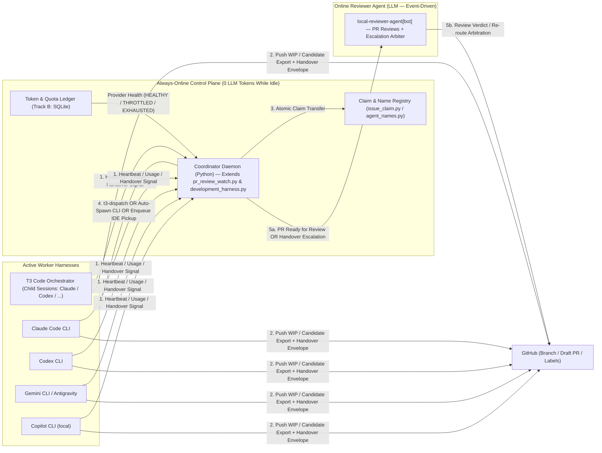
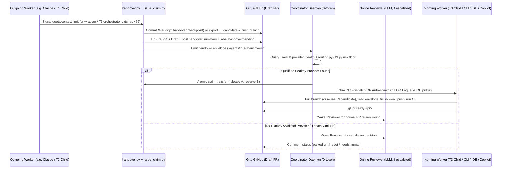
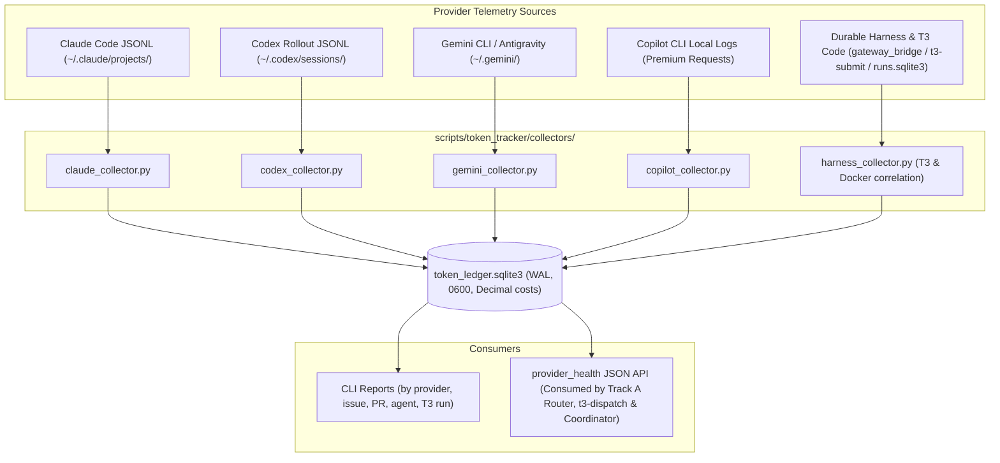

# Token-Aware Multi-Provider Harness, Auto-Handover & Token Tracker — Architectural Analysis

> [!NOTE]
> This analysis is grounded in the workspace's existing orchestration infrastructure:
> - **Interactive multi-harness GitHub loop**: [`issue_claim.py`](../../../../../scripts/issue_claim.py), [`agent_names.py`](../../../../../scripts/agent_names.py), [`pr_review_watch.py`](../../../../../scripts/pr_review_watch.py), [`review_bot.py`](../../../../../scripts/review_bot.py), and [`token_guard.py`](../../../../../scripts/token_guard.py).
> - **Durable Engineering Harness**: [`engineering-harness.md`](engineering-harness.md), [`engine.py`](../../../../../scripts/engineering_harness/engine.py), [`routing.py`](../../../../../scripts/engineering_harness/routing.py), [`contracts.py`](../../../../../scripts/engineering_harness/contracts.py), [`store.py`](../../../../../scripts/engineering_harness/store.py), [`t3.py`](../../../../../scripts/engineering_harness/t3.py), [`gateway_bridge.py`](../../../../../scripts/engineering_harness/gateway_bridge.py), and [`t3-registry.json`](../../../../../config/engineering-harness/t3-registry.json).

---

## 1. Executive Summary & Requirement Split

This document specifies **two coupled but architecturally separate requirements**:

| Track | Scope | Primary Goal | Independent Delivery |
|---|---|---|---|
| **Track A (Core)** | Token-aware routing + Auto-handover across **Claude, Gemini, Codex, and Copilot** — spanning **T3 Code child sessions**, headless CLIs, interactive IDEs, and the Docker gateway — coordinated with the always-online **Reviewer Agent** | Keep tasks moving when a provider hits context saturation, rate limits, or quota exhaustion—without losing work, violating risk floors, or breaking Maker-Checker independence. | Yes (starts with self-reported / threshold signals; upgrades automatically when Track B is present). |
| **Track B (Separate Requirement)** | **Cross-Provider Token Consumption Tracker** | Provide a single, unified ledger of token/request consumption, cache efficiency, quota headroom, and `Decimal` cost across all four providers and all harness transports (including **T3 Code** child sessions). | Yes (delivers standalone reporting and quota alerts; exposes a read-only `provider_health` contract consumed by Track A). |

---

## 2. Current State & Gap Analysis

The repository currently runs **two complementary orchestration layers**:

1. **Interactive Multi-Harness Loop (GitHub-centric)**: Claude Code, Antigravity (Gemini), Codex, and Copilot claim issues via `issue_claim.py`, work in isolated git worktrees, open draft PRs, and interact in rounds with an always-online `local-reviewer-agent[bot]` running `pr_review_watch.py`.
2. **Durable Engineering Harness (`development_harness.py`)**: A SQLite-backed controller (`store.py`) executing sequential stages (`PO -> BA -> Architect -> Dev -> Tester -> Docker Gates`) via Docker + `gateway_bridge.py` or via **T3 Code child sessions** (`t3.py`: `t3-dispatch` -> `delegate_task` -> `t3-heartbeat` -> `t3-submit`).

### Key Gaps Today

| Dimension | Current Behaviour | Gap |
|---|---|---|
| **Provider coverage** | `t3-registry.json` lists only Claude (`claudeAgent`: Haiku/Sonnet/Opus) and Codex (`codex`: `gpt-6.1-sol`). Gemini and Copilot are interactive-only. | No unified provider registry or dispatch adapter across all four providers and across both T3 Code and CLI/IDE transports. |
| **Token awareness** | `token_guard.py` only hooks Claude Code `PreToolUse`/`PostToolUse`. `gateway_bridge.py` caps tool results (16 KiB / 48 KiB history). `store.py` tracks cumulative tokens per run, and `t3.py` charges the full `min(attempt_tokens, max_tokens)` reservation (`usage_reported=False`) because T3 children do not return metered usage. | No awareness of *live provider quota windows* (5h/weekly/monthly caps), *rolling rate-limit pressure*, or *approaching context degradation (~200K)* across harnesses; `t3.capabilities_from_catalog()` checks only static registry + `orchestrator_capabilities`, not live `provider_health`, and T3 full-reservation accounting can trip `limits.tokens` prematurely. |
| **Failure / exhaustion behaviour** | Durable harness (both Docker and T3) transitions to `BLOCKED` on timeout, budget cap, or provider error. Interactive sessions stall or degrade until the user manually opens another provider and re-explains the task. | No structured mid-task checkpointing, no `handover_requested` child status in `t3.py`, no intra-T3 failover between `providerInstanceId`s, no cross-transport handover (T3 <-> CLI/IDE/Copilot-DeepSeek), and no automatic claim transfer. |
| **Reviewer coordination** | Reviewer agent watches PR readiness via `pr_review_watch.py` (0 idle LLM tokens), posts `APPROVE`/`REQUEST_CHANGES`/`COMMENT`. | Reviewer has no visibility into stalled/exhausted worker sessions (interactive or T3) and no coordination mechanism to trigger or audit a provider handover. |
| **Cross-provider telemetry** | None. Usage is scattered across `~/.claude/projects/`, `~/.codex/sessions/`, Gemini/Antigravity logs, Copilot CLI logs, and `runs.sqlite3` (where T3 attempts record `0` reported tokens and full reservation charges). | No unified tracker to report per-issue/per-PR/per-run burn across providers, correlate T3 child attempts with underlying provider JSONL logs, or expose live provider headroom. |

---

## 3. Track A: Token-Aware Structure

A token-aware architecture must separate **two distinct budgets**:

### 3.1 Two-Axis Budget Model

1. **Session Context Pressure (Per-Agent Window)**
   - **What it measures**: Active prompt/history tokens approaching the effective reasoning ceiling (~200K tokens per workspace rule 9, even on larger advertised windows, because reasoning quality degrades and per-turn re-send cost grows quadratically).
   - **Thresholds**:
     - `GREEN` (`< 65%` of effective ceiling): Normal execution.
     - `YELLOW` (`65%–80%`): Compact context, prune older tool outputs, avoid wide reads.
     - `RED` (`> 80%` or repeated compaction): **Trigger clean checkpoint & handover** (to a fresh session on the same provider if quota is healthy, or to an alternate provider).
2. **Provider Quota & Spend Pressure (Account / Subscription / API Window)**
   - **What it measures**: Rolling subscription limits (Claude 5h/weekly window, Codex rolling window, Gemini RPM/TPM/daily quota, Copilot monthly premium-request allowance) and hard run-level `limits.tokens` / `limits.cost` in `contracts.py` (including **T3 Code** attempt reservations, which currently charge the full `min(attempt_tokens, max_tokens)` ceiling unless reconciled with Track B's underlying provider logs).
   - **States per `(provider, model_family)`**:
     - `HEALTHY` (`< 75%` window used, no recent 429s).
     - `THROTTLED` (`75%–90%` used or transient 429 backoff active) — deprioritize in routing; allow only `critical`/`high` tasks if no healthy peer exists.
     - `EXHAUSTED` (`>= 90%` used, hard 429 / quota-exceeded error, or circuit breaker tripped) — exclude from routing until `reset_at` / cooldown; trigger handover for stalled active tasks.

### 3.2 Token-Aware Routing Extension (`routing.py` + `t3.py` + Unified Registry)

Today, `route()` selects the cheapest eligible target by static `(input_per_million + output_per_million)` without knowing whether that provider is throttled or exhausted, and `t3.capabilities_from_catalog(registry, catalog)` intersects `t3-registry.json` only with T3's live `orchestrator_capabilities` snapshot.

**Proposed Routing Pipeline (Preserving Risk Floors):**

1. **Risk Assessment (Unchanged)**: `assess()` enforces non-negotiable floors (`critical` for financial/decimal/ledger/concurrency, `high` for auth/schema/migration/broad refactors, `medium` for CRUD/API/UI, `low` for mechanical).
2. **Qualification & Transport Filter**: Filter unified `config/engineering-harness/provider-registry.json` (which subsumes or extends `t3-registry.json`) by `role`, `tier`, required `options`, and active transport. For **T3 Code** runs, `t3.capabilities_from_catalog()` additionally intersects with `orchestrator_capabilities` (`canRunChildTask == true`, live `providerInstanceId`, models, and offered option values — dropping any tier whose default `tier_options` are absent rather than silently re-tuning).
3. **Health & Quota Gate**: Intersect with live `provider_health` (from Track B or local circuit-breaker state):
   - Drop `EXHAUSTED` targets (including exhausted T3 `providerInstanceId`s such as `claudeAgent` or `codex`).
   - Rank `HEALTHY` ahead of `THROTTLED`.
4. **Two-Tier Quota Priority & Effective Cost Scoring**: Among eligible healthy targets, prefer:
   - **Priority Tier 1 — Weekly-limited subscription pool** (**Claude**, **Codex**, **Gemini**, via **T3 Code child sessions** when running inside T3, or via headless CLI / IDE): Use subscription seats first while their weekly/rolling windows are `HEALTHY`. Among healthy subscription providers, pick lowest effective cost per tier and highest remaining weekly headroom.
   - **Priority Tier 2 — Budget-capped, time-unlimited overflow** (**DeepSeek via local GitHub Copilot CLI**): When all qualified Tier-1 weekly limits are `EXHAUSTED` (including when no qualified T3 `providerInstanceId` remains healthy), automatically route overflow work to **DeepSeek on Copilot CLI**, which has no rolling time-window lockouts and is governed instead by a configurable `Decimal` monetary budget ceiling (matching workspace rule 9's DeepSeek-as-last-fallback directive).
5. **Hard Safety Invariant (No Silent Downgrade)**:
   - If **no** qualified target for a `critical` or `high` task is `HEALTHY`/`THROTTLED` (e.g., all weekly pools are exhausted *and* either DeepSeek is not qualified for that risk tier or its monetary budget ceiling is reached), the router **MUST NOT** silently downgrade to an unqualified model or silently relax T3 `tier_options`. Instead, it enters `PARKED_AWAITING_QUOTA` with an explicit `resume_after` timestamp (or budget-top-up alert) and notifies the coordinator.

### 3.3 Provider Capability & Dispatch Matrix

| Provider | Quota Model | Harness Transport(s) | Typical Qualified Tiers | Effort / Thinking Controls | Auto-Handover Dispatch Mode (Confirmed: Hybrid) |
|---|---|---|---|---|---|
| **Claude** | **Weekly / rolling limit** (Priority 1) | **T3 Code (`claudeAgent`)**, Claude Code CLI (`claude -p`), API Gateway | Haiku (`low`), Sonnet (`low`–`high`), Opus (`high`–`critical`, Reviewer) | `effort`: `low` / `medium` / `high` | **T3 `delegate_task`** (inside T3 runs) or **Auto-spawn** via `claude -p --output-format json` + hooks |
| **Codex** | **Weekly / rolling limit** (Priority 1) | **T3 Code (`codex`)**, Codex CLI (`codex exec`), API Gateway | GPT Sol (`low`–`high`), GPT Astra (`high`–`critical`) | `reasoningEffort`: `low` / `medium` / `high` | **T3 `delegate_task`** (inside T3 runs) or **Auto-spawn** via `codex exec --json` |
| **Gemini** | **Weekly / rolling limit** (Priority 1) | **T3 Code** (if exposed in `orchestrator_capabilities`), Gemini CLI (`gemini -p`), Antigravity IDE, API Gateway | Flash (`low`–`medium`), Pro / Neon (`medium`–`critical`) | Thinking toggle / thinking budget | **T3 `delegate_task`** (when registered in catalog), **Auto-spawn** via `gemini -p`, or **Pickup queue** for interactive Antigravity IDE sessions |
| **Copilot (DeepSeek)** | **No time limit; monetary budget cap** (Priority 2 overflow) | **GitHub Copilot CLI (local)** targeting **DeepSeek** (plus T3 if exposed in catalog) | Qualified DeepSeek tiers (configured in registry) | DeepSeek thinking controls; spend ceiling (`Decimal` USD) | **Auto-spawn / CLI adapter** via local Copilot CLI when Claude/Codex/Gemini weekly pools (including T3 providers) exhaust |

### 3.4 T3 Code Transport & Orchestrator Integration

Because the Python controller cannot invoke T3 MCP tools directly (`t3.py`), **T3 Code** operates as a **controller-routed, orchestrator-dispatched** transport alongside headless CLIs and the IDE pickup queue:

- **Split Responsibility (Preserved from `engineering-harness.md`)**:
  - **Controller (`development_harness.py` / `t3.py`)**: Owns risk assessment, live `orchestrator_capabilities` + `provider_health` intersection, `t3-dispatch` payload generation (`delegate_task` with `mode: wait`, `isolation: shared`, `clientRequestId = attempt_id`), budget reservations, `t3-heartbeat` lease extension, path/protected-file enforcement at `t3-submit`, integration commits, and Docker verification gates.
  - **T3 Orchestrator Agent**: Refreshes `orchestrator_capabilities` -> `catalog.json`, sends each controller-built `delegate_task` payload unchanged, calls `task_cancel` when a run/attempt is cancelled or handed over, and passes the child's final message back via `t3-submit`.
- **Expanding `t3-registry.json` into the Unified Registry**:
  - Add current qualified models (`gpt-6.2-sol`, `gpt-6.2-astra`, and optional Gemini/Copilot T3 `providerInstanceId` entries whenever exposed by `orchestrator_capabilities`) while preserving per-tier `tier_options` and `benchmark_id` governance.
  - Map each T3 `providerInstanceId` (`claudeAgent`, `codex`, etc.) to its canonical Track B `provider` key (`claude`, `codex`, `gemini`, `copilot`) so a single quota/health state governs both T3 child sessions and standalone CLI sessions sharing the same subscription.
- **Two Failover Scopes for T3 Runs**:
  1. **Intra-T3 Failover**: When a T3 `providerInstanceId` (e.g., `claudeAgent`) turns `THROTTLED` or `EXHAUSTED`, the next `t3-dispatch` filters it out via `provider_health` and delegates the stage to another qualified healthy T3 `providerInstanceId` (e.g., `codex`) inside the same candidate checkout.
  2. **Cross-Transport Handover (T3 <-> CLI / Copilot-DeepSeek / IDE)**: When *all* qualified T3 providers in `orchestrator_capabilities` are `EXHAUSTED` (or when overflow must route to local Copilot CLI / DeepSeek outside T3), `t3-dispatch` returns a `handover_required` action with a **Canonical Handover Envelope** and candidate branch/commit export so the Coordinator can seamlessly continue the task via headless CLI or IDE pickup—and later hand results back or finish the PR directly.

> [!IMPORTANT]
> **Cross-Provider Context Guardrail**: `token_guard.py` currently only hooks Claude Code. Context-discipline rules (no raw large `cat`, no `ls -R`, bounded reads, compact test summaries) should be enforced uniformly across providers via Claude hooks, CLI wrappers/MCP guards for Codex/Gemini/Copilot CLI, `t3.py` child prompt bounds + `max_tokens` ceilings, and `gateway_bridge.py`'s existing caps (`TOOL_RESULT_CHARS = 16384`, `HISTORY_CHARS = 49152`).

---

## 4. Track A: Auto-Handover Structure & Reviewer Coordination

### 4.1 Role of the Always-Online Reviewer Agent (Two-Tier Split)

Using the always-online reviewer to coordinate handovers works well **only if we avoid two anti-patterns**:
- **Anti-pattern 1 (Token Burn)**: Waking an Opus reviewer LLM on a timer to poll worker health or orchestrate routine handovers.
- **Anti-pattern 2 (Maker-Checker Violation)**: Letting the reviewer edit branches, push WIP commits, or fix code itself (violating rules 14 and 16).

**Architecture: Two-Tier Coordination**



- **Tier 1 — Deterministic Coordinator Daemon (Python, 0 LLM tokens)**:
  - Runs alongside or as an extended mode of `pr_review_watch.py` and coordinates with `development_harness.py` (`runs.sqlite3`).
  - Watches: (a) GitHub PR/issue labels & handover comments, (b) local worker heartbeat/lease files in `.agents/local/sessions/` and T3 `t3-heartbeat` leases, and (c) Track B's `provider_health` status.
  - Handles **routine handovers automatically** with zero LLM calls: verifies WIP (or T3 candidate checkout) is committed & pushed, validates the handover envelope schema, executes atomic claim transfer, selects the next qualified healthy provider, and dispatches via **intra-T3 `t3-dispatch`** (when a healthy qualified T3 `providerInstanceId` exists), **headless CLI auto-spawn** (including cross-transport spill from T3 to Copilot-DeepSeek or Gemini/Codex/Claude CLI), or an **IDE pickup queue** entry.
- **Tier 2 — Always-Online Reviewer Agent (LLM, woken selectively)**:
  - **Normal PR Review Rounds**: Unchanged (`pr-review-rounds.md`).
  - **Supervisory Escalation Role**: Woken by the Coordinator *only* when:
    1. A handover checkpoint fails validation (missing summary, unclear state, or unpushed/dirty worktree or T3 candidate checkout).
    2. A task hits **2+ handovers** or **2+ failed repair loops** (potential thrashing or architectural mismatch).
    3. No healthy qualified provider exists for a `high`/`critical` task across T3 and CLI/overflow transports (reviewer decides whether to park for quota reset or escalate to the user).
  - **Strict Boundary**: The reviewer never writes code or merges; it only posts structured review/arbitration decisions via `review_bot.py`.

### 4.2 Handover Trigger Taxonomy

| Trigger | Type | Detection Source | Action |
|---|---|---|---|
| **Context ceiling (`>80%` / ~160K–200K)** | Proactive (Soft) | Worker self-check / hook / `token_tracker` / T3 child `status: "handover_requested"` in `<<<HARNESS_RESULT>>>` | Finish current atomic edit, commit WIP (or preserve candidate checkout), emit handover envelope, hand off to fresh session (intra-T3 or alternate provider/transport). |
| **Quota warning (`>85%` window)** | Proactive (Soft) | Track B `budget-check` before next major step or next `t3-dispatch` | Complete current sub-step/stage, checkpoint, route next stage/round to a `HEALTHY` provider (next healthy T3 `providerInstanceId`, or cross-transport CLI/DeepSeek). |
| **HTTP 429 / Usage Cap Hit** | Reactive (Hard) | CLI exit code / stderr parser / gateway error / T3 `delegate_task` provider error or timeout | Mark provider `EXHAUSTED` with cooldown; for T3, call `task_cancel` on the stuck `clientRequestId`; commit WIP via deterministic wrapper script (no LLM needed), emit fallback envelope, hand off. |
| **Stale Lease / Dead Session** | Reactive (Watchdog) | Coordinator sees missed heartbeat > TTL (e.g., 15m) or expired `t3-heartbeat` lease with no git activity | Inspect worktree/candidate cleanliness; for T3, reconcile via `recover` + `task_cancel`; if clean/pushed, transfer claim & dispatch; if dirty, preserve patch in `.agents/local/handovers/` and wake Reviewer/Human. |
| **Tier Escalation (2 failed repairs)** | Quality-driven | `engine.py` repair counter or PR review round 2 | Escalate tier (e.g., Sonnet/Sol to Opus/Astra/Gemini Pro) and hand over cleanly (via next `t3-dispatch` or CLI/IDE handover). |

### 4.3 Canonical Handover Envelope (Provider-Neutral, `<= 64 KiB`)

Matching `contracts.py`'s 64 KiB envelope discipline, every handover—whether interactive, CLI, or **T3 Code**—produces a schema-versioned JSON envelope (stored in `.agents/local/handovers/<issue>-<seq>.json`, linked in `runs.sqlite3` when originating from a durable run, and summarized in a collapsed comment on the Draft PR):

```json
{
  "schema_version": 1,
  "handover_id": "ho-412-001",
  "created_at": "2026-11-27T07:15:00Z",
  "reason": "provider_quota_exhausted",
  "from": {
    "provider": "claude",
    "harness": "t3",
    "model": "claude-sonnet-5-5",
    "agent_name": "Alparslan",
    "session_id": "sess-abc123"
  },
  "t3_context": {
    "run_id": "run-20261127-01",
    "task_id": "backend_developer",
    "attempt_id": "att-003",
    "provider_instance_id": "claudeAgent",
    "candidate_sha": "e4f5a6b"
  },
  "target_constraints": {
    "risk_tier": "high",
    "role": "backend_developer",
    "excluded_providers": ["claude"]
  },
  "git_state": {
    "issue": 412,
    "pr": 495,
    "branch": "fix/412-ledger-reconciliation",
    "base_sha": "a1b2c3d",
    "head_sha": "e4f5a6b",
    "wip_committed": true,
    "worktree_path": "/path/to/worktree-412"
  },
  "progress": {
    "completed": [
      "Added Decimal apportionment guard in dues_service.rs (L112-L148)",
      "Unit tests pass locally (cargo test dues_service)"
    ],
    "remaining": [
      "Update Flutter money input handler in dues_screen.dart (L80-L110)",
      "Run run_tests.py --summary and mark PR ready"
    ],
    "last_verification": {
      "command": "python3 apps/development-time/SitePulse/scripts/run_tests.py --summary",
      "status": "failed",
      "summary": "1 Flutter widget test failed: dues_screen_test.dart:45 expected 125.50"
    }
  },
  "decisions": [
    "Used existing readDecimal() helper per flutter-reusable-components skill"
  ],
  "key_pointers": [
    "apps/development-time/SitePulse/backend/src/services/dues_service.rs:112-148",
    "apps/development-time/SitePulse/flutter/lib/presentation/dues_screen.dart:80-110"
  ],
  "checksum_sha256": "..."
}
```

(`t3_context` is optional and populated when a handover originates from or targets a T3 Code run; `from.harness` accepts `t3`, `claude_code`, `codex_cli`, `gemini_cli`, `antigravity`, `copilot_cli`, or `docker_gateway`.)

**Why this works across all four providers and T3 Code:**
- **Zero transcript replay**: The incoming model (whether a T3 child receiving `handoffs` in `t3.prompt()` or a headless CLI/IDE worker) reads a ~2–4 KiB structured brief + `git diff <base>..<head>`, starting at ~5% context usage instead of inheriting 180K tokens of stale conversation history.
- **Crash-safe**: If a provider dies mid-turn on a hard 429 (or a T3 child times out), a deterministic Python wrapper (`scripts/handover.py capture`) still generates a valid fallback envelope from `git status`, `git diff --stat`, last test exit log, and PR comments / `runs.sqlite3`—without needing another LLM call from the dead provider.

### 4.4 End-to-End Handover Sequence



### 4.5 Anti-Thrashing & Safety Guardrails

1. **Max Handovers per Task (`MAX_HANDOVERS = 3`)**: Prevents infinite ping-pong between providers when a task is underspecified or blocked. Exceeding the limit parks the task and wakes the Reviewer/Human.
2. **Provider Cooldown & Hysteresis**: A provider marked `EXHAUSTED` stays excluded until `reset_at` (from rate-limit headers) or a minimum backoff (e.g., 15 min), across both standalone CLIs and mapped T3 `providerInstanceId`s.
3. **Atomic Claim Transfer**: Extend `issue_claim.py` with a `transfer` subcommand that atomically swaps `claim:<old>` to `claim:<new>` and `agent:<old_name>` to `agent:<new_name>` (plus records `handover:count-N`), preventing a third idle agent from grabbing the issue mid-handover.
4. **Worktree Continuity, T3 Candidate Isolation & Dirty-Worktree Safety (Rule 11)**:
   - Interactive/CLI incoming providers check out the **same remote branch** in a fresh worktree (`git worktree add <path> <branch>`), ensuring clean isolation across harnesses.
   - For **T3 Code** runs, because T3 children share the candidate checkout (`isolation: "shared"`), the orchestrator **MUST** issue `task_cancel` on the outgoing child's `clientRequestId` and wait for termination before re-dispatching another T3 child or exporting the candidate checkout to a PR branch—preventing concurrent edits from a zombie child.
   - Never force-remove a dirty worktree. If the outgoing agent crashed with dirty edits, `handover.py` commits them to a `wip/handover-<seq>` commit on the PR branch (squashed on final merge) before releasing the worktree.
5. **No Silent Risk-Floor Downgrade**: Enforced identically to `routing.py` and `t3.capabilities_from_catalog()`.

---

## 5. Track B (Separate Requirement): Cross-Provider Token Consumption Tracker

> [!IMPORTANT]
> **Decoupled Requirement**: The Token Consumption Tracker is a standalone tool (`scripts/token_tracker.py` + local SQLite ledger) that delivers immediate visibility, cost control, and quota monitoring across **Claude, Gemini, Codex, and Copilot** — including **T3 Code** child sessions — independent of whether auto-handover is enabled.

### 5.1 Telemetry Reality Check Across Providers

Not every provider or transport exposes the same level of token fidelity on subscription plans vs. API billing. The tracker explicitly tags **measurement accuracy** rather than fabricating precision:

| Provider / Transport | Primary Data Sources | Native Metrics Available | Accuracy Tier |
|---|---|---|---|
| **Claude** (Claude Code & API) | 1. `~/.claude/projects/*/*.jsonl` session logs<br>2. Claude Code `Stop` hook / OTel (`CLAUDE_CODE_ENABLE_TELEMETRY=1`)<br>3. API/Gateway `usage` object | `input_tokens`, `output_tokens`, `cache_creation_input_tokens`, `cache_read_input_tokens`, model ID, session ID | `exact` |
| **Codex** (CLI / App / API) | 1. `~/.codex/sessions/YYYY/MM/DD/*.jsonl` (`token_count` events)<br>2. API/Gateway `usage` object | `input_tokens`, `cached_input_tokens`, `output_tokens`, `reasoning_output_tokens`, plus rolling rate-limit window % | `exact` + `quota_pct` |
| **Gemini** (Gemini CLI / Antigravity / API) | 1. Gemini CLI OTel / session telemetry (`~/.gemini/tmp/`)<br>2. Antigravity transcripts (`~/.gemini/antigravity/brain/<id>/.system_generated/logs/transcript.jsonl`)<br>3. Gemini API `usageMetadata` | Exact tokens via API & Gemini CLI telemetry; Antigravity transcripts fall back to char-based estimation where raw usage metadata is absent | `exact` (API/CLI) / `estimated` (transcript fallback) |
| **Copilot** (Local CLI) | 1. Local Copilot CLI session/audit logs<br>2. Model multiplier table (`0x`, `0.33x`, `1x`, `3x` premium requests)<br>3. Optional prompt/diff size estimator | **Premium requests** (the real billing/quota unit for Copilot) and model name; raw token counts rarely exposed on seat plans | `request_metered` + `estimated` tokens |
| **T3 Code** (Child Sessions: `claudeAgent`, `codex`, ...) | 1. Durable harness `runs.sqlite3` (`t3-dispatch` / `t3-submit` attempts & reservations)<br>2. Correlation by time window + candidate workspace path + `attempt_id` against underlying `~/.claude/projects/` and `~/.codex/sessions/` JSONL logs | Baseline: reserved attempt ceiling (`min(attempt_tokens, max_tokens)`) because `delegate_task` returns no metered usage.<br>Correlated: exact underlying provider token counts (avoiding double-counting with standalone CLI ingestion via `source_event_key` linking and refunding unused reservation in the ledger). | `exact` (when correlated) / `reserved_estimated` (uncorrelated fallback) |

### 5.2 Unified Storage Schema (`.agents/local/token_ledger.sqlite3`)

Stored in `.agents/local/` (gitignored, mode `0600`, WAL mode—matching `agent_names.py` and `store.py`). All monetary and request-multiplier values use **decimal strings** (`Decimal` in Python, never binary floats—matching workspace rule 2).

> [!IMPORTANT]
> **Transcript Privacy & Logging Boundary (Rule 8):** Because raw session logs (`~/.claude/projects/`, `~/.codex/sessions/`, `~/.gemini/`) contain full prompts, tool outputs, and potentially sensitive data, all Track B collectors **MUST extract only usage metadata** (event/session/attempt IDs, timestamps, provider/model, token and request counts, and quota headers). Collectors must **never** copy message bodies, prompts, or tool outputs into `token_ledger.sqlite3` or surface them in `harness_console.py`, and all test fixtures must be synthetic.

```sql
-- Append-only raw usage events (idempotent via source_event_key)
CREATE TABLE usage_events (
    id                  INTEGER PRIMARY KEY AUTOINCREMENT,
    source_event_key    TEXT NOT NULL UNIQUE,   -- e.g. "claude:<session>:<uuid>" or "t3:<run_id>:<attempt_id>" for idempotent re-ingestion
    recorded_at         TEXT NOT NULL,          -- ISO-8601 UTC
    provider            TEXT NOT NULL,          -- claude | gemini | codex | copilot
    harness             TEXT NOT NULL,          -- claude_code | antigravity | gemini_cli | codex_cli | copilot_cli | t3 | docker_gateway
    model               TEXT NOT NULL,
    session_id          TEXT,
    agent_name          TEXT,                   -- resolved from agent_names.py where available
    issue_number        INTEGER,
    pr_number           INTEGER,
    harness_run_id      TEXT,
    harness_attempt_id  TEXT,                   -- links T3 clientRequestId / attempt_id to correlated provider logs
    input_tokens        INTEGER NOT NULL DEFAULT 0,
    output_tokens       INTEGER NOT NULL DEFAULT 0,
    cache_read_tokens   INTEGER NOT NULL DEFAULT 0,
    cache_write_tokens  INTEGER NOT NULL DEFAULT 0,
    reasoning_tokens    INTEGER NOT NULL DEFAULT 0,
    premium_requests    TEXT NOT NULL DEFAULT '0',   -- Decimal string (for Copilot)
    estimated_cost_usd  TEXT NOT NULL DEFAULT '0',   -- Decimal string (computed from pricing table)
    accuracy            TEXT NOT NULL,               -- exact | request_metered | estimated | reserved_estimated
    billing_mode        TEXT NOT NULL                -- subscription | api | enterprise
);

-- Provider quota snapshots (rolling windows & circuit-breaker state)
CREATE TABLE quota_snapshots (
    id                  INTEGER PRIMARY KEY AUTOINCREMENT,
    observed_at         TEXT NOT NULL,
    provider            TEXT NOT NULL,
    model_family        TEXT NOT NULL,          -- e.g. claude-sonnet, gpt-sol, gemini-pro, copilot-premium
    window_type         TEXT NOT NULL,          -- 5h | daily | weekly | monthly | rpm
    utilization_pct     TEXT,                   -- Decimal string 0..100 (nullable if unknown)
    status              TEXT NOT NULL,          -- HEALTHY | THROTTLED | EXHAUSTED
    reset_at            TEXT,                   -- ISO-8601 UTC
    source              TEXT NOT NULL           -- rate_limit_header | codex_rollout | manual_cap | 429_event
);

-- Collector watermarks (byte offsets / timestamps for fast incremental tailing)
CREATE TABLE collector_cursors (
    collector_name      TEXT PRIMARY KEY,
    file_path           TEXT NOT NULL,
    byte_offset         INTEGER NOT NULL DEFAULT 0,
    updated_at          TEXT NOT NULL
);
```

### 5.3 Pluggable Ingestion Architecture



### 5.4 CLI Surface (`scripts/token_tracker.py`, `--help` & `--json` per Rule 6)

| Command | Purpose |
|---|---|
| `token_tracker.py ingest [--provider all\|claude\|codex\|gemini\|copilot\|harness]` | Incrementally parses new log lines and `runs.sqlite3` T3/Docker attempts since last cursor; idempotent via `source_event_key`. |
| `token_tracker.py record --provider ... --model ... --input N --output N` | Direct push endpoint for hooks (`Stop`, `gateway_bridge.py`, `engine.py` / `t3-submit`) or 429/exhaustion events (`--event 429 --reset-at ...`). |
| `token_tracker.py health [--json]` | Outputs per-provider/model `HEALTHY \| THROTTLED \| EXHAUSTED`, rolling window burn, and `reset_at`. **Single read-only contract consumed by Track A (`routing.py`, `t3.py`, and Coordinator).** |
| `token_tracker.py report --by provider\|model\|issue\|pr\|agent\|run --since 7d [--json]` | Summarizes tokens, cache hit rate, Copilot premium requests, and `Decimal` estimated cost, explicitly tagging accuracy (`exact` vs `request_metered` vs `estimated` vs `reserved_estimated`). |
| `token_tracker.py budget-check --provider claude --model claude-sonnet-5-5 [--json]` | Fast exit-code gate (`0` = OK, `10` = WARN/THROTTLED, `20` = EXHAUSTED) for hooks, `t3-dispatch`, and pre-dispatch checks. |

---

## 6. Unified Control Surface: Live Observability & Anytime Operator Intervention

**Non-Negotiable Requirement:** Full visibility, live observability, and the ability to manage or intervene **at any moment** are first-class requirements—never an afterthought. No agent runs as an opaque black box, and an operator command from the Control Console **always preempts** automated Coordinator decisions (matching rule 15: *"the user wins"*).

Both tracks converge into **one local Control Surface** (`scripts/harness_console.py`) backed by the same SQLite WAL state (`.agents/local/token_ledger.sqlite3`, `.agents/local/agent-names.json`, `.engineering-harness/runs.sqlite3`, and coordinator state), following the repository's existing loopback web workbench pattern (`scripts/pm_workbench.py`).

### 6.1 Live Visibility & Observability

1. **Provider Health & Quota Strip**: Real-time `HEALTHY / THROTTLED / EXHAUSTED` status, weekly rolling window % and reset countdown for **Claude, Codex, and Gemini** (covering both standalone CLIs and mapped T3 `providerInstanceId`s), plus cumulative `Decimal` USD spend vs. budget cap for **DeepSeek on Copilot CLI**.
2. **Active Work, T3 Runs & Handover Board**: Every claimed issue/PR and active **T3 Code** durable run (`run_id`, stage/role, `attempt_id`, `providerInstanceId`, candidate commit SHA, reservation vs. correlated tokens), active agent name & provider, model/effort tier, branch/worktree path, live context-window fill %, CI check status, review round state, handover count, and heartbeat/`t3-heartbeat` age.
3. **Real-Time Streaming Output**: Live log/transcript stream (SSE in the web console; `harness_console.py tail <issue|run>` in CLI) for every running CLI worker and durable harness stage so you can watch what an agent is doing in real time without switching terminals.
4. **Correlated Timeline & Cost Attribution**: End-to-end chronological trace per issue/PR/run linking commits, T3 stage attempts & audit hashes, handover envelopes (full inspectable JSON + diff stat), CI runs, review verdicts, and per-provider token/USD burn.

### 6.2 Anytime Intervention & Management Controls

Available identically via the **Local Web Dashboard** (`python3 scripts/harness_console.py serve` on `127.0.0.1`) and the **Unified CLI** (`python3 scripts/harness_console.py <command> [--json]`):

| Intervention | Action | Safety Guarantee |
|---|---|---|
| **Global / Task / Provider Pause** | `pause --all \| --issue N \| --run R \| --provider P` | Freezes new dispatches (including `t3-dispatch`) immediately; active workers checkpoint at the next safe boundary. |
| **Instant Stop / Kill** | `kill --issue N \| --run R` | Immediately terminates a runaway/looping worker (`development_harness.py cancel` + T3 `task_cancel` for active `clientRequestId`, or CLI process kill) and snapshots dirty edits into a `wip/interrupted-<ts>` commit or patch—never loses work. |
| **Soft Steering (Mid-Run Note)** | `steer --issue N \| --run R --note "..."` | Injects operator instructions into the active session's next checkpoint, next T3 `delegate_task` envelope, or handover envelope without discarding progress. |
| **Force Handover / Provider Pin** | `handover --issue N \| --run R --to <provider\|t3-instance>` / `pin` | Overrides automatic routing immediately (e.g., pin a T3 `providerInstanceId` via policy `preferences`, or force cross-transport handover from T3 to Codex CLI, Gemini, or DeepSeek-on-Copilot CLI). |
| **Manual Takeover** | `takeover --issue N \| --run R` | Pauses automation, releases the agent claim cleanly (and cancels any active T3 attempt), and prints the exact worktree/candidate path & branch so you can take over yourself. |
| **Budget & Quota Override** | `set-budget --provider copilot-deepseek --usd 25.00` / `mark-status` | Adjust DeepSeek USD ceiling or manually flip a provider's `HEALTHY`/`EXHAUSTED` state on the fly (propagating immediately to both CLI routing and `t3-dispatch`). |
| **Optional Approval Gates** | `set-gate --tier critical --require-approval` | Require explicit one-click confirmation before handovers, DeepSeek overflow spend, or auto-merge on sensitive tasks. |
| **IDE Pickup Queue** | `pickups` / one-click copy in UI | Copy a ready-to-paste handover brief for interactive IDE sessions (e.g., Antigravity). |

### 6.3 Security & Integrity Boundaries

- Binds strictly to `127.0.0.1` (loopback only) with origin/CSRF protection (mirroring `pm_workbench.py`).
- Never stores or exposes provider API keys or GitHub App private keys.
- Every operator command is written to an append-only SQLite command queue with timestamp and actor, then executed deterministically by the 0-token Coordinator Daemon (never rewriting git history or silently bypassing risk floors without explicit operator override).

---

## 7. Phased Implementation Roadmap

| Phase | Track | Deliverables | Verification |
|---|---|---|---|
| **Phase 1: Standalone Token Tracker** | Track B | `scripts/token_tracker.py` + SQLite ledger + `claude_collector`, `codex_collector`, `gemini_collector`, `copilot_collector`, `harness_collector` (ingesting `runs.sqlite3` T3/Docker attempts and correlating T3 child sessions with underlying provider JSONL logs, extracting **only usage fields**—IDs, timestamps, model, token/request counts—and never copying message/prompt content into SQLite or the console) + `config/provider-quotas.json` (weekly limits + DeepSeek USD budget cap). | Unit tests with **synthetic** JSONL + `runs.sqlite3` fixtures for all 4 providers and T3 correlation; verify idempotent re-ingestion, no double-counting, no message-content leakage (Rule 8), and `Decimal` arithmetic. |
| **Phase 2: Unified Registry & Token-Aware Routing** | Track A | Expand `config/engineering-harness/t3-registry.json` (or unified `provider-registry.json`) to include current Codex/Gemini/Copilot entries and `providerInstanceId -> provider` mappings; wire `provider_health` into `routing.py` and `t3.capabilities_from_catalog()` / `t3-dispatch` with strict risk-floor preservation and `PARKED_AWAITING_QUOTA` / `handover_required` states. | Extend `tests/engineering_harness` + `routing-cases.json` with intra-T3 failover (`claudeAgent` -> `codex`), weekly-exhausted → DeepSeek-overflow, and risk-floor-no-downgrade scenarios. |
| **Phase 3: Handover Protocol & Atomic Claim Transfer** | Track A | `scripts/handover.py` (envelope capture/validate/render with optional `t3_context`, WIP commit / T3 candidate export helper, 64 KiB cap) + `t3.py` `handover_requested` child status + `issue_claim.py transfer` + `handover:*` GitHub labels. | End-to-end test transferring a mock issue/PR between two harness identities (including T3 <-> CLI) with clean and dirty worktrees/candidates. |
| **Phase 4: Reviewer-Coordinated Auto-Handover** | Track A | Extend `pr_review_watch.py` (or add `scripts/harness_coordinator.py`) with 0-token handover dispatch loop + Hybrid launchers (intra-T3 `t3-dispatch`, auto-spawn Claude/Codex/Gemini/Copilot CLI, and IDE pickup queue) + Reviewer LLM escalation trigger for thrash/ambiguous handovers. | Dry-run simulation with synthetic 429s (CLI and T3 child) + live pilot on a non-critical issue. |
| **Phase 5: Unified Status & Command Console** | Track A + B | `scripts/harness_console.py` (local `127.0.0.1` web dashboard + unified `--json` CLI) wired to the Coordinator command queue, `token_tracker` health/reports, `runs.sqlite3` T3 runs/heartbeats, `issue_claim`, and `pr_review_queue`. | HTTP endpoint & CSRF/origin tests + CLI integration tests against fixture SQLite state (including T3 run cancellation and cross-transport handover commands). |

---

## 8. Confirmed Architectural Decisions

The following design decisions are locked for implementation:

1. **Auto-handover dispatch mode**: **Hybrid (Three-Transport)** — Coordinator routes via **T3 Code child delegation** (`t3-dispatch` / `delegate_task` with intra-T3 `providerInstanceId` failover) when running inside T3, **auto-spawns headless CLIs** (`claude -p`, `codex exec`, `gemini -p`, local Copilot CLI) in a fresh worktree on the PR branch (including cross-transport overflow from T3), and uses a **structured pickup queue** for interactive IDE sessions (e.g., Antigravity IDE).
2. **T3 Code as a first-class transport**: `t3-registry.json` maps T3 `providerInstanceId`s to canonical Track B providers so quota/health state is shared across T3 and standalone CLIs. `t3.capabilities_from_catalog()` intersects `orchestrator_capabilities` with live `provider_health`, `t3.py` adds `handover_requested` and `task_cancel`-guarded candidate handoff, and `harness_collector.py` correlates T3 attempts with underlying provider JSONL logs to avoid premature reservation exhaustion.
3. **Reviewer coordination boundary**: **Two-tier split** — a 0-token Python Coordinator Daemon handles routine handovers automatically; the always-online Reviewer LLM (`local-reviewer-agent[bot]`) is woken only for normal PR review rounds, invalid checkpoints, or thrash/quota escalations (2+ handovers).
4. **GitHub Copilot & DeepSeek overflow**: **Local GitHub Copilot CLI** targeting **DeepSeek** serves as the **Priority-2 overflow provider** when the weekly-limited subscription pools (**Claude, Codex, Gemini**, whether accessed via T3 Code or standalone CLIs) are exhausted. Because DeepSeek has no rolling time-window lockout, Track B tracks it against a configurable `Decimal` monetary budget ceiling (alongside Copilot CLI usage), while Track A enforces risk-floor qualifications before routing overflow work to it.
5. **Requirement decoupling**: Track B (Cross-Provider Token Consumption Tracker) is built as a standalone, independently verifiable tool first (Phase 1) and feeds Track A via the read-only `token_tracker.py health --json` contract.
6. **Single-place status & command surface**: A loopback-only local Control Console (`scripts/harness_console.py` — web dashboard + synchronized CLI) provides one place to monitor provider quotas, active interactive sessions and T3 runs, handovers, and PR reviews, and to issue operator commands (`dispatch`, `handover`, `pause/resume`, `kill`/`cancel`, `set-budget`).
