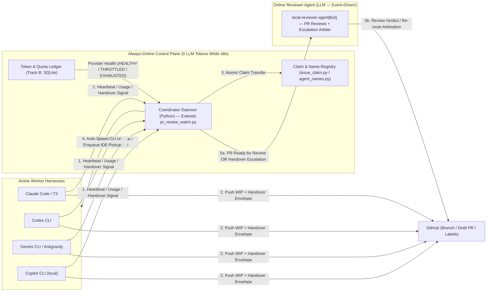
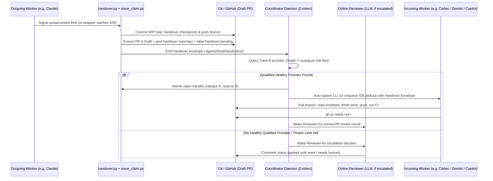
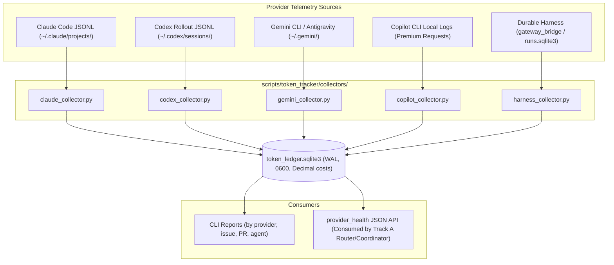

# Token-Aware Multi-Provider Harness, Auto-Handover & Token Tracker — Architectural Analysis

> [!NOTE]
> This analysis is grounded in the workspace's existing orchestration infrastructure:
> - **Interactive multi-harness GitHub loop**: [`issue_claim.py`](../../../../../scripts/issue_claim.py), [`agent_names.py`](../../../../../scripts/agent_names.py), [`pr_review_watch.py`](../../../../../scripts/pr_review_watch.py), [`review_bot.py`](../../../../../scripts/review_bot.py), and [`token_guard.py`](../../../../../scripts/token_guard.py).
> - **Durable Engineering Harness**: [`engineering-harness.md`](engineering-harness.md), [`engine.py`](../../../../../scripts/engineering_harness/engine.py), [`routing.py`](../../../../../scripts/engineering_harness/routing.py), [`contracts.py`](../../../../../scripts/engineering_harness/contracts.py), [`store.py`](../../../../../scripts/engineering_harness/store.py), [`t3.py`](../../../../../scripts/engineering_harness/t3.py), [`gateway_bridge.py`](../../../../../scripts/engineering_harness/gateway_bridge.py), and [`t3-registry.json`](../../../../../config/engineering-harness/t3-registry.json).

---

## 1. Executive Summary & Requirement Split

This document specifies **two coupled but architecturally separate requirements**:

| Track | Scope | Primary Goal | Independent Delivery |
|---|---|---|---|
| **Track A (Core)** | Token-aware routing + Auto-handover across **Claude, Gemini, Codex, and Copilot**, coordinated with the always-online **Reviewer Agent** | Keep tasks moving when a provider hits context saturation, rate limits, or quota exhaustion—without losing work, violating risk floors, or breaking Maker-Checker independence. | Yes (starts with self-reported / threshold signals; upgrades automatically when Track B is present). |
| **Track B (Separate Requirement)** | **Cross-Provider Token Consumption Tracker** | Provide a single, unified ledger of token/request consumption, cache efficiency, quota headroom, and `Decimal` cost across all four providers and all harness transports. | Yes (delivers standalone reporting and quota alerts; exposes a read-only `provider_health` contract consumed by Track A). |

---

## 2. Current State & Gap Analysis

The repository currently runs **two complementary orchestration layers**:

1. **Interactive Multi-Harness Loop (GitHub-centric)**: Claude Code, Antigravity (Gemini), Codex, and Copilot claim issues via `issue_claim.py`, work in isolated git worktrees, open draft PRs, and interact in rounds with an always-online `local-reviewer-agent[bot]` running `pr_review_watch.py`.
2. **Durable Engineering Harness (`development_harness.py`)**: A SQLite-backed controller (`store.py`) executing sequential stages (`PO -> BA -> Architect -> Dev -> Tester -> Docker Gates`) via Docker + `gateway_bridge.py` or via T3 Code child sessions (`t3.py`).

### Key Gaps Today

| Dimension | Current Behaviour | Gap |
|---|---|---|
| **Provider coverage** | `t3-registry.json` lists only Claude (Haiku/Sonnet/Opus) and Codex (`gpt-6.1-sol`). Gemini and Copilot are interactive-only. | No unified provider registry or dispatch adapter across all four providers. |
| **Token awareness** | `token_guard.py` only hooks Claude Code `PreToolUse`/`PostToolUse`. `gateway_bridge.py` caps tool results (16 KiB / 48 KiB history). `store.py` tracks cumulative tokens per run, and `t3.py` charges the full `max_tokens` reservation because T3 children do not report usage. | No awareness of *live provider quota windows* (5h/weekly/monthly caps), *rolling rate-limit pressure*, or *approaching context degradation (~200K)* across harnesses. |
| **Failure / exhaustion behaviour** | Durable harness transitions to `BLOCKED` on timeout, budget cap, or provider error. Interactive sessions stall or degrade until the user manually opens another provider and re-explains the task. | No structured mid-task checkpointing, no automatic claim transfer, and no automated handover to a healthy fallback provider. |
| **Reviewer coordination** | Reviewer agent watches PR readiness via `pr_review_watch.py` (0 idle LLM tokens), posts `APPROVE`/`REQUEST_CHANGES`/`COMMENT`. | Reviewer has no visibility into stalled/exhausted worker sessions and no coordination mechanism to trigger or audit a provider handover. |
| **Cross-provider telemetry** | None. Usage is scattered across `~/.claude/projects/`, `~/.codex/sessions/`, Gemini/Antigravity logs, Copilot CLI logs, and `runs.sqlite3`. | No unified tracker to report per-issue/per-PR burn across providers or expose live provider headroom. |

---

## 3. Track A: Token-Aware Structure

A token-aware architecture must separate **two distinct budgets**:

### 3.1 Two-Axis Budget Model

1. **Session Context Pressure (Per-Agent Window)**
   - **What it measures**: Active prompt/history tokens approaching the effective reasoning ceiling (~200K tokens per workspace rule 9, even on larger advertised windows, because reasoning quality degrades and per-turn re-send cost grows quadratically).
   - **Thresholds**:
     - `GREEN` (`< 65%` of effective ceiling): Normal execution.
     - `YELLOW` (`65%–80%`): Compact context, prune older tool outputs, avoid wide reads.
     - `RED` (`> 80%` or repeated compaction): **Trigger clean checkpoint & handover** (to a fresh session on the same provider if quota is healthy, or to an alternate provider).
2. **Provider Quota & Spend Pressure (Account / Subscription / API Window)**
   - **What it measures**: Rolling subscription limits (Claude 5h/weekly window, Codex rolling window, Gemini RPM/TPM/daily quota, Copilot monthly premium-request allowance) and hard run-level `limits.tokens` / `limits.cost` in `contracts.py`.
   - **States per `(provider, model_family)`**:
     - `HEALTHY` (`< 75%` window used, no recent 429s).
     - `THROTTLED` (`75%–90%` used or transient 429 backoff active) — deprioritize in routing; allow only `critical`/`high` tasks if no healthy peer exists.
     - `EXHAUSTED` (`>= 90%` used, hard 429 / quota-exceeded error, or circuit breaker tripped) — exclude from routing until `reset_at` / cooldown; trigger handover for stalled active tasks.

### 3.2 Token-Aware Routing Extension (`routing.py` + Unified Registry)

Today, `route()` selects the cheapest eligible target by static `(input_per_million + output_per_million)` without knowing whether that provider is throttled or exhausted.

**Proposed Routing Pipeline (Preserving Risk Floors):**

1. **Risk Assessment (Unchanged)**: `assess()` enforces non-negotiable floors (`critical` for financial/decimal/ledger/concurrency, `high` for auth/schema/migration/broad refactors, `medium` for CRUD/API/UI, `low` for mechanical).
2. **Qualification Filter**: Filter unified `config/engineering-harness/provider-registry.json` by `role`, `tier`, and required `options`.
3. **Health & Quota Gate**: Intersect with live `provider_health` (from Track B or local circuit-breaker state):
   - Drop `EXHAUSTED` targets.
   - Rank `HEALTHY` ahead of `THROTTLED`.
4. **Effective Cost & Headroom Scoring**: Among eligible healthy targets, prefer:
   - Configured preference / subscription-first priority (subscription seats before pay-per-token API fallback such as DeepSeek, matching workspace rule 9).
   - Lowest effective cost per tier (accounting for prompt-cache hit ratios where known).
   - Highest remaining quota headroom when two targets tie on tier and cost.
5. **Hard Safety Invariant (No Silent Downgrade)**:
   - If **no** qualified target for a `critical` or `high` task is `HEALTHY`/`THROTTLED`, the router **MUST NOT** silently downgrade to an unqualified model (e.g., running a financial ledger migration on a low-tier model). Instead, it enters `PARKED_AWAITING_QUOTA` with an explicit `resume_after` timestamp and notifies the coordinator.

### 3.3 Provider Capability & Dispatch Matrix

| Provider | Harness Transport(s) | Typical Qualified Tiers | Effort / Thinking Controls | Auto-Handover Dispatch Mode (Confirmed: Hybrid) |
|---|---|---|---|---|
| **Claude** | Claude Code CLI (`claude -p`), T3 (`claudeAgent`), API Gateway | Haiku (`low`), Sonnet (`low`–`high`), Opus (`high`–`critical`, Reviewer) | `effort`: `low` / `medium` / `high` | **Auto-spawn** via `claude -p --output-format json` + hooks |
| **Codex** | Codex CLI (`codex exec`), T3 (`codex`), API Gateway | GPT Sol (`low`–`high`), GPT Astra (`high`–`critical`) | `reasoningEffort`: `low` / `medium` / `high` | **Auto-spawn** via `codex exec --json` |
| **Gemini** | Gemini CLI (`gemini -p`), Antigravity IDE, API Gateway | Flash (`low`–`medium`), Pro / Neon (`medium`–`critical`) | Thinking toggle / thinking budget | **Auto-spawn** via `gemini -p`; **Pickup queue** for interactive Antigravity IDE sessions |
| **Copilot** | **GitHub Copilot CLI (local)** | Backing model selected in Copilot CLI | Model selection; premium-request multiplier | **Auto-spawn / CLI adapter** via local Copilot CLI |

> [!IMPORTANT]
> **Cross-Provider Context Guardrail**: `token_guard.py` currently only hooks Claude Code. Context-discipline rules (no raw large `cat`, no `ls -R`, bounded reads, compact test summaries) should be enforced uniformly across providers via Claude hooks, CLI wrappers/MCP guards for Codex/Gemini/Copilot CLI, and `gateway_bridge.py`'s existing caps (`TOOL_RESULT_CHARS = 16384`, `HISTORY_CHARS = 49152`).

---

## 4. Track A: Auto-Handover Structure & Reviewer Coordination

### 4.1 Role of the Always-Online Reviewer Agent (Two-Tier Split)

Using the always-online reviewer to coordinate handovers works well **only if we avoid two anti-patterns**:
- **Anti-pattern 1 (Token Burn)**: Waking an Opus reviewer LLM on a timer to poll worker health or orchestrate routine handovers.
- **Anti-pattern 2 (Maker-Checker Violation)**: Letting the reviewer edit branches, push WIP commits, or fix code itself (violating rules 14 and 16).

**Architecture: Two-Tier Coordination**



- **Tier 1 — Deterministic Coordinator Daemon (Python, 0 LLM tokens)**:
  - Runs alongside or as an extended mode of `pr_review_watch.py`.
  - Watches: (a) GitHub PR/issue labels & handover comments, (b) local worker heartbeat/lease files in `.agents/local/sessions/`, and (c) Track B's `provider_health` status.
  - Handles **routine handovers automatically** with zero LLM calls: verifies WIP is committed & pushed, validates the handover envelope schema, executes atomic claim transfer, selects the next qualified healthy provider, and dispatches via headless CLI or writes a pickup entry for IDE sessions.
- **Tier 2 — Always-Online Reviewer Agent (LLM, woken selectively)**:
  - **Normal PR Review Rounds**: Unchanged (`pr-review-rounds.md`).
  - **Supervisory Escalation Role**: Woken by the Coordinator *only* when:
    1. A handover checkpoint fails validation (missing summary, unclear state, or unpushed/dirty worktree).
    2. A task hits **2+ handovers** or **2+ failed repair loops** (potential thrashing or architectural mismatch).
    3. No healthy qualified provider exists for a `high`/`critical` task (reviewer decides whether to park for quota reset or escalate to the user).
  - **Strict Boundary**: The reviewer never writes code or merges; it only posts structured review/arbitration decisions via `review_bot.py`.

### 4.2 Handover Trigger Taxonomy

| Trigger | Type | Detection Source | Action |
|---|---|---|---|
| **Context ceiling (`>80%` / ~160K–200K)** | Proactive (Soft) | Worker self-check / hook / `token_tracker` | Finish current atomic edit, commit WIP, emit handover envelope, hand off to fresh session (same or alternate provider). |
| **Quota warning (`>85%` window)** | Proactive (Soft) | Track B `budget-check` before next major step | Complete current sub-step, checkpoint, route next stage/round to a `HEALTHY` provider. |
| **HTTP 429 / Usage Cap Hit** | Reactive (Hard) | CLI exit code / stderr parser / gateway error | Mark provider `EXHAUSTED` with cooldown, commit WIP via deterministic wrapper script (no LLM needed), emit fallback envelope, hand off. |
| **Stale Lease / Dead Session** | Reactive (Watchdog) | Coordinator sees missed heartbeat > TTL (e.g., 15m) with no git activity | Inspect worktree cleanliness; if clean/pushed, transfer claim & dispatch; if dirty, preserve patch in `.agents/local/handovers/` and wake Reviewer/Human. |
| **Tier Escalation (2 failed repairs)** | Quality-driven | `engine.py` repair counter or PR review round 2 | Escalate tier (e.g., Sonnet/Sol to Opus/Astra/Gemini Pro) and hand over cleanly. |

### 4.3 Canonical Handover Envelope (Provider-Neutral, `<= 64 KiB`)

Matching `contracts.py`'s 64 KiB envelope discipline, every handover produces a schema-versioned JSON envelope (stored in `.agents/local/handovers/<issue>-<seq>.json` and summarized in a collapsed comment on the Draft PR):

```json
{
  "schema_version": 1,
  "handover_id": "ho-412-001",
  "created_at": "2026-11-27T07:15:00Z",
  "reason": "provider_quota_exhausted",
  "from": {
    "provider": "claude",
    "harness": "claude_code",
    "model": "claude-sonnet-5-5",
    "agent_name": "Alparslan",
    "session_id": "sess-abc123"
  },
  "target_constraints": {
    "risk_tier": "high",
    "role": "backend_developer",
    "excluded_providers": ["claude"]
  },
  "git_state": {
    "issue": 412,
    "pr": 495,
    "branch": "fix/412-ledger-reconciliation",
    "base_sha": "a1b2c3d",
    "head_sha": "e4f5a6b",
    "wip_committed": true,
    "worktree_path": "/path/to/worktree-412"
  },
  "progress": {
    "completed": [
      "Added Decimal apportionment guard in dues_service.rs (L112-L148)",
      "Unit tests pass locally (cargo test dues_service)"
    ],
    "remaining": [
      "Update Flutter money input handler in dues_screen.dart (L80-L110)",
      "Run run_tests.py --summary and mark PR ready"
    ],
    "last_verification": {
      "command": "python3 apps/development-time/SitePulse/scripts/run_tests.py --summary",
      "status": "failed",
      "summary": "1 Flutter widget test failed: dues_screen_test.dart:45 expected 125.50"
    }
  },
  "decisions": [
    "Used existing readDecimal() helper per flutter-reusable-components skill"
  ],
  "key_pointers": [
    "apps/development-time/SitePulse/backend/src/services/dues_service.rs:112-148",
    "apps/development-time/SitePulse/flutter/lib/presentation/dues_screen.dart:80-110"
  ],
  "checksum_sha256": "..."
}
```

**Why this works across all four providers:**
- **Zero transcript replay**: The incoming model reads a ~2–4 KiB structured brief + `git diff <base>..<head>`, starting at ~5% context usage instead of inheriting 180K tokens of stale conversation history.
- **Crash-safe**: If a provider dies mid-turn on a hard 429, a deterministic Python wrapper (`scripts/handover.py capture`) still generates a valid fallback envelope from `git status`, `git diff --stat`, last test exit log, and PR comments—without needing another LLM call from the dead provider.

### 4.4 End-to-End Handover Sequence



### 4.5 Anti-Thrashing & Safety Guardrails

1. **Max Handovers per Task (`MAX_HANDOVERS = 3`)**: Prevents infinite ping-pong between providers when a task is underspecified or blocked. Exceeding the limit parks the task and wakes the Reviewer/Human.
2. **Provider Cooldown & Hysteresis**: A provider marked `EXHAUSTED` stays excluded until `reset_at` (from rate-limit headers) or a minimum backoff (e.g., 15 min).
3. **Atomic Claim Transfer**: Extend `issue_claim.py` with a `transfer` subcommand that atomically swaps `claim:<old>` to `claim:<new>` and `agent:<old_name>` to `agent:<new_name>` (plus records `handover:count-N`), preventing a third idle agent from grabbing the issue mid-handover.
4. **Worktree Continuity & Dirty-Worktree Safety (Rule 11)**:
   - Incoming providers check out the **same remote branch** in a fresh worktree (`git worktree add <path> <branch>`), ensuring clean isolation across harnesses.
   - Never force-remove a dirty worktree. If the outgoing agent crashed with dirty edits, `handover.py` commits them to a `wip/handover-<seq>` commit on the PR branch (squashed on final merge) before releasing the worktree.
5. **No Silent Risk-Floor Downgrade**: Enforced identically to `routing.py`.

---

## 5. Track B (Separate Requirement): Cross-Provider Token Consumption Tracker

> [!IMPORTANT]
> **Decoupled Requirement**: The Token Consumption Tracker is a standalone tool (`scripts/token_tracker.py` + local SQLite ledger) that delivers immediate visibility, cost control, and quota monitoring across **Claude, Gemini, Codex, and Copilot**, independent of whether auto-handover is enabled.

### 5.1 Telemetry Reality Check Across Providers

Not every provider exposes the same level of token fidelity on subscription plans vs. API billing. The tracker explicitly tags **measurement accuracy** rather than fabricating precision:

| Provider | Primary Data Sources | Native Metrics Available | Accuracy Tier |
|---|---|---|---|
| **Claude** (Claude Code & API) | 1. `~/.claude/projects/*/*.jsonl` session logs<br>2. Claude Code `Stop` hook / OTel (`CLAUDE_CODE_ENABLE_TELEMETRY=1`)<br>3. API/Gateway `usage` object | `input_tokens`, `output_tokens`, `cache_creation_input_tokens`, `cache_read_input_tokens`, model ID, session ID | `exact` |
| **Codex** (CLI / App / API) | 1. `~/.codex/sessions/YYYY/MM/DD/*.jsonl` (`token_count` events)<br>2. API/Gateway `usage` object | `input_tokens`, `cached_input_tokens`, `output_tokens`, `reasoning_output_tokens`, plus rolling rate-limit window % | `exact` + `quota_pct` |
| **Gemini** (Gemini CLI / Antigravity / API) | 1. Gemini CLI OTel / session telemetry (`~/.gemini/tmp/`)<br>2. Antigravity transcripts (`~/.gemini/antigravity/brain/<id>/.system_generated/logs/transcript.jsonl`)<br>3. Gemini API `usageMetadata` | Exact tokens via API & Gemini CLI telemetry; Antigravity transcripts fall back to char-based estimation where raw usage metadata is absent | `exact` (API/CLI) / `estimated` (transcript fallback) |
| **Copilot** (Local CLI) | 1. Local Copilot CLI session/audit logs<br>2. Model multiplier table (`0x`, `0.33x`, `1x`, `3x` premium requests)<br>3. Optional prompt/diff size estimator | **Premium requests** (the real billing/quota unit for Copilot) and model name; raw token counts rarely exposed on seat plans | `request_metered` + `estimated` tokens |

### 5.2 Unified Storage Schema (`.agents/local/token_ledger.sqlite3`)

Stored in `.agents/local/` (gitignored, mode `0600`, WAL mode—matching `agent_names.py` and `store.py`). All monetary and request-multiplier values use **decimal strings** (`Decimal` in Python, never binary floats—matching workspace rule 2).

```sql
-- Append-only raw usage events (idempotent via source_event_key)
CREATE TABLE usage_events (
    id                  INTEGER PRIMARY KEY AUTOINCREMENT,
    source_event_key    TEXT NOT NULL UNIQUE,   -- e.g. "claude:<session>:<uuid>" for idempotent re-ingestion
    recorded_at         TEXT NOT NULL,          -- ISO-8601 UTC
    provider            TEXT NOT NULL,          -- claude | gemini | codex | copilot
    harness             TEXT NOT NULL,          -- claude_code | antigravity | gemini_cli | codex_cli | copilot_cli | t3 | docker_gateway
    model               TEXT NOT NULL,
    session_id          TEXT,
    agent_name          TEXT,                   -- resolved from agent_names.py where available
    issue_number        INTEGER,
    pr_number           INTEGER,
    harness_run_id      TEXT,
    input_tokens        INTEGER NOT NULL DEFAULT 0,
    output_tokens       INTEGER NOT NULL DEFAULT 0,
    cache_read_tokens   INTEGER NOT NULL DEFAULT 0,
    cache_write_tokens  INTEGER NOT NULL DEFAULT 0,
    reasoning_tokens    INTEGER NOT NULL DEFAULT 0,
    premium_requests    TEXT NOT NULL DEFAULT '0',   -- Decimal string (for Copilot)
    estimated_cost_usd  TEXT NOT NULL DEFAULT '0',   -- Decimal string (computed from pricing table)
    accuracy            TEXT NOT NULL,               -- exact | request_metered | estimated
    billing_mode        TEXT NOT NULL                -- subscription | api | enterprise
);

-- Provider quota snapshots (rolling windows & circuit-breaker state)
CREATE TABLE quota_snapshots (
    id                  INTEGER PRIMARY KEY AUTOINCREMENT,
    observed_at         TEXT NOT NULL,
    provider            TEXT NOT NULL,
    model_family        TEXT NOT NULL,          -- e.g. claude-sonnet, gpt-sol, gemini-pro, copilot-premium
    window_type         TEXT NOT NULL,          -- 5h | daily | weekly | monthly | rpm
    utilization_pct     TEXT,                   -- Decimal string 0..100 (nullable if unknown)
    status              TEXT NOT NULL,          -- HEALTHY | THROTTLED | EXHAUSTED
    reset_at            TEXT,                   -- ISO-8601 UTC
    source              TEXT NOT NULL           -- rate_limit_header | codex_rollout | manual_cap | 429_event
);

-- Collector watermarks (byte offsets / timestamps for fast incremental tailing)
CREATE TABLE collector_cursors (
    collector_name      TEXT PRIMARY KEY,
    file_path           TEXT NOT NULL,
    byte_offset         INTEGER NOT NULL DEFAULT 0,
    updated_at          TEXT NOT NULL
);
```

### 5.3 Pluggable Ingestion Architecture



### 5.4 CLI Surface (`scripts/token_tracker.py`, `--help` & `--json` per Rule 6)

| Command | Purpose |
|---|---|
| `token_tracker.py ingest [--provider all\|claude\|codex\|gemini\|copilot]` | Incrementally parses new log lines since last cursor; idempotent via `source_event_key`. |
| `token_tracker.py record --provider ... --model ... --input N --output N` | Direct push endpoint for hooks (`Stop`, `gateway_bridge.py`, `engine.py`) or 429/exhaustion events (`--event 429 --reset-at ...`). |
| `token_tracker.py health [--json]` | Outputs per-provider/model `HEALTHY \| THROTTLED \| EXHAUSTED`, rolling window burn, and `reset_at`. **Single read-only contract consumed by Track A.** |
| `token_tracker.py report --by provider\|model\|issue\|pr\|agent --since 7d [--json]` | Summarizes tokens, cache hit rate, Copilot premium requests, and `Decimal` estimated cost, explicitly tagging accuracy (`exact` vs `request_metered` vs `estimated`). |
| `token_tracker.py budget-check --provider claude --model claude-sonnet-5-5 [--json]` | Fast exit-code gate (`0` = OK, `10` = WARN/THROTTLED, `20` = EXHAUSTED) for hooks and pre-dispatch checks. |

---

## 6. Phased Implementation Roadmap

| Phase | Track | Deliverables | Verification |
|---|---|---|---|
| **Phase 1: Standalone Token Tracker** | Track B | `scripts/token_tracker.py` + SQLite ledger + `claude_collector`, `codex_collector`, `gemini_collector`, `copilot_collector`, `harness_collector` + `config/provider-quotas.json` (pricing & soft/hard caps). | Unit tests with synthetic JSONL fixtures for all 4 providers; verify idempotent re-ingestion & `Decimal` arithmetic. |
| **Phase 2: Unified Registry & Token-Aware Routing** | Track A | Expand `config/engineering-harness/t3-registry.json` (or new `provider-registry.json`) to include Gemini & Copilot CLI; wire `provider_health` into `routing.py` with strict risk-floor preservation and `PARKED_AWAITING_QUOTA` state. | Extend `tests/engineering_harness` + `routing-cases.json` with quota-exhausted and risk-floor-no-downgrade scenarios. |
| **Phase 3: Handover Protocol & Atomic Claim Transfer** | Track A | `scripts/handover.py` (envelope capture/validate/render, WIP commit helper, 64 KiB cap) + `issue_claim.py transfer` + `handover:*` GitHub labels. | End-to-end test transferring a mock issue/PR between two harness identities with clean and dirty worktrees. |
| **Phase 4: Reviewer-Coordinated Auto-Handover** | Track A | Extend `pr_review_watch.py` (or add `scripts/harness_coordinator.py`) with 0-token handover dispatch loop + Hybrid launchers (auto-spawn Claude/Codex/Gemini/Copilot CLI + IDE pickup queue) + Reviewer LLM escalation trigger for thrash/ambiguous handovers. | Dry-run simulation with synthetic 429s + live pilot on a non-critical issue. |

---

## 7. Confirmed Architectural Decisions

The following design decisions are locked for implementation:

1. **Auto-handover dispatch mode**: **Hybrid** — Coordinator auto-spawns headless CLIs (`claude -p`, `codex exec`, `gemini -p`, local Copilot CLI) in a fresh worktree on the PR branch, and uses a structured pickup queue for interactive IDE sessions (e.g., Antigravity IDE).
2. **Reviewer coordination boundary**: **Two-tier split** — a 0-token Python Coordinator Daemon handles routine handovers automatically; the always-online Reviewer LLM (`local-reviewer-agent[bot]`) is woken only for normal PR review rounds, invalid checkpoints, or thrash/quota escalations (2+ handovers).
3. **GitHub Copilot integration**: **Local GitHub Copilot CLI** for both Track A handover dispatch and Track B consumption tracking (request-metered + estimated tokens).
4. **Requirement decoupling**: Track B (Cross-Provider Token Consumption Tracker) is built as a standalone, independently verifiable tool first (Phase 1) and feeds Track A via the read-only `token_tracker.py health --json` contract.
