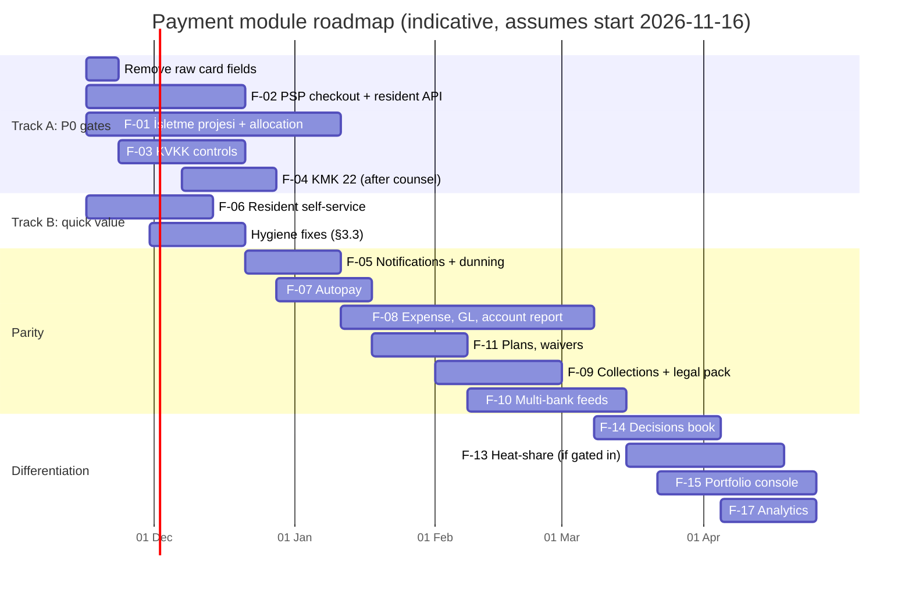
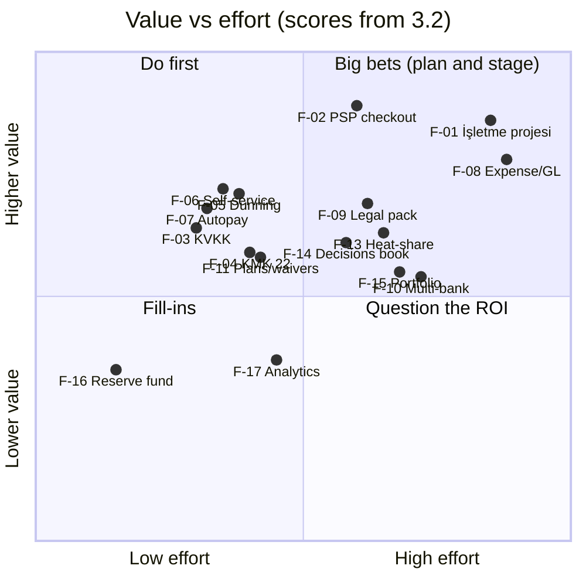

# Product Owner Evaluation: SitePulse Payment Module vs. Competitors

> **Date:** 2026-11-08
> **Scope:** SitePulse payments and treasury (Rust backend, Flutter app, PostgreSQL), checked against the code at `master` 9fa19d2 (after SPEC-005 / V16 and SPEC-006 / V17).
> **Builds on:** [PAYMENTS_REGULATORY_AND_MARKET_EVALUATION.md](PAYMENTS_REGULATORY_AND_MARKET_EVALUATION.md) (regulation, sources) and [PAYMENTS_MANAGEMENT_STRUCTURE_REPORT.md](PAYMENTS_MANAGEMENT_STRUCTURE_REPORT.md) (code structure, remediation status).
> **Supersedes:** the earlier draft `PRODUCT_OWNER_PAYMENTS_EVALUATION_REPORT.md`. §0 lists what changed and why.
>
> ⚠️ **Not legal advice.** Regulatory points come from the secondary sources listed in the regulatory evaluation (§7 there). Items marked **(verify)** need a lawyer or mali müşavir before they are built.
> Competitor capabilities come from vendor material and were not tested hands-on. **(src)** = vendor claim; **?** = no source found.

---

## 0. Review of the earlier draft

The earlier draft had the right overall direction: legal basis first, then payments, then accounting and collections. Some of it was out of date or had no source, and that would mislead a planning decision.

### 0.1 Factual corrections (checked against the code)

| Draft claim | Actual state | Evidence |
|---|---|---|
| "KMK 20 penalty is computed on the original principal" (listed as blocker #3) | **Fixed.** The penalty accrues in segments on the **outstanding** principal, and `penalty_accrued_through` prevents double accrual | `dues_calculation_service.rs:39-66`, V16, SPEC-005 R3 |
| "TBK 101 designation: 🔴 Forced FIFO" | **Fixed in the backend.** `PaymentDesignation` (due ids, periods, expense type). Bank channels derive it from the transfer description. **Still missing:** a resident UI to choose the debt | `models/mod.rs:2042`, `dues_ledger.rs:152-194`, SPEC-005 R4 |
| P0-03 is a top-3 priority | Most of it is already built. What remains (a penalty audit-trail table and the designation UI) is moved into F-06 | — |
| Matrix omits reversal / refund | **Built:** `POST /payments/reverse` issues an `IAD-` receipt with a contra entry and un-allocation | `app.rs:160`, SPEC-006 |
| Debt aging assumed wrong | **Fixed:** uses outstanding amounts and the liability's debtor. Snapshots exist (`/payments/debt-aging/snapshot`) | SPEC-005 R5, `app.rs:161` |
| "Checkout posts to a staff-only endpoint with raw card fields" | **Still true.** `dashboard_controller.dart:4105` → `/api/v1/payments/record` (falls through to `Access::SiteStaff`, `auth.rs:255`). The dialog has card number, holder and **CVV** controllers (`payment_checkout_dialog.dart:48-68`) | — |
| Receipt "Paylaş / PDF" | **Still a stub:** it only shows a snackbar | `payment_tracking_page.dart:433-437` |
| Notifications (SMS / push / WhatsApp) | **No backend infrastructure** for any channel. This makes dunning and the KVKK personal-channel rule bigger jobs than the draft suggests | `grep` over `backend/src` |

So the module is **further along on ledger correctness** than the draft said. It is **just as far behind on go-to-market features**.

### 0.2 Claims removed or re-labelled because they have no source

| Draft claim | Treatment |
|---|---|
| Apsiyon "~1.5M units" | Removed. No source in the evidence base |
| Autopay "increases collection rate by ~35%", global autopay adoption ">75%" | Removed. Replaced with a pilot hypothesis (§6) |
| KPI baselines (DSO 42 days, 65% on-time, 99.2% auto-reconciliation) | Removed. Baselines will be measured in the pilot (§6) |
| PSP fees (aggregator 1.8–2.6%, bank POS 0.9–1.4%) and "1–2 weeks" integration time | Marked **(verify)**. Fees are negotiated per merchant and change often. Get quotes |
| "UYAP XML export" | Re-scoped to a lawyer handover pack (PDF/Excel). We found no source for direct UYAP submission by site software **(verify)** |
| Competitor ✅ for İşletme Projesi, KVKK audit, virman, TBK 101 | Set to **?** where the sourced matrix had no evidence |
| Heat-share "80% consumption + 20% fixed", "Ministry of Environment and Urbanization" | Marked **(verify)**. The split and the issuing ministry must be confirmed against the current heat-cost sharing regulation |
| Senyonet profile (AP, approval hierarchies, cost) | Kept as a named competitor (it appears in `pm_feature_gap_and_mvp_plan.md`), with capabilities marked **?** |

### 0.3 Structural fixes

- **The SWOT quadrant chart was removed.** SWOT has four categories, not two axes. Plotting threats as points on "readiness × differentiation" mixed internal weaknesses with external threats. §2.3 replaces it with a SWOT table.
- **Value scores are now reproducible.** The draft named five scoring dimensions but showed only one unexplained number per feature. §3.1 shows every sub-score and the weights.
- **Gaps the draft missed are added:** KMK 22 tenant joint liability with the rent cap, the arsa payı allocation key for operating dues, waivers and write-offs, the digital decisions book (karar defteri), reserve fund, the 5-year limitation flag, and the resident API authorization prerequisite.
- **Dependencies are explicit.** Examples: autopay needs the PSP, and the legal pack needs the approved budget.

---

## Implementation status (2026-11-09)

SPEC-007 (V18) and SPEC-009 (V20, [spec](../../.specify/specs/009-payments-phase3/spec.md), [EPIC-11](../../.specify/requirements/EPIC-11-payments-phase3.md)) implement every feature in §3.2. External services are behind ports with **sandbox** implementations only, and items marked (verify) still need counsel or a mali müşavir before production.

| ID | Feature | Status | Where | Still needed for production |
|---|---|---|---|---|
| F-01 | İşletme projesi, cap, allocation, lifecycle | ✅ SPEC-007 + `HOUSE_TYPE`/`METER`/`CUSTOM` keys, 90-day transition, legal-basis report, interim-deadline reminders, decision link | `operating_budget_service`, `budget_compliance_service` | Verify the revaluation-rate source |
| F-02 | Licensed PSP checkout, resident API | ✅ SPEC-007; instalments and save-card on intents | `card_payment_service`, `create_payment_intent_v2` | A real provider (`PaymentProvider`) and its contract |
| F-03 | KVKK controls | ✅ notices, acknowledgements, consents, personal-channel rule (also a DB constraint), masked export, access log, retention review/purge | `domain::kvkk`, `kvkk_service` | Counsel review of retention periods |
| F-04 | KMK 22 rent cap (verify) | ✅ leases, joint-exposure view, rent-deduction certificate PDF, corrected receipt citation | `domain::joint_liability`, `lease_service` | The legal opinion in §7.5 |
| F-05 | Notifications and dunning | ✅ delivery log with dedupe, KVKK enforcement, per-site schedule, daily run, ihtarname draft PDF | `notification_service`, `dunning_service` | Real SMS / push / e-mail vendors |
| F-06 | Resident self-service | ✅ statement and PDF/QR (SPEC-007), debt selection (TBK 101), disputes, virman requests | `resident_request_service`, Flutter `resident_self_service.dart` | — |
| F-07 | Autopay and instalments | ✅ provider tokens, mandates, D+2/D+5 retries, expiry suspension, decline notices | `autopay_service` | Merchant-initiated charges at a real provider |
| F-08 | Expenses, GL, account report | ✅ vendors (VKN/TCKN, IBAN), invoices, four-eyes and auditor threshold, payments, derived double-entry ledger, trial balance, budget vs actual, yearly report PDF, `AUDITOR` role | `domain::double_entry`, `accounting_service` | Mali müşavir review of the chart of accounts |
| F-09 | Collections and legal handover | ✅ case workflow, evidence pack PDF, KMK 25 counter, limitation warnings, token-based lawyer access | `collections_service` | Counsel review of mediation and limitation |
| F-10 | Multi-bank feeds and matching | ✅ TCKN (digest) / phone / block-unit matching, feed connections with credential references, daily reconciliation | `domain::payer_match`, `bank_matching_service` | Corporate bank API integrations |
| F-11 | Plans, waivers, write-offs | ✅ instalment plans, broken-plan trigger, four-eyes adjustments, penalty waiver on completion | `domain::installments`, `plan_service` | — |
| F-13 | Heat-share (verify) | ✅ periods, readings, consumption/area split, accrual to the occupant | `domain::heat_share`, `heat_share_service` | Verify the split rule against the regulation |
| F-14 | Decisions book and assembly | ✅ meetings, quorum, votes by count and land share, numbered decisions that approve budgets | `domain::assembly_vote`, `assembly_service` | Verify the majority rules (KMK 30) |
| F-15 | Portfolio and fee invoicing | ✅ companies, members, portfolio summary, monthly e-Arşiv / e-Fatura invoices | `portfolio_service` | A GİB özel entegratör |
| F-16 | Reserve fund | ✅ account 549 with the budget's `RESERVE` target | `accounting_service::reserve_fund` | — |
| F-17 | Collection analytics | ✅ collection and on-time rates, DSO, channel and zero-touch shares, 6-month forecast, at-risk scoring | `domain::collection_metrics`, `analytics_service` | Baselines from the pilot (§6) |
| §3.3 | Hygiene | ✅ receipt hash v2 (payer + allocation), virman reversal (SPEC-007), stream KPIs through analytics | `domain::fingerprint` | — |

## 1. Executive summary

SitePulse has a **better-engineered payment core than its Turkish competitors advertise**:
- a per-unit sanal IBAN with real-time webhook settlement;
- an explicit tenant / owner dual ledger with per-debtor advances and virman;
- one idempotent ingestion path that issues `TAH-` receipts for every channel;
- append-only receipts and allocations, and `IAD-` reversals;
- a KMK 20 penalty on the outstanding principal, and TBK 101 payer designation;
- capital projects with installments (EPIC-10).

It **still cannot be sold in Turkey**, for four reasons:

1. **No legal basis for dues (Law 7579 / KMK 37).** Dues are a free-typed amount per house type. There is no işletme projesi, no revaluation-rate cap, no service or objection record and no arsa payı allocation. Unpaid dues therefore have no İİK 68/1 document behind them.
2. **Residents cannot pay.** The "Hemen Öde" checkout calls a staff-only route (403). There is no licensed PSP, and the Flutter form collects raw card data including the CVV. Under 6493 SitePulse must never touch funds or card data.
3. **No KVKK controls on financial data (Decision 2026/348).** There are no consent or notice records, no personal-channel rule, no access audit and no guard against public debtor-list exports. There is also no notification infrastructure at all.
4. **The tenant liability model contradicts KMK 22 (verify).** The tenant is jointly liable with the owner up to the unpaid rent, but SitePulse treats the split as absolute and stores no rent amount.

After those, the **largest commercial gap** is the accounting spine that every competitor sells as basic: expenses, vendor payments, a general ledger and the yearly account report (*hesap verme*). Collections features come next: reminders, payment plans and the legal handover.

**Recommendation:** Run two tracks in parallel for 6 weeks. Track A: the **compliance and checkout gate** (F-01, F-02, F-03, F-04). Track B: the cheap, high-value **resident self-service** work (F-06). Then build **expense/GL and dunning** for parity before any differentiators.

---

## 2. Competitive landscape

### 2.1 Competitors

| Product | Positioning | Payment-relevant strengths | Weak spots relative to SitePulse |
|---|---|---|---|
| **Apsiyon** (TR, market leader) | Full site management suite | Bank integrations with auto-match by TCKN / block-unit / phone; credential-free setup with Yapı Kredi, Ziraat, Şekerbank, Kuveyt Türk; sanal POS with installments; card-on-file autopay; automatic receipts on a standard chart of accounts; owner/tenant distribution; heat-share billing; scheduled SMS/e-mail; starting icra (all src) | Matching by payer attributes rather than per-unit IBAN; dual-ledger depth unclear (?) |
| **Konsiyon / Dijiyon** (TR) | Dues tracking plus legal handover | Lawyer assignment and handing the debt schedule to the lawyer for enforcement (src) | Fintech depth and resident app: ? |
| **Senyonet** (TR) | Site / facility management | Named in the internal PM gap analysis; capabilities ? | ? |
| **Buildium, AppFolio, Vantaca, CINC, PayHOA** (global) | HOA / property management | ACH and card autopay; configurable late fees; reminders; payment plans; waivers and write-offs; NSF handling; accrual GL; bank reconciliation; budgets; collections escalation (src) | No KMK, Law 7579, KVKK, FAST or sanal IBAN model; owner-centric ledger |

### 2.2 Feature matrix

✅ has · ⚠️ partial · ❌ missing · (src) vendor claim · ? no source

| Capability | SitePulse | Apsiyon | Konsiyon / Dijiyon | Global HOA tools |
|---|:---:|:---:|:---:|:---:|
| **Collection channels** | | | | |
| Per-unit sanal IBAN with real-time webhook | ✅ | ❌ (attribute match) | ? | ❌ |
| Bank statement import (MT940 / Excel) | ✅ | ✅ live feed (src) | ? | ✅ |
| Multi-bank live feed, TCKN / phone matching | ⚠️ Kuveyt Türk sandbox only | ✅ (src) | ? | ✅ |
| Card payment via licensed PSP, 3-D Secure | ❌ (UI only, posts to a staff route) | ✅ with installments (src) | ? | ✅ |
| Autopay / card on file | ❌ | ✅ (src) | ? | ✅ |
| **Ledger correctness** | | | | |
| Single idempotent ingestion; receipt on every channel | ✅ (SPEC-005) | ✅ automatic receipts (src) | ? | ✅ |
| Tenant / owner dual ledger, per-debtor advance | ✅ (differentiator) | ⚠️ owner/tenant distribution (src) | ? | ⚠️ owner-centric |
| Inter-ledger virman (tenant surplus → owner) | ✅ | ? | ? | ? |
| KMK 20 penalty on outstanding principal | ✅ (SPEC-005) | ? | ? | ✅ configurable late fees |
| TBK 101 payer designation | ⚠️ backend ✅, no resident UI | ? | ? | ⚠️ |
| Reversal / refund receipt | ✅ `IAD-` (SPEC-006) | ? | ? | ✅ incl. NSF |
| Waivers / write-offs with approval | ❌ | ? | ? | ✅ |
| KMK 22 tenant joint liability with rent cap | ❌ | ? | ? | n.a. |
| **Legal basis and governance** | | | | |
| İşletme projesi, Law 7579 cap, objection window | ❌ | ? | ? | ✅ budgets (generic) |
| Arsa payı allocation of operating dues | ❌ (capital projects only) | ✅ distribution options (src) | ? | n.a. |
| Digital decisions book and assembly votes | ❌ | ? | ? | ⚠️ |
| KVKK consent, notice, personal channels, access audit | ❌ (`pii_settings` masking only) | ✅ notice and e-message consent (src) | ? | n.a. |
| **Resident experience** | | | | |
| Statement of account (Cari Hesap Ekstresi) | ❌ | ✅ (src) | ? | ✅ |
| Receipt PDF with verification QR | ❌ (stub) | ✅ (src) | ? | ✅ |
| **Collections** | | | | |
| Reminders (SMS / push / e-mail) | ❌ (no notification infrastructure) | ✅ scheduled (src) | ? | ✅ |
| Payment plans (yapılandırma) | ❌ (capital installments only) | ? | ? | ✅ |
| Lawyer handover / icra workflow | ❌ | ✅ icra start (src) | ✅ lawyer assignment (src) | ✅ |
| **Accounting** | | | | |
| Expense / vendor payments (AP) | ❌ (capital disbursements only) | ✅ income/expense (src) | ? | ✅ |
| Chart of accounts / GL, yearly account report | ❌ | ✅ (src) | ? | ✅ |
| **Other** | | | | |
| Heat-share / sub-meter billing | ❌ | ✅ (src) | ? | ⚠️ |
| Capital projects with installments | ✅ (EPIC-10) | ? | ? | ✅ special assessments |
| Multi-site portfolio for management firms | ❌ | ? | ? | ✅ |

**Reading the matrix:** SitePulse wins on **how money is matched and attributed**. It loses on **everything that happens before money arrives** (legal basis, a way for residents to pay, reminders) and **after it arrives** (expenses, ledger, account report). Most `?` cells are research debt. A one-day hands-on trial of Apsiyon and Konsiyon would turn them into facts before the RFP messaging is written.

### 2.3 SWOT

| | Helpful | Harmful |
|---|---|---|
| **Internal** | **Strengths:** per-unit sanal IBAN with webhook auto-settlement; explicit dual ledger and virman; single idempotent ingestion with receipts on every channel; append-only ledger and reversals; law-aware penalty and designation; capital-project installments | **Weaknesses:** no işletme projesi or arsa payı allocation; no resident payment path; no notification infrastructure; no expense/GL; receipt PDF is a stub; single-bank integration; ownership transfer not atomic |
| **External** | **Opportunities:** Law 7579 forces every site to formalize budgets and caps, so incumbents must retrofit while we can build it in; KVKK 2026/348 penalizes the "debtor list on the board" habit, which favors private digital channels; professional management firms want multi-site consoles | **Threats:** Apsiyon's bank partnerships and installed base; PSP and bank onboarding lead times; regulatory risk from 6493 if the payment design ever touches funds; legal uncertainty (KMK 22 rent offset, mediation, limitation) that could force rework |

---

## 3. Missing features, ordered by value

### 3.1 Scoring method

Each feature is scored 1–5 on four value dimensions:

| Dimension | Weight | Question |
|---|:---:|---|
| **RL**: Regulatory / legal | 35% | Does its absence expose the site or the platform to unenforceable debts, fines or criminal liability? |
| **RC**: Revenue / cash flow | 25% | Does it speed up collections for the site, or SaaS revenue for us? |
| **CS**: Customer stickiness | 20% | Does its absence cause churn to an incumbent? |
| **WR**: Win rate | 20% | Do buyers ask for it in demos and tenders? |

**Value** = 0.35·RL + 0.25·RC + 0.20·CS + 0.20·WR, on a scale of 5.
**Effort:** S = 1, M = 2, L = 3, XL = 5 (relative engineering size).
**Value / Effort** is used only to order work within a tier.

**Legal gates override the value order.** A feature without which the product may not lawfully operate is P0, whatever its score.

### 3.2 Ranked list

| Rank | ID | Feature | RL | RC | CS | WR | **Value** | Effort | V/E | Tier | Depends on |
|:---:|---|---|:---:|:---:|:---:|:---:|:---:|:---:|:---:|:---:|---|
| 1 | **F-02** | Licensed PSP checkout and resident payment API | 4 | 5 | 4 | 5 | **4.45** | L | 1.48 | **P0** | — |
| 2 | **F-01** | İşletme projesi, Law 7579 cap, arsa payı allocation, approval lifecycle | 5 | 3 | 4 | 5 | **4.30** | XL | 0.86 | **P0** | — |
| 3 | F-08 | Expense / AP, general ledger, yearly account report | 4 | 2 | 5 | 5 | **3.90** | XL | 0.78 | P1 | F-01 (budget lines) |
| 4 | F-06 | Resident self-service: statement, PDF/QR receipts, designation UI | 3 | 3 | 5 | 4 | **3.60** | M | 1.80 | P1 (start now) | — |
| 5 | F-05 | Notification infrastructure and dunning schedule | 2 | 5 | 4 | 4 | **3.55** | M | 1.78 | P1 | F-03 (channel rules) |
| 6 | F-09 | Collections and legal handover workflow | 3 | 4 | 3 | 4 | **3.45** | L | 1.15 | P1 | F-01, F-05 |
| 7 | F-07 | Autopay / card on file, installments | 1 | 5 | 5 | 4 | **3.40** | M | 1.70 | P1 | F-02 |
| 8 | **F-03** | KVKK financial-data controls | 5 | 1 | 3 | 3 | **3.20** | M | 1.60 | **P0** | — |
| 9 | F-13 | Heat-share / sub-meter billing | 3 | 2 | 4 | 4 | **3.15** | L | 1.05 | P2 (segment gate) | F-01 (`METER` key) |
| 10 | F-14 | Digital decisions book and assembly voting | 4 | 1 | 4 | 3 | **3.05** | L | 1.02 | P1 (minimal record inside F-01) | — |
| 11 | **F-04** | KMK 22 tenant joint liability with rent cap | 4 | 3 | 2 | 2 | **2.95** | M | 1.48 | **P0** (verify) | — |
| 12 | F-11 | Payment plans, waivers and write-offs | 2 | 4 | 3 | 3 | **2.90** | M | 1.45 | P1 | F-05 |
| 13 | F-15 | Management-company portfolio and e-Arşiv fee invoicing | 1 | 4 | 4 | 3 | **2.75** | L | 0.92 | P2 | F-08 |
| 14 | F-10 | Multi-bank feeds and TCKN / phone matching | 1 | 3 | 4 | 4 | **2.70** | L | 0.90 | P1 | — |
| 15 | F-17 | Collection analytics and cash-flow forecast | 1 | 2 | 3 | 2 | **1.85** | M | 0.93 | P2 | F-01, F-08 |
| 16 | F-16 | Reserve fund (*yedek akçe*) tracking | 2 | 1 | 2 | 2 | **1.75** | S | 1.75 | P2 (bundle into F-08) | F-08 |

**Why the order differs from the earlier draft**

- **F-02 is ahead of F-01 on value.** It is the only way a resident can pay today besides a bank transfer. It also removes a live PCI and 6493 exposure: the CVV field in the app. F-01 is the bigger legal gap but takes longer. Both are P0, so start both.
- **F-03 (KVKK) scores low on value but stays P0.** It earns no revenue, but it is a legal gate, and F-05 dunning cannot be built without its channel rules.
- **F-08 (accounting) ranks above collections.** The manager has a statutory duty to account to the genel kurul (KMK 35), so a site with no expense ledger must keep a second tool. That is the main churn reason in this market.
- **F-06 is the best value per effort item.** The backend already has designation, receipts and per-debtor ledgers, so most of the work is Flutter and PDF.

### 3.3 Hygiene fixes outside the ranking

These are known defects, not features. Fix them inside the tracks, not as backlog items to be prioritized (from the structure report, §0):

- **Ownership transfer:** not atomic; the exit balance includes the tenant's dues; placeholder password hash; hard-coded history date (§3.8).
- **Waterfall:** operational → capital tiering for owner payers and the `MALİK ADINA` keyword (§3.9).
- **Payment stream:** collection-rate and channel KPIs (§3.10).
- **Receipt hash:** must cover the allocation breakdown and the payer; a QR payload is needed (§3.11).
- **Virman reversal** (deferred in SPEC-006).

---

## 4. Feature specifications

### P0: legal and commercial gates

#### F-01 İşletme projesi and approval lifecycle (Law 7579, KMK 20/35/37)
- **Why:** Without it, dues have no legal basis and cannot be enforced through İİK 68/1. Since 22.05.2026 a manager's interim increase is capped at the revaluation rate.
- **Scope:**
  - A budget per site and fiscal year, with lines (personnel, cleaning, energy, maintenance, insurance, management fee, reserve). Each line has an **allocation key**: `LAND_SHARE` (the KMK 20 default), `EQUAL`, `HOUSE_TYPE`, `METER`, `CUSTOM`.
  - Computes each unit's monthly advance. **This replaces the fixed `house_types.dues_amount`.**
  - States: `DRAFT → INTERIM → SERVED → OBJECTION_WINDOW (7 days) → FINAL`, plus `REJECTED`.
  - A `revaluation_rates(year, rate)` table and a cap check on interim increases.
  - A 3-month deadline to put an interim project before the assembly, with reminders.
  - A service record per owner (method and date) and objection records.
  - A **minimal assembly-decision record** (date, quorum, outcome, attachment), so approval has evidence. The full voting module is F-14.
  - `dues_liabilities.operating_budget_id` / `assembly_decision_id`.
  - Accrual is allowed only from an `INTERIM` or `FINAL` budget.
- **Acceptance:** an accrual run on a site with no budget fails with a clear error. An interim budget 1% above the cap is blocked unless a decision is referenced. Every liability created after go-live has a legal-basis link (100%).

#### F-02 Licensed PSP checkout and resident payment API (6493, PCI DSS)
- **Why:** Residents cannot pay by card. The current dialog collects card number, holder and CVV in the app and posts to a staff-only route.
- **Scope:**
  - **Remove the raw card fields now**, even before a PSP exists. This is a 1-day change.
  - A hosted payment page or PSP SDK with 3-D Secure. Funds settle **directly into the site's own account** (sub-merchant or bank sanal POS). SitePulse holds tokens and references only.
  - A `payment_intents` table (provider, ref, amount, `CREATED / AUTHORIZED / CAPTURED / FAILED / REFUNDED`, fee, 3DS status).
  - A signed provider webhook that calls `record_and_allocate_payment` with channel `CREDIT_CARD` and idempotency key `PSP:<ref>`.
  - **A resident-scoped route** `POST /api/v1/residents/:unit/payments/intents`, so residents get their own route instead of opening `/payments/record` to them.
  - Refunds go through the provider and then `POST /payments/reverse`.
- **Acceptance:** no PAN or CVV ever reaches the Flutter state or the backend. A replayed provider callback creates no second receipt. A resident can pay only their own unit's dues.

#### F-03 KVKK financial-data controls (6698, Decision 2026/348)
- **Scope:**
  - Privacy-notice acknowledgement and consent records per person.
  - A channel policy: debt notices go only to personal channels, never to group channels.
  - No named debtor-list export outside staff roles; aggregated or masked views only.
  - An access audit log of who viewed or exported financial data.
  - A retention policy for IBANs, names and statements.
- **Acceptance:** a site-wide debtor export from a non-staff role returns masked data only. Every export writes an audit row.

#### F-04 KMK 22 tenant joint liability with rent cap (verify)
- **Scope:**
  - `unit_occupancies.monthly_rent`, `lease_start`, `lease_end`.
  - A "joint exposure" view: owner debts that can be claimed from the tenant, up to the unpaid rent.
  - A rent-deduction certificate for tenant payments that settle owner items.
  - The dual ledger stays as the internal attribution.
  - Fix the legal citation on the receipt (KMK 22 vs TBK 314).
- **Why P0:** collection letters that tell a tenant "you owe nothing for owner items" may be legally wrong. Confirm with counsel first; if counsel says the current split is acceptable, move it to P1.

### P1: market parity

| ID | Feature | Key scope | Acceptance highlight |
|---|---|---|---|
| F-06 | Resident self-service | Tenant and owner statement (Cari Hesap Ekstresi) with running balance; real receipt PDF with VKN and verification QR (replacing the stub); "choose which debt to pay" UI on the existing `PaymentDesignation`; virman request; dispute and objection entry | A resident statement balance equals the sum of the ledger rows for that debtor |
| F-05 | Notifications and dunning | Notification service (push, SMS, e-mail) with delivery log and KVKK channel rules; schedule such as D+3 push, D+10 SMS, D+30 written warning, D+45 ihtarname template; per-site configuration | No notice is ever sent to a group channel; every send is logged |
| F-08 | Expense, GL and account report | Vendors (VKN, IBAN); incoming invoices with PDF; categories mapped to F-01 lines; approval thresholds (manager → denetçi); outgoing payments; double-entry postings generated from receipts and expenses; budget vs actual; yearly *hesap verme* report; read-only denetçi role; reserve fund (F-16) as an account | The trial balance always balances; budget vs actual reconciles to the F-01 lines |
| F-09 | Collections and legal handover | States `REMINDED → NOTICE_SENT → MEDIATION (verify) → LAWYER_ASSIGNED → ICRA_FILED → COLLECTED / WRITTEN_OFF`; lawyer portal; **evidence pack** (budget, decision, service proof, statement, daily penalty breakdown); KMK 25 counter (3 actions in 2 years); 5-year limitation warning (verify) | The evidence pack generates only for liabilities with a legal-basis link (F-01) |
| F-07 | Autopay and installments | PSP tokens; charge on the due date; retries; expiry and decline notices; card installments where the PSP supports them; bank standing orders where available | A declined autopay never marks a due as paid |
| F-11 | Payment plans, waivers, write-offs | An installment schedule over open debts, with a broken-plan trigger; penalty waiver and write-off with reason, approver and audit entry | Every waiver has an approver distinct from the requester |
| F-10 | Multi-bank feeds | Bank corporate APIs using the site's own credentials (avoids the account-information-service licence question, verify); TCKN / phone / block-unit matching for transfers that bypass the sanal IBAN; daily ledger-vs-bank reconciliation | — |
| F-14 | Decisions book and assembly | Agendas, attendance, votes by arsa payı or unit count, the 2/3 toplu yapı rule; decisions linked to budgets and dues | — |

### P2: differentiation

| ID | Feature | Note |
|---|---|---|
| F-13 | Heat-share / sub-meter billing | **Segment gate:** mandatory for sites with central heating, irrelevant for the rest. Decide using the share of the pipeline with central heating. The cost split rule must be verified against the current regulation |
| F-15 | Management-company portfolio | Multi-site console; fee invoicing through a GİB e-Fatura/e-Arşiv integrator (the site itself is generally not a taxpayer, verify) |
| F-17 | Collection analytics | DSO, collection-rate trend, cash-flow forecast from F-01 and F-08, at-risk unit scoring |
| F-16 | Reserve fund | Bundle into F-08 as an account with a target in the budget |

---

## 5. Roadmap

- **Pilot-ready (about week 8, mid-January 2027):** F-01, F-02, F-03, F-04 and F-06 are done. A site can adopt a lawful budget, residents can pay by card or sanal IBAN, and every payment is receipted and visible to the resident.
- **RFP parity (about week 16, early March 2027):** adds reminders, autopay, expense/GL with the account report, and payment plans.

Each feature needs an EPIC/STORY entry in `.specify/requirements/`, a SPEC, task-DAG nodes, and fixtures in `backend/tests/financial_fixtures.rs`. It must pass the full gate (`scripts/run_tests.py`) with PostgreSQL.

### 5.1 Value vs effort

Coordinates: x is effort (S = 0.15, M = 0.35, L = 0.6, XL = 0.85, spread slightly for legibility); y is Value ÷ 5.

---

## 6. Success metrics

The earlier draft's baselines (42-day DSO, 65% on time, 99.2% automation) had no source. **Measure the baselines in the first pilot month, then set targets.** The definitions below are measurable from the existing ledger tables.

| Metric | Definition | Source | Target logic |
|---|---|---|---|
| Legal-basis coverage | % of liabilities created after go-live with `operating_budget_id` or `assembly_decision_id` | `dues_liabilities` | **100%** (a hard gate, not a goal) |
| On-time collection rate | Principal settled by the due date ÷ principal due, per period | `payment_allocations` + `dues_liabilities` | Baseline + 15 pts in 2 quarters (hypothesis) |
| DSO | Mean days from due date to the settling allocation | same | Baseline −30% after autopay (hypothesis) |
| Zero-touch reconciliation | % of inbound payments settled without manual matching | `payment_entries.payment_channel`, reconciliation queue | Report by channel; sanal IBAN should be close to 100% |
| Digital payment share | % of settled amount from `VIRTUAL_IBAN` + `CREDIT_CARD` + autopay | `payment_entries` | Track; drives the PSP business case |
| Autopay enrolment | Units with an active token ÷ units | `payment_intents` / tokens | Track from F-07 |
| KVKK incidents | Debtor data sent to a non-personal channel, or exported unmasked by a non-staff role | audit log (F-03) | **0** |
| Receipt coverage | Settled entries without a receipt | `payment_entries` | **0** (already enforced by V16) |

**Business metrics for the SaaS:** pilot-to-paid conversion, churn reasons that mention "second tool for accounting" (validates F-08), and feature requests by RFP (validates the WR scores).

---

## 7. Decisions needed from leadership

1. **PSP model (F-02).**
   - **Option A: payment aggregator** (sub-merchant per site; for example iyzico, PayTR, Param). Faster onboarding and built-in installments, at a higher commission.
   - **Option B: bank sanal POS per site.** Lower commission, but bank onboarding per site and more integration work.
   - **Recommendation:** Option A for the pilot, behind a provider-agnostic `payment_intents` port so that bank POS can be added for large sites later. Get written fee quotes; the draft's percentages are unverified.
   - Either way, funds must settle into the site's own account (6493).
2. **Budget enforcement (F-01).**
   - **Recommendation:** a hard gate for new sites.
   - For sites migrating mid-year, allow a time-boxed **transition mode** (90 days). Accrual is permitted but every liability is flagged "no legal basis" and the manager gets a warning. Mixing this with the 3-month interim deadline gives a natural end date.
3. **After the P0 gates: accounting (F-08) or the legal pack (F-09)?**
   - **Recommendation:** F-08 first, with lightweight dunning (F-05) in parallel.
   - Reasons: the yearly account report is a statutory duty and the main churn driver; F-09's evidence pack depends on F-01 anyway; Konsiyon's legal positioning is narrower than Apsiyon's suite.
4. **Heat-share scope (F-13).** Decide from data: count the central-heating sites in the Q1 pipeline. If they are more than about 25% of target units, pull it into parity; otherwise keep it in Phase 3.
5. **New: KMK 22 model (F-04).** Commission a legal opinion on tenant joint liability, the rent cap and the correct rent-offset citation before the next collection-letter template ships.
6. **New: receipt wording.** Confirm with a mali müşavir whether dues receipts may be called "official" (resmî), and what e-document duties apply to professional management companies (F-15).

---

## 8. Open research items

- Hands-on trial of Apsiyon and Konsiyon/Dijiyon, to replace the `?` cells in §2.2 (1 day).
- PSP fee and onboarding-time quotes from at least three providers.
- Current heat-cost sharing regulation: the split rule and the issuing ministry.
- Whether site software can or should submit to UYAP, or only hand over to the lawyer.
- The regulatory evaluation's open legal questions (§6 there): revaluation-rate source, mediation pre-condition, 5-year limitation, and the 6493 account-information-service question.
