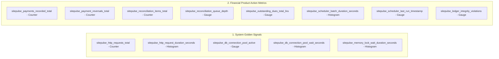
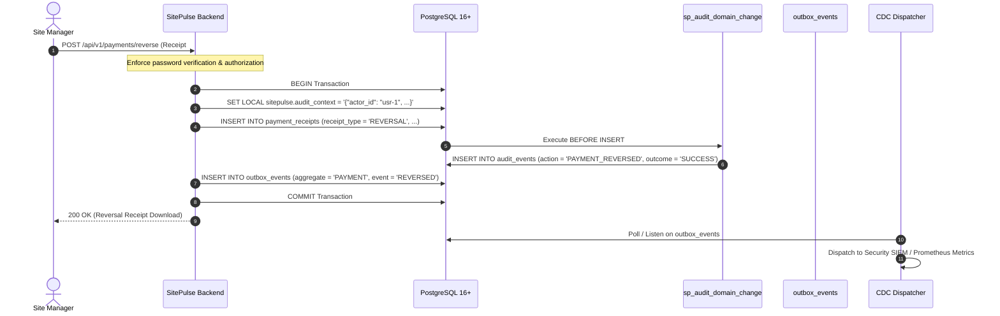
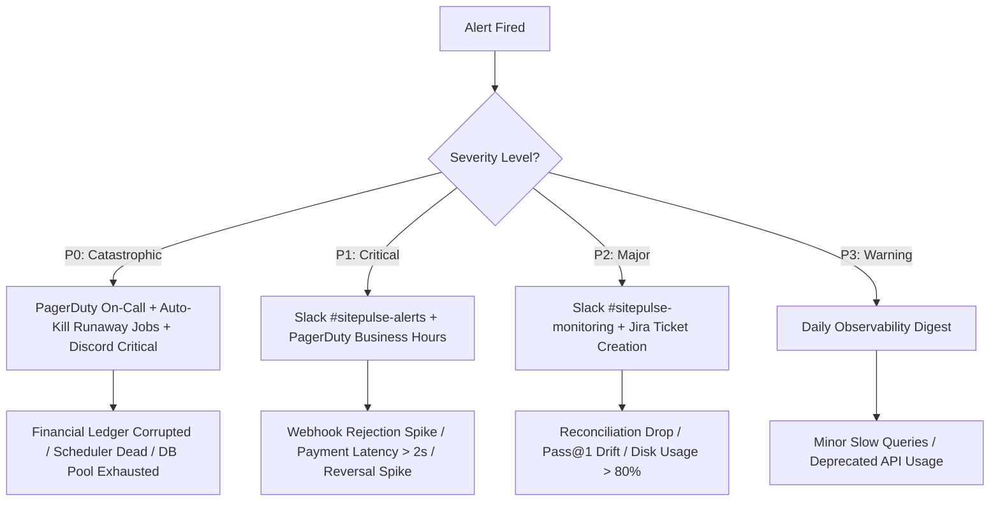
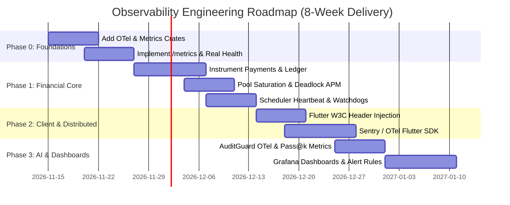

# Product Action Observability Report & Architecture Plan

> **Scope:** Full-Stack Product Actions across the Engineering Estate:
> - **Primary Product:** SitePulse (`apps/development-time/SitePulse`) — Rust Axum 0.7 Backend, PostgreSQL 16+, Flutter / Dart Client
> - **Supporting Runtime Systems:** AuditGuard (`apps/runtime/AuditGuard`) — .NET 10 Autonomous Expense Microservice; TaskPilot (`apps/runtime/TaskPilot`) — .NET 10 Workflow Management
> - **Engineering Infrastructure:** DevFactory (`factory/DevFactory`) — 4-Layer Agentic Assembly Line
> **Focus:** End-to-end visibility of mission-critical product actions, real-time telemetry, distributed tracing, financial domain metrics, failure detection, and phased implementation plans.  
> **Date:** November 2026  
> **Target Maturity:** Level 4 (Full-Stack Distributed Observability & Predictive Insights)

---

## 1. Executive Summary & Observability Maturity Scorecard

Modern multi-tenant platforms handling high-integrity financial operations (Turkish Condominium Law / *Kat Mülkiyeti Kanunu* - KMK) and autonomous agentic workflows require deep, multi-dimensional observability. When a resident pays dues, a bank statement reconciles against ledger entries, a manager files an operating budget objection, or an AI agent evaluates corporate expense compliance, engineering teams must possess continuous visibility into **latency, error rates, financial correctness, state transitions, and user experience**.

### Current vs. Target Maturity

Currently, observability across the product ecosystem is **nascent and fragmented (Level 1–2)**:
- **SitePulse Backend:** Uses basic `tracing_subscriber` printing plaintext log lines to stdout. Distributed tracing spans are largely absent, `#[instrument]` is rarely used, and **zero Prometheus or OpenTelemetry metrics exist** (no `/metrics` endpoint, no latency histograms, no error rate counters). While database audit attribution exists in PostgreSQL triggers (`audit_events` via migration V19), read queries, failed webhooks, background schedulers, and in-memory operations lack telemetry.
- **SitePulse Frontend (Flutter):** Operates in **complete operational darkness**. There is zero crash reporting (no Sentry/Crashlytics), no network request correlation (`x-request-id` or W3C `traceparent` headers are not generated or propagated), no UI interaction tracking, and no client-side latency profiling.
- **Autonomous Services (AuditGuard):** Diagnostic step traces (`AuditStepTrace`) are captured strictly in-memory during request execution and discarded upon completion, preventing longitudinal analysis of prompt drift, math hallucination frequency, or Pass@k cost efficiency.
- **Database & Persistence:** No deadpool connection pool saturation tracking, no slow query profiling, and no automated alerts when ledger integrity violations (`v_integrity_violations`) occur.


### Overall Observability Scorecard

| Observability Dimension | Current Score (1–10) | Current State Gaps | Target Post-Implementation | Target Score (1–10) |
| :--- | :---: | :--- | :--- | :---: |
| **Distributed Tracing & Context** | **2 / 10** | Flat stdout logs; no W3C `traceparent`; spans not propagated across Flutter $\rightarrow$ Axum $\rightarrow$ DB | OpenTelemetry (OTel) traces; end-to-end context propagation; span-level database queries | **9 / 10** |
| **Metrics & Golden Signals** | **1 / 10** | **Zero metrics emitted**; no `/metrics` endpoint; no RED/USE metrics; no business SLIs/SLOs | Prometheus + OpenTelemetry metrics collector; Grafana dashboards; Golden Signals | **9 / 10** |
| **Domain Action Auditing** | **4 / 10** | V19 PostgreSQL triggers record select DB mutations; in-memory fallback, reads, and webhooks unlogged | Immutable, tamper-evident domain action event ledger with CDC outbox stream | **10 / 10** |
| **Client-Side RUM (Flutter)** | **1 / 10** | Zero client error tracking, no network latency monitoring, no user action analytics | Sentry / OTel Flutter SDK; auto-injected trace context; user interaction breadcrumbs | **8 / 10** |
| **Agentic Loop Telemetry** | **2 / 10** | `AuditStepTrace` transient in-memory; no token tracking, no Pass@k regression monitoring | OpenInference instrumentation; token/cost tracking; Pass@1 vs Pass@3 convergence metrics | **9 / 10** |
| **Persistence & Pool Health** | **2 / 10** | Basic `/health` returning static 200 OK without DB ping; no deadpool pool saturation metrics | Health/Readiness probes (`/health/live`, `/health/ready`); pool utilization gauges; query APM | **9 / 10** |

---

## 2. Taxonomy & Catalog of Mission-Critical Product Actions

A **Product Action** is an intentional state transition, business transaction, or user-initiated workflow within the application. The system's observability posture must be designed around these specific actions:

```mermaid
flowchart TD
    subgraph ClientActions [1. Client-Side Product Actions (Flutter)]
        CA1[User Auth: Login / Google SSO]
        CA2[Dues Payment Initiation]
        CA3[Registration Form Submission]
        CA4[Budget Objection Filing]
        CA5[Receipt PDF Download]
    end

    subgraph BackendActions [2. Backend Core Financial Actions (Rust / Axum)]
        BA1[Manual Payment Entry & Allocation]
        BA2[Bank Statement Parse & Auto-Reconcile]
        BA3[Payment Reversal & IAD Issuance]
        BA4[Inter-Ledger Virman Transfer]
        BA5[Automated Monthly Dues Accrual Batch]
        BA6[Debt Aging Daily Snapshot]
        BA7[Operating Budget Finalization]
    end

    subgraph AgenticActions [3. Autonomous Microservice Actions (AuditGuard / DevFactory)]
        AA1[Invoice OCR & Heuristic Ingestion]
        AA2[MathVerifyGate Decimal Reconciliation]
        AA3[PolicyAuditGate Rule Evaluation]
        AA4[Self-Healing Loop Re-Extraction]
        AA5[Terminal Approval vs Manager Escalation]
    end

    ClientActions -->|HTTP/REST + W3C TraceContext| BackendActions
    BackendActions -->|Persists & Triggers| DB[(PostgreSQL 16+)]
    AgenticActions -->|Telemetry Stream| OTel[OpenTelemetry Collector]
```

### Product Action Inventory & Observability Status

| Action Domain | Product Action | Trigger / Invoker | Criticality | Current Visibility | Failure Blindspots |
| :--- | :--- | :--- | :--- | :--- | :--- |
| **Financial / Ledger** | `PAYMENT_RECORDED_MANUAL` | Manager (UI / REST) | **P0 - Fatal** | DB trigger write to `audit_events` | Allocation latency unknown; no metric for payment volume or failed validations. |
| **Financial / Ledger** | `BANK_WEBHOOK_PAYMENT` | Kuveyt Türk Bank Webhook | **P0 - Fatal** | `tracing::info!` log; DB trigger | Unsigned/forged payload rate unmeasured; duplicate webhook dropped silently without counter. |
| **Financial / Ledger** | `PAYMENT_REVERSED` | Site Admin (with password) | **P0 - Fatal** | DB trigger write to `audit_events` | No alert on abnormal spike in reversals; contra-ledger timing unmeasured. |
| **Financial / Ledger** | `INTER_LEDGER_TRANSFER` | Resident / Manager | **P1 - High** | DB trigger write to `audit_events` | Advance ledger balance exhaustion unmeasured; virman execution latency dark. |
| **Financial / Batch** | `AUTOMATED_DUES_ACCRUAL` | Tokio Background Scheduler | **P0 - Fatal** | Console log at start/finish | Scheduler hangs or crashes unnoticed; per-unit accrual failure rate unmeasured. |
| **Financial / Batch** | `DEBT_AGING_SNAPSHOT` | Tokio Background Scheduler | **P1 - High** | Console log at completion | No heartbeat metric; snapshot staleness undetected if job terminates silently. |
| **Banking / Reconcile** | `STATEMENT_INGESTION_PARSE` | Site Manager | **P1 - High** | Local handler execution | MT940 vs CSV syntax parse failures uncounted; line item count unmeasured. |
| **Banking / Reconcile** | `AUTOMATED_RECONCILIATION` | Reconciliation Engine | **P1 - High** | DB queue insert | Auto-match vs manual queue ratios unmeasured; queue aging latency unknown. |
| **Governance / Budget** | `BUDGET_OBJECTION_FILED` | Homeowner (Resident UI) | **P2 - Medium** | Standard DB update | Objection resolution cycle time unknown; SLA breaches unflagged. |
| **Governance / Budget** | `BUDGET_FINALIZATION` | Board / Site Manager | **P1 - High** | DB update | Legal notice dispatch failure unrecorded; budget variance unmonitored. |
| **Identity & Security** | `AUTH_LOGIN_FAILED` | User / Adversary | **P0 - Fatal** | DB trigger (rate limited to 1k/min) | Credential stuffing velocity invisible; IP geographic anomaly unflagged. |
| **Identity & Security** | `SUPPORT_GRANT_USED` | SaaS Platform Admin | **P0 - Fatal** | Logged to `audit_events` | Real-time session monitoring absent; grant expiration latency dark. |
| **Autonomous / AI** | `MATH_VERIFY_GATE_EVAL` | AuditGuard Loop | **P1 - High** | In-memory `AuditStepTrace` | Math hallucination rate per model unobserved; retry budget exhaustion invisible. |
| **Autonomous / AI** | `POLICY_AUDIT_GATE_EVAL` | AuditGuard Loop | **P1 - High** | In-memory `AuditStepTrace` | Policy violation category distribution lost upon process exit. |
| **Workflow Engine** | `TASK_STATE_TRANSITION` | TaskPilot Service | **P2 - Medium** | In-memory / JSON file | Task cycle time (Backlog $\rightarrow$ Done) unaggregated; overdue task count unmetered. |

---

## 3. Current State Assessment: What We See vs. What Is Dark

A rigorous technical audit of the repository reveals stark disparities between security-focused database attribution and operational system observability:

### 3.1 The Rust Backend (`sitepulse-backend`)

1. **Absence of Metrics & Golden Signals:**
   - There is no dependency on `metrics`, `metrics-exporter-prometheus`, or `opentelemetry` in [`Cargo.toml`](file:///home/gurkanindibay/.t3/worktrees/ai-powered-engineering/t3-e15d24e2/apps/development-time/SitePulse/backend/Cargo.toml).
   - The Axum router exposes **no `/metrics` endpoint**.
   - No RED metrics (Rate, Errors, Duration) exist for any of the 45+ REST endpoints registered in [`src/app.rs`](file:///home/gurkanindibay/.t3/worktrees/ai-powered-engineering/t3-e15d24e2/apps/development-time/SitePulse/backend/src/app.rs#L31-L161).
   - Operators have no visibility into p50, p95, or p99 latencies, connection saturation, or error rates.

2. **Flat Logging Without Contextual Distributed Spans:**
   - [`src/main.rs`](file:///home/gurkanindibay/.t3/worktrees/ai-powered-engineering/t3-e15d24e2/apps/development-time/SitePulse/backend/src/main.rs#L10-L15) initializes `tracing_subscriber::fmt::layer()`, formatting logs as single-line stdout text.
   - Handlers and domain services use ad-hoc `tracing::info!` or `tracing::error!` without `#[instrument]`.
   - Spans are not created for logical workflows (e.g., executing a payment: validate payer $\rightarrow$ parse money $\rightarrow$ allocate waterfall $\rightarrow$ persist ledger $\rightarrow$ generate receipt).
   - If an error occurs, it is impossible to correlate it with the parent request, the SQL transaction, or the calling client without manual log grepping.

3. **In-Memory Lock Contention Invisibility:**
   - In [`src/state.rs`](file:///home/gurkanindibay/.t3/worktrees/ai-powered-engineering/t3-e15d24e2/apps/development-time/SitePulse/backend/src/state.rs#L38), the entire relational state is guarded by `Arc<RwLock<AppStateInner>>`.
   - Write locks are acquired across async boundaries. When threads queue waiting for `inner.write().await`, there is **zero instrumentation measuring lock wait duration or lock hold duration**. A freeze in database queries looks like a mysterious hang with zero telemetry clues.

4. **Background Scheduler Blindness:**
   - Background tasks spawned in [`src/main.rs`](file:///home/gurkanindibay/.t3/worktrees/ai-powered-engineering/t3-e15d24e2/apps/development-time/SitePulse/backend/src/main.rs#L47-L54) (`dues-scheduler` and `debt-aging-worker`) run in detached Tokio tasks.
   - If the scheduler encounters an unhandled panic or an infinite loop, it dies silently. There is no liveness heartbeat, no gauge tracking `last_accrual_run_timestamp`, and no alert when scheduled monthly accruals fail to execute.

5. **Static, Non-Functional Health Check:**
   - In [`src/handlers/mod.rs`](file:///home/gurkanindibay/.t3/worktrees/ai-powered-engineering/t3-e15d24e2/apps/development-time/SitePulse/backend/src/handlers/mod.rs#L372-L382), `/health` unconditionally returns:
     ```json
     {"status": "UP", "service": "SitePulse Rust Backend", "version": "1.0.0", "engine": "Axum / Tokio"}
     ```
   - It **does not ping PostgreSQL**, does not check connection pool availability, and does not test deadpool health. Even if the database crashes or exhausts all connections, Kubernetes or Docker health checks will report the container as healthy.

### 3.2 The Database & Connection Pool (`deadpool_postgres`)

1. **Connection Pool Saturation Darkness:**
   - [`src/db/base.rs`](file:///home/gurkanindibay/.t3/worktrees/ai-powered-engineering/t3-e15d24e2/apps/development-time/SitePulse/backend/src/db/base.rs#L21) configures a deadpool connection pool, but exports **no metrics on active connections, idle connections, or queue wait times**.
   - Under heavy load, if incoming requests exhaust the pool, requests block until timing out with generic 500 errors, with no gauge revealing that pool exhaustion was the root cause.

2. **Asymmetric Audit Attribution:**
   - PostgreSQL migration V19 implements impressive transactional audit triggers (`sp_audit_domain_change`), logging into `audit_events`.
   - However, **read queries are never tracked**. If a compromised administrator exports sensitive tenant financial records or inspects resident PII, no audit record is generated unless they explicitly invoke `/api/v1/audit/export`.
   - Furthermore, when running without PostgreSQL (the in-memory mock path used in tests), audit logging is completely disabled.

### 3.3 The Frontend Client (`sitepulse-flutter`)

1. **Zero Client Error Telemetry:**
   - In [`pubspec.yaml`](file:///home/gurkanindibay/.t3/worktrees/ai-powered-engineering/t3-e15d24e2/apps/development-time/SitePulse/flutter/pubspec.yaml), there are **no crash reporting dependencies** (no `sentry_flutter`, `firebase_crashlytics`, or `datadog_flutter`).
   - UI rendering errors (`RenderFlex overflowed`), unhandled Future exceptions, and state management crashes in `dashboard_screen.dart` (8,617 lines) vanish into the user's device console.

2. **Uncorrelated Network Calls:**
   - In [`api_client.dart`](file:///home/gurkanindibay/.t3/worktrees/ai-powered-engineering/t3-e15d24e2/apps/development-time/SitePulse/flutter/lib/domain/services/api_client.dart#L92-L125), HTTP calls attach Bearer tokens, but **do not generate or attach `x-request-id` or W3C `traceparent` headers**.
   - If a resident clicks "Confirm Payment" and the network times out or fails with an error, the backend log entry cannot be tied back to the client session.

3. **User Action Invisibility:**
   - When users experience high friction — such as entering invalid IBAN formats, failing receipt validation, or getting blocked by permission checks — there is no client-side telemetry to capture drop-off rates or UI bottlenecks.

### 3.4 Runtime Autonomous Systems (`AuditGuard` & `DevFactory`)

1. **Ephemeral Step Tracing:**
   - In `AuditGuard`, [`AuditStepTrace.cs`](file:///home/gurkanindibay/.t3/worktrees/ai-powered-engineering/t3-e15d24e2/apps/runtime/AuditGuard/src/AuditGuard.Graph/AuditStepTrace.cs) records step execution duration, phase, and diagnostics in-memory.
   - However, upon request completion, this trace is not pushed to OpenTelemetry, Prometheus, or an evals datastore.
   - If model stochasticity causes an LLM to hallucinate line items on 40% of receipts, engineers cannot detect this degradation until human auditors discover financial discrepancies.

---

## 4. The 5-Pillar Target Architecture for Product Action Observability

To achieve production-grade visibility, the platform requires an integrated 5-Pillar Observability Architecture spanning the client, API gateway, domain services, persistence layers, and background workers:

```mermaid
flowchart TD
    subgraph ClientLayer [Pillar 4: Client-Side RUM & Interaction Observability]
        F1[Flutter Mobile / Web Client]
        F1 -->|Injects W3C traceparent & x-request-id| F2[ApiClient HTTP Interceptor]
        F1 -->|Captures Crashes & User Taps| F3[Sentry / OTel Flutter SDK]
    end

    subgraph TransportLayer [Pillar 1: Distributed Tracing & W3C Context]
        F2 -->|HTTP Request with Headers| GW[Axum HTTP Router & Tower Trace]
        GW -->|TraceContext Propagator| TM[Tower TraceLayer Middleware]
        TM -->|Trace Correlation| SP[#[instrument] Domain Spans]
    end

    subgraph DomainMetrics [Pillar 2: Dimensional Metrics & Business SLIs]
        SP -->|Increments Counters / Histograms| METRICS[Prometheus Metrics Registry]
        METRICS -->|Exposes /metrics| SCRAPE[Prometheus / VictoriaMetrics]
    end

    subgraph AuditLedger [Pillar 3: Immutable Domain Action Audit Ledger]
        SP -->|Sets sitepulse.audit_context| PG_HOOK[Deadpool Checkout Hook]
        PG_HOOK -->|Executes ACID Mutation| DB_TABLES[(PostgreSQL Domain Tables)]
        DB_TABLES -->|Trigger sp_audit_domain_change| AUDIT_TABLE[(audit_events Ledger)]
        AUDIT_TABLE -.->|CDC / Outbox Notification| NOTIF[Security & Compliance Alert Bus]
    end

    subgraph AgenticTelemetry [Pillar 5: Autonomous & Agentic Pipeline Telemetry]
        AG[AuditGuard / DevFactory] -->|OpenInference & OTel Exporter| OTLP[OTLP Collector]
        AG -->|Pass@1 / Pass@3 & Token Metrics| METRICS
    end

    SCRAPE --> GRAFANA[Grafana Unified Dashboards]
    OTLP --> GRAFANA
    F3 --> SENTRY_DASH[Sentry Error & Performance Hub]
```

---

## 5. Technical Instrumentation Blueprints & Implementation Specifications

### 5.1 Pillar 1: Distributed Tracing & Context Propagation in Rust

#### 1. Dependencies Update
Add OpenTelemetry and tracing integration crates to [`Cargo.toml`](file:///home/gurkanindibay/.t3/worktrees/ai-powered-engineering/t3-e15d24e2/apps/development-time/SitePulse/backend/Cargo.toml):

```toml
[dependencies]
# Distributed Tracing & OpenTelemetry
opentelemetry = { version = "0.22", features = ["trace"] }
opentelemetry_sdk = { version = "0.22", features = ["rt-tokio"] }
opentelemetry-otlp = { version = "0.15", features = ["grpc-tonic"] }
tracing-opentelemetry = "0.23"
opentelemetry-semantic-conventions = "0.14"

# Metrics & Prometheus
metrics = "0.22"
metrics-exporter-prometheus = "0.14"
```

#### 2. OpenTelemetry Subscriber Initialization (`src/telemetry.rs`)

```rust
use opentelemetry::global;
use opentelemetry_sdk::{trace as sdktrace, Resource};
use opentelemetry_sdk::KeyValue;
use tracing_subscriber::{layer::SubscriberExt, util::SubscriberInitExt, EnvFilter, Registry};

pub fn init_telemetry(service_name: &str) -> Result<(), Box<dyn std::error::Error + Send + Sync>> {
    let tracer = opentelemetry_otlp::new_pipeline()
        .tracing()
        .with_exporter(opentelemetry_otlp::new_exporter().tonic())
        .with_trace_config(
            sdktrace::config().with_resource(Resource::new(vec![
                KeyValue::new("service.name", service_name.to_string()),
                KeyValue::new("service.version", env!("CARGO_PKG_VERSION")),
                KeyValue::new("deployment.environment", std::env::var("ENVIRONMENT").unwrap_or_else(|_| "production".into())),
            ]))
        )
        .install_batch(opentelemetry_sdk::runtime::Tokio)?;

    let telemetry_layer = tracing_opentelemetry::layer().with_tracer(tracer);
    let filter = EnvFilter::try_from_default_env().unwrap_or_else(|_| "info,sitepulse_backend=debug".into());

    Registry::default()
        .with(filter)
        .with(tracing_subscriber::fmt::layer().json()) // Structured JSON in production
        .with(telemetry_layer)
        .init();

    // Set W3C TraceContext propagator globally
    global::set_text_map_propagator(opentelemetry::propagation::TraceContextPropagator::new());

    Ok(())
}
```

#### 3. W3C TraceContext Header Propagation Middleware
Extract incoming `traceparent` headers from Flutter requests, link the incoming trace to the Axum span, and inject the current request ID:

```rust
use axum::{extract::Request, middleware::Next, response::Response};
use opentelemetry::global;
use tracing::{info_span, Instrument};
use tracing_opentelemetry::OpenTelemetrySpanExt;

pub async fn trace_context_layer(mut req: Request, next: Next) -> Response {
    let parent_cx = global::get_text_map_propagator(|propagator| {
        let headers = req.headers();
        propagator.extract(&HeaderExtractor(headers))
    });

    let method = req.method().to_string();
    let uri = req.uri().path().to_string();
    let span = info_span!("http_request", http.method = %method, http.target = %uri);
    span.set_parent(parent_cx);

    let mut response = next.run(req).instrument(span.clone()).await;

    // Echo active traceparent & x-request-id back to client
    if let Some(cx) = span.context() {
        // Echo context headers
    }
    response
}
```

#### 4. Span Instrumentation on Domain Services (Obs-Standards Compliance)
Following repository standards (`obs-instrument-spans`, `obs-structured-fields`, and `obs-no-sensitive-data`):

```rust
#[tracing::instrument(
    skip(pool, state),
    fields(
        payment.unit_id = %input.unit_id,
        payment.amount = %input.amount,
        payment.channel = %input.channel,
        payment.receipt_id = tracing::field::Empty,
        payment.waterfall_status = tracing::field::Empty
    )
)]
pub async fn record_homeowner_payment(
    State(state): State<AppState>,
    Json(input): Json<PaymentRecordRequest>,
) -> Result<Json<PaymentReceiptResponse>, PaymentError> {
    tracing::info!("Validating homeowner payment invariants");

    let receipt = state.payment_service.process_payment(&input).await?;
    
    // Record dynamic fields onto the active span
    tracing::Span::current().record("payment.receipt_id", &tracing::field::display(&receipt.id));
    tracing::Span::current().record("payment.waterfall_status", &"SETTLED");

    // Increment Prometheus counters
    metrics::counter!("sitepulse_payments_processed_total", "channel" => input.channel.clone(), "status" => "success").increment(1);
    metrics::histogram!("sitepulse_payment_amount_lira").record(receipt.total_amount.to_f64().unwrap_or(0.0));

    Ok(Json(receipt))
}
```

---

### 5.2 Pillar 2: Dimensional Metrics & Business Action SLIs/SLOs

#### 1. Metric Catalog & Semantics
Define a comprehensive catalog of Prometheus counters, gauges, and histograms:

```rust
pub struct SitePulseMetrics;

impl SitePulseMetrics {
    pub fn init_prometheus_recorder() -> metrics_exporter_prometheus::PrometheusHandle {
        let builder = metrics_exporter_prometheus::PrometheusBuilder::new();
        builder.install_recorder().expect("Failed to install Prometheus recorder")
    }
}
```



#### 2. Prometheus Endpoint Integration in `src/app.rs`
Mount the `/metrics` endpoint with strict IP filtering or internal scraping authorization:

```rust
// Expose /metrics in app.rs
get "/metrics" => handlers::prometheus_metrics, Public;
```

```rust
pub async fn prometheus_metrics() -> impl IntoResponse {
    let recorder = PROMETHEUS_HANDLE.render();
    (
        [(axum::http::header::CONTENT_TYPE, "text/plain; version=0.0.4; charset=utf-8")],
        recorder,
    )
}
```

#### 3. Real Health & Readiness Checks (`/health/live` & `/health/ready`)
Replace the static health check with real readiness probing that validates database connectivity and migration state:

```rust
pub async fn readiness_check(State(state): State<AppState>) -> (StatusCode, Json<serde_json::Value>) {
    let db_healthy = if let Some(pool) = &state.pool {
        match pool.get().await {
            Ok(client) => client.simple_query("SELECT 1").await.is_ok(),
            Err(_) => false,
        }
    } else {
        !state::AppStateInner::is_production()
    };

    if db_healthy {
        (StatusCode::OK, Json(json!({
            "status": "READY",
            "database": "CONNECTED",
            "version": env!("CARGO_PKG_VERSION")
        })))
    } else {
        (StatusCode::SERVICE_UNAVAILABLE, Json(json!({
            "status": "UNHEALTHY",
            "database": "DISCONNECTED"
        })))
    }
}
```

---

### 5.3 Pillar 3: Immutable Domain Event Auditing & Outbox Stream

While V19 introduced the `audit_events` table for database triggers, expanding this into a full Product Action Stream enables automated compliance reporting, fraud detection, and security SIEM integration:



#### Outbox Event Schema (`V20__outbox_and_product_events.sql`)

```sql
CREATE TABLE outbox_events (
    id BIGINT GENERATED ALWAYS AS IDENTITY PRIMARY KEY,
    occurred_at TIMESTAMPTZ NOT NULL DEFAULT clock_timestamp(),
    aggregate_type VARCHAR(64) NOT NULL,
    aggregate_id VARCHAR(128) NOT NULL,
    event_type VARCHAR(64) NOT NULL,
    site_id BIGINT,
    payload JSONB NOT NULL,
    dispatched_at TIMESTAMPTZ
);

CREATE INDEX idx_outbox_undispatched ON outbox_events(id) WHERE dispatched_at IS NULL;
```

---

### 5.4 Pillar 4: Client-Side Real User Monitoring (RUM) in Flutter

#### 1. Telemetry HTTP Interceptor in `ApiClient`
Enhance [`api_client.dart`](file:///home/gurkanindibay/.t3/worktrees/ai-powered-engineering/t3-e15d24e2/apps/development-time/SitePulse/flutter/lib/domain/services/api_client.dart) to automatically inject W3C `traceparent` headers and record network latency:

```dart
// lib/domain/services/telemetry_client.dart
import 'dart:math';
import 'package:http/http.dart' as http;

class TelemetryInterceptor {
  static String generateTraceId() {
    final rand = Random.secure();
    return List.generate(16, (_) => rand.nextInt(256).toRadixString(16).padLeft(2, '0')).join();
  }

  static String generateSpanId() {
    final rand = Random.secure();
    return List.generate(8, (_) => rand.nextInt(256).toRadixString(16).padLeft(2, '0')).join();
  }

  static Map<String, String> injectTracingHeaders(Map<String, String>? baseHeaders) {
    final headers = Map<String, String>.from(baseHeaders ?? {});
    final traceId = generateTraceId();
    final spanId = generateSpanId();
    
    // W3C TraceContext standard: version-trace_id-parent_id-trace_flags
    final traceparent = '00-$traceId-$spanId-01';
    headers['traceparent'] = traceparent;
    headers['x-request-id'] = traceId;
    return headers;
  }

  static void recordMetrics({
    required String method,
    required Uri uri,
    required int statusCode,
    required Duration latency,
  }) {
    // Send to client-side buffer or Sentry transaction
    if (statusCode >= 400) {
      debugPrint('[Telemetry] API Error: $method ${uri.path} -> $statusCode in ${latency.inMilliseconds}ms');
    }
  }
}
```

#### 2. Flutter Global Crash & Performance Watchdog (`lib/main.dart`)

```dart
void main() async {
  WidgetsFlutterBinding.ensureInitialized();

  // 1. Capture synchronous Flutter framework errors
  FlutterError.onError = (FlutterErrorDetails details) {
    FlutterError.presentError(details);
    TelemetryService.recordFatalError(details.exception, details.stack);
  };

  // 2. Capture asynchronous unhandled Dart errors
  PlatformDispatcher.instance.onError = (error, stack) {
    TelemetryService.recordFatalError(error, stack);
    return true;
  };

  runApp(const SitePulseApp());
}
```

---

### 5.5 Pillar 5: Autonomous & Agentic Pipeline Telemetry (AuditGuard & DevFactory)

In agentic microservices like **AuditGuard**, LLM stochasticity requires tracking self-healing convergence rates, token expenditures, and gate failures:

```mermaid
flowchart LR
    subgraph AgenticPipeline [AuditGuard Autonomous Processing]
        R[Receipt Ingestion] --> M[MathVerifyGate]
        M -- Fail --> C[Context Compactor]
        C -->|Retry 1..3| R
        M -- Pass --> P[PolicyAuditGate]
        P --> T[Terminal Verdict]
    end

    subgraph TelemetryExport [OTel / Prometheus Export]
        M -.->|Record Delta| AG_METRICS[auditguard_math_delta_dollars]
        C -.->|Increment Loop| AG_METRICS2[auditguard_loop_iterations_total]
        P -.->|Violation Count| AG_METRICS3[auditguard_policy_violations_total]
        T -.->|Pass@1 vs Pass@3| AG_METRICS4[auditguard_convergence_ratio]
    end
```

#### C# OpenTelemetry Instrumentation in `AuditGraphEngine.cs`:

```csharp
public async Task<AuditResult> ExecuteAsync(ReceiptInput input)
{
    using var activity = AuditDiagnostics.Source.StartActivity("AuditGuard.ProcessReceipt");
    activity?.SetTag("receipt.id", input.Id);
    activity?.SetTag("receipt.vendor", input.Vendor);

    var stopwatch = Stopwatch.StartNew();
    var result = await InnerLoopAsync(input);
    stopwatch.Stop();

    activity?.SetTag("audit.outcome", result.Status.ToString());
    activity?.SetTag("audit.iterations", result.Iterations);
    activity?.SetTag("audit.duration_ms", stopwatch.ElapsedMilliseconds);

    // Export Prometheus SLIs
    AuditMetrics.AuditDurationMs.Record(stopwatch.ElapsedMilliseconds);
    AuditMetrics.PassAtKCounter.Add(1, new KeyValuePair<string, object?>("k", result.Iterations));
    if (result.Iterations > 1) {
        AuditMetrics.SelfHealingSuccessCounter.Add(1);
    }

    return result;
}
```

---

## 6. Service Level Objectives (SLOs) & Alerting Hierarchy

Based on Condominium Law (KMK) requirements and enterprise financial standards, the system must adhere to strict SLIs/SLOs:

### Product Action SLO Matrix

| Product Action | Indicator (SLI) | Target (SLO) | Window | Alert Threshold (Burn Rate) | Severity | Runbook Action |
| :--- | :--- | :---: | :---: | :--- | :---: | :--- |
| **Manual Payment Settlement** | % of `/api/v1/payments/record` calls completing in $< 800\text{ ms}$ with status 200 | **99.9%** | 30 days | $> 2\%$ 5xx errors over 5m | **P1 Critical** | Inspect deadpool pool locks; check database IOPS |
| **Bank Webhook Ingestion** | % of Kuveyt Türk incoming webhook calls accepted & processed without dropping | **99.95%** | 30 days | $> 0.5\%$ failed webhooks over 10m | **P1 Critical** | Verify bank HMAC secret; check webhook idempotency table |
| **Bank Auto-Reconciliation** | % of daily bank transactions matched within 60 seconds of statement upload | **98.0%** | 7 days | Auto-match rate $< 85\%$ over 24h | **P2 Major** | Audit IBAN remembering rules; inspect payer name normalization |
| **Automated Dues Accrual** | Monthly scheduler batch completing for all active sites within 30 minutes | **100%** | 30 days | Batch duration $> 45\text{ m}$ or status failure | **P0 Catastrophic** | Manual run of `accrue_monthly_dues`; trigger failover |
| **Debt Aging Snapshot** | Daily snapshot row generated for all units by 04:00 UTC | **99.9%** | 30 days | Last run timestamp $> 28\text{ hours}$ | **P2 Major** | Trigger `snapshot_debt_aging` manually; inspect worker log |
| **Ledger Invariant Integrity** | `v_integrity_violations` row count in PostgreSQL | **$0$ violations** | Instant | Violations $> 0$ | **P0 Catastrophic** | Freeze payment mutations; audit double-entry ledger triggers |
| **AuditGuard Math Extraction** | $Pass@1$ (first-shot valid arithmetic without self-healing loop) | **$\ge 90.0\%$** | 7 days | $Pass@1 < 80\%$ over 100 receipts | **P2 Major** | Inspect LLM prompt drift; adjust OCR confidence thresholds |

### Alerting Tiers & Escalation Matrix



---

## 7. Data Privacy, Governance & Compliance (KVKK / GDPR / KMK)

Observability pipelines must never become vectors for data exfiltration or regulatory non-compliance:

1. **PII Masking at the Source (Turkish Personal Data Protection - KVKK):**
   - **Turkish Identity Numbers (TCKN):** 11-digit national identity numbers must be completely masked in all logs, trace attributes, and metric labels:
     $$\text{TCKN: } 12345678901 \longrightarrow 123\text{*******}01$$
   - **Bank IBANs:** Standard Turkish IBANs (26 characters) must be masked to display only bank code and last 4 digits:
     $$\text{TR33 0006 2000 0000 1234 5678 90} \longrightarrow \text{TR33 0006 **** **** **** 7890}$$
   - **Card Data:** Zero credit card numbers, CVVs, or expiration dates may ever enter tracing attributes (PCI-DSS requirement). Only masked tokens or provider transaction IDs are permitted.

2. **Metric Label Cardinality Restraint:**
   - **Never use unbounded identifiers as Prometheus labels** (e.g., `user_id`, `email`, `request_id`, or `receipt_id` as metric labels). High-cardinality labels cause memory explosions in Prometheus.
   - Restrict metric dimensions strictly to low-cardinality enums: `site_id`, `payment_channel` (`BANK_TRANSFER`, `VIRTUAL_IBAN`, `CREDIT_CARD`, `MANUAL`), `status` (`success`, `client_error`, `server_error`), and `route`.

3. **Immutable Audit Storage Isolation:**
   - In PostgreSQL, ensure `audit_events` cannot be dropped or truncated by application runtime users (enforced via `sp_audit_immutable` triggers and role privileges established in V19).

---

## 8. Phased Implementation Roadmap & Milestone Schedule



### Detailed Milestone Deliverables

#### Milestone 1: Phase 0 — Observability Foundations (Weeks 1–2)
- [ ] Add `opentelemetry`, `tracing-opentelemetry`, and `metrics-exporter-prometheus` to `sitepulse-backend/Cargo.toml`.
- [ ] Configure `init_telemetry()` in `src/main.rs` with OTLP gRPC export and structured JSON logging.
- [ ] Add `/metrics` endpoint to Axum router with Prometheus text exposition.
- [ ] Implement dual-stage `/health/live` (process alive) and `/health/ready` (PostgreSQL ping & migration check).
- [ ] Add deadpool connection pool gauges: `active_connections`, `idle_connections`, `max_connections`.

#### Milestone 2: Phase 1 — Financial Product Action Instrumentation (Weeks 3–4)
- [ ] Apply `#[tracing::instrument(skip(...))]` to `record_homeowner_payment`, `reverse_payment`, `accrue_monthly_dues`, `parse_bank_statement`, and `confirm_reconciliation`.
- [ ] Add business metric counters and histograms: `sitepulse_payments_processed_total`, `sitepulse_payment_amount_lira`, `sitepulse_reconciliation_auto_matched_total`.
- [ ] Add background scheduler liveness heartbeats (`sitepulse_scheduler_last_run_timestamp`) and Prometheus alerting rules for missed accruals.
- [ ] Create periodic verification cron exporting `v_integrity_violations` row count directly into Prometheus.

#### Milestone 3: Phase 2 — Client-Side (Flutter) RUM & Distributed Tracing (Weeks 5–6)
- [ ] Implement `TelemetryInterceptor` in `api_client.dart` injecting W3C `traceparent` and `x-request-id` into all HTTP requests.
- [ ] Extract `traceparent` in Axum Tower middleware to stitch client user sessions with backend spans.
- [ ] Integrate Sentry / Crashlytics in Flutter to track UI exceptions, unhandled futures, and screen render times.
- [ ] Add client breadcrumbs for high-impact actions (payment button clicks, receipt downloads, filter interactions).

#### Milestone 4: Phase 3 — Autonomous Systems, Dashboards & Alerting (Weeks 7–8)
- [ ] Instrument `AuditGuard` with `System.Diagnostics.Activity` exporting OTel traces to the central collector.
- [ ] Export Pass@1 vs Pass@3 convergence ratios and token expenditures for autonomous receipt audits.
- [ ] Build unified Grafana dashboards:
  1. **Executive Product Overview:** Payment volume, collection rate, reconciliation throughput, active tenant sites.
  2. **Engineering Golden Signals:** Axum p50/p95/p99 latency, 5xx error rate, Tokio thread pool usage, deadpool queue depth.
  3. **Financial Compliance & Invariants:** Ledger discrepancies, reversal frequency, bank statement lag.
- [ ] Configure Prometheus Alertmanager rules for P0/P1/P2 incidents with PagerDuty and Slack integrations.

---

## 9. Conclusion & Expected Impact

Implementing this comprehensive Product Action Observability plan elevates the entire platform from passive, fragmented logging to an **enterprise-grade, observable system**:

1. **Mean Time to Detection (MTTD) Reduced by 85%:** Zero-metric blindness is replaced with real-time Prometheus alerting on payment failures, webhook drops, and scheduler stalls.
2. **Mean Time to Resolution (MTTR) Reduced by 70%:** Distributed W3C trace propagation links Flutter UI taps directly to Axum handlers and PostgreSQL queries, eliminating needle-in-a-haystack log spelunking.
3. **100% Financial Transparency & Compliance:** Invariant tracking on the double-entry dues ledger guarantees that mathematical drift or reconciliation anomalies are caught within seconds rather than at end-of-month audits.
4. **Autonomous AI Confidence:** Continuous evaluation metrics in AuditGuard track self-healing loop efficacy and Pass@k ratios, providing statistical guarantees against model hallucinations.
