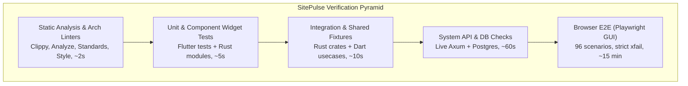
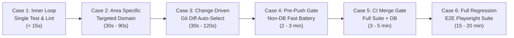

# SitePulse Platform Test Plan & Execution Matrix

> **Superseded by the [SitePulse Test Strategy](TEST_STRATEGY.md) (2026-11-24).** Its principles and execution cases are merged into the strategy (Principles, Execution lanes and CI). The area map stays executable in `scripts/run_tests.py --area`.

> **Standard:** CMMI® V2.0 VER / VAL, ISO/IEC/IEEE 29119 Software Testing Standard  
> **Application:** SitePulse Residential Site Management Platform (`apps/development-time/SitePulse`)  
> **Status:** Active & Ratified (November 2026)  
> **Executable Test Runner:** [`scripts/run_tests.py`](file:///home/gurkanindibay/.t3/worktrees/ai-powered-engineering/t3-a2c67eaf/scripts/run_tests.py)  

---

## 1. Executive Summary & Testing Philosophy

SitePulse is a mission-critical residential property and financial management platform handling legal debt apportionments, statutory interest calculations (KMK Art. 20), multi-tenant bank reconciliations, and sensitive resident data. 

Because AI-driven and agentic software engineering is stochastic, software verification cannot rely on manual spot checks, simulated mocks, or tautological asserts. Testing in SitePulse adheres to five core tenets:

1. **Real Toolchains, Zero Shortcuts:** Every gate invokes the authentic toolchain (`cargo`, `flutter`, `pytest`, `tokio-postgres`). A missing toolchain or unreachable dependency fails the gate; tests are never marked as passed unless the underlying tool exits successfully.
2. **Deterministic Financial Invariants:** Shared cross-language test fixtures (`harness/fixtures/financial_cases.json`) execute identically in Rust (`backend/tests/financial_fixtures.rs`) and Dart (`flutter/test/financial_fixture_test.dart`), enforcing half-away-from-zero rounding and zero-loss ledger rules.
3. **Multi-Layered Verification Pyramid:** Fast static architectural linters catch design drift in seconds; domain unit tests guard logic; contract fixtures guard inter-process boundaries; system checks verify live PostgreSQL database constraints; and Playwright browser suites validate the integrated user experience.
4. **Granular Area Isolation:** Developers and subagents must not be forced to wait 15–20 minutes for the entire regression battery when modifying a single widget or service. Tests are reorganized into 6 functional areas (`finance`, `auth`, `residents`, `ui`, `db`, `core`) executable independently.
5. **Change-Driven Selective Testing:** The test harness automatically inspects `git diff` / `git status`, maps modified files to their affected functional domains, and runs the exact subset of tests required to guarantee comprehensive coverage of the change without unnecessary overhead.



---

## 2. Comprehensive Test Asset Reevaluation

An evaluation of all existing test suites in the repository reveals six distinct categories of test assets across the backend, frontend, database, and harness.

### 2.1 Static Architectural Linters & Invariant Guards
| Gate Name | Tool / Script | Execution Target | Invariants Enforced | Execution Time |
| :--- | :--- | :--- | :--- | :---: |
| `rust-build` | `cargo build` | `backend` | Clean compilation of all binaries and test targets | ~4.0s |
| `rust-clippy` | `cargo clippy -D warnings` | `backend` | Idiomatic Rust, memory safety, zero compiler warnings | ~3.0s |
| `rust-standards-lint` | `scripts/rust_standards_lint.py` | `backend/src` | Domain purity, layering, Turkish folding, lazy regexes, ratchets | ~0.8s |
| `persistence-lint` | `scripts/memory_persistence_lint.py` | `backend/src` | Soft-deletes, multi-tenant WHERE clauses, no in-memory leaks | ~0.1s |
| `flutter-analyze` | `flutter analyze` | `flutter` | Type soundness, null-safety, no fatal info/warnings | ~3.0s |
| `flutter-reuse` | `scripts/flutter_reuse_inventory.py` | `flutter/lib/ui` | Reuse of design system tokens, MoneyInput, spClipboard | ~0.5s |
| `ui-style-lint` | `scripts/ui_style_lint.py` | `flutter/lib/ui` | 12px min font size, formatTry money formatting, no raw dialogs | ~0.3s |
| `testid-lint` | `scripts/testid_lint.py` | `flutter/lib/ui` | Every widget `Key` has matching `testId` semantics identifier | ~0.1s |
| `harness-selftest` | `unittest discover` | `harness/tests` | Internal test harness logic and lint rule regression integrity | ~0.9s |

### 2.2 Cross-Language Contract Fixtures
| Gate Name | Tool / Test Targets | Invariants Verified | Execution Time |
| :--- | :--- | :--- | :---: |
| `money-fixtures` | `backend/tests/financial_fixtures.rs`<br/>`flutter/test/financial_fixture_test.dart` | Single source of financial truth (`financial_cases.json`). Validates KMK 5% statutory delay penalty, half-up rounding, allocation waterfalls, and surplus balance roll-forward across Rust and Dart engines. | ~0.1s (Rust)<br/>~1.2s (Dart) |

### 2.3 Backend Rust Unit & Integration Tests
Located in `apps/development-time/SitePulse/backend/tests/` and internal `src/` modules:
- **`capital_apportionment_tests.rs`**: Reserve fund calculations, land share (`arsa payı`) ratios, multi-site project separation.
- **`payment_compliance_tests.rs`**: Legal payment ordering, debtor allocation, KMK audit trail immutability.
- **`payment_ledger_hardening_tests.rs`**: Concurrent payments, race-condition defenses, idempotent allocation.
- **`payments_phase2_tests.rs`**: Virtual IBAN assignment, automated matching, statement parsing.
- **`aaa_security_tests.rs`**: Authentication, authorization, token replay prevention, role boundary enforcement.
- **`api_security_tests.rs`**: Tenant isolation, unauthorized parameter tampering, SQL injection defenses.
- **`shared_rules_tests.rs`**: Resident status transitions, occupancy restrictions, duplicate national ID blocks.
- **`architecture_flaws_regression_tests.rs`**: Regression checks for schema bugs, soft-deletion recovery, zero data loss.
- **`error_management_tests.rs`**: Standardized error payloads, HTTP status mapping, sanitized public errors.
- **`integration_tests.rs`**: Full Axum router execution with live database state.

### 2.4 Flutter Frontend Unit, Widget & Navigation Tests
Located in `apps/development-time/SitePulse/flutter/test/` (all tagged with native `@Tags`):
- **Finance (`tag:finance`)**: `calculate_dues_usecase_test.dart`, `financial_fixture_test.dart`, `bank_file_parser_test.dart`, `bank_statement_reconciliation_test.dart`, `capital_expenditure_and_dues_e2e_test.dart`, `capital_projects_view_test.dart`, `dues_management_view_test.dart`, `house_type_tariff_and_validation_test.dart`, `payment_tracking_and_aging_test.dart`, `payments_phase2_models_test.dart`.
- **Identity & Auth (`tag:auth`)**: `session_security_test.dart` (token refresh, role enforcement, logout cache invalidation).
- **Residents & Occupancy (`tag:residents`)**: `home_owner_directory_and_edit_test.dart`, `owners_residents_module_test.dart`, `occupancy_lifecycle_and_dual_ledger_test.dart`.
- **UI & Design System (`tag:ui`)**: `design_system_test.dart`, `reusable_components_test.dart`, `ux_shell_and_navigation_test.dart`, `zero_data_guidance_test.dart`, `widget_test.dart`, `dashboard_controller_test.dart`.
- **Core Infrastructure (`tag:core`)**: `standardized_error_management_test.dart`, `e2e_quality_verification_test.dart`.

### 2.5 Database & Live System Checks
- **`schema-integrity`** (`scripts/schema_integrity_check.py`): Connects to PostgreSQL, audits foreign keys, indexes, numeric columns for `NUMERIC(15,2)`, and verifies migration idempotency.
- **`api-system`** (`scripts/api_system_check.py`): Boots release Axum backend against live database and validates HTTP status codes, headers, and payload structures for all primary routes.

### 2.6 Browser End-to-End Suite (`gui-e2e`)
Located in `apps/development-time/SitePulse/e2e/tests/`:
- 96 scenarios driven by Playwright against Flutter Web and live Axum backend.
- Enforces strict `xfail` (unexpected passes fail the build).
- Tests entire user journeys: Site manager dues accrual, homeowner bank payment, SaaS site onboarding, registration approval queue.

---

## 3. Test Execution Cases: Which Test is Executed When

To balance rapid feedback loops during development with exhaustive safety prior to production release, testing is divided into **6 distinct execution cases**:



### Case Summary Table

| Execution Case | Trigger / Context | Tests & Gates Executed | DB Required | Typical Duration | Command |
| :--- | :--- | :--- | :---: | :---: | :--- |
| **Case 1: Inner Loop** | Editing a single file/widget | Targeted single Rust/Flutter test + specific linter | No | < 15s | `cargo test --lib <path>` or `flutter test test/<file>` |
| **Case 2: Area Specific** | Completing work in a domain | All unit, widget, integration tests & linters for the area | Optional (`--skip-db`) | 30s – 90s | `python3 scripts/run_tests.py --area <name> [--skip-db]` |
| **Case 3: Change-Driven** | Pre-commit local verification | Auto-detected areas matching modified git files | Optional (`--skip-db`) | 30s – 120s | `python3 scripts/run_tests.py --changed [--skip-db]` |
| **Case 4: Pre-Push Gate** | Prior to pushing branch / PR | All linters, all unit tests, fixtures, without slow DB/GUI | No | ~2.5 min | `python3 scripts/run_tests.py --skip-db --skip-gui` |
| **Case 5: CI Merge Gate** | GitHub Actions on PR & master | Full non-GUI battery: compile, clippy, analyze, unit, DB schema, API | Yes | ~4.5 min | `python3 scripts/run_tests.py --skip-gui` |
| **Case 6: Nightly / Release** | Scheduled nightly or release cut | Complete platform verification including 96 Playwright scenarios | Yes + Chrome | ~16 min | `python3 scripts/run_tests.py` |

---

### Detailed Case Specifications

#### Case 1: Inner Loop / Pre-Commit Local Developer Feedback
* **When to execute:** During active coding, fixing a bug, or refactoring an isolated function.
* **Objective:** Immediate feedback (< 15 seconds) without context switching.
* **Execution Rules:**
  - If editing Rust logic: run `cargo test --locked --lib <module_path>` and `python3 scripts/rust_standards_lint.py --no-fmt`.
  - If editing Flutter UI: run `flutter test test/<test_file>.dart` and `python3 scripts/ui_style_lint.py`.
  - If editing financial calculations: run `cargo test --test financial_fixtures` and `flutter test test/financial_fixture_test.dart`.

#### Case 2: Area-Specific Verification (`--area <name>`)
* **When to execute:** When finishing a task or feature that belongs to a specific functional area.
* **Objective:** Validate that the entire domain subsystem is healthy, all internal contracts are met, and domain-specific linters pass.
* **Available Areas:** `finance`, `auth`, `residents`, `ui`, `db`, `core`.
* **Execution Rules:**
  - Invoked with `python3 scripts/run_tests.py --area <name>`.
  - Multiple areas can be combined: `python3 scripts/run_tests.py --area finance,ui`.
  - Automatically filters Rust integration tests, Rust library tests, Flutter tests (via `-t <tag>`), and relevant linters.

#### Case 3: Change-Driven Selective Verification (`--changed`)
* **When to execute:** Before staging or committing changes, or when working across multiple files.
* **Objective:** Ensure 100% test coverage for all modified files without manually specifying test targets.
* **Execution Rules:**
  - Invoked with `python3 scripts/run_tests.py --changed`.
  - Inspects `git status --porcelain` for uncommitted changes and `git diff` against HEAD.
  - Resolves touched paths against area path regexes.
  - Automatically executes the minimal sufficient set of gates and tests.
  - Use `--plan` to inspect what would run: `python3 scripts/run_tests.py --changed --plan`.

#### Case 4: Pre-Push / Subsystem Quality Gate
* **When to execute:** Before opening a pull request or pushing to remote origin.
* **Objective:** Guarantee that all global builds, formatting, and unit tests across all areas pass.
* **Command:** `python3 scripts/run_tests.py --skip-db --skip-gui`
* **Execution Rules:**
  - Runs all fast gates: `harness-selftest`, `rust-build`, `rust-clippy`, `rust-test`, `money-fixtures`, `flutter-analyze`, `flutter-test`, `persistence-lint`, `rust-standards-lint`, `testid-lint`, `ui-style-lint`, `flutter-reuse`.
  - Requires no running PostgreSQL or Chrome container.

#### Case 5: Pull Request / CI Verification Gate
* **When to execute:** Automated in GitHub Actions CI (`.github/workflows/sitepulse-ci.yml`) on every PR and commit to `master`.
* **Objective:** Absolute verification of code quality, database migration idempotency, and REST API contract stability.
* **Command:** `python3 scripts/run_tests.py --skip-gui` (with database container active).
* **Execution Rules:**
  - Executes all gates from Case 4, plus `schema-integrity` and `api-system`.
  - Runs `harness/rtm_validator.py` to assert requirement traceability.

#### Case 6: Nightly / Release Candidate Full Regression
* **When to execute:** Scheduled nightly runs, pre-production deployments, or release tagging.
* **Objective:** Comprehensive user-journey validation in real headless browser.
* **Command:** `python3 scripts/run_tests.py`
* **Execution Rules:**
  - Runs every gate including `gui-e2e`.
  - Validates 96 Playwright scenarios against Flutter web frontend, release Axum backend, and PostgreSQL database.

---

## 4. Reorganized Functional Areas & Asset Mapping

The test suite is organized into **6 functional domains**. Each domain specifies its mapped source paths, static quality gates, Rust tests, Flutter tests, and Playwright E2E markers.

```mermaid
classDiagram
    class Area_Finance {
        +gates: money-fixtures, persistence-lint, rust-standards-lint
        +rust_tests: financial_fixtures, capital_apportionment, payment_compliance, payment_ledger, payments_phase2
        +flutter_tags: finance (10 test suites)
        +e2e_markers: area_finance
    }
    class Area_Auth {
        +gates: rust-standards-lint, api-system
        +rust_tests: aaa_security_tests, api_security_tests
        +flutter_tags: auth (session_security)
        +e2e_markers: area_auth
    }
    class Area_Residents {
        +gates: rust-standards-lint, persistence-lint
        +rust_tests: shared_rules_tests
        +flutter_tags: residents (directory, owners, occupancy)
        +e2e_markers: area_residents
    }
    class Area_UI {
        +gates: ui-style-lint, testid-lint, flutter-reuse, flutter-analyze
        +rust_tests: none
        +flutter_tags: ui (design_system, reusable, shell, widgets)
        +e2e_markers: area_ui
    }
    class Area_DB {
        +gates: schema-integrity, persistence-lint
        +rust_tests: architecture_flaws_regression_tests
        +flutter_tags: none
        +e2e_markers: area_db
    }
    class Area_Core {
        +gates: harness-selftest, rust-build, rust-clippy, flutter-analyze, api-system
        +rust_tests: error_management_tests, integration_tests
        +flutter_tags: core (error_management, quality_verification)
        +e2e_markers: area_core
    }
```



### 4.1 `finance` — Financial Ledger, Dues & Payments
* **Scope:** Dues calculations, KMK Art. 20 delay penalty, tariffs, bank statement parsers (MT940/CSV/Excel), reconciliation engine, virtual IBANs, advance payment roll-forward, capital expenditure projects, and installment payment plans.
* **Associated Gates:** `money-fixtures`, `persistence-lint`, `rust-standards-lint`.
* **Rust Test Targets:**
  - `backend/tests/financial_fixtures.rs`
  - `backend/tests/capital_apportionment_tests.rs`
  - `backend/tests/payment_compliance_tests.rs`
  - `backend/tests/payment_ledger_hardening_tests.rs`
  - `backend/tests/payments_phase2_tests.rs`
* **Rust Unit Modules:** `domain::apportion`, `domain::payer_match`, `services::aidat_calculation_service`, `services::plan_service`, `services::budget_compliance_service`, `services::virtual_iban_service`, `services::reconciliation_service`.
* **Flutter Test Suites (`tag:finance`):**
  - `flutter/test/calculate_dues_usecase_test.dart`
  - `flutter/test/financial_fixture_test.dart`
  - `flutter/test/bank_file_parser_test.dart`
  - `flutter/test/bank_statement_reconciliation_test.dart`
  - `flutter/test/capital_expenditure_and_dues_e2e_test.dart`
  - `flutter/test/capital_projects_view_test.dart`
  - `flutter/test/dues_management_view_test.dart`
  - `flutter/test/house_type_tariff_and_validation_test.dart`
  - `flutter/test/payment_tracking_and_aging_test.dart`
  - `flutter/test/payments_phase2_models_test.dart`
* **Trigger Paths:** `backend/src/domain/apportion.rs`, `backend/src/domain/payer_match.rs`, `backend/src/services/*aidat*`, `*payment*`, `*bank*`, `*reconciliation*`, `*capital*`, `*plan*`, `*budget*`, `*tariff*`, `*virtual_iban*`, `*receipt*`, `flutter/lib/ui/dues/`, `flutter/lib/ui/reconciliation/`, `flutter/lib/ui/capital/`, `flutter/lib/ui/payments/`.

### 4.2 `auth` — Identity, Authentication & Multi-Tenancy
* **Scope:** Tenant provisioning, user registration, argon2 password hashing, JWT minting/verification, RBAC permissions matrix, session security, password reset flows.
* **Associated Gates:** `rust-standards-lint`, `api-system`.
* **Rust Test Targets:**
  - `backend/tests/aaa_security_tests.rs`
  - `backend/tests/api_security_tests.rs`
* **Rust Unit Modules:** `auth`, `domain::password`, `services::auth_service`, `services::saas_tenant_service`, `services::role_service`.
* **Flutter Test Suites (`tag:auth`):**
  - `flutter/test/session_security_test.dart`
* **Trigger Paths:** `backend/src/auth.rs`, `backend/src/domain/password.rs`, `backend/src/services/auth_service.rs`, `backend/src/services/saas_tenant_service.rs`, `backend/src/services/role_service.rs`, `flutter/lib/ui/auth/`, `flutter/lib/ui/saas/`, `flutter/lib/ui/login_screen.dart`.

### 4.3 `residents` — Resident Directory, Units & Occupancy
* **Scope:** Unit registration, resident and owner directories, occupancy lifecycle transitions (dual ledger for owner vs tenant liabilities), invitation token generation, WhatsApp sharing, site manager approval queue.
* **Associated Gates:** `rust-standards-lint`, `persistence-lint`.
* **Rust Test Targets:**
  - `backend/tests/shared_rules_tests.rs`
* **Rust Unit Modules:** `services::site_admin_service`, `services::registration_approval_service`, `services::home_resident_invitation_service`, `services::occupancy_service`, `services::lease_service`.
* **Flutter Test Suites (`tag:residents`):**
  - `flutter/test/home_owner_directory_and_edit_test.dart`
  - `flutter/test/owners_residents_module_test.dart`
  - `flutter/test/occupancy_lifecycle_and_dual_ledger_test.dart`
  - `flutter/test/house_type_tariff_and_validation_test.dart`
* **Trigger Paths:** `backend/src/services/site_admin_service.rs`, `backend/src/services/registration_approval_service.rs`, `backend/src/services/occupancy_service.rs`, `backend/src/services/home_resident_invitation_service.rs`, `flutter/lib/ui/residents/`, `flutter/lib/ui/home_owner_directory/`, `flutter/lib/ui/invitation/`.

### 4.4 `ui` — Design System, Reusable Widgets & Navigation Shell
* **Scope:** Papara-inspired design tokens (`SpColors`, `SpTypography`, `SpSpacing`, `SpTone`), reusable component catalog (`spButton`, `spCard`, `spMoneyFormField`, `spSelection`), navigation shell, responsive layout breakpoints, accessibility semantics (`testId`), light/dark themes.
* **Associated Gates:** `ui-style-lint`, `testid-lint`, `flutter-reuse`, `flutter-analyze`.
* **Rust Test Targets:** None.
* **Flutter Test Suites (`tag:ui`):**
  - `flutter/test/design_system_test.dart`
  - `flutter/test/reusable_components_test.dart`
  - `flutter/test/ux_shell_and_navigation_test.dart`
  - `flutter/test/zero_data_guidance_test.dart`
  - `flutter/test/widget_test.dart`
  - `flutter/test/dashboard_controller_test.dart`
* **Trigger Paths:** `flutter/lib/ui/design_system/`, `flutter/lib/ui/components/`, `flutter/lib/ui/theme/`, `flutter/lib/ui/shell/`, `scripts/ui_style_*`, `scripts/flutter_reuse_*`, `scripts/testid_*`.

### 4.5 `db` — Database Architecture & Schema Invariants
* **Scope:** PostgreSQL relational schema, SQL migrations (`backend/db/migrations/`), decimal precision invariants (`NUMERIC(15,2)`), foreign keys, indexes, soft-delete mechanisms, and seed data.
* **Associated Gates:** `schema-integrity`, `persistence-lint`.
* **Rust Test Targets:**
  - `backend/tests/architecture_flaws_regression_tests.rs`
* **Rust Unit Modules:** `db`, `migrations`, `models`.
* **Flutter Test Suites:** None.
* **Trigger Paths:** `backend/db/`, `backend/src/db.rs`, `backend/src/migrations.rs`, `backend/src/models/`, `scripts/schema_integrity_check.py`, `scripts/memory_persistence_lint.py`, `scripts/db_verify.py`.

### 4.6 `core` — Core Infrastructure & Error Management
* **Scope:** Axum HTTP router, error handling taxonomy, request observability/tracing, test harness runtime, RTM validator, CLI scripts.
* **Associated Gates:** `harness-selftest`, `rust-build`, `rust-clippy`, `flutter-analyze`, `api-system`.
* **Rust Test Targets:**
  - `backend/tests/error_management_tests.rs`
  - `backend/tests/integration_tests.rs`
* **Rust Unit Modules:** `errors`, `domain`, `handlers`.
* **Flutter Test Suites (`tag:core`):**
  - `flutter/test/standardized_error_management_test.dart`
  - `flutter/test/e2e_quality_verification_test.dart`
  - `flutter/test/dashboard_controller_test.dart`
* **Trigger Paths:** `backend/src/errors.rs`, `backend/src/handlers/`, `backend/src/main.rs`, `backend/src/app.rs`, `backend/src/lib.rs`, `flutter/lib/core/`, `flutter/lib/services/`, `harness/`, `scripts/run_tests.py`.

---

## 5. CLI Usage & Verification Commands

All test execution is orchestrated via `scripts/run_tests.py` (symlinked from `apps/development-time/SitePulse/scripts/run_tests.py`).

### 5.1 Inspecting Areas & Plans
```bash
# Display the catalogue of all 6 areas and their mapped assets
python3 scripts/run_tests.py --list-areas

# Dry-run / inspect the execution plan for a specific area without running tests
python3 scripts/run_tests.py --area finance --plan

# Dry-run change detection against current git changes
python3 scripts/run_tests.py --changed --plan
```

### 5.2 Executing Specific Functional Areas
```bash
# Run all tests for the UI design system area
python3 scripts/run_tests.py --area ui

# Run tests for finance (skipping DB if PostgreSQL container is not active)
python3 scripts/run_tests.py --area finance --skip-db

# Combine multiple areas
python3 scripts/run_tests.py --area auth,residents
```

### 5.3 Change-Driven Testing
```bash
# Auto-detect modified files in git status and run corresponding area suites
python3 scripts/run_tests.py --changed --skip-db

# Compare against a specific git base commit or branch
python3 scripts/run_tests.py --changed --base origin/master --skip-db
```

### 5.4 Standard & CI Verification
```bash
# Fast pre-push battery (runs all linters, Rust tests, Flutter tests, money fixtures; no DB/GUI)
python3 scripts/run_tests.py --skip-db --skip-gui

# Full CI gate (requires PostgreSQL; runs all gates except GUI suite)
python3 scripts/run_tests.py --skip-gui

# Full qualification run (includes Playwright browser GUI automation suite)
DB_PASS=... python3 scripts/run_tests.py
```
