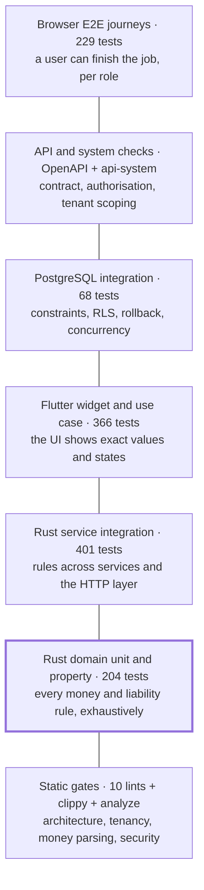
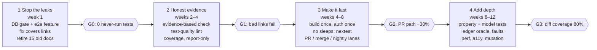

# SitePulse Test Strategy and Report (single source)

**Status:** Active, single source of truth for SitePulse testing · **Last assessed:** 2026-11-24 at `2f16868` · **Owner:** SitePulse maintainers

## Executive summary

This is SitePulse's single test strategy and its current-state report. It replaces 15 separate testing documents (see Governance). The strategy sections come first; the assessment that justifies them follows.

The suite is broad and well traced, but "traced" is not the same as "verified". As assessed at `2f16868` (2026-11-23), 1,705 tests across Rust, Flutter, Python harness and browser E2E back 466 Gherkin scenarios, and the repo's own `feature_traceability.py check` passes. Following each link to its test and to how that test runs in CI shows that **409 scenarios (88%) are verified by a precise, running, asserting test**. The other 57 are not:

- **30 pending** with no automation, including 2 `@smoke` and 13 `@core` (22 of them in EPIC-13 journeys). Seven are blocked by product gaps, not missing tests.
- **16 mis-covered**: linked only to tests that never run or always skip in CI (4), only to a whole-suite wrapper (6), only to a file-level comment (2), only to a script (1), or only to a GUI check that waits but asserts nothing (3).
- **11 automated by Gherkin steps**: fine, but they run only in the browser tier.

**Overall effectiveness: good on breadth and money correctness, weak on proof.** Nothing measures line or branch coverage. Mutation testing samples 58 curated faults in 18 of about 300 source files and does not gate PRs. Seven tests never run in CI: three are compiled out, three are ignored and outside every gate, and one always skips. 41 fixed sleeps and 89 wall-clock reads make the slow tiers both slower and flakier than they need to be.

| Layer | Tests | Runs in CI | Strength | Main gap |
| --- | --- | --- | --- | --- |
| Rust backend (unit + integration + DB) | 678 | 678 (70 via `rust-db-test`) | Money rules, RLS tenant isolation, state machines | 6 never run; `is_err()`-only error checks; env-var races |
| Flutter frontend | 366 | 366 | Widget + Decimal money behaviour | 13 untagged files invisible to `--area` runs; no coverage numbers |
| Browser E2E (pytest + Playwright) | 250 | 228, plus 1 that always skips (wrapper file ignored in CI) | Journeys per role, 8-way sharding | \~7 s median per test, 41 fixed waits, 30 pending GUI scenarios |
| Harness / tooling (Python) | 410 | 410 (6 env-conditional, all met in CI) | Lints, traceability, report tooling | Validates tooling, not product |
| Mutation (nightly) | 58 mutants | Nightly, not on PRs | 96.6% kill rate on sampled faults | 18 files targeted; \~24 min; no PR signal |

**Top five actions**, detailed in the master plan below:

1. Add `sale_clearance_tests` to the `rust-db-test` gate, and run the `e2e` cargo feature tests in CI. That brings 5 never-run tests and 2 scenarios back.
2. Make the traceability check fail on links to non-running tests, whole-file wrappers and file-level comments, not just missing links.
3. Turn on line and branch coverage (cargo-llvm-cov, `flutter test --coverage`, coverage.py), plus a changed-lines gate.
4. Move business-rule checks down the pyramid. Use a few deep journeys plus API-level scenario tests instead of more 7-second browser tests.
5. Add a PR mutation diff on changed files only, and keep the full catalogue nightly.

# Strategy

## Governance: one strategy, fifteen documents retired or narrowed

This document is the single test strategy for SitePulse. It absorbs 15 testing documents (about 2,700 lines) that had drifted apart. Each one is merged here, kept as a narrow reference that this strategy points to, or marked retired (its text stays behind a banner until roadmap phase 1 removes it). A change to how SitePulse is tested starts with an edit to this document.

| Document | What it held | Disposition |
| --- | --- | --- |
| `docs/testing/TEST_PLAN_AND_EXECUTION_MATRIX.md` | Five principles, 6 functional areas, 6 execution cases | **Merged** (Principles, Lanes). The area map stays executable in `run_tests.py --area` |
| `docs/testing/GUI_TEST_PLAN.md` | GUI-xx-nn scenario and selector catalogue, API data builders | **Narrowed** to the catalogue and data builders; historical execution notes removed |
| `docs/testing/GUI_AUTOMATION_PLAN.md` | Plan to build the browser suite (phases 0–4 done) | **Retired** (banner now; removed in roadmap phase 1): complete |
| `docs/testing/GUI_COVERAGE_GAPS.md` | Superseded 2026-11-07 gap report | **Retired**; current state is in this strategy and CI reports |
| `docs/testing/journey-plan/` (3 files) | Fixtures F0–F7, ledger invariants, isolation and teardown contract | **Kept** as the test-data reference (Test data section) |
| `docs/testing/TEST_PLAN_EPIC_10_CAPITAL_EXPENDITURE.md` | EPIC-10 RTM, boundary partitions, teardown | **Narrowed** to its boundary data dictionary; the RTM is superseded by `.specify/features` traceability |
| `docs/testing/test-coverage-assessment-2026-11-10.md` | Point-in-time assessment | **Retired** (banner now; removed in roadmap phase 1): superseded by the assessment here |
| `docs/testing/mutation-testing-analysis.md`, `mutation-testing-ci-integration.md` | First mutation run; two-tier CI design | **Retired** (banner now; removed in roadmap phase 1); the design is adopted in Quality gates |
| `docs/testing/mutation-coverage-improvement.md` | Live mutation score and 8 catalogue candidates | **Kept** as the mutation backlog |
| `docs/testing/cucumber-serenity-migration-analysis.md` | Pilot arms A and B, results | **Decided** (Reporting): pytest-bdd stays canonical; arm B archived |
| `docs/testing/test-reporting-pages-analysis.md` | One Pages dashboard for all suites | **Merged** (Reporting) |
| `docs/engineering-process/test-time-analysis.md` | Measured CI time, steps A–N | **Merged**: done steps recorded, open steps in the roadmap |

Retired reports are either removed or replaced with a short pointer to the current source of truth.

Editing this strategy is operator or interactive work. Durable-harness workers read it through AGENTS.md but cannot write it (it is a protected path, like the gate catalogue); a worker whose change needs a strategy update reports that as a residual risk.

Still authoritative and aligned to this strategy: `AGENTS.md` rules 3, 12 and 13, `.agents/rules/test-execution-records.md`, `.specify/agents/tester-agent.md` and `.specify/constitution.md`. The `docs/quality/` reports (security, code and database flaws, throughput, observability) are inputs: every open finding there gets a regression test id, and the observability SLOs become performance-test thresholds.

**Conflicts between the old documents, resolved:**

| Topic | What the documents said | Decision |
| --- | --- | --- |
| Scenario source | 83 GUI scenarios (gaps doc), "96 scenarios" (matrix), 466 Gherkin scenarios (`.specify/features`) | `.specify/features` is the only scenario catalogue; GUI ids map onto SC ids |
| Known defects | 28 to 43 strict xfails across the docs | Code has 0; every future xfail needs an open issue (Quality gates) |
| When the browser suite runs | Matrix: nightly only, merge gate without GUI. CI: full suite on every PR | The lanes in this strategy: smoke and core on PRs, everything on master, edge nightly |
| Selection unit | 6 areas (matrix), 13 epics (features), area markers (pytest) | Epics are the traceability unit; areas are the local selection unit, mapped by `impact-map.json` |
| E2E duration | "\~15 min", "15–20 min", 27 min CI | Measured: 8 shards of 5–7 min; whole run 11.5 min (run 129) |
| Recorded runs | Required per task (older docs) vs a switch that is off (AGENTS.md rule 13) | CI artifacts are the evidence; committing recorded runs stays off |

## Principles

Ten rules govern every test, gate and report. Each is enforceable by a gate, a lint or a review checklist, and the enforcement is named.

1. **A scenario is verified only by evidence.** Evidence means a named test that runs in CI, asserts the rule, and passed on the commit. A `covers:` line alone is a claim. *Enforced by the evidence-based traceability check.*
2. **Real toolchains, no silent passes.** A missing tool, database or env var fails or skips loudly; it never returns early as PASS. Skipped gates are reported, never counted. *Enforced by the test-quality lint and `run_tests.py` reporting.*
3. **Exact money, everywhere.** Decimal to the kuruş, half away from zero, the same cases in Rust and Dart from `harness/fixtures/financial_cases.json`. *Enforced by the `money-fixtures` gate and the Financial Precision Gate in the constitution.*
4. **Test each rule at the cheapest layer that can prove it.** Browser tests prove journeys, not arithmetic. *Enforced by review and by the levels table below.*
5. **One rule, one test case, one precise assertion.** Assert the value, id, variant or status code, not that "something" happened. *Enforced by the lint: no `is_err()`-only, unwrap-only or wait-only tests; at most 3 scenarios claimed per test.*
6. **Determinism.** Injected clock and config, named starting states, no fixed sleeps, no process-env mutation, no shared mutable data between tests. *Enforced by the lint and the flake report.*
7. **Known defects stay visible.** A known defect is a strict xfail with an open issue id, never a skip or a deleted test. Product gaps keep their scenario `@pending` with the gap named. *Enforced by `xfail_strict = true` and `closed_issue_warnings`.*
8. **Fast feedback first, full proof before merge.** PRs run what can fail because of the change, plus smoke. Master runs everything. Nightly runs the slow and the sampled. *Enforced by the lanes.*
9. **Measure test strength, not test count.** Changed-lines coverage, mutation score and verified-scenario share are the headline numbers. *Enforced by quality gates and KPIs.*
10. **Never weaken a gate to go green.** Gates change where, when or how often a test runs, never whether it can fail (AGENTS.md rule 12). *Enforced by review and `test_run_tests_groups.py`.*

## Test levels and ownership

Each layer proves one kind of claim, and a rule belongs to the lowest layer that can prove it. The domain layer is highlighted because that is where SitePulse's hardest rules (who owes what, split by date and role) should be exhausted, with the property and model-based tests added in this strategy.

Across every layer: scenario traceability (466) · mutation testing (58 mutants) · changed-lines coverage.

Ownership follows the harness roles. The developer role writes domain, service and widget tests with the change. The tester role (`.specify/agents/tester-agent.md`) owns `.specify/features`, E2E steps and tests, boundary cases and mutation probes. CI owns evidence. Nobody owns a test that runs in no lane: it is deleted or given a lane.

## Strategy for complex business cases

SitePulse's hard cases are combinations: who is liable (owner, tenant, joint) × expense type (operational, capital) × occupancy state × date (mid-month handover, month end, closed period) × tenant. Hand-written examples can't cover that space. Test the rules exhaustively below the UI, then prove a few deep journeys end to end.

**Put each kind of check in the cheapest layer that can prove it:**

| What is being proved | Layer | Technique | Already in the repo |
| --- | --- | --- | --- |
| A money rule (split, proration, fee, apportionment) | Rust domain unit | Decision tables plus property-based invariants | `financial_fixtures` shared Rust/Dart, `heat_share`, `installments` |
| Who pays what for each combination | Rust domain + Dart use case | **One decision table** (liable party × expense type × occupancy × payer) loaded by both languages, one row = one case id | Partly: `financial_fixtures` covers amounts, not liability |
| State changes over time (occupancy, periods) | Rust domain | **Model-based testing**: deterministic generated command sequences against the state machine and a tiny reference model, with invariants checked after every step | `occupancy_state_machine_tests` |
| Persistence invariants and RLS | PostgreSQL tests | Direct SQL constraint checks, two-connection concurrency, fault injection | `db_*` tests, `MUT-DB-002` control |
| API contract and authorisation | API system check | Generated from OpenAPI: every endpoint called with another tenant's ids must return 403/404 | `openapi_tests.rs`, `api_system_check.py` |
| UI shows the right thing | Flutter widget | Fixture JSON validated against OpenAPI; exact Decimal text | 366 widget tests |
| A user can finish the job | Browser E2E | One deep journey per role, plus `smoke` per epic | J-01 to J-19 journeys |

**Six techniques for the hard cases:**

1. **Ledger oracle after every journey step.** Journey stages check the detailed ledger invariants in §4. The autouse E2E/API pytest fixture also asserts that `v_integrity_violations` is empty after each test, so invariant regressions surface even outside journey scenarios.
2. **Calendar matrix on the injectable clock.** Run accrual, due-day, late-fee and period-close rules over frozen dates: the 28th to 31st, February in leap and non-leap years, 23:30 and 00:30 at UTC+3, back-dated entries just inside and outside the window. The `e2e` clock already supports this; use it at the API layer, not the browser.
3. **Model-based occupancy and ownership.** Generate sequences of move-in, move-out, handover, sale and reversal, including same-day handovers. Assert no gap or overlap in liable periods and that a split never gains or loses a kuruş. This covers SC-13-03-07 and -09 once the product gaps close (SC-13-03-06 is automated).
4. **Concurrency and idempotency.** Two PostgreSQL connections with a barrier: two payments on one unit (SC-05-02-01), double approval of one statement line (SC-13-09-07), concurrent accrual of one period. Assert one committed result and one clean rejection.
5. **Fault injection at the persistence boundary.** A failing repository or pool wrapper (or the `fail` crate's failpoints) in DB tests. Assert full rollback of occupancy, household and settlement (SC-13-03-14).
6. **Volume and tenancy at scale, nightly.** Seed 50 sites × 200 units with the 88-unit onboarding fixture as the template. Time key API calls against a stated SLO, and run the cross-tenant id fuzz from the API row above.

## Test data, fixtures and environments

Every test starts from a named, versioned state, not from data it invents. The journey plan already defines the model. This strategy makes it the rule for all layers.

| Asset | Source of truth | Used by | Rule |
| --- | --- | --- | --- |
| Starting states F0–F7 (empty site to residents added after accruals) | `docs/testing/journey-plan/README.md` §3 | E2E journeys today; API and DB tests next | A new test names its state (`Given the site is in state F5`) or declares one small boundary fixture next to it |
| Reference data (clock 2026-11-19 12:00 Europe/Istanbul, tariffs, due day, KMK 5% late fee) | journey plan §2 | All layers | Expected amounts are written as literals in the scenario, never recomputed by the test |
| Ledger invariants | journey plan §4 and `v_integrity_violations` | Journey stages and autouse E2E/API pytest teardown | Detailed balance checks run at journey checkpoints; the database view must be empty after every E2E/API pytest test |
| Money cases | `harness/fixtures/financial_cases.json` | Rust `financial_fixtures.rs`, Dart `financial_fixture_test.dart` | Add the liability decision table here so both languages run it |
| Boundary partitions for capital dues | `TEST_PLAN_EPIC_10_CAPITAL_EXPENDITURE.md` §3 | Property tests | Generators draw from these partitions |
| API data builders | `e2e/support/api.py` (listed in `GUI_TEST_PLAN.md` §4) | E2E arrange steps | Seed through the API or SQL, never through screens, except in the one UI test per flow |
| PM scenario presets `F0`–`F10_GOVERNANCE` and the Workbench | `scripts/pm_scenarios` (`REFERENCE_CLOCKS`, `EXPECTED_TOTALS`, `EXPECTED_UNIT_BALANCES`, `PM_CHECKLISTS`, `PERSONAS`) | E2E seeder, `pm_workbench.py`, Workbench Web UI, manual sessions | One catalogue for automation and people: expected totals are literals in the preset, the cheat sheet is generated from it, and [PM_TEST_PLAYBOOK.md](PM_TEST_PLAYBOOK.md) quotes it rather than restating it |
| Clock | `e2e` cargo feature clock | Backend, E2E | One `Clock` trait injected everywhere; no `Utc::now()` / `DateTime.now()` in tests |

**Isolation.** Each scenario attempt gets its own site (`e2e-<run>-<shard>-<attempt>`, journey plan §5). Each PostgreSQL test gets its own database, created from a migrated template. Teardown must work from a half-built state (`test_teardown_works_after_half_built_state` already proves this).

**Environments.** Local runs use `run_tests.py`. CI uses the GitHub service PostgreSQL. Each browser shard downloads the debug backend and `web-e2e` bundle produced by the workflow's `build-e2e` job. Real Google OIDC, the SMS provider and the live bank are replaced by in-repo fakes with recorded contracts, so their scenarios can run instead of staying skipped or pending.

## Execution lanes and CI

CI already went from about 27 minutes in one sequential job to 11.5 minutes (run 129). That came from parallel gate groups, cache-on-failure, lints first, 8 duration-balanced E2E shards and dropping the duplicate wrapper suites (time analysis steps A–E). PRs now run `smoke` and `core` plus any epic selected by `impact-map.json`; shared-code changes still run the full browser suite. Docs-only PRs skip the browser build and shards. Master runs the full suite, and nightly runs `edge`. The lanes below decide what runs when. The table after them tracks the speed-ups, with time-analysis step letters where one exists.

Targeted PR lanes trade early cross-epic coverage for speed: a regression outside the selected epic tests may only be caught by the full E2E suite on master. When a master E2E run fails, the author of the merged change owns triage and a fix or revert; maintainers coordinate when several changes may be involved.

### Lanes: what runs when

| Lane | Trigger | Runs | Blocks merge | Target |
| --- | --- | --- | --- | --- |
| Local pre-push | Developer | `run_tests.py --changed --skip-gui`: lints, affected Rust, Flutter by tag | No | Under 3 min |
| PR | Every push to a PR | All lints; Rust unit, integration and DB; Flutter; money fixtures; E2E `smoke or core` plus impact-map picks; changed-lines coverage; mutation in-diff (report-only first) | Yes, except mutation | Critical path 30% below today's measured baseline |
| Merge to master | Push to master | Everything in PR plus the full E2E suite; records evidence and updates traceability | Reverts on red | As today |
| Nightly | 03:30 UTC | Full mutation catalogue; E2E `edge`; mobile viewport; calendar matrix; volume and tenancy fuzz; flake report | Opens issues | Under 45 min |
| Release candidate | Tag | Full suite on a clean environment, cross-browser smoke, accessibility smoke | Yes | n/a |

| # | Area | Today | Change | Expected effect |
| --- | --- | --- | --- | --- |
| 1 | E2E setup | Each of the 8 shards installed Rust and Flutter, compiled the backend with `--features e2e`, and restored or built the web bundle | Implemented in #375. One `build-e2e` job builds the backend binary and `flutter/build/web-e2e` once and uploads them. Shards download and run both artifacts. | Removes 7 redundant compiles per PR |
| 2 | E2E per-test cost | Median 6.9 s per test, 20–30 s per journey; every test signs in through the UI | Playwright `storage_state` per role, created once per worker. Seed data through the API or SQL fixtures (F0–F6), not through screens. Keep one UI sign-in test per role | Typically 30–50% off GUI test time |
| 3 | Fixed waits | 41 `wait_for_timeout` calls, about 48 s per full pass | State-based waits (`expect`, `wait_for_response`) | Saves about 48 s per pass and removes timing flakes |
| 4 | Shard balance | 1 min 52 s spread between shards. Balancing used local recorded runs, which hold only 115 of 250 E2E tests | Master CI ingests JUnit durations from every shard into a cache-backed `e2e_shard.py` store; PR shards restore the latest master store | Shard assignments use recent CI timings and converge |
| 5 | Risk-based lanes | `smoke`/`core`/`edge` markers are declared as P0/P1/P2 but CI ran everything on every PR | **PR**: lint, unit, integration, DB, Flutter, E2E `smoke or core` plus tests from affected epics. **Merge to master**: the full suite. **Nightly**: `edge`, the full mutation catalogue, mobile viewport, flaky tests and random journeys | Faster PR feedback; full coverage still runs |
| 6 | Change-based selection | `run_tests.py --changed` and `.specify/features/impact-map.json` existed but CI did not use them | `ci_e2e_plan.py` runs `feature_traceability.py affected` and skips E2E for PRs with no behaviour paths; shared code changes retain the full suite | Docs-only PRs skip E2E build and shards |
| 7 | Rust test runner | `cargo test` over 41 separate integration-test binaries | `cargo nextest` (parallel per test, JUnit, retries reported as flaky) and merge `tests/*.rs` into one `tests/it/` crate with modules | Fewer link steps; nextest is commonly 2–3× faster on many-binary suites |
| 8 | PostgreSQL tests | Each test creates a throwaway database and migrates it; 4 threads | Migrate and seed once into a template database per nextest run, then `CREATE DATABASE … TEMPLATE …` per test; keep four concurrent DB tests | Per-test setup clones the migrated seed instead of rerunning migrations |
| 9 | Mutation on PRs | Nightly only, about 24 min; a survivor stops the aggregator before it publishes | PR job: `cargo-mutants --in-diff` on changed `domain/` and `services/` files, 10-minute cap, non-blocking at first. Fix the aggregator to publish before failing | Mutation signal while the author is still on the change |
| 10 | Retries and evidence | Flaky failures look like real failures | `pytest-rerunfailures --reruns 1` reported as FLAKY, never PASS; the flake rate feeds quarantine (suggestion 10) | Fewer red reruns without hiding flakes |
| 11 | Backend profile (F) | E2E compiled a release backend next to the debug build every other gate uses | Implemented in #375. The shared E2E backend uses Cargo's dev profile. | Avoids release compilation and retains the dev profile's optimized password hashing |
| 12 | Long journeys (N) | The 111 s auditor journey sets the floor for any shard | Split journeys into checkpointed stages sharing one fixture, or run the full chains in the master lane only | Shards can shrink below 2 minutes each |
| 13 | Post-merge evidence (M) | record-evidence re-runs global gates once per DAG task | Run global gates once per commit and reuse the results for every task | Shorter master post-merge time |

Keep two things exactly as they are: the parallel gate groups with the guard test that fails if one is dropped, and cancel-in-progress for superseded PR pushes.

### Manual and exploratory testing (PM lane)

The manual lane answers a question no automated lane answers: **can a person do this job on this build?** It is a usability and sanity lane, not a verification lane. The walkthroughs, the six complexity packs and the 15-minute release smoke live in [PM_TEST_PLAYBOOK.md](PM_TEST_PLAYBOOK.md), which is the entry point for anyone testing by hand.

| Concern | Rule |
| --- | --- |
| Tooling | [`scripts/pm_workbench.py`](../../scripts/pm_workbench.py) starts the local stack and seeds a preset; [`scripts/pm_workbench_web.py`](../../scripts/pm_workbench_web.py) serves the Workbench Web UI (`:9095`) with the scenario gallery, cheat sheet, Time Machine, companion files and bug-bundle export; [`scripts/pm_ledger_health.py`](../../scripts/pm_ledger_health.py) scores a seeded site against the twelve ledger invariants |
| Starting state | Always a named preset from `scripts/pm_scenarios` (`F0`–`F10_GOVERNANCE`), the same catalogue the E2E seeder uses, so a cheat sheet cannot drift from the suite. The playbook's copies of those numbers are themselves checked by `harness/tests/test_pm_playbook.py` |
| What it can prove | That the build is usable, that the documented numbers appear on screen, and that a defect reproduces on a known state |
| What it cannot prove | That a rule holds. A manual pass is one observation on one site; the evidence of record stays the scenario and its named CI test (principle 1) |
| Output of a failed session | A bug bundle (preset, clock, site, redacted roster, ledger-health scorecard, correlated `request_id`/`trace_id` fields) attached to an issue, plus the checklist line that failed |
| Closing the loop | The defect gains a Gherkin scenario in `.specify/features/` and a test in the cheapest layer that can prove it. A manual pass alone never marks a scenario verified. |
| Cadence | The 15-minute release smoke before a release-candidate tag or a stakeholder demo; exploratory sessions whenever a change touches money, dates or occupancy |

The manual lane reads the same reference clock, the same expected totals and the same invariants as the automated lanes, so a disagreement between them is itself a finding: either the product drifted from the catalogue or the catalogue is stale.

## Quality signals and gates

Four signals measure whether the tests are strong, not just numerous. Each has one owner script, one lane and one threshold that tightens over the roadmap.

| Signal | Tool (exists / new) | Lane | Threshold now → week 12 |
| --- | --- | --- | --- |
| **Verified scenarios**: every non-pending scenario has a named test that runs in a CI lane, asserts, and passed on the commit | `feature_traceability.py check` (exists), extended with gate-awareness and CI case results (new) | PR, lint group | Report only → blocking; 409/466 → all non-pending |
| **Changed-lines coverage** | `cargo llvm-cov`, `flutter test --coverage`, coverage.py, combined with `diff-cover` (new) | PR | Published → ≥ 80% on `backend/src/{domain,services}` and `flutter/lib` |
| **Mutation score** | `mutation_scenarios.py` with 66 curated mutants; PR runs use `run --changed BASE --direct-only --strict` | Tier 1 reports on PRs touching targeted files; tier 2 enforces strict verdicts nightly | 96.6% nightly → ≥ 95% on 66+ mutants, and no survivor on PR-changed files |
| **Test quality** | `test_quality_lint.py` with `test_quality_baseline.json` | PR, lint group | Baseline: 132 shortcut counts, 84 backend `Utc::now()` reads and 14 existing over-limit claims; target 10 or fewer shortcut counts, with no new over-limit claims |

**Mutation tiers** follow `mutation-testing-ci-integration.md`. Tier 1 runs only the mutants whose target file the PR changes (2–3 min for `dues_ledger.rs`, 0 s for unrelated changes). Its report includes per-layer outcomes and artifacts. The workflow checks out full history and compares the PR merge tree to the event base SHA. Tier 2 is the existing nightly matrix (Rust about 15 min, Flutter 3, Python 1, DB 3). The aggregator must publish its artifact before failing on a survivor. The catalogue grows with the 8 candidates in `mutation-coverage-improvement.md`, plus one probe per regression fix that exposes a new invariant.

**Known defects and flakes.**

- **Strict xfail** only with an open issue id in the reason. `known_issues.py` holds shared reasons. `closed_issue_warnings` fails the check when the issue closes.
- **Flaky tests** are measured from the last 30 recorded runs plus CI JUnit. Above 2% flips, a test is quarantined to the nightly lane with an issue and an expiry date of 14 days. Expired quarantine fails the build.
- **Reruns** are allowed once in the browser lane and are reported as FLAKY, never as PASS.
- **Hung tests** fail alone. `e2e/pytest.ini` gives every E2E test a 300 s limit (`pytest-timeout`, `signal` method, test body only), so a stuck browser call fails one test in minutes instead of holding a job until its 90-minute limit, as the WebKit nightly did in November 2026. The slowest real test takes about 85 s; a test that needs longer opts in with `@pytest.mark.timeout(n)`.

**The gate that never moves:** a skipped or deselected test is reported with its reason in every run summary, as `run_tests.py` already does for gates.

## Non-functional and security testing

The [nightly quality workflow](../../e2e/nightly/README.md) runs scheduled performance, accessibility, browser, mobile and tenant authorization checks. Each kind gets one owner check, one lane and a threshold taken from an existing document.

| Kind | Today | Check to add | Lane | Threshold source |
| --- | --- | --- | --- | --- |
| Static security | `security-lint` on every PR; `dependency_audit.py` weekly and on lock changes | Keep | PR / weekly | `security_lint_baseline.json`, allowlist expiry dates |
| Security regressions | 17 findings in `SECURITY_ASSESSMENT.md`; S3, S4 and S7 are fixed but need runtime tests | One API test per fixed finding: production mode without `APP_ENV`, per-client and per-account lockout (S4, the PostgreSQL counter is still open), security headers and no public API docs in production | PR (API layer) | The finding's own acceptance text |
| Code and database flaws | `architecture_flaws_regression_tests.rs` covers flaws AF-01 to AF-10 and NV-01 to NV-07 in 5 tests; the 21 critical and high findings of the 2026-11-07 report have no single regression index | Every new flaw finding ships with a regression test id in the same PR | PR | `CODE_AND_DATABASE_FLAWS_REPORT.md` |
| Cross-tenant access | RLS DB tests, `tenant-lint`, and nightly OpenAPI contract checks; runtime evidence is mapped for all 151 tenant-reference and 57 implicit-scope operations | Map a runtime test (`e2e/<file>.py::<test>`) for every new tenant-applicable operation; the nightly inventory check fails on a missing or unresolvable mapping | Nightly | Zero access to another fixture site |
| Input hardening | None through the UI | XSS, very long and Unicode input on every form (names, IBANs, amounts) at the API and in 5 key screens | Nightly | No 5xx; stored text renders escaped |
| Performance | 50 sites × 200 units from the fixture pattern | Time payment record, accrual batch, reconciliation and statement endpoints | Nightly | Observability SLOs: payment record under 800 ms at 99.9%, monthly accrual for all sites under 30 min, auto-match within 60 s |
| Ledger integrity | Ledger invariants in journeys; the view is queried in one tenant-isolation DB test | Assert `v_integrity_violations` is empty after every DB and E2E test | PR | 0 violations (P0 SLO) |
| Accessibility | axe-core on 10 screens with semantics enabled | Assert critical violations and missing accessible names | Nightly, then PR for touched screens | Zero critical violations |
| Browsers and mobile | Chrome desktop on PRs | `smoke` on Firefox and WebKit; `smoke` in Chromium at 375 px. WebKit runs with CPU rasterisation (`WEBKIT_SKIA_ENABLE_CPU_RENDERING=1`, set in `e2e/conftest.py`): on GPU-less runners its GPU path crashes the page in about one load in five (issue #422). WebKit runs the smoke tests about 2.5 times slower than Firefox, so the nightly splits them into three duration-balanced shards (`webkit-smoke-1of3` to `3of3`, `scripts/e2e_shard.py`), each with its own stack | Nightly and release candidate | All smoke tests pass |
| Concurrency | API check covers concurrent payments over HTTP | Two-connection DB tests (Strategy, technique 4); two-user browser journey for approve-while-paying | PR (DB) / nightly (browser) | One commit, one clean rejection |

## Reporting and evidence

There is one place to look: the [SitePulse Pages dashboard](https://gurkanindibay.github.io/ai-powered-engineering/), fed by the CI artifacts of every master run. The PR job summary is the per-change view.

| View | Built by | Shows | Gap to close |
| --- | --- | --- | --- |
| Epic → story → scenario | `feature_traceability.py`, `ci_test_report.py` | Status per scenario from execution records | Mark scenarios verified only through wrappers or file-level links as COARSE, not PASS |
| Per-suite case inventory | `ci_case_results.py`, `ci_scenario_evidence.py` | Named Rust, Flutter, API, harness and browser cases linked to stable scenario IDs; passing, failing, skipped, scheduled and unresolved evidence | Investigate unresolved links listed in the report |
| Quality signals | new | Verified-scenario share, changed-lines coverage, mutation score, test-quality findings, flake rate | Add one panel each, with a 30-run trend |
| Timing | `run_tests.py --json` per gate, shard JUnit | Duration per gate, shard and test | Upload per-gate `duration_s` as an artifact (time analysis §5) and feed shard balancing |
| Mutation | nightly shard JSON | Kills, survivors, per layer | Publish even when survivors fail the run |

**Evidence rules.** CI artifacts are the evidence of record. Committing a recorded run per task stays switched off (`require_recorded_run` in `settings.json`), as AGENTS.md rule 13 says. Shards merge into one run id. `record-evidence` must keep an explicit Actions-only payload with `history/runs`; its absence failed master run 45054743421. `ci_scenario_evidence.py` compares stable `covers:` links with named CI cases across all lanes, adds a scenario evidence section to `test-report.md`, and writes `scenario-evidence.json` and `scenario-evidence.md` into the artifact. The matcher compares full case names and sanitizes every case name it publishes. It reads each link's test from the gate's lexical resolver (so multi-line declarations and markers inside a test body resolve), matches an API system check by its registry key, and matches an interpolated Dart title only where each interpolated value is one word. On the artifact of Actions run 45681621438 (commit `c7e97ad`, 471 scenarios) it finds a passing case for 454 of the 456 automated scenarios; the other two are scheduled in the nightly lane and none is unresolved. A `@pending` scenario is reported as planned, with any linked cases listed, even when they pass; a failing linked case reports it as failing. The browser execution history remains separate from named non-browser CI case evidence.

**Cucumber/Serenity decision.** The four-scenario pilot met parity on outcomes, example identity and failure attribution. Arm B ran 36 s against arm A's 44 s, but it adds Node, TypeScript, 8 npm packages and a Java runtime, and gives no stronger verification. **pytest-bdd stays the only browser runner.** `e2e-cucumber/` is archived to its existing git tag `pilot/cucumber-serenity-arm-b` and removed from the tree, together with its opt-in workflow. Step-level narrative evidence comes from extending the SitePulse report, not from a second toolchain.

# Current-state assessment (2026-11-24)

The sections below are the evidence behind the strategy above: what exists, how it runs, and where it falls short. Re-run the scanner in Method and reproduction each quarter, and update only these sections.

## Test inventory and how it runs in CI

Every test function was parsed from source (Rust attributes, Dart `test`/`testWidgets` calls, Python AST) and matched against the gate commands in `harness/loop/verification_gates.py` and `.github/workflows/sitepulse-ci.yml`.

| Suite | Location | Tests | CI gate (group) | Runs in CI | Not run |
| --- | --- | --- | --- | --- | --- |
| Rust unit | `backend/src/**` `#[cfg(test)]` | 204 | `rust-test` (rust) | 204 | 0 |
| Rust integration | `backend/tests/it/*.rs` modules | 404 | `rust-test` (rust) | 404 | 0 |
| Rust PostgreSQL | `backend/tests/it/db_*`, `#[ignore]` + 2 env opt-ins | 70 | `rust-db-test` (rust) | 70 | 0 |
| Rust, never reached | `sale_clearance_tests`, `payments_phase2_tests`, `e2e_clock*` | 6 | none | 0 | **6** |
| Flutter | `flutter/test/*_test.dart` | 366 | `flutter-test`, `money-fixtures` (flutter) | 366 | 0 |
| Browser E2E | `e2e/tests/**` | 229 | `gui-e2e`, 8 shards (e2e) | 229 | 0 |
| E2E suite wrappers | `e2e/tests/test_linked_backend_suites.py` | 21 | ignored in CI (`PYTEST_ADDOPTS --ignore`) | 0 | 21 by design |
| SitePulse harness | `harness/tests` | 267 | `harness-selftest` (lint) | 267 | 0 |
| Engineering harness | `tests/**` | 143 | `engineering-harness-ci.yml` | 143 | 0 |
| Cucumber/Serenity pilot | `e2e-cucumber/` | 5 cases, 4 scenarios | master push (`serenity-report` job, never gates); on-demand `sitepulse-cucumber-pilot.yml` | 0 | reference only; its Serenity site is published on Pages |
| Mutation catalogue | `scripts/mutation_scenarios.py` | 66 mutants | `mutation-testing.yml`, direct PR changes and nightly 02:00 UTC | PR and nightly | report only on PRs |

CI is structured well. Five gate groups (lint, rust, flutter, e2e, final) run as parallel jobs, and `test_run_tests_groups.py` fails if a gate is dropped from CI. PR runs cancel superseded pushes. The `continue-on-error: true` flags sit only on artifact and metadata steps, so they never mask a red gate. The six env-conditional harness tests (`HARNESS_DOCKER_IMAGE`, workflow-file presence) do run in CI, because CI sets those preconditions.

## Tags and markers: xfail, ignore, skip, pending

There are no active xfail markers. `e2e/pytest.ini` keeps `xfail_strict = true` and `--strict-markers`. Historical execution notes describing old xfails have been removed; the GUI scenario catalogue remains in `GUI_TEST_PLAN.md`.

| Marker | Where | Count | Effect in CI | Verdict |
| --- | --- | --- | --- | --- |
| `@pytest.mark.xfail` / `expectedFailure` | e2e, harness | 0 | n/a | No active markers |
| `#[ignore = "needs PostgreSQL"]` | 8 `db_*` files | 66 | Run by `rust-db-test --ignored` | Good |
| `#[ignore = "needs PostgreSQL… run by the rust-db-test gate"]` | `sale_clearance_tests.rs` | 2 | **Never run**: file missing from the gate's `--test` list | Bug: the message is false |
| `#[ignore = "visual review helper"]` | `payments_phase2_tests.rs` `sample_receipt_pdf` | 0 | Moved to `examples/sample_receipt_pdf.rs` (#369) | Resolved |
| `#![cfg(feature = "e2e")]` | `e2e_clock_tests.rs`, `e2e_clock_reset_tests.rs` | 3 | **Never run**: only `run_tests.py --area` passes `--features e2e` | Add to `rust-test` |
| `SITEPULSE_PG_TESTS=1` early return | `accrual_corrections`, `finance_store_pg` | 0 | Replaced with `#[ignore = "needs PostgreSQL"]` and added to `rust-db-test` (#369) | Resolved |
| `pytest.skip` when `GOOGLE_CLIENT_ID` is unset | `test_p2_edge.py` Google redirect | 1 | **Always skipped**: CI never sets it | Stub the provider or mark it pending |
| `skipUnless` / `skipIf` | harness, engineering harness | 6 | Run (CI meets the conditions) | Good |
| Gherkin `@pending` | `.specify/features` | 30 scenarios | Deselected | See mis-coverage |
| Gherkin `@linked` | `.specify/features` | 425 scenarios | Deselected, verified through `covers` | Check what the link points at |
| Gherkin `@smoke` / `@core` / `@edge` | features | 38 / 266 / 101 tag uses | Priority only; no CI lane selects on them | Use them for PR vs nightly lanes |
| pytest `smoke` / `core` / `edge` | e2e | 31 / 141 / 51 | Declared "P0 every change, P1 each merge, P2 nightly" | Implemented in #377: PR selects smoke/core plus impacted epics, master runs all, nightly selects edge |
| Flutter `@Tags([...])` | `flutter/test` | 40 of 53 files | `--area` runs select by tag | 13 files untagged, so `--area` skips them |

The untagged Flutter files are `money_format`, `dues_models_penalty_row`, `sale_clearance`, `unit_state`, `unit_registration_person_refs`, `unit_directory_row`, `unit_directory_benchmark`, `resident_directory`, `person_components`, `person_directory_repository`, `responsible_contact_selection`, `sp_directory_scaffold` and `standardized_logging`. `money_format` and `sale_clearance` are finance tests, so a `--area finance` run misses them. Smaller issue: `pytest.ini` declares `depth`, `state` and `layer` twice.

## Shortcuts

Most tests assert precisely, using exact Decimal amounts, IDs and row counts. The shortcuts cluster in three places: error-path checks that accept any error, GUI tests that only wait for an element, and time and env handling that makes tests order- or clock-dependent.

| Shortcut | Count | Example | Why it matters | Fix |
| --- | --- | --- | --- | --- |
| Error check accepts any error | 17 `assert!(x.is_err())` | `when_google_token_is_unsigned_then_account_takeover_is_impossible` (integration\_tests.rs:4627) | A missing `GOOGLE_CLIENT_ID` or a config error passes the same as a rejected signature. This is a security test. | Match the variant: `assert!(matches!(err, AuthError::InvalidToken))`, or assert the HTTP status and error code |
| "Accepted" proven only by `.unwrap()` | 3 | `when_payment_date_is_within_the_backdating_window_then_it_is_accepted` (:4737) | Passes if nothing panics; never checks that the payment was allocated or for how much | Assert the allocation result, ledger rows and balances |
| Weak-only assertions (`is_ok`, `is_some`, `isNotNull`, `isTrue`) | 9 | `advance_exit_settlement_service.rs` `request_requires_*` (3 tests) | Proves "something" happened, not the rule | Assert the specific rejection reason and field |
| GUI test only waits for an element | 5 | `test_confirming_matched_rows_keeps_the_unmatched_ones`: sleeps 1.5 s, then waits for the first "assign unmatched" button | Never counts matched vs unmatched rows or checks the confirmed payments | `expect(locator).to_have_count(n)` plus an API read-back of what was confirmed |
| Fixed sleeps | 41 `wait_for_timeout` (1–3 s) in 24 E2E tests; 2 `time.sleep` | e2e bank and occupancy tests | About 48 s of pure waiting per full pass; flaky on slow runners and wasteful on fast ones | Wait on state: `expect(...).to_be_visible()`, a network response, or an API poll with a deadline |
| Process-env mutation in parallel tests | 15 `set_var`/`remove_var` lines in 4 test files, no `serial_test` | The Google token test removes `GOOGLE_CLIENT_ID` while other tests run in parallel threads | Order-dependent results, and `remove_var` becomes `unsafe` in Rust 2024 | Inject config through `AppState`/a settings struct; `#[serial]` as a stopgap |
| Wall-clock dates | 89 `Utc::now()` in `backend/tests`, 12 `DateTime.now()` in `flutter/test` | Backdating-window tests compute `now - 10 days` | Fails at month and period boundaries and around UTC+3 midnight, which the suite itself tests for | One injectable `Clock` (the `e2e` clock exists); freeze dates per test |
| Results discarded | 16 tests (`let _ = ….await`, `.ok();`, `unwrap_or_default()`) | `billing_period_lifecycle_tests` reopen test | Some are legitimate cleanup; others hide a failed setup step | Make setup `expect("…")`; keep `let _` for teardown only |
| One test claims many scenarios | Up to 7 per test (26 per wrapper) | `when_command_is_illegal_for_the_state_then_nothing_changes` claims 7 | A single failure hides which rule broke; a pass over-reports coverage | One scenario per test, or a parameterised table with one case id per row |
| Constructor-only check | 1 | `test_project_dag_is_valid` builds a `TaskDag` and asserts nothing | Acceptable smoke, but silent on content | Assert node count, no cycles, known roots |

## Mis-coverage

`feature_traceability.py check` proves that a `covers:` line exists for each `@linked` scenario. It does not prove the linked test runs in CI, asserts the rule, or is even a test. Following each of the 642 links to its test produced 16 scenarios that look covered but are not, plus 30 that are openly pending.

### Scenarios that look covered but are not (16)

| Scenario | Priority | What the link points at | Fix |
| --- | --- | --- | --- |
| SC-08-05-07, SC-08-05-09 (sale override approved / rejected) | edge | `#[ignore]` tests in `sale_clearance_tests.rs`, which the DB gate never runs | Add `--test sale_clearance_tests` to `rust-db-test` |
| SC-06-03-02, SC-06-05-01 (Google sign-in offered / starts flow) | edge | One E2E test that always skips in CI (`GOOGLE_CLIENT_ID` unset) | Fake OIDC provider in the E2E stack, or set the env to a stub client id |
| SC-07-09-01, -02, -04, -05, -06 (occupancy proration) | 2 core, 3 edge | Only the wrapper that runs all of `occupancy_proration_tests`, which CI ignores; no proration test declares `covers` | Add `// covers:` on the 7 proration tests |
| SC-11-07-03 (payments phase 3, API) | none | Wrapper plus `api_system_check.py` as a whole | Link the specific API check case |
| SC-09-05-02 | none | `scripts/api_system_check.py` (a script, not a test) | Same |
| SC-12-08-01, SC-12-08-02 (person merge, GUI) | core | `// covers:` above `main()` in `person_merge_test.dart`, attached to no test | Move the comment onto the merge tests |
| SC-06-02-02, SC-06-02-03, SC-06-05-03 (login reaches cockpit / dashboard) | smoke | Tests that only wait for a page object; no assertion on role, name or data | Assert the signed-in role and one tenant-scoped value |

Three systemic gaps sit behind these:

- **82 links are attached only by proximity.** The comment sits inside a test body or more than 6 lines above it, so the repo's own report records the link with no test name.
- **100 links point at the 21 wrapper tests.** CI ignores the wrapper file, so in CI those scenarios get no per-scenario evidence. The wrapped suites still run in their own gates, but a scenario passes as soon as its file does. The wrappers also run `cargo test` without `--ignored`, so an ignored test inside a wrapped file is never exercised.
- **Layer drift:** 3 `@layer:gui` scenarios (SC-07-08-03, SC-12-08-01, SC-12-08-02) are covered only by Rust DB or Flutter widget tests.

### Pending scenarios (30)

22 of the 30 are EPIC-13 journey scenarios. Two are `@smoke` and block confidence in the main manager journey.

| Scenario | Priority | Layer | Blocker (from the feature file's `Pending:` note) |
| --- | --- | --- | --- |
| SC-13-08-01 First sign-in unlocks a populated site after password change | smoke | gui | Journey automation pending |
| SC-13-03-02 Tenant replaced mid-month keeps the old debt | core | backend | **Product gap**: accrual splits by role, not person |
| SC-13-03-21 Every liability row names who owes it | core | backend | **Product gap**: owner and split rows carry no liable person id |
| SC-13-14-10 Owners keep joint exposure without double counting | core | backend | **Product gap**: joint-liability marker only on some tenant rows |
| SC-13-03-03 Former tenant sees own debt only | core | gui | Needs SC-13-03-02 first |
| SC-13-04-13, SC-13-05-17, SC-13-08-02, SC-13-08-04, SC-13-11-05, SC-13-13-05 | core | gui | GUI journeys not written (#273, #251) |
| SC-02-02-02, SC-02-03-05, SC-02-05-02 | core | gui | Badge has no semantics id; scenario outdated (activation link); resident feed not opened |
| SC-13-03-07, -09 (same-day handover, kuruş rounding) | edge | backend | **Product gap**: accrual splits by role |
| SC-13-03-14 Failed replacement rolls everything back | edge | backend | Needs fault injection at the persistence boundary |
| SC-13-01-10, SC-13-01-15 | edge | backend | Needs F3 fixture (#271) |
| SC-13-05-10, SC-13-08-06, SC-13-08-07, SC-13-10-08 | edge | gui | Excel import, lost-response, stale-action and late-response isolation journeys |
| SC-05-02-01 Concurrent balance modification | none | backend | No test runs two concurrent payments on one unit |
| SC-03-04-03, SC-06-05-02, SC-10-06-03, SC-10-06-04 | none | gui/flutter | SMS provider absent; Google IdP stub; capital card detail; banner text not implemented |

Six pending scenarios are blocked by product gaps, not by missing tests. They belong on the product backlog with the scenario as the acceptance test. Beyond the catalogue, `GUI_COVERAGE_GAPS.md` lists about 20 UI features with no browser scenario. EPIC-11 (payments phase 3) has no GUI scenarios at all.

# Improvement plan

## Suggestions to make the tests better and more effective

The highest-leverage change is to make the traceability check verify evidence, not links. The repo already has the parts: the catalogue, the gate list, CI case results and recorded executions.

| # | Suggestion | Concretely | Effort | Impact |
| --- | --- | --- | --- | --- |
| 1 | **Evidence-based traceability** | Extend `feature_traceability.py check` to fail when a link (a) has no resolvable test name, (b) points at an `#[ignore]` test outside the `rust-db-test` list, a `cfg(feature)` file no gate builds, or an env-skipped test, (c) points at the wrapper file or a file-level comment, or (d) has no PASS case in the latest CI `ci_case_results` artifact | M | Closes every mis-coverage class found here and stops it recurring |
| 2 | **Test-quality lint with a ratcheting baseline** | Same pattern as `rust_standards_lint` and `ui_style_lint`: flag `assert!(x.is_err())`, unwrap-only tests, `wait_for_timeout`, no-assertion tests, `env::set_var` in tests, `Utc::now()` / `DateTime.now()` in tests. Start from today's counts and only allow them to go down | S | Stops new shortcuts; burns down the old ones |
| 3 | **Measure code coverage** | `cargo llvm-cov` for the backend, `flutter test --coverage` (lcov), coverage.py for harness and scripts. Publish to the existing Pages report. Gate on **changed-lines coverage ≥ 80%** for `backend/src/{domain,services}` and `flutter/lib`; no global threshold until a baseline exists | M | Finds unexecuted code that scenario counts can't see |
| 4 | **Property-based tests for money rules** | `proptest` over allocation, proration, installments, heat share, late fees and capital apportionment. Invariants: totals preserved to the kuruş, no negative balances, re-running is idempotent, order of payments never changes the total. Mirror the key ones in Dart with generated cases from the shared `financial_fixtures` | M | Catches the rounding and split bugs that hand-picked examples miss (SC-13-03-09 is exactly this class) |
| 5 | **Deterministic time and config** | One injectable `Clock` (the `e2e` clock already exists) and a settings struct in `AppState` instead of process env. Then remove `remove_var` from tests | S–M | Removes a whole class of date-boundary and parallel-thread flakes |
| 6 | **Precise error assertions** | Every negative test asserts the error variant or HTTP status plus error code (`PASSWORD_CHANGE_REQUIRED`-style codes already exist) | S | Security and validation tests stop passing for the wrong reason |
| 7 | **Contract tests at the Flutter ↔ API seam** | `openapi_tests.rs` already pins the spec. Validate every Flutter test fixture JSON against that OpenAPI schema in a Dart test, so widget-test mocks cannot drift from the real API | S | Lets you trust cheap widget tests instead of re-proving in the browser |
| 8 | **One scenario, one test case** | Keep `covers:` on the test that asserts that rule. For tables of cases use `rstest` / parameterised tests with one case id per row, and cap claims at 3 scenarios per test in the lint | S | Failures point at the broken rule; coverage numbers stop inflating |
| 9 | **Honest xfail and quarantine** | Every `xfail(strict=True)` and every quarantined flaky test must reference an open issue, checked against GitHub by the existing `closed_issue_warnings`. Reconcile `GUI_TEST_PLAN.md` and `GUI_COVERAGE_GAPS.md` with code today | S | Docs and runners tell the same story |
| 10 | **Flake tracking from recorded runs** | 36 recorded runs already hold per-test status and duration. Compute pass→fail→pass flips per test over the last 30 runs; anything above 2% goes to quarantine with an issue and an expiry date | S | Keeps the slow tier trustworthy |

## Roadmap and KPIs

The plan has four phases over about 12 weeks: stop the leaks, make the evidence honest, make it fast, then add depth. Each phase ends at a measurable gate. Durations are a proposal sized for one or two engineers alongside feature work.

### Phases and exit gates

Ongoing: close pending scenarios (smoke first) · product-gap backlog · flake quarantine · quarterly re-scan.

1. **Stop the leaks (week 1).** Add `sale_clearance_tests` to `rust-db-test`. Run the `e2e`-feature clock tests in `rust-test`. Put `covers:` on the 7 proration tests and the person-merge tests. Stub Google OIDC or mark its scenarios `@pending`. Convert the two `SITEPULSE_PG_TESTS` guards to `#[ignore]`. Apply the Governance table: retire or narrow the 15 documents, archive e2e-cucumber, and reconcile the xfail references in `GUI_TEST_PLAN.md` and `GUI_COVERAGE_GAPS.md`. **Gate G0:** zero never-run tests; 16 mis-covered scenarios down to 5 (3 login checks and 2 script-only links, fixed in phase 2).
2. **Make the evidence honest (weeks 2–4).** Evidence-based traceability check (suggestion 1). Test-quality lint with today's counts as the baseline. Coverage instrumentation, report-only (implemented in #373 via `cargo-llvm-cov`, `flutter test --coverage`, `coverage.py`, `diff-cover`, and `scripts/ci_coverage_report.py`). Precise error assertions in auth and validation tests. Runtime regression tests for security findings S3, S4 and S7. Injectable clock and config; no env mutation in tests. **Gate G1:** the check fails on a non-running or file-level link; line and branch coverage published per layer; zero `is_err()`-only checks in auth tests.
3. **Make it fast (weeks 4–8).** Build E2E artifacts once. Role `storage_state` and API seeding. Remove fixed waits. `cargo nextest` with one integration crate. PostgreSQL template databases. PR / merge / nightly lanes. CI durations feeding shard balance. Debug-profile backend for E2E, checkpointed journeys, evidence gates once per commit (time-analysis steps F, N, M). **Gate G2:** PR critical path down 30% from the measured baseline; shard spread under 30 s; zero `wait_for_timeout`.
4. **Add depth (weeks 8–12).** Shared liability decision table. Property tests on 6 money rules. Model-based occupancy. Calendar matrix. Ledger-oracle fixture. Concurrency and fault-injection DB tests. Mutation tier 1 on PRs. Nightly performance against the SLOs, axe accessibility, Firefox and WebKit smoke, OpenAPI tenant fuzz. The eight catalogue candidates from `mutation-coverage-improvement.md`. **Gate G3:** changed-lines coverage gate at 80% enforced; mutation catalogue at 66 or more mutants with at least 95% killed; SC-05-02-01 and SC-13-03-14 automated.
5. **Ongoing.** Close pending scenarios, smoke first, then the about 20 UI features with no scenario and the missing EPIC-11 GUI scenarios from the old gaps document. Track the 7 product-gap scenarios as product work, with the scenario as the acceptance test. Run flake quarantine with expiry dates. Repeat this review each quarter with the scanner below.

### KPIs

| KPI | Today | G1 (week 4) | G3 (week 12) |
| --- | --- | --- | --- |
| Scenarios verified by a running, asserting test | 409 of 466 (88%) | All non-pending | All non-pending |
| Pending scenarios (smoke / core) | 30 (2 / 13) | 28 (0 / 13) | 15 or fewer (0 / 5) |
| Tests that never run in CI | 7 | 0 | 0 |
| Shortcut-lint findings (weak, unwrap-only and wait-only assertions, sleeps, env mutation) | about 90 (17 any-error, 3 unwrap-only, 9 weak, 5 wait-only, 43 sleeps, 15 env lines; some overlap) | 45 | 10 or fewer |
| Line / branch coverage | Not measured | Published | Changed lines ≥ 80% |
| Mutation score (mutants) | 96.6% (58, nightly) | Unchanged | ≥ 95% (66+) plus PR in-diff |
| E2E median per test | 6.9 s | 6.9 s | 4 s or less |
| Flake rate | Not measured | Measured | Under 2% |

## Method and reproduction

The assessment covers master at `2f16868` (2026-11-23), read from a shallow clone. Nothing was executed against PostgreSQL or a browser. GitHub Actions timings were not reachable, so CI durations come from the repo's own records: `test-time-analysis.md`, `mutation-coverage-improvement.md` and 36 recorded runs in `.specify/executions/runs`.

1. **Inventory.** `scripts/test_strategy_scan.py` parses Rust test attributes and bodies, Dart `test`/`testWidgets` calls and Python test functions through the AST. It reads the gate commands from `harness/loop/verification_gates.py` to classify each test as running in CI, running in the DB gate, conditional, or never run.
2. **Shortcuts.** Per test it counts explicit assertions, unwrap-only bodies, weak-only assertions, wait-only GUI checks, fixed sleeps, swallowed results and env-guarded early returns. Every flagged item quoted in this report was opened and read by hand. Heuristic flags that turned out wrong were reclassified (for example, the suite wrappers fail through `pytest.fail`).
3. **Mis-coverage.** It loads the catalogue and links through the repo's own `feature_traceability.py`, resolves each of the 642 links to the enclosing or next test by line range, and classifies the scenario by the strongest running, asserting link.
4. **Rerun** from `apps/development-time/SitePulse`: `python3 -I scripts/test_strategy_scan.py` prints totals, never-run tests and mis-covered scenarios; `--json` gives the summary as JSON and `--output scan.json` writes every test and scenario row. `harness/tests/test_test_strategy.py` keeps the strategy wired into AGENTS.md, the tester agent and the harness policy.

`python3 scripts/feature_traceability.py --json check` and the scanner report the same
`verified_scenarios` count. This is a static count of Gherkin scenarios and linked scenarios
with a named, asserting test selected by CI. Actual pass and fail results come from the CI
case results artifact. Use a covers declaration inside a test or immediately above its declaration
and attributes. Put a scenario's coverage on an individual test, even when a suite wrapper records
that scenario for local history. An API system check can supply evidence when registered as a
named case in its CI gate. Other standalone script and file declarations are rejected.

**Limits.** Assertion strength is judged statically, so a helper that asserts internally counts as an assertion only if its name starts with `assert`, `expect`, `check` or `verify`. Dynamic skips inside helpers can be missed. Line, branch and mutation coverage were not measured in this review; their numbers come from the repo documents cited.
