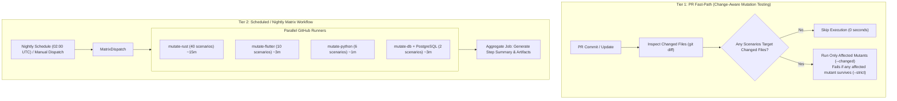

# Mutation Testing CI/CD Integration Analysis & Architecture

**Document Version**: 1.0  
**Date**: November 2026  
**Context**: SitePulse Engineering Harness & Verification Infrastructure  

---

## 1. Executive Summary & Problem Context

SitePulse maintains a curated catalogue of **58 mutation scenarios** defined in [`harness/mutation/scenarios.toml`](../../harness/mutation/scenarios.toml). Each scenario seeds a deliberate, realistic fault (e.g. boundary operator change, removed condition, rounding distortion) into production code across four technical layers: Rust backend, Flutter frontend, Python harness utilities, and PostgreSQL schema/RLS rules.

While test counts and Gherkin scenario traceability demonstrate that tests run, mutation testing answers whether tests would actually *fail* if behavior broke.

### Current CI/CD Reality

An inspection of `.github/workflows/sitepulse-ci.yml` and the test harness reveals:
1. **Catalog Drift Validation Only**: CI only executes [`harness/tests/test_mutation_scenarios.py`](../../harness/tests/test_mutation_scenarios.py) inside the Python `lint` gate (`run_tests.py --group lint`). This verifies syntactic and textual freshness—confirming that the `original` snippet still exists exactly once in each targeted file.
2. **Zero Mutant Execution in CI**: Neither `sitepulse-ci.yml` nor any other pipeline runs `mutation_scenarios.py run`. Mutants are never applied or tested in automated pipelines.
3. **Execution Blindspot**: As documented in [`mutation-testing-analysis.md`](mutation-testing-analysis.md), mutation scores and survivor detection currently rely entirely on manual local developer runs.

---

## 2. Analysis of Constraints & Trade-Offs

### 2.1 Why Sequential Execution Fails on Every PR
A full run of all 58 scenarios involves:
- **Rust Backend (40 mutants)**: Each mutant modifies a `.rs` file, requiring `cargo test --locked --lib` or integration tests. At ~20–30s per scenario, this takes ~15–20 minutes.
- **Flutter Frontend (10 mutants)**: Each mutant runs `flutter test`. Takes ~3–5 minutes.
- **Python Harness (6 mutants)**: Runs `unittest discover` (~9s per mutant, ~50s total).
- **PostgreSQL / DB (2 mutants)**: Requires an active PostgreSQL database and migration setup (~2–4 minutes).

**Total Sequential Runtime**: **~35 to 45 minutes**.

Subjecting every commit on every Pull Request to a 45-minute gate would:
- Severely degrade developer velocity and loop responsiveness.
- Exhaust GitHub Actions runner minutes and trigger rate limiting.
- Violate workspace token and execution budget guidelines.

### 2.2 The Risk of Complete Absence from CI
Conversely, running no mutation tests in CI creates risks:
- Tests that guard critical financial, authorization, and tenancy rules can silently degrade or be bypassed.
- New code paths may pass unit tests that lack assertions, creating a false sense of security.
- Mutation drift fixes in PRs might introduce invalid mutants that pass `validate` without actually being killed.

---

## 3. Recommended Multi-Tier Architecture

To achieve strong test verification without blocking the PR feedback loop, we adopt a **two-tier architecture**:

### 3.1 Tier 1: Change-Aware Developer Gate & Targeted PR Tooling (`--changed`)
- **Mechanism**: Extended `mutation_scenarios.py` with `--changed [BASE]` (matching `run_tests.py --changed` patterns).
- **Filtering**: Compares working tree or branch against base (`origin/master...HEAD`). Matches modified files against scenario `file` attributes.
- **Workflow Role**: Today, this operates as a fast developer verification tool prior to opening or updating a PR (`mutation_scenarios.py run --changed --strict`). If wired directly into automated PR CI in the future, the checkout step must set `fetch-depth: 0` so git can resolve `origin/master...HEAD`.
- **Impact**: 
  - If a change edits `backend/src/services/dues_ledger.rs`, it runs only `MUT-RS-001` through `MUT-RS-010` (~2–3 minutes).
  - If a change touches documentation or unaffected modules, 0 mutants run (0 seconds overhead).
- **Enforcement**: `--strict` flag causes non-zero exit code (exit 1 on survivors/unviable/timeouts, exit 2 on invalid git ref).

### 3.2 Tier 2: Dedicated Nightly & On-Demand Workflow (`mutation-testing.yml`)
- **Triggers**: Nightly schedule (`cron: '0 2 * * *'`) and manual `workflow_dispatch`.
- **Parallelization**: Shards execution by `--layer` (`python`, `flutter`, `rust`, `db`) across concurrent runners.
- **Service Containers**: Spins up PostgreSQL 16 Alpine container only for the `db` layer.
- **Caching**: Utilizes `Swatinem/rust-cache` and `subosito/flutter-action` cache for fast compilation.
- **Reporting & Observability**:
  - `actions/download-artifact` uses `merge-multiple: true` and `ci_mutation_report.py` uses recursive globbing (`rglob`) to ingest all shards.
  - Aggregator runs with `--strict` to fail the nightly run if any mutant survives, times out, or fails to compile (active regression guard).
  - Exports Markdown report into `$GITHUB_STEP_SUMMARY`.
  - Emits JSON summary and uploads consolidated `mutation-test-report` artifact.

---

## 4. Technical Implementation Specification

### 4.1 Runner Enhancements (`scripts/mutation_scenarios.py`)
1. **`--changed [BASE]`**:
   - Query `git status --porcelain` and `git diff --name-only <base>`.
   - Filter `catalogue.scenarios` where `scenario.file` matches any changed file.
2. **`--strict`**:
   - Exit with code 1 if `summary["survivors"]`, unviable mutants, or timeouts are detected.
3. **`test_mutation_scenarios.py`**:
   - Add unit tests for `--changed` detection and `--strict` return code logic.

### 4.2 Workflow Definition (`.github/workflows/mutation-testing.yml`)
- Create standard reusable workflow with matrix strategy:
  - `python`: runs in under 1 minute.
  - `flutter`: caches pub packages and runs flutter layer mutants.
  - `rust`: caches cargo builds and runs unit/integration tests per mutant.
  - `db`: provisions `postgres:16-alpine`, executes with `--with postgres --layer db`.
- Report consolidation step merging all layer results.
