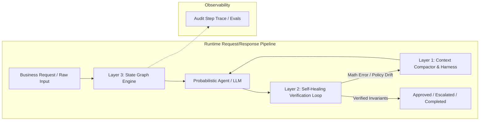

# Runtime Inference Systems (`apps/runtime/`)

> **Definition**: Applications where Large Language Models (LLMs), heuristics, and agentic loops execute as part of the live production runtime to process business data, evaluate policies, and make autonomous decisions.

---

## 1. Overview & Architectural Principles

In runtime inference applications, the AI model is an active component inside the production request/response pipeline. Because LLM outputs are non-deterministic and prone to mathematical or policy hallucinations, **Runtime Inference Engineering** surrounds the model with deterministic guardrails across four layers:



### The Four Runtime Layers
1. **Layer 1: Harness Engineering**: Policy catalogs, context compactors, and feedback shapers that feed exact mathematical deltas back to models without bloat.
2. **Layer 2: Loop Engineering**: Zero-tolerance deterministic verification gates (`MathVerifyGate`, `PolicyAuditGate`) and bounded retry budgets (max 3 iterations) to eliminate runaway loops.
3. **Layer 3: Graph Engineering**: Directed state machines routing transactions through typed phases (`Ingest` $\rightarrow$ `Extract` $\rightarrow$ `VerifyMath` $\rightarrow$ `AuditPolicy` $\rightarrow$ `Reconcile` $\rightarrow$ `Terminal`).
4. **Layer 4: Evals & Benchmarks**: Real-world transaction test fixtures measuring $Pass@1$ (immediate pass) vs $Pass@3$ (self-healed pass).

---

## 2. Catalog of Runtime Applications

| Application | Stack | Role | Runtime Features |
| :--- | :--- | :--- | :--- |
| [**AuditGuard**](AuditGuard/README.md) | .NET 10 / C# | Autonomous Expense Audit Microservice | In-loop math reconciliation, corporate policy catalog, directed graph engine, and 6-fixture benchmark runner |
| [**TaskPilot**](TaskPilot/README.md) | .NET 10 C# | Enterprise Workflow Management | High-reliability domain state machine, thread-safe atomic repository, overdue calculation engine |

---

## 3. Developer Guide: Working with GitHub Copilot

When developing or extending runtime inference systems using GitHub Copilot:

### A. Authoring Verification Gates
Prompt Copilot to generate strict, zero-tolerance deterministic gates:
```text
Prompt: "Create a deterministic verification gate for [Domain Rule] in .NET 10 that verifies [Invariants], uses high-precision decimal arithmetic, and returns a GateResult with exact delta metrics."
```

### B. Designing Context Compactors
Prompt Copilot to shape minimal, actionable self-healing feedback:
```text
Prompt: "Write a ContextCompactor method that takes the MathVerifyGate failure and formats a compact, single-sentence prompt payload specifying the exact discrepancy delta."
```

### C. Enforcing Finite Budgets
Always instruct Copilot to include bounded loop counters and safe fallbacks:
```text
Prompt: "Wrap this agent loop in an iteration controller with a hard budget of 3 iterations. If the budget expires without passing, route to AuditStatus.RequiresHumanReview."
```

---

## 4. Developer Guide: Working with Antigravity

Antigravity operates with deep context awareness in this workspace, governed by [.agents/rules/runtime-inference.md](file:///.agents/rules/runtime-inference.md):

### A. Modifying Runtime Rules
When asking Antigravity to adjust policy or math rules, specify the affected layer:
```text
"Update AuditGuard's PolicyCatalog to add a $150 threshold for electronics and verify with tests."
```
Antigravity will:
1. Update `PolicyRules.cs` and `PolicyCatalog.cs`.
2. Update unit tests in `PolicyAuditGateTests.cs`.
3. Run `dotnet test apps/runtime/AuditGuard/tests/AuditGuard.Tests` to verify.

### B. Benchmarking Runtime Models
Ask Antigravity to evaluate model extraction accuracy:
```text
"Run the AuditGuard benchmark suite and report Pass@1 vs Pass@3 metrics."
```

---

## 5. Quickstart & Verification

```bash
# 1. Run AuditGuard Unit Tests
dotnet test apps/runtime/AuditGuard/tests/AuditGuard.Tests

# 2. Run AuditGuard Benchmark Suite (Pass@1 vs Pass@3)
dotnet run --project apps/runtime/AuditGuard/benchmarks/AuditGuard.Benchmarks

# 3. Run TaskPilot Unit Tests
dotnet test apps/runtime/TaskPilot/tests/TaskPilot.Tests

# 4. Run TaskPilot CLI
dotnet run --project apps/runtime/TaskPilot/src/TaskPilot.Cli -- summary
```
