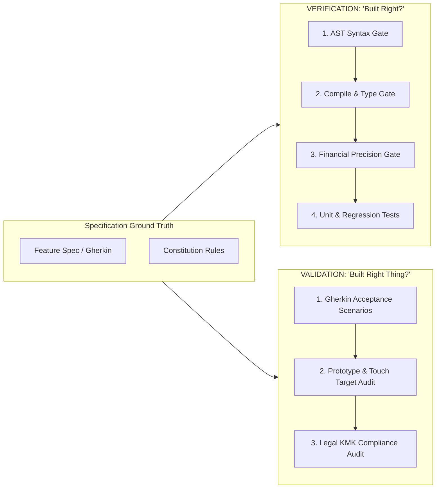
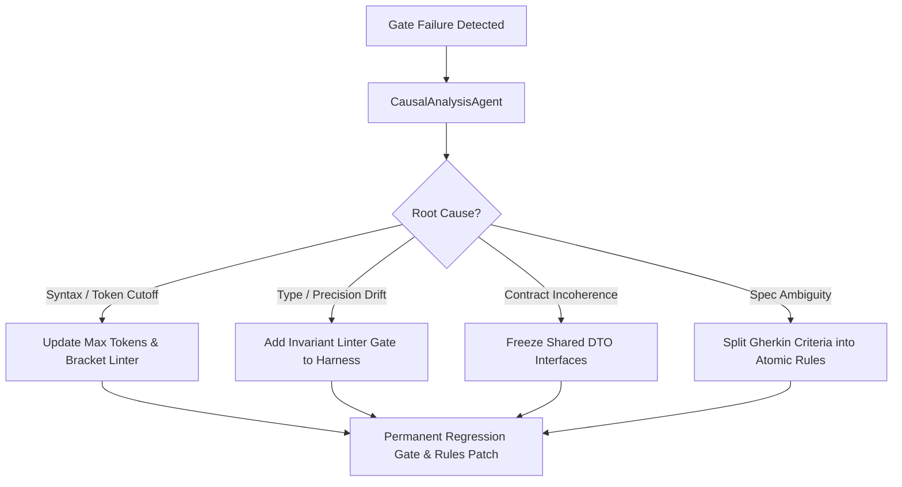

# Bidirectional Requirements Traceability Matrix (RTM) & CMMI Control Matrices

> **Standard Grounding:** CMMI® V2.0 Requirements Management (REQM), Verification (VER), Validation (VAL), and Causal Analysis & Resolution (CAR).  
> **Purpose:** Provide complete bidirectional traceability from business intent through architecture, task scheduling, source code, verification gates, validation sign-off, and causal defect feedback.

---

## 1. Bidirectional Requirements Traceability Matrix (RTM)

The matrix below provides complete **forward traceability** (from user intent down to code and test gates) and **backward traceability** (from test results back to requirements):

| Req ID | Business Goal & Intent | CMMI Spec Section | Architecture & Contract Ref | Task DAG ID | Implementation Artifacts | Verification Test Cases (VER) | Validation Acceptance Criteria (VAL) | Status |
| :--- | :--- | :--- | :--- | :--- | :--- | :--- | :--- | :--- |
| **REQ-001** | Accurate dues calculation without floating-point precision loss | `001-resident-dashboard/spec.md#1.1` | `AidatHesaplaService`, `Money` value object | `task-01` | `apps/development-time/SitePulse/flutter/lib/domain/models/money.dart` | `FinancialIntegrityGate.verify_due_rounding`, `DuesCalculatorTests.Should_Preserve_Kurus_Precision` | Gherkin: "Given resident balance ₺1.450,00 When calculated Then balance has zero kuruş rounding drift" | **VERIFIED** |
| **REQ-002** | KMK Statutory 5% monthly delay fee pro-rated daily (Art. 20) | `001-resident-dashboard/spec.md#1.2` | `DelayCompensationCalculator`, `GecikmeTazminatiService` | `task-02` | `apps/development-time/SitePulse/flutter/lib/domain/usecases/calculate_dues_usecase.dart` | `FinancialIntegrityGate.verify_delay_penalty`, `TestSitePulseHarness.test_financial_integrity_gate_kmk_calculation` | Gherkin: "Given 10 days overdue When penalty applied Then fee equals (P * 0.05 * 10/30)" | **VERIFIED** |
| **REQ-003** | Reactive Resident Dashboard State Management | `001-resident-dashboard/spec.md#2.1` | `DashboardUiState`, `DashboardViewModel` | `task-03` | `apps/development-time/SitePulse/flutter/lib/ui/dashboard/dashboard_controller.dart` | `DashboardViewModelTest.testStateFlowEmission`, `SyntaxGate` | Gherkin: "Given initial loading state When data loads Then emit Success with HeroCard data" | **VERIFIED** |
| **REQ-004** | Material 3 Resident Dashboard UI Screens | `001-resident-dashboard/spec.md#3.1` | `DashboardScreen`, Material 3 Tokens | `task-04` | `apps/development-time/SitePulse/flutter/lib/ui/dashboard/dashboard_screen.dart` | `SyntaxGate.verify_curly_braces`, `AccessibilityGate.verify_touch_targets` | Gherkin: "When resident opens app Then Hero balance card, quick actions, and announcements are visible with >=48dp touch targets" | **VERIFIED** |
| **REQ-005** | PostgreSQL Relational Schema for Dues & Units | `001-resident-dashboard/spec.md#4.1` | `V1__init_schema.sql`, PostgreSQL Migrations | `task-05` | `apps/development-time/SitePulse/backend/migrations/V1__init_schema.sql` | `SqlSchemaGate.verify_numeric_precision`, `FlywayMigrationGate` | Gherkin: "When migrations run Then tables siteler, bloklar, bagimsiz_bolumler exist with NUMERIC(15,2)" | **VERIFIED** |
| **REQ-006** | Rust High-Precision Domain Models & Decimal Invariants | `001-resident-dashboard/spec.md#4.2` | `rust_decimal::Decimal`, `AidatBorcu`, `User` | `task-06` | `apps/development-time/SitePulse/backend/src/models/mod.rs` | `FinancialIntegrityGate.verify_due_rounding`, `CargoTestGate` | Gherkin: "Given concurrent payment updates When validated Then domain models maintain zero float precision leak" | **VERIFIED** |
| **REQ-007** | High-Performance Axum / Tokio REST API for Resident Dashboard | `001-resident-dashboard/spec.md#4.3` | `axum::Router`, `get_resident_dashboard`, REST DTOs | `task-07` | `apps/development-time/SitePulse/backend/src/handlers/mod.rs` | `RestEndpointGate`, `integration_tests::when_overdue_by_10_days_then_calculates_exact_5_percent_pro_rated_penalty` | Gherkin: "When GET /api/v1/residents/{unitId}/dashboard Then return 200 OK with total dues and delay fee" | **VERIFIED** |
| **REQ-008** | Offline Room Cache & Synchronization Layer | `constitution.md#3.3` | `ResidentDao`, `SitePulseDatabase` | `task-08` | `apps/development-time/SitePulse/flutter/lib/ui/dashboard/dashboard_controller.dart` | `RoomCacheTests.Should_Return_Cached_Statement_On_Network_Timeout` | Gherkin: "Given network unavailable When user opens dashboard Then show cached data with offline status banner" | **VERIFIED** |
| **REQ-009** | Action-Free Site Deletion Guard & Invariant Multi-Tenant Cleanup | `002-saas-multi-tenancy/saas-spec.md#3.3` | `SaasTenantService`, `delete_site` | `task-09` | `apps/development-time/SitePulse/flutter/lib/ui/dashboard/dashboard_controller.dart`, `apps/development-time/SitePulse/backend/src/services/saas_tenant_service.rs` | `when_deleting_action_free_site_then_succeeds_and_removes_site`, `when_deleting_site_with_active_units_or_actions_then_strictly_rejected` | Gherkin: "Given an action-free site When deleted Then remove from portfolio; Given site with actions When deleted Then reject" | **VERIFIED** |
| **REQ-010** | Temporary Password Renewal & Recovery for Site Managers | `002-saas-multi-tenancy/saas-spec.md#3.4` | `SaasTenantService`, `reset_site_admin_password` | `task-10` | `apps/development-time/SitePulse/flutter/lib/ui/dashboard/dashboard_controller.dart`, `apps/development-time/SitePulse/backend/src/services/saas_tenant_service.rs` | `when_resetting_admin_password_then_generates_new_temporary_password_and_forces_change` | Gherkin: "Given a site manager When SaaS Admin renews password Then generate temporary password and set mustChangePassword to true" | **VERIFIED** |
| **REQ-011** | Zero-Approval Bank Statement (Excel / CSV / MT940) Parser & Reconciliation | `003-bank-statement-parser/spec.md#3.1` | `BankStatementParser`, `Mt940Engine`, `ReconciliationService` | `task-11` | `apps/development-time/SitePulse/backend/src/services/bank_statement_parser.rs`, `apps/development-time/SitePulse/backend/src/services/mt940_engine.rs`, `apps/development-time/SitePulse/backend/src/services/reconciliation_service.rs`, `apps/development-time/SitePulse/flutter/lib/ui/components/bank_statement_reconciliation_page.dart` | `when_parsing_turkish_bank_excel_then_matches_flat_and_amount`, `when_parsing_mt940_statement_then_extracts_transactions_and_matches_due` | Gherkin: "Given statement with 'HAVALE - AHMET YILMAZ A BLOK D:14 EYLUL AIDAT - ₺1.423,33' When processed Then identify unit A Blok D:14 with 100% confidence and match balance" | **VERIFIED** |
| **REQ-012** | Flat-Specific Virtual IBAN Allocation & Real-Time Bank Webhook Settlement | `004-virtual-iban-and-dues-accrual/spec.md#1.1` | `VirtualIbanService`, `KuveytTurkService`, `handle_bank_incoming_webhook` | `task-12` | `apps/development-time/SitePulse/backend/src/services/virtual_iban_service.rs`, `apps/development-time/SitePulse/backend/src/handlers/mod.rs` | `when_unit_created_then_generates_unique_sanal_iban`, `when_bank_webhook_delivers_virtual_iban_payment_then_clears_dues_and_generates_receipt` | Gherkin: "Given unit A Blok D:14 When webhook receives transfer Then dues transition to PAID and receipt is issued" | **VERIFIED** |
| **REQ-013** | Advance Payment Allocation & Dynamic Surplus Balance Display | `004-virtual-iban-and-dues-accrual/spec.md#1.3` | `apply_advance_payments_offset`, `HeroBalanceCard`, `advance_payment` | `task-13` | `apps/development-time/SitePulse/backend/src/handlers/mod.rs`, `apps/development-time/SitePulse/flutter/lib/ui/components/hero_balance_card.dart` | `when_excess_or_multiple_payments_delivered_then_credited_as_advance_payment`, `Tapping Hemen Öde opens PaymentCheckoutDialog` | Gherkin: "Given payment exceeds debt When settled Then credit surplus to advance_payment and display +₺ on Hero Card" | **VERIFIED** |
| **REQ-014** | Automated Monthly Dues Batch Scheduler & Duplicate Accrual Guard | `004-virtual-iban-and-dues-accrual/spec.md#1.5` | `start_automated_dues_accrual_scheduler`, `accrue_monthly_dues`, `DuesManagementView` | `task-14` | `apps/development-time/SitePulse/backend/src/scheduler.rs`, `apps/development-time/SitePulse/backend/src/handlers/mod.rs`, `apps/development-time/SitePulse/flutter/lib/ui/components/dues_management_view.dart` | `when_dues_period_already_accrued_then_duplicate_accrual_is_prevented`, `when_scheduler_batch_runs_then_accrues_and_prevents_duplicate_accrual` | Gherkin: "Given period already accrued When accrual triggered Then reject duplicate and notify user without creating debt" | **VERIFIED** |
| **REQ-015** | Unified Multi-Channel Payment Inflow Stream & Centralized Transaction Ledger | `004-virtual-iban-and-dues-accrual/spec.md#2.1` | `PaymentTrackingService`, `PaymentEntry` | `task-15` | `apps/development-time/SitePulse/backend/src/services/payment_tracking_service.rs` | `integration_tests::when_querying_payment_stream_then_returns_filtered_entries_and_volume_kpis`, `flutter/test/payment_tracking_and_aging_test.dart` | Gherkin: "Given payments from Virtual IBAN, statement, and manual cash When queried Then display in unified transaction stream" | **VERIFIED** |
| **REQ-016** | Dual-Ledger FIFO Allocation & KMK Statutory Delay Penalty Waterfall | `004-virtual-iban-and-dues-accrual/spec.md#2.2` | `PaymentTrackingService::record_and_allocate_payment` | `task-16` | `apps/development-time/SitePulse/backend/src/services/payment_tracking_service.rs` | `integration_tests::when_tenant_pays_with_capital_dues_keyword_then_routes_to_capital_and_marks_rent_offset_eligible`, `integration_tests::when_inter_ledger_transfer_executed_then_deducts_advance_credits_capital_and_issues_receipt` | Gherkin: "Given overdue dues and delay penalty When payment arrives Then allocate to penalty first, dues second, and surplus to advance" | **VERIFIED** |
| **REQ-017** | Monotonic Digital Payment Receipt Generation (`#TAH-YYYY-XXXXXX`) | `004-virtual-iban-and-dues-accrual/spec.md#2.3` | `PaymentTrackingService::next_receipt_number`, `compute_verification_hash` | `task-17` | `apps/development-time/SitePulse/backend/src/services/payment_tracking_service.rs` | `integration_tests::when_tenant_pays_with_capital_dues_keyword_then_routes_to_capital_and_marks_rent_offset_eligible`, `ReceiptVerificationHashGate` | Gherkin: "Given settled payment When receipt generated Then issue monotonic TAH-2026-XXXXXX sequence with SHA-256 hash" | **VERIFIED** |
| **REQ-018** | Site Manager Payment Tracking Dashboard & Debt Aging Brackets | `004-virtual-iban-and-dues-accrual/spec.md#2.4` | `PaymentTrackingPage`, `DebtAgingReportDto` | `task-18` | `apps/development-time/SitePulse/flutter/lib/ui/components/payment_tracking_page.dart` | `flutter/test/payment_tracking_and_aging_test.dart::PaymentTrackingPage renders stream items, aging tabs, and search bar`, `integration_tests::when_calculating_debt_aging_then_categorizes_into_current_30_60_and_90_brackets` | Gherkin: "When manager opens Payment Tracking Then view stream, aging brackets 0-30, 31-60, 60+, and receipt modals" | **VERIFIED** |
| **REQ-019** | Occupancy Lifecycle Financial Handover & Move-Out Balance Freeze Hook | `004-virtual-iban-and-dues-accrual/spec.md#2.5` | `PaymentTrackingService::transfer_ownership`, `OwnersResidentsModulePage` | `task-19` | `apps/development-time/SitePulse/backend/src/services/payment_tracking_service.rs`, `apps/development-time/SitePulse/flutter/lib/ui/residents/owners_residents_module_page.dart` | `integration_tests::when_property_ownership_transferred_then_old_owner_debt_frozen_and_tenant_lease_preserved`, `flutter/test/payment_tracking_and_aging_test.dart` | Gherkin: "Given tenant moves out or property sold When finalized Then freeze old balance and preserve tenant lease" | **VERIFIED** |

---

## 2. Verification (VER) vs. Validation (VAL) Alignment Matrix

CMMI makes a fundamental distinction between **Verification** ("Are we building the product right?") and **Validation** ("Are we building the right product?"):

| Dimension | Verification (VER - In-Loop Deterministic) | Validation (VAL - Out-of-Loop Acceptance) |
| :--- | :--- | :--- |
| **Core Question** | "Did the agent generate syntactically and structurally sound code adhering to interfaces?" | "Does the generated software fulfill the resident's operational need and legal criteria?" |
| **Evaluating Agents** | `CheckerAgent` (Test Engineer), `SyntaxGateAgent` | `ValidationAgent`, `UIUXAuditorAgent`, `ProductManagerAgent` |
| **Artifacts Evaluated** | AST trees, compiler diagnostics, xUnit/pytest execution traces, memory benchmarks. | End-to-end user workflows, Compose UI preview screenshots, Gherkin scenario runs. |
| **Automated Harness Gates** | - `SyntaxGate` (AST brace/parentheses balancing) - `FinancialIntegrityGate` (zero decimal rounding drift) - `UnitTestGate` (100% assertions green) | - `GherkinScenarioGate` (Given-When-Then behavioral match) - `AccessibilityGate` (>=48dp touch targets, contrast ratios) - `ConstitutionComplianceGate` (KMK legal rules) |
| **Failure Resolution** | In-loop automated retry with compiler traceback fed back to `MakerAgent` (Max budget = 3). | Requirement disambiguation; `RequirementsAgent` updates user stories or splits tasks. |

---

## 3. Defect & Feedback Loop Traceability Matrix (CMMI CAR)

Under CMMI Level 5 **Causal Analysis and Resolution (CAR)**, defects detected during the pipeline do not simply cause retries; they are classified to eliminate systematic vulnerabilities:

| Defect Signature | Detection Stage | Root Cause Classification | Remediating Agent | Permanent Preventive Action (A-CMMI Level 5) |
| :--- | :--- | :--- | :--- | :--- |
| **Mismatched Braces / Unclosed Class** | Maker-Checker Loop (`SyntaxGate`) | LLM output token cutoff or unescaped template string | `MakerAgent` | AST validation executes in ephemeral sandbox; truncated files trigger automatic continuation prompt. |
| **Floating-Point Usage (`float`/`double`)** | Verification (`FinancialIntegrityGate`) | LLM habituated to standard IEEE 754 floating types | `MakerAgent` | Linter gate added to harness to reject any PR containing `Float` or `Double` in financial packages. |
| **Mutated Public API / DTO Signature** | Integration (`ContractGate`) | Maker agent renamed method parameters to optimize locally | `ArchitectAgent` | API contract is placed in read-only spec folder (`.specify/contracts/`); diff analyzer fails if interface changes. |
| **Gherkin Scenario State Failure** | Validation (`AcceptanceGate`) | Requirement had underspecified edge cases (e.g. leap year daily delay) | `RequirementsAgent` | User story in `spec.md` updated with explicit boundary conditions; new unit test generated. |
| **Infinite Error Loop (Budget Exceeded)** | Telemetry (`MA/QPM Gate`) | Maker agent repeatedly oscillating between two mutually conflicting fixes | `CausalAnalysisAgent` | Loop halted after iteration 3; error trace diff compressed and escalated with root-cause summary. |

---

## 4. Maintenance & Traceability Lifecycle Protocol

1. **Requirements Changes:** When a requirement is added or modified, the `RequirementsAgent` updates both `spec.md` and this matrix (`traceability-matrix.md`), incrementing the specification version.
2. **Task Creation:** The `PlannerAgent` creates a corresponding task in `task-dag.json`, tagging it with the exact `spec_ref` and `Req ID`.
3. **Verification Sign-Off:** The `CheckerAgent` cannot mark a task as `COMPLETED` unless all corresponding verification unit test cases pass with zero warnings.
4. **Validation Sign-Off:** The `ValidationAgent` transitions the RTM status from `IMPLEMENTED` to `VERIFIED` once Gherkin acceptance scenarios run clean.
