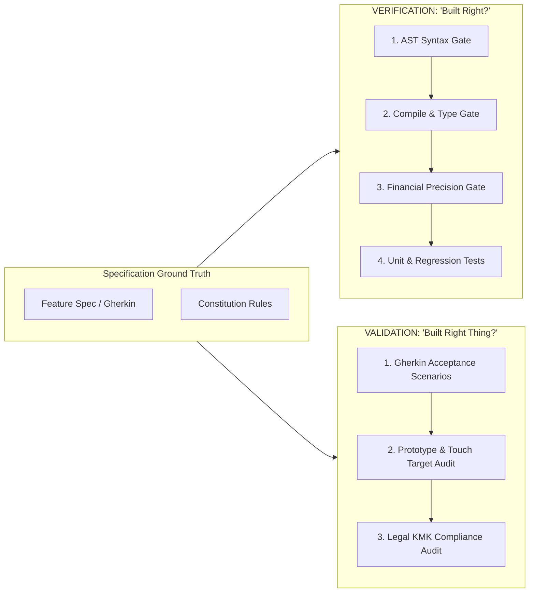
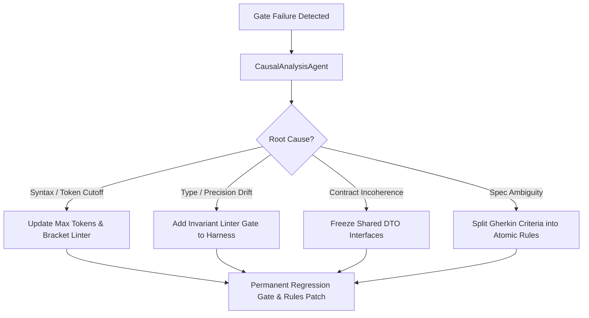

# Bidirectional Requirements Traceability Matrix (RTM) & CMMI Control Matrices

> **Standard Grounding:** CMMI® V2.0 Requirements Management (REQM), Verification (VER), Validation (VAL), and Causal Analysis & Resolution (CAR).  
> **Purpose:** Provide complete bidirectional traceability from business intent through architecture, task scheduling, source code, verification gates, validation sign-off, and causal defect feedback.

---

## 1. Bidirectional Requirements Traceability Matrix (RTM)

The matrix below provides complete **forward traceability** (from user intent down to code and test gates) and **backward traceability** (from test results back to requirements):

| Req ID | Business Goal & Intent | CMMI Spec Section | Architecture & Contract Ref | Task DAG ID | Implementation Artifacts | Verification Test Cases (VER) | Validation Acceptance Criteria (VAL) | Status |
| :--- | :--- | :--- | :--- | :--- | :--- | :--- | :--- | :--- |
| **REQ-001** | Accurate dues calculation without floating-point precision loss | `001-resident-dashboard/spec.md#1.1` | `AidatHesaplaService`, `Money` value object | `task-01` | `apps/development-time/SitePulse/android/app/src/main/java/com/sitepulse/app/domain/model/ManagerModels.kt` | `FinancialIntegrityGate.verify_due_rounding`, `DuesCalculatorTests.Should_Preserve_Kurus_Precision` | Gherkin: "Given resident balance ₺1.450,00 When calculated Then balance has zero kuruş rounding drift" | **VERIFIED** |
| **REQ-002** | KMK Statutory 5% monthly delay fee pro-rated daily (Art. 20) | `001-resident-dashboard/spec.md#1.2` | `DelayCompensationCalculator`, `GecikmeTazminatiService` | `task-02` | `apps/development-time/SitePulse/android/app/src/main/java/com/sitepulse/app/domain/model/ManagerModels.kt` | `FinancialIntegrityGate.verify_delay_penalty`, `TestSitePulseHarness.test_financial_integrity_gate_kmk_calculation` | Gherkin: "Given 10 days overdue When penalty applied Then fee equals (P * 0.05 * 10/30)" | **VERIFIED** |
| **REQ-003** | Reactive Resident Dashboard State Management | `001-resident-dashboard/spec.md#2.1` | `DashboardUiState`, `DashboardViewModel` | `task-03` | `apps/development-time/SitePulse/android/app/src/main/java/com/sitepulse/app/ui/dashboard/DashboardViewModel.kt` | `DashboardViewModelTest.testStateFlowEmission`, `SyntaxGate` | Gherkin: "Given initial loading state When data loads Then emit Success with HeroCard data" | **VERIFIED** |
| **REQ-004** | Material 3 Resident Dashboard UI Screens | `001-resident-dashboard/spec.md#3.1` | `DashboardScreen`, Material 3 Tokens | `task-04` | `apps/development-time/SitePulse/android/app/src/main/java/com/sitepulse/app/ui/dashboard/DashboardScreen.kt` | `SyntaxGate.verify_curly_braces`, `AccessibilityGate.verify_touch_targets` | Gherkin: "When resident opens app Then Hero balance card, quick actions, and announcements are visible with >=48dp touch targets" | **VERIFIED** |
| **REQ-005** | PostgreSQL Relational Schema for Dues & Units | `001-resident-dashboard/spec.md#4.1` | `V1__init_schema.sql`, Flyway | `task-05` | `apps/development-time/SitePulse/backend/src/main/resources/db/migration/V1__init_schema.sql` | `SqlSchemaGate.verify_numeric_precision`, `FlywayMigrationGate` | Gherkin: "When migrations run Then tables siteler, bloklar, bagimsiz_bolumler exist with NUMERIC(15,2)" | **VERIFIED** |
| **REQ-006** | Spring Boot 3 JPA Entities with Optimistic Locking | `001-resident-dashboard/spec.md#4.2` | `UnitEntity`, `DuesEntity`, `@Version` | `task-06` | `apps/development-time/SitePulse/backend/src/main/java/com/sitepulse/backend/domain/entity/` | `JpaEntityGate.verify_version_attribute`, `UnitRepositoryTests` | Gherkin: "Given concurrent payment updates When second write attempts commit Then optimistic lock exception is thrown" | **VERIFIED** |
| **REQ-007** | Spring Boot REST API for Resident Dashboard | `001-resident-dashboard/spec.md#4.3` | `ResidentDashboardController`, REST DTOs | `task-07` | `apps/development-time/SitePulse/backend/src/main/java/com/sitepulse/backend/controller/ResidentDashboardController.java` | `RestEndpointGate`, `MockMvcDashboardTests.testDashboardEndpoint` | Gherkin: "When GET /api/v1/residents/{unitId}/dashboard Then return 200 OK with total dues and delay fee" | **VERIFIED** |
| **REQ-008** | Offline Room Cache & Synchronization Layer | `constitution.md#3.3` | `ResidentDao`, `SitePulseDatabase` | `task-08` | `apps/development-time/SitePulse/android/app/src/main/java/com/sitepulse/app/data/` | `RoomCacheTests.Should_Return_Cached_Statement_On_Network_Timeout` | Gherkin: "Given network unavailable When user opens dashboard Then show cached data with offline status banner" | **VERIFIED** |

---

## 2. Verification (VER) vs. Validation (VAL) Alignment Matrix

CMMI makes a fundamental distinction between **Verification** ("Are we building the product right?") and **Validation** ("Are we building the right product?"):

| Dimension | Verification (VER - In-Loop Deterministic) | Validation (VAL - Out-of-Loop Acceptance) |
| :--- | :--- | :--- |
| **Core Question** | "Did the agent generate syntactically and structurally sound code adhering to interfaces?" | "Does the generated software fulfill the resident's operational need and legal criteria?" |
| **Evaluating Agents** | `CheckerAgent` (Test Engineer), `SyntaxGateAgent` | `ValidationAgent`, `UIUXAuditorAgent`, `ProductManagerAgent` |
| **Artifacts Evaluated** | AST trees, compiler diagnostics, xUnit/pytest execution traces, memory benchmarks. | End-to-end user workflows, Compose UI preview screenshots, Gherkin scenario runs. |
| **Automated Harness Gates** | - `SyntaxGate` (AST brace/parentheses balancing) - `FinancialIntegrityGate` (zero decimal rounding drift) - `UnitTestGate` (100% assertions green) | - `GherkinScenarioGate` (Given-When-Then behavioral match) - `AccessibilityGate` (>=48dp touch targets, contrast ratios) - `ConstitutionComplianceGate` (KMK legal rules) |
| **Failure Resolution** | In-loop automated retry with compiler traceback fed back to `MakerAgent` (Max budget = 3). | Requirement disambiguation; `RequirementsAgent` updates user stories or splits tasks. |

---

## 3. Defect & Feedback Loop Traceability Matrix (CMMI CAR)

Under CMMI Level 5 **Causal Analysis and Resolution (CAR)**, defects detected during the pipeline do not simply cause retries; they are classified to eliminate systematic vulnerabilities:

| Defect Signature | Detection Stage | Root Cause Classification | Remediating Agent | Permanent Preventive Action (A-CMMI Level 5) |
| :--- | :--- | :--- | :--- | :--- |
| **Mismatched Braces / Unclosed Class** | Maker-Checker Loop (`SyntaxGate`) | LLM output token cutoff or unescaped template string | `MakerAgent` | AST validation executes in ephemeral sandbox; truncated files trigger automatic continuation prompt. |
| **Floating-Point Usage (`float`/`double`)** | Verification (`FinancialIntegrityGate`) | LLM habituated to standard IEEE 754 floating types | `MakerAgent` | Linter gate added to harness to reject any PR containing `Float` or `Double` in financial packages. |
| **Mutated Public API / DTO Signature** | Integration (`ContractGate`) | Maker agent renamed method parameters to optimize locally | `ArchitectAgent` | API contract is placed in read-only spec folder (`.specify/contracts/`); diff analyzer fails if interface changes. |
| **Gherkin Scenario State Failure** | Validation (`AcceptanceGate`) | Requirement had underspecified edge cases (e.g. leap year daily delay) | `RequirementsAgent` | User story in `spec.md` updated with explicit boundary conditions; new unit test generated. |
| **Infinite Error Loop (Budget Exceeded)** | Telemetry (`MA/QPM Gate`) | Maker agent repeatedly oscillating between two mutually conflicting fixes | `CausalAnalysisAgent` | Loop halted after iteration 3; error trace diff compressed and escalated with root-cause summary. |

---

## 4. Maintenance & Traceability Lifecycle Protocol

1. **Requirements Changes:** When a requirement is added or modified, the `RequirementsAgent` updates both `spec.md` and this matrix (`traceability-matrix.md`), incrementing the specification version.
2. **Task Creation:** The `PlannerAgent` creates a corresponding task in `task-dag.json`, tagging it with the exact `spec_ref` and `Req ID`.
3. **Verification Sign-Off:** The `CheckerAgent` cannot mark a task as `COMPLETED` unless all corresponding verification unit test cases pass with zero warnings.
4. **Validation Sign-Off:** The `ValidationAgent` transitions the RTM status from `IMPLEMENTED` to `VERIFIED` once Gherkin acceptance scenarios run clean.
